# Guía de Instalación Completa de TVFVideoCapture para Desarrolladores Delphi

> Productos relacionados: [All-in-One Media Framework (Delphi / ActiveX)](https://www.visioforge.com/all-in-one-media-framework)

## Instalación automática (Delphi 6 a Delphi 13)

El instalador del SDK registra el paquete en cada Delphi que encuentra en el equipo, de Delphi 6 a Delphi 13, para el usuario de Windows que lo ejecuta:

- agrega la carpeta `Video Capture\Packages\Delphi <versión>` a la ruta de biblioteca de Windows 32 bits, y, desde Delphi XE2, la carpeta `Delphi <versión> x64` a la de Windows 64 bits;
- registra el paquete precompilado `VisioForge_VideoCapture_Package.bpl` de esa carpeta, de modo que el IDE lo carga al iniciarse. El registro es para el IDE de 32 bits, el que Delphi inicia de forma predeterminada; si usa el IDE de 64 bits de Delphi 12 o 13, inicie el de 32 bits para diseñar con el componente.

Cierre Delphi antes de ejecutar el instalador. Después inicie Delphi: `TVFVideoCapture` está en la página **VisioForge** de la paleta de componentes, listo para colocarlo en un formulario, y los proyectos de demostración de `Demos\Source code` se compilan sin más configuración.

Si Delphi estaba abierto durante la instalación, el instalador se ejecutó con otra cuenta de Windows (por ejemplo, la cuenta de un administrador indicada en la solicitud de elevación), o instaló Delphi después del SDK, cierre Delphi y ejecute **Install Delphi packages** desde la carpeta **VisioForge Video Capture SDK** del menú Inicio (la única carpeta del instalador, para los tres productos). Hace el mismo registro para el usuario actual y muestra en su ventana cada Delphi para el que no se incluye un paquete precompilado; instale allí el paquete a mano, como se describe a continuación. La ejecución del propio instalador escribe esa lista en `VFPackageInstaller.log`, en la carpeta `%TEMP%` de la cuenta que ejecutó el instalador.

## Instalación en Borland Delphi 6/7

El proceso de instalación para entornos heredados de Delphi 6/7 requiere varios pasos específicos para asegurar la integración adecuada de la biblioteca TVFVideoCapture.

### Paso 1: Crear un Nuevo Paquete

Comience creando un nuevo paquete en su entorno de desarrollo Delphi 6/7.

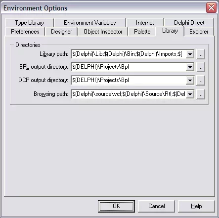

### Paso 2: Configurar Rutas de Biblioteca

Agregue la carpeta del paquete de TVFVideoCapture (`Video Capture\Packages\Delphi <versión>`, que contiene las unidades precompiladas `.dcu`) a los ajustes de ruta de biblioteca y de navegación. Esto permite a Delphi localizar los archivos de componente necesarios.

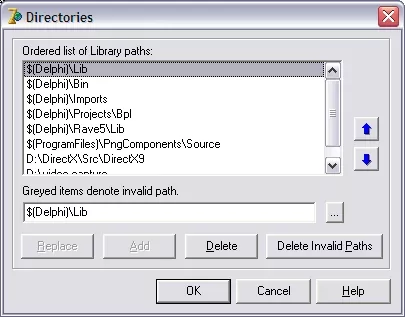

### Paso 3: Abrir el Paquete de Biblioteca

Navegue y abra el archivo de paquete de biblioteca para preparar la instalación.

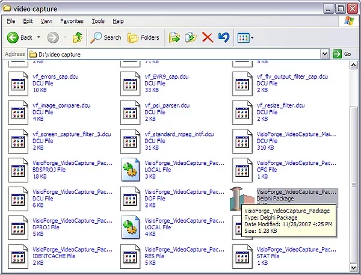

### Paso 4: Instalar el Paquete de Componente

Complete la instalación seleccionando la opción de instalar dentro de la interfaz del paquete.

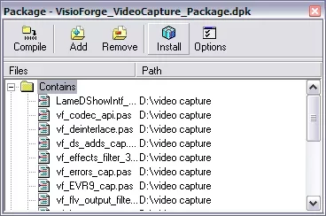

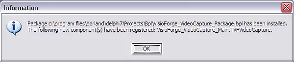

### Limitaciones de Arquitectura

Mientras que TVFVideoCapture ofrece soporte para arquitecturas x86 y x64, Delphi 6/7 solo soporta x86 debido a limitaciones de la plataforma. Los desarrolladores usando estas versiones necesitarán utilizar la implementación de 32 bits exclusivamente.

## Proceso de Instalación para Delphi 2005 y Versiones Posteriores

Las versiones modernas de Delphi ofrecen un flujo de trabajo de instalación mejorado con capacidades avanzadas.

### Paso 1: Iniciar Delphi con Privilegios Administrativos

Asegúrese de ejecutar su IDE Delphi con derechos administrativos para prevenir problemas de instalación relacionados con permisos.

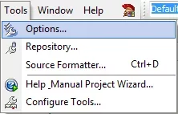

### Paso 2: Acceder al Diálogo de Opciones

Navegue al menú Opciones para configurar ajustes esenciales de biblioteca.

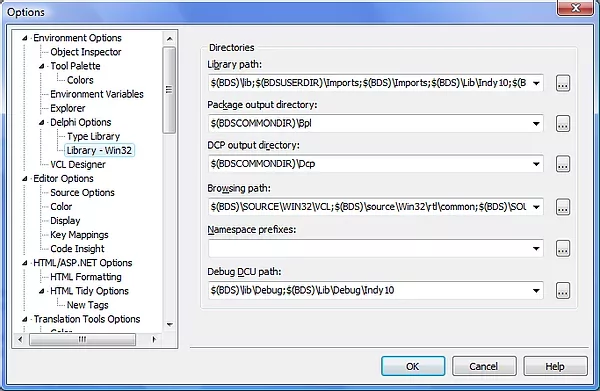

### Paso 3: Configurar Rutas del Directorio Fuente

Agregue la carpeta del paquete de TVFVideoCapture (`Video Capture\Packages\Delphi <versión>`, que contiene las unidades precompiladas `.dcu`) a los ajustes de ruta de biblioteca y de navegación para asegurar el descubrimiento apropiado de componentes.

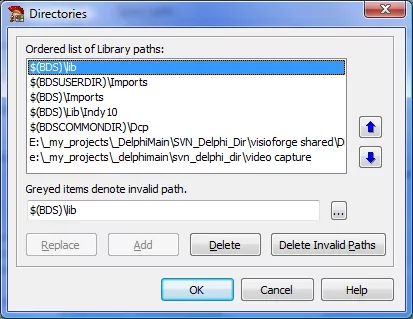

### Paso 4: Abrir el Paquete de Biblioteca de Componentes

Localice y abra el archivo de paquete de biblioteca incluido con TVFVideoCapture.

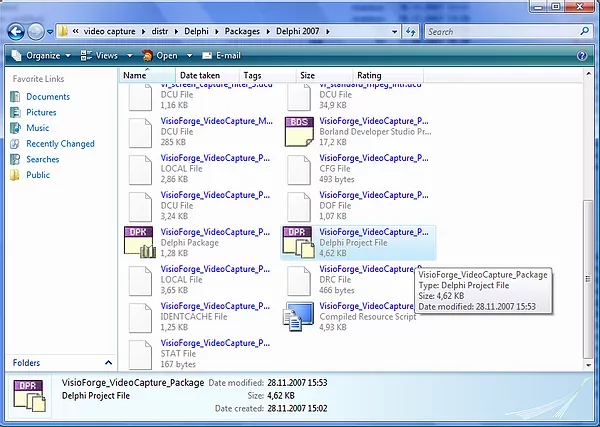

### Paso 5: Completar la Instalación del Paquete

Instale el paquete a través de la interfaz de instalación de paquetes del IDE.

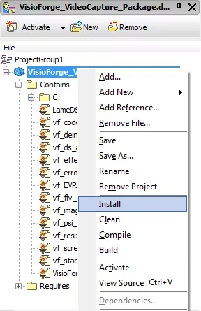

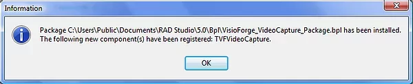

## Instalación Avanzada para Delphi 11 y Versiones Más Nuevas

Las últimas versiones de Delphi requieren un enfoque ligeramente diferente que aprovecha las estructuras de proyecto modernas.

### Paso 1: Localizar y Abrir el Proyecto de Paquete

Después de instalar el framework, navegue a la carpeta `Video Capture\Packages\Delphi <versión>` del directorio de instalación y abra el proyecto de paquete `VisioForge_VideoCapture_Package.dproj`.

### Paso 2: Seleccionar la Configuración de Compilación Apropiada

Elija la configuración de compilación Release para asegurar el rendimiento óptimo del componente, y la plataforma de destino **Windows 32-bit**: el IDE instala el paquete a partir de su compilación de 32 bits. Ambas son los valores predeterminados del proyecto. Abra el proyecto desde la carpeta `Delphi <versión>`, no desde `Delphi <versión> x64`.

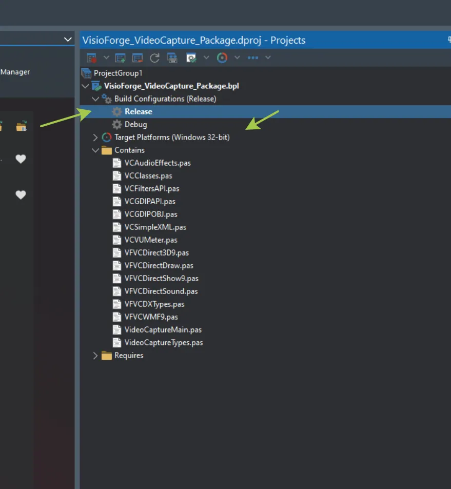

### Paso 3: Instalar el Paquete de Componentes

Complete el proceso de instalación a través de la interfaz de instalación de paquetes del IDE.

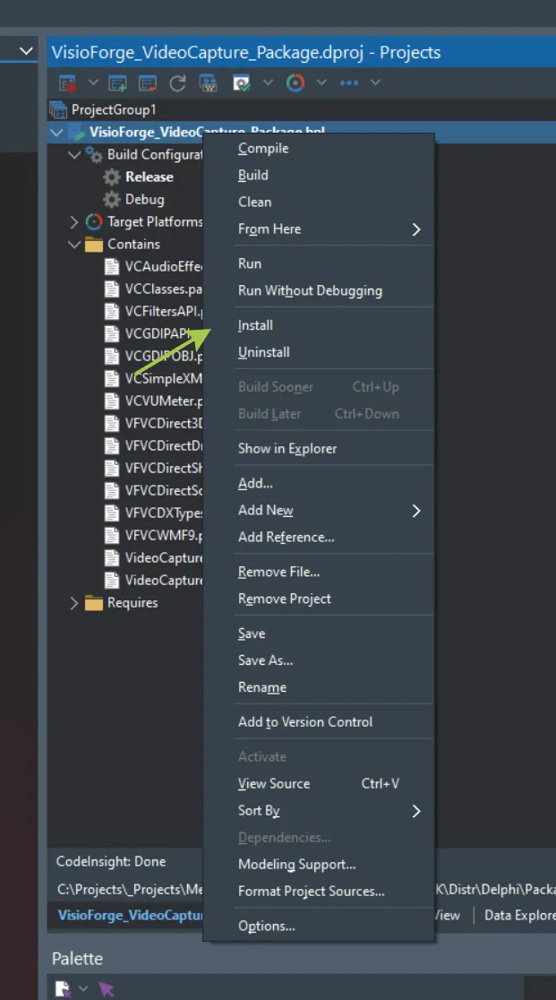

### Paso 4: Verificar el Éxito de la Instalación

Confirme que la instalación se completó exitosamente antes de proceder con el desarrollo.

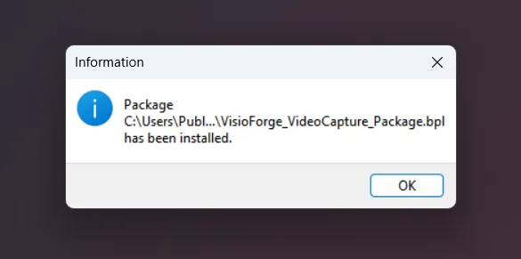

## Requisitos de Configuración del Proyecto y Mejores Prácticas

### Soporte Multi-Arquitectura

TVFVideoCapture soporta arquitecturas x86 y x64, permitiéndole desarrollar aplicaciones para diferentes objetivos de plataforma. El IDE usa el paquete de 32 bits en tiempo de diseño; sus aplicaciones pueden apuntar igualmente a Windows 64 bits (Delphi XE2 y posteriores) mediante la carpeta `Delphi <versión> x64` en la ruta de biblioteca de Windows 64 bits.

### Configuración de Ruta de Biblioteca

Para la funcionalidad apropiada del componente, asegúrese de haber configurado la ruta de carpeta de biblioteca correcta en los ajustes de su proyecto de aplicación. Esta ruta debe apuntar a la ubicación que contiene los archivos `.dcu` para su arquitectura objetivo.

Para configurar esto:
1. Abra el diálogo de opciones de su proyecto
2. Navegue a la sección de ruta de Biblioteca
3. Agregue la ruta de biblioteca apropiada de TVFVideoCapture
4. Guarde los ajustes de su proyecto

Esta configuración asegura que su aplicación pueda localizar todos los recursos de componente requeridos durante el desarrollo y tiempo de ejecución.

## Solución de Problemas Comunes de Instalación

Al instalar TVFVideoCapture, los desarrolladores podrían encontrar varios problemas conocidos. Aquí hay soluciones a los problemas más frecuentes:

### Problemas de Instalación de Paquete de 64 bits

Si tiene dificultades instalando la versión de paquete de 64 bits, consulte nuestra [guía detallada para resolver problemas de instalación de paquete Delphi de 64 bits](../../general/install-64bit.md).

### Problemas de Instalación de Archivo de Recursos (.otares)

Algunos desarrolladores encuentran problemas relacionados con archivos `.otares` durante la instalación del paquete. Para un proceso de resolución paso a paso, vea nuestra [guía de solución de problemas para problemas de instalación de .otares](../../general/install-otares.md).

## Soporte Técnico y Recursos Adicionales

Para desarrolladores que requieren asistencia adicional con el proceso de instalación o implementación de componentes:

- Contacte a nuestro [equipo de soporte técnico](https://helpdesk.visioforge.com/helpdesk/my-tickets/new) para asistencia personalizada de instalación
- Visite nuestro [repositorio de GitHub](https://github.com/visioforge/) para ejemplos de código adicionales y ejemplos de implementación
- Revise nuestra documentación para escenarios de uso avanzado y patrones de integración

Siguiendo esta guía de instalación asegurará que tenga un entorno de desarrollo correctamente configurado para crear potentes aplicaciones multimedia con TVFVideoCapture en sus proyectos Delphi.
