# Instalar TVFVideoEdit en Delphi

> Productos relacionados: [VisioForge All-in-One Media Framework (Delphi / ActiveX)](https://www.visioforge.com/all-in-one-media-framework)

## Requisitos de Instalación

Antes de comenzar el proceso de instalación, asegúrese de tener:

1. Versión apropiada de Delphi instalada y correctamente configurada
2. Derechos administrativos para la instalación de paquetes
3. Descargada la última versión de la biblioteca TVFVideoEdit

## Instalación automática (Delphi 6 a Delphi 13)

El instalador del SDK registra el paquete en cada Delphi que encuentra en el equipo, de Delphi 6 a Delphi 13, para el usuario de Windows que lo ejecuta:

- agrega la carpeta `Video Edit\Packages\Delphi <versión>` a la ruta de biblioteca de Windows 32 bits, y, desde Delphi XE2, la carpeta `Delphi <versión> x64` a la de Windows 64 bits;
- registra el paquete precompilado `VisioForge_Video_Edit_Package.bpl` de esa carpeta, de modo que el IDE lo carga al iniciarse. El registro es para el IDE de 32 bits, el que Delphi inicia de forma predeterminada; si usa el IDE de 64 bits de Delphi 12 o 13, inicie el de 32 bits para diseñar con el componente.

Cierre Delphi antes de ejecutar el instalador. Después inicie Delphi: `TVFVideoEdit` está en la página **VisioForge** de la paleta de componentes, listo para colocarlo en un formulario, y los proyectos de demostración de `Demos\Source code` se compilan sin más configuración.

Si Delphi estaba abierto durante la instalación, el instalador se ejecutó con otra cuenta de Windows (por ejemplo, la cuenta de un administrador indicada en la solicitud de elevación), o instaló Delphi después del SDK, cierre Delphi y ejecute **Install Delphi packages** desde la carpeta **VisioForge Video Capture SDK** del menú Inicio (la única carpeta del instalador, para los tres productos). Hace el mismo registro para el usuario actual y muestra en su ventana cada Delphi para el que no se incluye un paquete precompilado; instale allí el paquete a mano, como se describe a continuación. La ejecución del propio instalador escribe esa lista en `VFPackageInstaller.log`, en la carpeta `%TEMP%` de la cuenta que ejecutó el instalador.

## Instalación en Borland Delphi 6/7

### Paso 1: Configurar Rutas de Biblioteca

Comience abriendo la ventana "Opciones" en su IDE de Delphi.

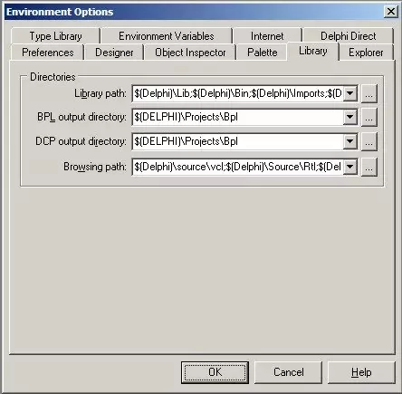

Navegue a la sección de Biblioteca y agregue la carpeta del paquete (`Video Edit\Packages\Delphi <versión>`, que contiene las unidades precompiladas `.dcu`) tanto a las rutas de biblioteca como de navegación. Esto asegura que Delphi pueda localizar los archivos necesarios.

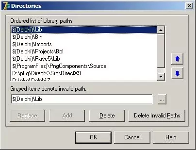

### Paso 2: Abrir e Instalar el Paquete

Localice y abra el archivo principal del paquete desde la biblioteca.

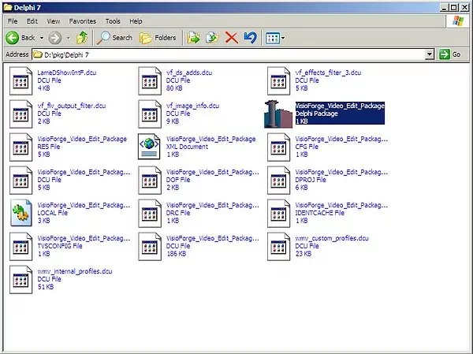

Instale el paquete haciendo clic en el botón Instalar en el IDE. Esto registra los componentes con la paleta de componentes de Delphi.

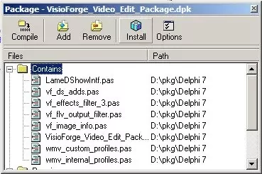

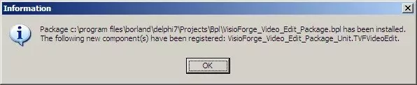

### Consideraciones de Arquitectura

La biblioteca incluye versiones para arquitectura x86 y x64. Sin embargo, para Delphi 6/7, debe usar la versión x86 ya que estas versiones de Delphi no soportan desarrollo de 64-bit.

## Instalación en Delphi 2005 y Posterior

### Paso 1: Iniciar con Privilegios Administrativos

Para Delphi 2005 y versiones posteriores, inicie el IDE con derechos administrativos para asegurar permisos de instalación apropiados.

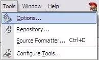

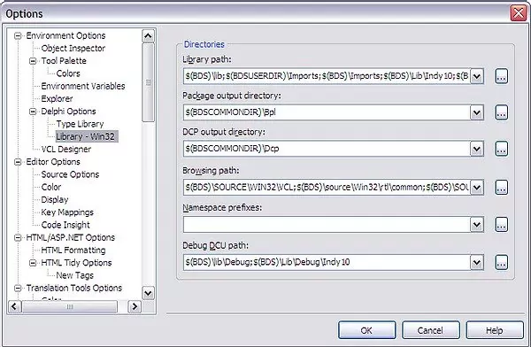

### Paso 2: Configurar Rutas de Biblioteca

Abra la ventana de Opciones y navegue a la sección de Biblioteca. Agregue la carpeta del paquete (`Video Edit\Packages\Delphi <versión>`, que contiene las unidades precompiladas `.dcu`) tanto a las rutas de biblioteca como de navegación.

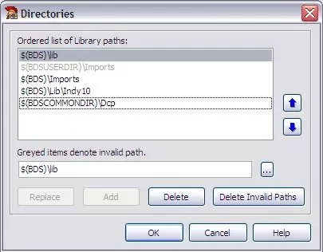

### Paso 3: Instalar el Paquete

Abra el archivo de paquete principal `VisioForge_Video_Edit_Package.dpk` desde la carpeta `Video Edit\Packages\Delphi <versión>`.

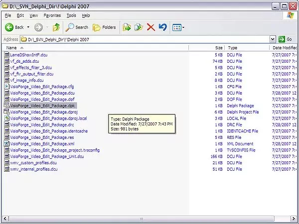

Haga clic en el botón Instalar para registrar los componentes con la paleta de componentes de Delphi.

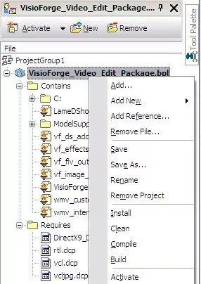

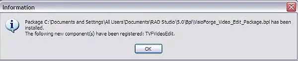

### Soporte de Arquitectura

Para Delphi XE2 y versiones posteriores, están disponibles versiones x86 y x64. Puede utilizar la versión de 64-bit si necesita desarrollar aplicaciones de 64-bit. El IDE usa la versión x86 en tiempo de diseño.

## Instalación en Delphi 11 y Posterior

Las versiones modernas de Delphi presentan un proceso de instalación simplificado:

1. Abra el proyecto de paquete `VisioForge_Video_Edit_Package.dproj` ubicado en la carpeta `Video Edit\Packages\Delphi <versión>` después de la instalación
2. Seleccione la configuración de construcción Release del menú desplegable y la plataforma de destino **Windows 32-bit** (ambas son los valores predeterminados del proyecto); el IDE instala el paquete a partir de su compilación de 32 bits, así que abra el proyecto desde la carpeta `Delphi <versión>`, no desde `Delphi <versión> x64`
3. Construya e instale el paquete usando los comandos de construcción del IDE
4. Los componentes serán registrados y estarán listos para usar

## Mejores Prácticas de Configuración del Proyecto

El IDE usa el paquete de 32 bits en tiempo de diseño; sus aplicaciones pueden apuntar a Windows 32 bits o, desde Delphi XE2, a 64 bits. Asegúrese de haber configurado correctamente los ajustes de ruta de biblioteca de su aplicación:

1. Agregue la ruta correcta de la carpeta de biblioteca a las opciones de su proyecto
2. Configure la ruta para localizar correctamente los archivos `.dcu`
3. Verifique la compatibilidad de arquitectura entre su proyecto y los paquetes instalados

## Solución de Problemas Comunes de Instalación

Si encuentra problemas durante la instalación, verifique estos problemas comunes:

### Problemas de Instalación de Paquete de 64-bit en Delphi

Algunos problemas específicos pueden ocurrir al instalar paquetes de 64-bit. Vea nuestra [guía detallada de solución de problemas](../../general/install-64bit.md) para soluciones.

### Problemas con Archivos .otares

Los problemas de instalación relacionados con archivos `.otares` están documentados en nuestra [página dedicada de solución de problemas](../../general/install-otares.md).

## Recursos Adicionales y Soporte

Para ejemplos de código adicionales e implementaciones, visite nuestro [repositorio de GitHub](https://github.com/visioforge/) donde mantenemos una colección de proyectos de muestra.

Si necesita asistencia personalizada con la instalación o implementación, por favor contacte a nuestro [equipo de soporte técnico](https://helpdesk.visioforge.com/helpdesk/my-tickets/new) quienes pueden proporcionar orientación específica para su entorno de desarrollo.

---
Para preguntas técnicas o asistencia de instalación con esta biblioteca, por favor comuníquese con nuestro [equipo de soporte de desarrollo](https://helpdesk.visioforge.com/helpdesk/my-tickets/new). Explore ejemplos de código adicionales y recursos en nuestra página de [GitHub](https://github.com/visioforge/).