# Installer TVFVideoEdit dans Delphi

> Produits liés : [VisioForge All-in-One Media Framework (Delphi / ActiveX)](https://www.visioforge.com/all-in-one-media-framework)

## Prérequis d'installation

Avant de commencer le processus d'installation, assurez-vous d'avoir :

1. Une version appropriée de Delphi installée et correctement configurée
2. Les droits d'administrateur pour l'installation des paquets
3. Téléchargé la dernière version de la bibliothèque TVFVideoEdit

## Installation automatique (Delphi 6 à Delphi 13)

Le programme d'installation du SDK enregistre le paquet dans chaque Delphi qu'il trouve sur l'ordinateur, de Delphi 6 à Delphi 13, pour l'utilisateur Windows qui l'exécute :

- il ajoute le dossier `Video Edit\Packages\Delphi <version>` au chemin de bibliothèque Windows 32 bits, et, à partir de Delphi XE2, le dossier `Delphi <version> x64` à celui de Windows 64 bits ;
- il enregistre le paquet précompilé `VisioForge_Video_Edit_Package.bpl` de ce dossier, afin que l'IDE le charge au démarrage. L'enregistrement concerne l'IDE 32 bits, celui que Delphi démarre par défaut ; si vous utilisez l'IDE 64 bits de Delphi 12 ou 13, démarrez l'IDE 32 bits pour concevoir avec le composant.

Fermez Delphi avant d'exécuter le programme d'installation. Démarrez ensuite Delphi : `TVFVideoEdit` se trouve sur la page **VisioForge** de la palette de composants, prêt à être déposé sur une fiche, et les projets de démonstration de `Demos\Source code` se compilent sans autre configuration.

Si Delphi était ouvert pendant l'installation, si le programme d'installation s'est exécuté sous un autre compte Windows (par exemple celui d'un administrateur saisi à l'invite d'élévation), ou si vous avez installé Delphi après le SDK, fermez Delphi et lancez **Install Delphi packages** depuis le dossier **VisioForge Video Capture SDK** du menu Démarrer (l'unique dossier du programme d'installation, pour les trois produits). Il effectue le même enregistrement pour l'utilisateur courant et affiche dans sa fenêtre chaque Delphi pour lequel aucun paquet précompilé n'est livré ; installez-y le paquet à la main, comme décrit ci-dessous. L'exécution du programme d'installation lui-même écrit cette liste dans `VFPackageInstaller.log`, dans le dossier `%TEMP%` du compte qui a exécuté le programme d'installation.

## Installation dans Borland Delphi 6/7

### Étape 1 : configurer les chemins de bibliothèques

Commencez par ouvrir la fenêtre « Options » dans votre IDE Delphi.

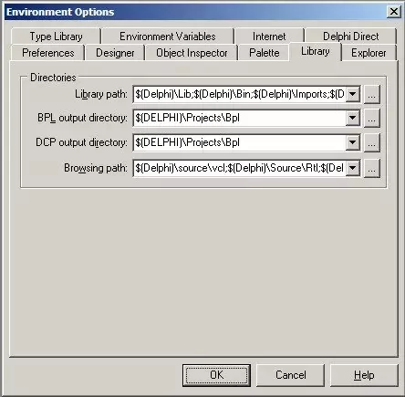

Naviguez vers la section Library et ajoutez le dossier du paquet (`Video Edit\Packages\Delphi <version>`, qui contient les unités précompilées `.dcu`) à la fois aux chemins de bibliothèque et aux chemins de navigation. Cela garantit que Delphi peut localiser les fichiers nécessaires.

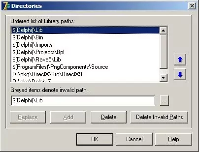

### Étape 2 : ouvrir et installer le paquet

Localisez et ouvrez le fichier principal du paquet depuis la bibliothèque.

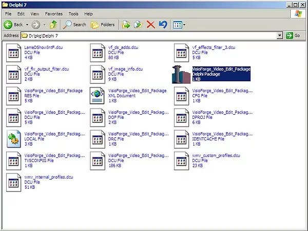

Installez le paquet en cliquant sur le bouton Install dans l'IDE. Cela enregistre les composants dans la palette de composants de Delphi.

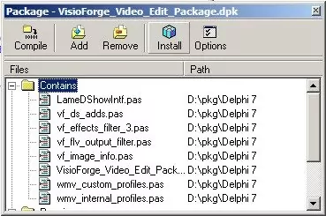

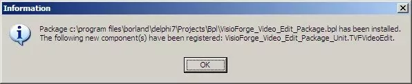

### Considérations d'architecture

La bibliothèque inclut à la fois des versions x86 et x64. Néanmoins, pour Delphi 6/7, vous devez utiliser la version x86 car ces versions de Delphi ne prennent pas en charge le développement 64 bits.

## Installation dans Delphi 2005 et versions ultérieures

### Étape 1 : lancer avec des privilèges d'administrateur

Pour Delphi 2005 et les versions ultérieures, lancez l'IDE avec des droits d'administrateur pour vous assurer de disposer des permissions d'installation appropriées.

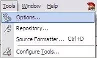

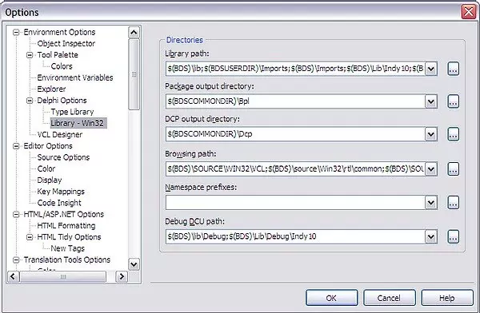

### Étape 2 : configurer les chemins de bibliothèques

Ouvrez la fenêtre Options et naviguez vers la section Library. Ajoutez le dossier du paquet (`Video Edit\Packages\Delphi <version>`, qui contient les unités précompilées `.dcu`) à la fois aux chemins de bibliothèque et aux chemins de navigation.

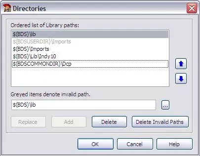

### Étape 3 : installer le paquet

Ouvrez le fichier de paquet principal `VisioForge_Video_Edit_Package.dpk` depuis le dossier `Video Edit\Packages\Delphi <version>`.

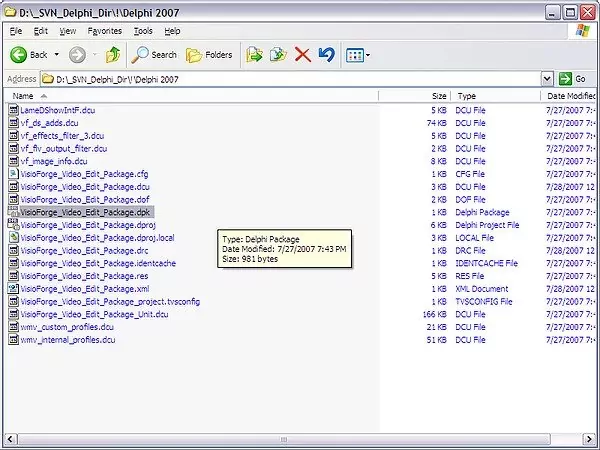

Cliquez sur le bouton Install pour enregistrer les composants dans la palette de composants de Delphi.

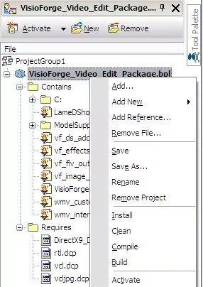

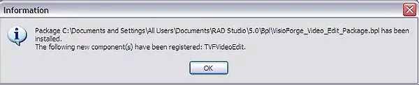

### Prise en charge des architectures

Pour Delphi XE2 et les versions ultérieures, les versions x86 et x64 sont disponibles. Vous pouvez utiliser la version 64 bits si vous devez développer des applications 64 bits. L'IDE utilise lui-même la version x86 à la conception.

## Installation dans Delphi 11 et versions ultérieures

Les versions modernes de Delphi proposent un processus d'installation rationalisé :

1. Ouvrez le projet de paquet `VisioForge_Video_Edit_Package.dproj` situé dans le dossier `Video Edit\Packages\Delphi <version>` après installation
2. Sélectionnez la configuration de compilation Release dans le menu déroulant et la plateforme cible **Windows 32-bit** (ce sont les valeurs par défaut du projet) ; l'IDE installe le paquet à partir de sa version 32 bits, ouvrez donc le projet depuis le dossier `Delphi <version>`, et non depuis `Delphi <version> x64`
3. Compilez et installez le paquet à l'aide des commandes de compilation de l'IDE
4. Les composants seront enregistrés et prêts à l'emploi

## Bonnes pratiques de configuration de projet

L'IDE utilise le paquet 32 bits à la conception ; vos applications peuvent cibler Windows 32 bits ou, à partir de Delphi XE2, 64 bits. Veillez à avoir correctement configuré les paramètres de chemin de bibliothèque de votre application :

1. Ajoutez le chemin correct du dossier de bibliothèque aux options de votre projet
2. Configurez le chemin pour localiser correctement les fichiers `.dcu`
3. Vérifiez la compatibilité d'architecture entre votre projet et les paquets installés

## Dépannage des problèmes d'installation courants

Si vous rencontrez des problèmes lors de l'installation, vérifiez ces problèmes courants :

### Problèmes d'installation de paquet 64 bits sous Delphi

Certains problèmes spécifiques peuvent survenir lors de l'installation de paquets 64 bits. Consultez notre [guide de dépannage détaillé](../../general/install-64bit.md) pour les solutions.

### Problèmes liés aux fichiers .otares

Les problèmes d'installation liés aux fichiers `.otares` sont documentés sur notre [page de dépannage dédiée](../../general/install-otares.md).

## Ressources supplémentaires et support

Pour des exemples de code et implémentations supplémentaires, visitez notre [dépôt GitHub](https://github.com/visioforge/) où nous maintenons une collection de projets d'exemple.

Si vous avez besoin d'une assistance personnalisée pour l'installation ou l'implémentation, veuillez contacter notre [équipe de support technique](https://helpdesk.visioforge.com/helpdesk/my-tickets/new) qui pourra fournir des conseils adaptés à votre environnement de développement.

---
Pour toute question technique ou assistance d'installation concernant cette bibliothèque, veuillez contacter notre [équipe de support développement](https://helpdesk.visioforge.com/helpdesk/my-tickets/new). Parcourez les exemples de code et ressources supplémentaires sur notre page [GitHub](https://github.com/visioforge/).