# Install TVFVideoEdit in Delphi

> Related products: [VisioForge All-in-One Media Framework (Delphi / ActiveX)](https://www.visioforge.com/all-in-one-media-framework)

## Installation Requirements

Before beginning the installation process, ensure that you have:

1. Appropriate Delphi version installed and properly configured
2. Administrative rights for package installation
3. Downloaded the latest version of the TVFVideoEdit library

## Automatic Installation (Delphi 6 to Delphi 13)

The SDK installer registers the package with every Delphi it finds on the computer, Delphi 6 through Delphi 13, for the Windows user who runs it:

- it adds the `Video Edit\Packages\Delphi <version>` folder to the Windows 32-bit library path, and, from Delphi XE2 on, the `Delphi <version> x64` folder to the Windows 64-bit library path;
- it registers the precompiled package `VisioForge_Video_Edit_Package.bpl` from that folder, so the IDE loads it at startup. The registration is for the 32-bit IDE, the one Delphi starts by default; if you use the 64-bit IDE of Delphi 12 or 13, start the 32-bit one to design with the component.

Close Delphi before you run the installer. Then start Delphi: `TVFVideoEdit` is on the **VisioForge** page of the component palette, ready to drop on a form, and the demo projects under `Demos\Source code` compile without further setup.

If Delphi was running during the installation, the setup ran under another Windows account (for example, an administrator's account entered at the elevation prompt), or you installed Delphi after the SDK, close Delphi and run **Install Delphi packages** from the **VisioForge Video Capture SDK** folder of the Start menu (the setup's one folder, for all three products). It does the same registration for the current user and lists in its window any Delphi for which no precompiled package ships; install the package by hand there, as described below. The setup's own run writes that list to `VFPackageInstaller.log` in the `%TEMP%` folder of the account that ran the setup.

## Installing in Borland Delphi 6/7

### Step 1: Configure Library Paths

Begin by opening the "Options" window in your Delphi IDE.

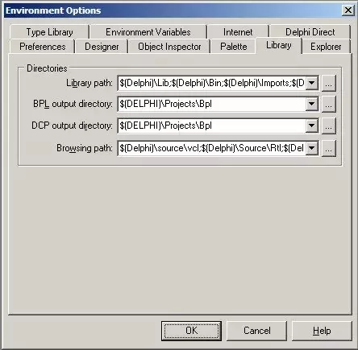

Navigate to the Library section and add the package folder (`Video Edit\Packages\Delphi <version>`, which holds the precompiled `.dcu` units) to both the library and browsing paths. This ensures that Delphi can locate the necessary files.

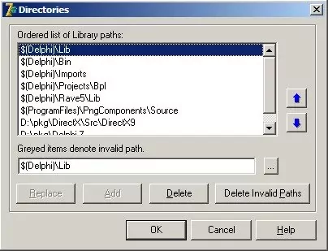

### Step 2: Open and Install the Package

Locate and open the main package file from the library.

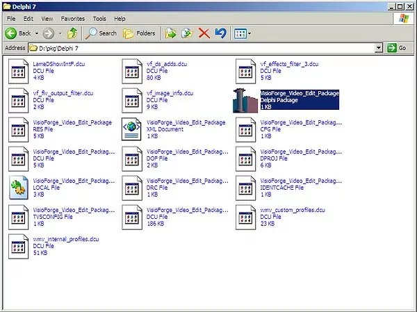

Install the package by clicking the Install button in the IDE. This registers the components with Delphi's component palette.

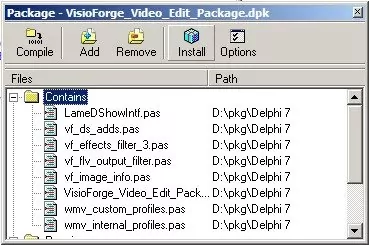

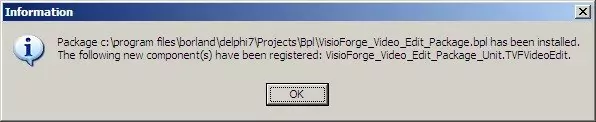

### Architecture Considerations

The library includes both x86 and x64 architecture versions. However, for Delphi 6/7, you must use the x86 version as these Delphi versions do not support 64-bit development.

## Installing in Delphi 2005 and Later

### Step 1: Launch with Administrative Privileges

For Delphi 2005 and later versions, launch the IDE with administrative rights to ensure proper installation permissions.

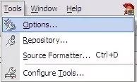

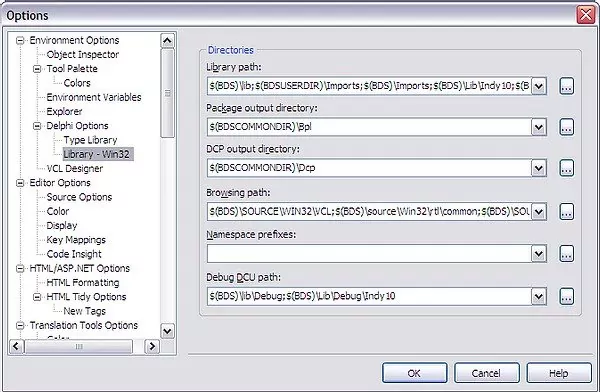

### Step 2: Configure Library Paths

Open the Options window and navigate to the Library section. Add the package folder (`Video Edit\Packages\Delphi <version>`, which holds the precompiled `.dcu` units) to both the library and browsing paths.

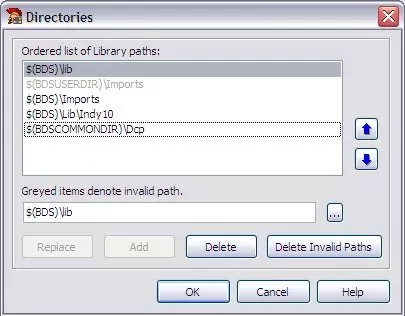

### Step 3: Install the Package

Open the main package file `VisioForge_Video_Edit_Package.dpk` from the `Video Edit\Packages\Delphi <version>` folder.

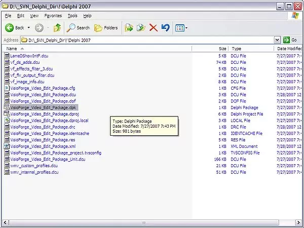

Click the Install button to register the components with Delphi's component palette.

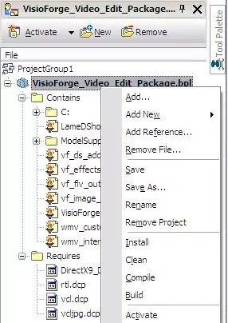

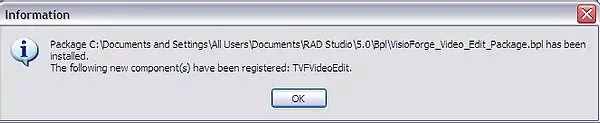

### Architecture Support

For Delphi XE2 and later versions, both x86 and x64 versions are available. You can utilize the 64-bit version if you need to develop 64-bit applications. The IDE itself uses the x86 version at design time.

## Installing in Delphi 11 and Later

Modern Delphi versions feature a streamlined installation process:

1. Open the `VisioForge_Video_Edit_Package.dproj` package project located in the `Video Edit\Packages\Delphi <version>` folder after installation
2. Select the Release build configuration from the dropdown menu and the **Windows 32-bit** target platform (both are the project's defaults); the IDE installs the package from its 32-bit build, so open the project from the `Delphi <version>` folder, not from `Delphi <version> x64`
3. Build and install the package using the IDE's build commands
4. The components will be registered and ready to use

## Project Configuration Best Practices

The IDE uses the 32-bit package at design time; your applications can target Windows 32-bit or, from Delphi XE2 on, 64-bit. Ensure you've properly configured your application's library path settings:

1. Add the correct library folder path to your project options
2. Configure the path to properly locate `.dcu` files
3. Verify architecture compatibility between your project and the installed packages

## Troubleshooting Common Installation Issues

If you encounter problems during installation, check these common issues:

### Delphi 64-bit Package Installation Problems

Some specific issues can occur when installing 64-bit packages. See our [detailed troubleshooting guide](../../general/install-64bit.md) for solutions.

### Issues with .otares Files

Installation problems related to `.otares` files are documented in our [dedicated troubleshooting page](../../general/install-otares.md).

## Additional Resources and Support

For additional code examples and implementations, visit our [GitHub repository](https://github.com/visioforge/) where we maintain a collection of sample projects.

If you need personalized assistance with installation or implementation, please contact our [technical support team](https://helpdesk.visioforge.com/helpdesk/my-tickets/new) who can provide guidance specific to your development environment.

---
For technical questions or installation assistance with this library, please reach out to our [development support team](https://helpdesk.visioforge.com/helpdesk/my-tickets/new). Browse additional code samples and resources on our [GitHub](https://github.com/visioforge/) page.