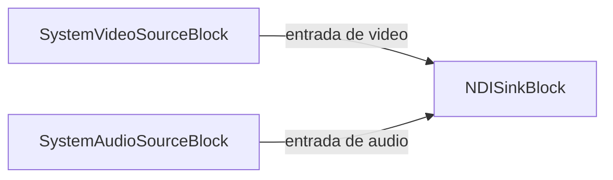
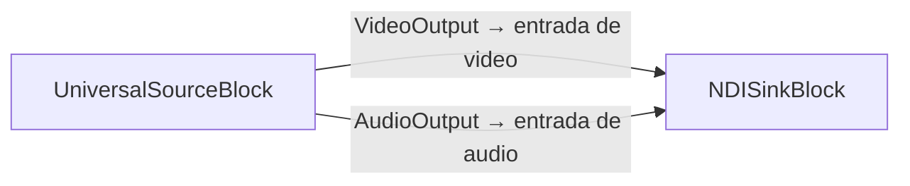

# Integración de Transmisión Network Device Interface (NDI)

[Video Capture SDK .NET](https://www.visioforge.com/video-capture-sdk-net){ .md-button .md-button--primary target="_blank" } [Media Blocks SDK .NET](https://www.visioforge.com/media-blocks-sdk-net){ .md-button .md-button--primary target="_blank" }

## ¿Qué es NDI?

Network Device Interface (NDI) es un estándar de la industria para producción de video en vivo sobre redes IP. Permite transmisión de video y audio de alta calidad y baja latencia sobre Ethernet convencional, reemplazando costoso cableado SDI con flujos de trabajo basados en software. Los casos de uso comunes incluyen:

- Transmisión y streaming en vivo
- Videoconferencia profesional
- Configuraciones de producción multi-cámara
- Flujos de trabajo de producción remota
- Aplicaciones de servidor de playout

El SDK de VisioForge proporciona soporte de salida NDI para flujos de trabajo de escritorio y servidor, permitiéndole transmitir cámaras, dispositivos de captura o archivos multimedia a receptores NDI en su red.

## Requisitos de Instalación

Para usar transmisión NDI, instale uno de los siguientes paquetes oficiales de NDI:

1. **[NDI SDK](https://ndi.video/for-developers/ndi-sdk/download/)** - Recomendado para desarrolladores
2. **[NDI Tools](https://ndi.video/tools/)** - Adecuado para pruebas

Estos proporcionan los componentes de runtime que habilitan la comunicación NDI. Puede verificar la disponibilidad de NDI en código:

```csharp
bool ndiAvailable = NDISinkBlock.IsAvailable();
```

## Tutorial en vídeo: enviar y recibir NDI en C# WPF

[MediaBlocksPipeline](#){ .md-button }

El tutorial crea una aplicación WPF que envía una webcam y su micrófono a la red como fuente NDI, con una vista previa en directo de lo que sale, y recibe cualquier fuente NDI de la red en una segunda vista; NDI Studio Monitor recibe la misma fuente a su lado.

<div class="video-wrapper">
  <iframe src="https://www.youtube.com/embed/_9aDu_hk2uw?controls=1" frameborder="0" allowfullscreen></iframe>
</div>

### La versión corta

El mismo envío y recepción como dos aplicaciones de consola en unas pocas líneas de C#: una emite un archivo de vídeo por NDI y la otra muestra una fuente NDI por su nombre en una ventana propia.

<div class="video-wrapper">
  <iframe src="https://www.youtube.com/embed/76pKYRA9hs0?controls=1" frameborder="0" allowfullscreen></iframe>
</div>

Su código: [ndi-send-short-console](https://github.com/visioforge/.Net-SDK-s-samples/tree/master/Media%20Blocks%20SDK/_VideoTutorials/ndi-send-short-console) y [ndi-receive-short-console](https://github.com/visioforge/.Net-SDK-s-samples/tree/master/Media%20Blocks%20SDK/_VideoTutorials/ndi-receive-short-console) en GitHub.

### Enviar una webcam por NDI

Un `TeeBlock` divide la cámara: una copia va a la vista previa y la otra a `NDISinkBlock`, cuyo nombre es el que ven los receptores. El micrófono va a una segunda entrada del mismo sumidero.

```cs
var camera = new SystemVideoSourceBlock(
    new VideoCaptureDeviceSourceSettings(_cameras[cbCamera.SelectedIndex]));
var tee = new TeeBlock(2, MediaBlockPadMediaType.Video);
var preview = new VideoRendererBlock(_sendPipeline, VideoView1);
var ndiSink = new NDISinkBlock(edName.Text.Trim());

_sendPipeline.Connect(camera.Output, tee.Input);
_sendPipeline.Connect(tee.Outputs[0], preview.Input);
_sendPipeline.Connect(tee.Outputs[1], ndiSink.CreateNewInput(MediaBlockPadMediaType.Video));

// Sin micrófono: solo se envía vídeo
if (cbMicrophone.SelectedIndex >= 0)
{
    var microphone = new SystemAudioSourceBlock(
        _microphones[cbMicrophone.SelectedIndex].CreateSourceSettings());
    _sendPipeline.Connect(microphone.Output, ndiSink.CreateNewInput(MediaBlockPadMediaType.Audio));
}

var started = await _sendPipeline.StartAsync();
```

### Recibir una fuente NDI

`DeviceEnumerator.Shared.NDISourcesAsync()` lista todos los emisores NDI de la red. `NDISourceSettings.CreateAsync` se conecta al seleccionado y lee sus formatos; devuelve `null` cuando la fuente no está accesible.

```cs
_ndiSources = await DeviceEnumerator.Shared.NDISourcesAsync();

// Se conecta al emisor y lee sus formatos de vídeo y audio
var settings = await NDISourceSettings.CreateAsync(
    _receivePipeline.GetContext(), _ndiSources[cbSource.SelectedIndex]);

if (settings != null)
{
    var ndiSource = new NDISourceBlock(settings);

    if (settings.GetInfo().VideoStreams.Count > 0)
    {
        var video = new VideoRendererBlock(_receivePipeline, VideoView2);
        _receivePipeline.Connect(ndiSource.VideoOutput, video.Input);
    }

    if (settings.GetInfo().AudioStreams.Count > 0 && cbPlayAudio.IsChecked == true)
    {
        var speakers = new AudioRendererBlock();
        _receivePipeline.Connect(ndiSource.AudioOutput, speakers.Input);
    }

    await _receivePipeline.StartAsync();
}
```

El proyecto completo, con el XAML y el cierre de la ventana: [ndi-send-receive-wpf en GitHub](https://github.com/visioforge/.Net-SDK-s-samples/tree/master/Media%20Blocks%20SDK/_VideoTutorials/ndi-send-receive-wpf).

## Salida NDI Multiplataforma

[VideoCaptureCoreX](#){ .md-button } [MediaBlocksPipeline](#){ .md-button }

### Clase NDIOutput

La clase `NDIOutput` proporciona salida NDI para el motor VideoCaptureCoreX:

```csharp
public class NDIOutput : IVideoCaptureXBaseOutput, IOutputVideoProcessor, IOutputAudioProcessor
```

#### Configuración

| Propiedad | Tipo | Descripción |
| --- | --- | --- |
| `Sink` | `NDISinkSettings` | Configuración de salida NDI (nombre del flujo, compresión, configuraciones de red) |
| `CustomVideoProcessor` | `MediaBlock` | Procesamiento de video personalizado opcional antes de la transmisión NDI |
| `CustomAudioProcessor` | `MediaBlock` | Procesamiento de audio personalizado opcional antes de la transmisión NDI |

#### Constructores

```csharp
// Crear con nombre de flujo
var output = new NDIOutput("My Stream");

// Crear con configuraciones pre-configuradas
var output = new NDIOutput(new NDISinkSettings("My Stream"));
```

## Ejemplos de Implementación

### Media Blocks SDK

```cs
// Crear un bloque de salida NDI con un nombre de flujo descriptivo
var ndiSink = new NDISinkBlock("VisioForge Production Stream");

// Conectar fuente de video a la salida NDI
pipeline.Connect(videoSource.Output, ndiSink.CreateNewInput(MediaBlockPadMediaType.Video));

// Conectar fuente de audio a la salida NDI
pipeline.Connect(audioSource.Output, ndiSink.CreateNewInput(MediaBlockPadMediaType.Audio));
```

### Video Capture SDK

```cs
// Inicializar salida NDI con un nombre de flujo amigable para red
var ndiOutput = new NDIOutput("VisioForge_Studio_Output");

// Agregar la salida NDI configurada al pipeline de captura de video
core.Outputs_Add(ndiOutput); // core representa la instancia VideoCaptureCoreX
```

## Transmisión de Cámara a NDI

[MediaBlocksPipeline](#){ .md-button }

El caso de uso más común es transmitir una webcam local y micrófono a NDI. Este ejemplo usa el Media Blocks SDK para capturar desde dispositivos del sistema y enviarlos a NDI.

### Arquitectura del Pipeline



### Ejemplo de Código

```cs
using VisioForge.Core;
using VisioForge.Core.MediaBlocks;
using VisioForge.Core.MediaBlocks.Sources;
using VisioForge.Core.MediaBlocks.Sinks;
using VisioForge.Core.Types.X.Sources;

// Inicializar SDK una vez al inicio
await VisioForgeX.InitSDKAsync();

var pipeline = new MediaBlocksPipeline();

// Enumerar dispositivos disponibles
var videoDevices = await DeviceEnumerator.Shared.VideoSourcesAsync();
var audioDevices = await DeviceEnumerator.Shared.AudioSourcesAsync();

// Configurar fuente de video (primera cámara disponible)
var videoSettings = new VideoCaptureDeviceSourceSettings(videoDevices[0]);
var videoSource = new SystemVideoSourceBlock(videoSettings);

// Configurar fuente de audio (primer micrófono disponible)
var audioSettings = new AudioCaptureDeviceSourceSettings(audioDevices[0]);
var audioSource = new SystemAudioSourceBlock(audioSettings);

// Crear salida NDI
var ndiSink = new NDISinkBlock("My Camera Stream");

// Conectar video y audio; el sumidero NDI convierte ambos a los formatos de NDI
pipeline.Connect(videoSource.Output, ndiSink.CreateNewInput(MediaBlockPadMediaType.Video));
pipeline.Connect(audioSource.Output, ndiSink.CreateNewInput(MediaBlockPadMediaType.Audio));

await pipeline.StartAsync();
```

## Implementación NDI Específica de Windows

[VideoCaptureCore](#){ .md-button } [VideoEditCore](#){ .md-button }

Para implementaciones específicas de Windows, el SDK proporciona opciones de configuración adicionales a través de los componentes VideoCaptureCore o VideoEditCore.

### Guía de Implementación Paso a Paso

#### 1. Habilitar Transmisión de Red

```cs
VideoCapture1.Network_Streaming_Enabled = true;
```

#### 2. Configurar Transmisión de Audio

```cs
VideoCapture1.Network_Streaming_Audio_Enabled = true;
```

#### 3. Seleccionar Protocolo NDI

```csharp
VideoCapture1.Network_Streaming_Format = NetworkStreamingFormat.NDI;
```

#### 4. Crear y Configurar Salida NDI

```cs
var streamName = "VisioForge NDI Streamer";
var ndiOutput = new NDIOutput(streamName);
```

#### 5. Asignar la Salida

```cs
VideoCapture1.Network_Streaming_Output = ndiOutput;
```

#### 6. Generar la URL NDI (Opcional)

```cs
string ndiUrl = $"ndi://{System.NET.Dns.GetHostName()}/{streamName}";
Debug.WriteLine(ndiUrl);
```

## Reproducción de Archivos a Salida NDI

El Media Blocks SDK puede transmitir archivos multimedia locales (MP4, MKV, AVI, etc.) directamente a NDI sin ninguna renderización local — ideal para aplicaciones de servidor de playout.

### Pipeline Recomendado



### Ejemplo de Código

```cs
var pipeline = new MediaBlocksPipeline();

// Fuente de archivo con detección automática de formato
var fileSource = new UniversalSourceBlock(
    await UniversalSourceSettings.CreateAsync(new Uri("file:///path/to/video.mp4")));

// Salida NDI
var ndiSink = new NDISinkBlock("My NDI Stream");

// Conectar video y audio (si lo hay); el sumidero NDI remuestrea el audio a 48kHz por sí mismo
pipeline.Connect(fileSource.VideoOutput,
    ndiSink.CreateNewInput(MediaBlockPadMediaType.Video));

// Sin pista de audio: solo se envía video
if (fileSource.AudioOutput != null)
{
    pipeline.Connect(fileSource.AudioOutput,
        ndiSink.CreateNewInput(MediaBlockPadMediaType.Audio));
}

// Opcional: habilitar reproducción en bucle
pipeline.Loop = true;

await pipeline.StartAsync();
```

## Requisitos de Formato de Audio

NDI transporta audio **48kHz, punto flotante de 32 bits (F32LE), entrelazado**. `NDISinkBlock` convierte y remuestrea por sí mismo su entrada de audio a ese formato, así que una pista AAC a 44.1kHz de un archivo MP4 o un micrófono a otra frecuencia se conectan directamente al sumidero.

Las versiones del SDK anteriores a 2026.3.1 pasaban la frecuencia de audio sin cambiarla, y el audio a otra frecuencia tartamudeaba o se desfasaba del video. En esas versiones, coloque un `AudioResamplerBlock` entre la fuente de audio y el sumidero:

```cs
var audioResampler = new AudioResamplerBlock(
    new AudioResamplerSettings(AudioFormatX.F32LE, 48000, 2));
```

## Recepción de Fuentes NDI

El [tutorial en vídeo](#tutorial-en-video-enviar-y-recibir-ndi-en-c-wpf) anterior elige una fuente NDI de la lista de emisores de la red en una aplicación WPF; su [versión corta](#la-version-corta) recibe una por su nombre. Para descubrir, conectar, previsualizar o capturar fuentes NDI con más detalle, incluidas aplicaciones Android y MAUI de reproducción NDI, consulte la [Referencia de Fuentes de Video NDI](../../videocapture/video-sources/ip-cameras/ndi.md).

## Solución de Problemas

### Tartamudeo o Fallos de Audio en Salida NDI

**Síntoma:** El audio no es fluido al transmitir desde archivos — tartamudea, tiene fallos o problemas de sincronización labial.

**Causa:** Las versiones del SDK anteriores a 2026.3.1 enviaban el audio a la frecuencia de muestreo de la fuente (por ejemplo, AAC a 44.1kHz en archivos MP4), y NDI espera audio a 48kHz.

**Solución:** Actualice al SDK 2026.3.1 o posterior, en el que `NDISinkBlock` remuestrea el audio a 48kHz por sí mismo. En una versión anterior, inserte un `AudioResamplerBlock` configurado para 48kHz F32LE estéreo entre la fuente y el sumidero NDI, como se muestra en [Requisitos de Formato de Audio](#requisitos-de-formato-de-audio).

## Transcripción del vídeo

### Qué vamos a construir

Vamos a enviar una webcam por NDI y recibir vídeo NDI de vuelta, en una aplicación C# WPF con el VisioForge Media Blocks SDK. Esto es lo que vamos a construir. Una aplicación WPF que envía una webcam y su micrófono a la red como fuente NDI, con una vista previa en directo de lo que sale. La misma aplicación lista las fuentes NDI de la red y recibe cualquiera de ellas en una segunda vista. Esta es la aplicación terminada, a la izquierda, enviando la webcam. A la derecha, NDI Studio Monitor, una herramienta NDI gratuita, recibe la misma fuente por la red. Y aquí la aplicación recibe de vuelta su propia fuente: la cámara a la izquierda y lo que llega por NDI a la derecha. ¿Por qué NDI? Transporta vídeo y audio por una red local corriente. Los emisores se anuncian solos, así que un receptor los encuentra por su nombre: no hay servidor que ejecutar ni dirección que escribir. La latencia es baja, porque se creó para la producción en directo. Y vMix, TriCaster, NDI Studio Monitor y muchos otros programas aceptan una fuente NDI directamente.

### Requisitos previos

Necesita Windows 10 u 11, y Visual Studio 2022 o 2026 con la carga de trabajo de desarrollo de escritorio de .NET. El proyecto usa .NET 8 o posterior. NDI necesita su runtime en el equipo: instale NDI Tools, que es gratuito e incluye Studio Monitor, o el NDI SDK. Y una webcam.

### Crear un proyecto WPF

En Visual Studio, cree un proyecto nuevo. Busque WPF y elija WPF Application para C#. Llame al proyecto NdiWpf. Elija .NET 10 y haga clic en Create.

### Añadir los paquetes NuGet

Ahora añada dos paquetes NuGet. El propio Media Blocks SDK, y CrossPlatform Core, el runtime de GStreamer sobre el que funcionan los bloques, con los elementos NDI de envío y recepción. NDI transporta vídeo y audio sin comprimir, así que no hace falta ningún paquete de códecs. O use el NuGet Package Manager: clic derecho en el proyecto, Manage NuGet Packages, e instale VisioForge.DotNet.MediaBlocks desde la pestaña Browse. Después instale el paquete Core para Windows x64. La pestaña Installed muestra los dos. Son los paquetes x64, así que ponga PlatformTarget en x64 en el archivo del proyecto. NDI no funciona en un proceso nativo Windows ARM64, así que en un PC ARM esta compilación x64 se ejecuta en emulación.

### Construir la ventana en XAML

La ventana se escribe en XAML. Primero la ventana, con tres columnas y las dos vistas de vídeo, y el diseñador las dibuja al momento. Asigne el espacio de nombres VisioForge.Core.UI.WPF a un prefijo, aquí vf. La cuadrícula tiene una columna para los controles y dos para el vídeo: VideoView1 muestra la cámara que se envía y VideoView2 la fuente NDI que se recibe. La ventana empieza deshabilitada hasta que el SDK se ha cargado. A continuación, los controles de envío. Un StackPanel en la columna izquierda: un cuadro combinado para las cámaras, otro para los micrófonos y un cuadro de texto para el nombre que la fuente tiene en la red. Luego Send y Stop. Stop empieza deshabilitado hasta que se envía algo. Por último, los controles de recepción. Un cuadro combinado para las fuentes NDI, una casilla Play audio y los botones Refresh, Receive y Stop. Cada controlador que nombra el XAML va en MainWindow.xaml.cs, y los próximos capítulos los escriben.

### Inicializar el SDK

MainWindow.xaml.cs empieza con estos usings: el núcleo del SDK, el pipeline y los espacios de nombres de los bloques que usa: fuentes, sinks, renderizadores y el tee. Cuando se carga la ventana, espere una vez a VisioForgeX.InitSDKAsync. Después DeviceEnumerator lista las cámaras y los micrófonos. Guarde los dos arrays: el controlador de Send toma de ellos los dispositivos seleccionados. Se selecciona el primero de cada lista y se habilita la ventana. La aplicación tiene dos pipelines, uno que envía y otro que recibe, y esta función auxiliar crea los dos. Los errores del pipeline llegan en el evento OnError; aquí van a la barra de título.

### Enviar por NDI

Para enviar, conecte bloques en un pipeline. La cámara es un SystemVideoSourceBlock. Un TeeBlock la divide en dos: una copia va a un VideoRendererBlock en VideoView1, la vista previa, y la otra a un NDISinkBlock, con el nombre del cuadro de texto. Ese nombre es lo que ven los receptores. El micrófono es un SystemAudioSourceBlock, conectado a una segunda entrada del mismo sink NDI. Sin micrófono, solo se envía vídeo. StartAsync devuelve si el pipeline arrancó; si no, el pipeline se detiene y se libera. No hay que elegir codificador. NDISinkBlock convierte lo que entregue la cámara a un formato que NDI acepta y remuestrea el audio a 48 kilohercios. El vídeo y el audio salen como una sola fuente NDI. NDI envía vídeo a calidad completa, así que cuente con unos 100 a 150 megabits por segundo para una transmisión HD. Para dejar de enviar, espere a StopAsync, luego a DisposeAsync, y descarte el pipeline. La fuente desaparece de la red.

### Recibir NDI

Refresh llama a DeviceEnumerator.Shared.NDISourcesAsync, que devuelve todos los emisores NDI que encuentra en la red, incluido el de esta misma aplicación. Cada uno tiene un nombre: el equipo y, entre paréntesis, el nombre de la fuente. Para recibir, cree el segundo pipeline y NDISourceSettings.CreateAsync para la fuente seleccionada. Se conecta al emisor y lee sus formatos de vídeo y audio; devuelve null cuando no se puede alcanzar la fuente. Después, un NDISourceBlock con esa configuración. Si la fuente tiene vídeo, su salida de vídeo va a un renderizador en VideoView2. El audio solo se reproduce si Play audio está marcado: al recibir la propia fuente de la aplicación, devolvería el micrófono directamente a los altavoces. Después, StartAsync. Si la ventana se cierra mientras envía o recibe, cancele el cierre, detenga el pipeline que esté en marcha y vuelva a cerrar. En esa segunda pasada se libera el SDK.

### Ejecutarla

Ejecute la aplicación desde Visual Studio. Cuando el SDK se ha cargado, se llenan las listas de cámaras y micrófonos. Haga clic en Send. La vista previa arranca y la cámara está en la red como VisioForge NDI. Ahora otra aplicación NDI. Abra NDI Studio Monitor, haga clic derecho y elija la fuente: este equipo y luego VisioForge NDI. Studio Monitor muestra la cámara, imagen y sonido, enviada desde nuestra aplicación por la red. Cualquier otro equipo de la misma red vería también esta fuente. De vuelta en la aplicación, haga clic en Refresh. La lista contiene todas las fuentes NDI de la red. Elija VisioForge NDI y haga clic en Receive. La vista de la derecha muestra ahora la fuente recibida por NDI, junto a la cámara de la que procede. Detenga la recepción, detenga el envío y cierre la ventana.

### Errores frecuentes

Algunos errores frecuentes. No hay runtime NDI en el equipo: instale NDI Tools o el NDI SDK. La primera ejecución pide acceso a la red al firewall de Windows, y responder Cancel bloquea NDI para la aplicación. Una compilación nativa ARM64 no puede cargar NDI; compile para x64. Y varias fuentes HD necesitan una red gigabit. Sea cual sea el problema, el pipeline lo notifica en el evento OnError.

### Próximos pasos

También hay guías para emitir un archivo de vídeo por NDI, para recibir varias fuentes NDI a la vez, para reproductores NDI en Android y MAUI, y para la salida NDI del Video Capture SDK. El código fuente completo está en GitHub, y la documentación en visioforge.com/help. Gracias por ver el vídeo.

## Preguntas Frecuentes

### ¿Cómo transmito video desde una cámara a NDI en C#?

Use el Media Blocks SDK para crear un pipeline con `SystemVideoSourceBlock` para la cámara, `SystemAudioSourceBlock` para el micrófono y `NDISinkBlock` como salida; el sumidero convierte el audio al formato de 48kHz que usa NDI. Consulte la sección [Transmisión de Cámara a NDI](#transmision-de-camara-a-ndi) para el código completo.

### ¿Qué formato de audio requiere NDI?

NDI usa audio de 48kHz, punto flotante de 32 bits (F32LE), entrelazado. Desde el SDK 2026.3.1, `NDISinkBlock` convierte por sí mismo su entrada de audio a ese formato; en versiones anteriores, añada `AudioResamplerBlock(new AudioResamplerSettings(AudioFormatX.F32LE, 48000, 2))` entre la fuente de audio y el sumidero NDI, o el audio puede tartamudear o desfasarse del video.

### ¿Puedo transmitir un archivo de video a NDI para playout?

Sí. Use `UniversalSourceBlock` para leer el archivo y conecte sus salidas de video y audio a `NDISinkBlock`, que remuestrea el audio a 48kHz. Habilite `pipeline.Loop = true` para playout continuo. Este patrón es ideal para servidores de playout de transmisión con cero sobrecarga de renderización local.

### ¿Cuáles son los requisitos del sistema para transmisión NDI en .NET?

Necesita el [NDI SDK](https://ndi.video/for-developers/ndi-sdk/download/) o [NDI Tools](https://ndi.video/tools/) instalado para soporte NDI en tiempo de ejecución. El SDK de VisioForge soporta NDI en Windows, macOS y Linux, y la recepción NDI también en Android; NDI no está disponible en un proceso nativo de Windows ARM64 (una compilación x64 en emulación funciona). Verifique la disponibilidad de NDI en tiempo de ejecución con `NDISinkBlock.IsAvailable()` para el envío y `NDISourceBlock.IsAvailable()` para la recepción. Los requisitos de ancho de banda de red dependen de la resolución y la tasa de fotogramas — un flujo NDI HD típico usa aproximadamente 100-150 Mbps.

### ¿Cómo verifico si NDI está disponible en el sistema?

Llame a `NDISinkBlock.IsAvailable()` antes de crear componentes del pipeline NDI. Este método estático verifica si las bibliotecas de runtime NDI están instaladas y accesibles. Si devuelve `false`, solicite al usuario que instale el paquete NDI SDK o NDI Tools.

## Ver También

- [Referencia de Fuentes de Video NDI](../../videocapture/video-sources/ip-cameras/ndi.md) — recibir y capturar fuentes NDI en .NET
- [Visor de Streams RTSP y Reproductor de Cámaras IP](../../mediablocks/Guides/rtsp-player-csharp.md) — guía similar de streaming IP para cámaras RTSP
- [Guía de Despliegue](../../deployment-x/index.md) — paquetes de runtime específicos de plataforma para Windows, macOS, Linux
- [Ejemplos de Código en GitHub](https://github.com/visioforge/.Net-SDK-s-samples/tree/master/Media%20Blocks%20SDK) — demos de transmisor y fuente NDI
- [Media Blocks SDK .NET](https://www.visioforge.com/media-blocks-sdk-net) — página del producto y descargas
