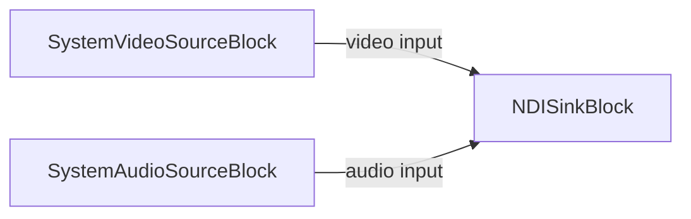

# Network Device Interface (NDI) Streaming Integration

[Video Capture SDK .NET](https://www.visioforge.com/video-capture-sdk-net){ .md-button .md-button--primary target="_blank" } [Media Blocks SDK .NET](https://www.visioforge.com/media-blocks-sdk-net){ .md-button .md-button--primary target="_blank" }

## What is NDI?

Network Device Interface (NDI) is an industry standard for live video production over IP networks. It enables high-quality, low-latency video and audio streaming over standard Ethernet — replacing expensive SDI cabling with software-based workflows. Common use cases include:

- Live broadcasting and streaming
- Professional video conferencing
- Multi-camera production setups
- Remote production workflows
- Playout server applications

The VisioForge SDK provides NDI output support for desktop/server workflows, letting you stream cameras, capture devices, or media files to NDI receivers on your network.

## Installation Requirements

To use NDI streaming, install one of the following official NDI packages:

1. **[NDI SDK](https://ndi.video/for-developers/ndi-sdk/download/)** - Recommended for developers
2. **[NDI Tools](https://ndi.video/tools/)** - Suitable for testing

These provide the runtime components that enable NDI communication. You can verify NDI availability in code:

```csharp
bool ndiAvailable = NDISinkBlock.IsAvailable();
```

## Video Tutorial: Send and Receive NDI in C# WPF

[MediaBlocksPipeline](#){ .md-button }

The tutorial builds a WPF app that sends a webcam and its microphone to the network as an NDI source, with a live preview of what goes out, and receives any NDI source on the network into a second view - NDI Studio Monitor receives the same source alongside it.

<div class="video-wrapper">
  <iframe src="https://www.youtube.com/embed/_9aDu_hk2uw?controls=1" frameborder="0" allowfullscreen></iframe>
</div>

### The short version

The same send and receive as two console apps in a few lines of C#: one plays a video file out over NDI, the other shows an NDI source by name in a window of its own.

The sender:

<!-- vf-compile -->
```csharp
using VisioForge.Core;
using VisioForge.Core.MediaBlocks;
using VisioForge.Core.MediaBlocks.Sinks;
using VisioForge.Core.MediaBlocks.Sources;
using VisioForge.Core.Types.X.Sources;
using static VisioForge.Core.MediaBlocks.MediaBlockPadMediaType;

await VisioForgeX.InitSDKAsync();
await using var p = new MediaBlocksPipeline();
p.OnError += (_, e) =>
    Console.WriteLine(e.Message);
var file = new UniversalSourceBlock(
    await UniversalSourceSettings.CreateAsync(
        args[0]));
var ndi = new NDISinkBlock("VisioForge NDI");
p.Connect(file.VideoOutput,
    ndi.CreateNewInput(Video));
if (file.AudioOutput != null)
    p.Connect(file.AudioOutput,
        ndi.CreateNewInput(Audio));
if (!await p.StartAsync()) return;
Console.ReadLine();
await p.StopAsync();
```

The receiver:

<!-- vf-compile -->
```csharp
using VisioForge.Core;
using VisioForge.Core.MediaBlocks;
using VisioForge.Core.MediaBlocks.AudioRendering;
using VisioForge.Core.MediaBlocks.Sources;
using VisioForge.Core.MediaBlocks.VideoRendering;
using VisioForge.Core.Types.X.Sources;

await VisioForgeX.InitSDKAsync();
await using var p = new MediaBlocksPipeline();
p.OnError += (_, e) =>
    Console.WriteLine(e.Message);
var settings = await NDISourceSettings
    .CreateAsync(p.GetContext(), args[0], null);
if (settings == null) return;
var ndi = new NDISourceBlock(settings);
var video = new VideoRendererBlock(p, null);
p.Connect(ndi.VideoOutput, video.Input);
if (settings.GetInfo().AudioStreams.Count > 0)
    p.Connect(ndi.AudioOutput,
        new AudioRendererBlock().Input);
if (!await p.StartAsync()) return;
Console.ReadLine();
await p.StopAsync();
```

Their code: [ndi-send-short-console](https://github.com/visioforge/.Net-SDK-s-samples/tree/master/Media%20Blocks%20SDK/_VideoTutorials/ndi-send-short-console) and [ndi-receive-short-console](https://github.com/visioforge/.Net-SDK-s-samples/tree/master/Media%20Blocks%20SDK/_VideoTutorials/ndi-receive-short-console) on GitHub.

### Send a webcam over NDI

A `TeeBlock` splits the camera: one copy goes to the preview, the other to `NDISinkBlock`, whose name is what receivers see. The microphone goes to a second input of the same sink.

```cs
var camera = new SystemVideoSourceBlock(
    new VideoCaptureDeviceSourceSettings(_cameras[cbCamera.SelectedIndex]));
var tee = new TeeBlock(2, MediaBlockPadMediaType.Video);
var preview = new VideoRendererBlock(_sendPipeline, VideoView1);
var ndiSink = new NDISinkBlock(edName.Text.Trim());

_sendPipeline.Connect(camera.Output, tee.Input);
_sendPipeline.Connect(tee.Outputs[0], preview.Input);
_sendPipeline.Connect(tee.Outputs[1], ndiSink.CreateNewInput(MediaBlockPadMediaType.Video));

// No microphone: send video only
if (cbMicrophone.SelectedIndex >= 0)
{
    var microphone = new SystemAudioSourceBlock(
        _microphones[cbMicrophone.SelectedIndex].CreateSourceSettings());
    _sendPipeline.Connect(microphone.Output, ndiSink.CreateNewInput(MediaBlockPadMediaType.Audio));
}

var started = await _sendPipeline.StartAsync();
```

### Receive an NDI source

`DeviceEnumerator.Shared.NDISourcesAsync()` lists every NDI sender on the network. `NDISourceSettings.CreateAsync` connects to the selected one and reads its formats; it returns `null` when the source cannot be reached.

```cs
_ndiSources = await DeviceEnumerator.Shared.NDISourcesAsync();

// Connects to the sender and reads its video and audio formats
var settings = await NDISourceSettings.CreateAsync(
    _receivePipeline.GetContext(), _ndiSources[cbSource.SelectedIndex]);

if (settings != null)
{
    var ndiSource = new NDISourceBlock(settings);

    if (settings.GetInfo().VideoStreams.Count > 0)
    {
        var video = new VideoRendererBlock(_receivePipeline, VideoView2);
        _receivePipeline.Connect(ndiSource.VideoOutput, video.Input);
    }

    if (settings.GetInfo().AudioStreams.Count > 0 && cbPlayAudio.IsChecked == true)
    {
        var speakers = new AudioRendererBlock();
        _receivePipeline.Connect(ndiSource.AudioOutput, speakers.Input);
    }

    await _receivePipeline.StartAsync();
}
```

The complete project, with the XAML and the window's teardown: [ndi-send-receive-wpf on GitHub](https://github.com/visioforge/.Net-SDK-s-samples/tree/master/Media%20Blocks%20SDK/_VideoTutorials/ndi-send-receive-wpf).

## Cross-Platform NDI Output

[VideoCaptureCoreX](#){ .md-button } [MediaBlocksPipeline](#){ .md-button }

### NDIOutput Class

The `NDIOutput` class provides NDI output for the VideoCaptureCoreX engine:

```csharp
public class NDIOutput : IVideoCaptureXBaseOutput, IOutputVideoProcessor, IOutputAudioProcessor
```

#### Configuration

| Property | Type | Description |
|----------|------|-------------|
| `Sink` | `NDISinkSettings` | NDI output configuration (stream name, compression, network settings) |
| `CustomVideoProcessor` | `MediaBlock` | Optional custom video processing before NDI transmission |
| `CustomAudioProcessor` | `MediaBlock` | Optional custom audio processing before NDI transmission |

#### Constructors

```csharp
// Create with stream name
var output = new NDIOutput("My Stream");

// Create with pre-configured settings
var output = new NDIOutput(new NDISinkSettings("My Stream"));
```

## Implementation Examples

### Media Blocks SDK

```cs
// Create an NDI output block with a descriptive stream name
var ndiSink = new NDISinkBlock("VisioForge Production Stream");

// Connect video source to the NDI output
pipeline.Connect(videoSource.Output, ndiSink.CreateNewInput(MediaBlockPadMediaType.Video));

// Connect audio source to the NDI output
pipeline.Connect(audioSource.Output, ndiSink.CreateNewInput(MediaBlockPadMediaType.Audio));
```

### Video Capture SDK

```cs
// Initialize NDI output with a network-friendly stream name
var ndiOutput = new NDIOutput("VisioForge_Studio_Output");

// Add the configured NDI output to the video capture pipeline
core.Outputs_Add(ndiOutput); // core represents the VideoCaptureCoreX instance
```

## Streaming a Camera to NDI

[MediaBlocksPipeline](#){ .md-button }

The most common use case is streaming a local webcam and microphone to NDI. This example uses the Media Blocks SDK to capture from system devices and send them to NDI.

### Pipeline Architecture



### Code Example

```cs
using VisioForge.Core;
using VisioForge.Core.MediaBlocks;
using VisioForge.Core.MediaBlocks.Sources;
using VisioForge.Core.MediaBlocks.Sinks;
using VisioForge.Core.Types.X.Sources;

// Initialize SDK once at startup
await VisioForgeX.InitSDKAsync();

var pipeline = new MediaBlocksPipeline();

// Enumerate available devices
var videoDevices = await DeviceEnumerator.Shared.VideoSourcesAsync();
var audioDevices = await DeviceEnumerator.Shared.AudioSourcesAsync();

// Set up video source (first available camera)
var videoSettings = new VideoCaptureDeviceSourceSettings(videoDevices[0]);
var videoSource = new SystemVideoSourceBlock(videoSettings);

// Set up audio source (first available microphone)
var audioSettings = new AudioCaptureDeviceSourceSettings(audioDevices[0]);
var audioSource = new SystemAudioSourceBlock(audioSettings);

// Create NDI output
var ndiSink = new NDISinkBlock("My Camera Stream");

// Connect video and audio; the NDI sink converts both to NDI's formats
pipeline.Connect(videoSource.Output, ndiSink.CreateNewInput(MediaBlockPadMediaType.Video));
pipeline.Connect(audioSource.Output, ndiSink.CreateNewInput(MediaBlockPadMediaType.Audio));

await pipeline.StartAsync();
```

## Windows-Specific NDI Implementation

[VideoCaptureCore](#){ .md-button } [VideoEditCore](#){ .md-button }

For Windows-specific implementations, the SDK provides additional configuration options through the VideoCaptureCore or VideoEditCore components.

### Step-by-Step Implementation Guide

#### 1. Enable Network Streaming

```cs
VideoCapture1.Network_Streaming_Enabled = true;
```

#### 2. Configure Audio Streaming

```cs
VideoCapture1.Network_Streaming_Audio_Enabled = true;
```

#### 3. Select NDI Protocol

```csharp
VideoCapture1.Network_Streaming_Format = NetworkStreamingFormat.NDI;
```

#### 4. Create and Configure NDI Output

```cs
var streamName = "VisioForge NDI Streamer";
var ndiOutput = new NDIOutput(streamName);
```

#### 5. Assign the Output

```cs
VideoCapture1.Network_Streaming_Output = ndiOutput;
```

#### 6. Generate the NDI URL (Optional)

```cs
string ndiUrl = $"ndi://{System.NET.Dns.GetHostName()}/{streamName}";
Debug.WriteLine(ndiUrl);
```

## File Playback to NDI Output

The Media Blocks SDK can stream local media files (MP4, MKV, AVI, etc.) directly to NDI without any local rendering — ideal for playout server applications.

### Recommended Pipeline


### Code Example

```cs
var pipeline = new MediaBlocksPipeline();

// File source with automatic format detection
var fileSource = new UniversalSourceBlock(
    await UniversalSourceSettings.CreateAsync(new Uri("file:///path/to/video.mp4")));

// NDI output
var ndiSink = new NDISinkBlock("My NDI Stream");

// Connect video and audio (if any); the NDI sink resamples the audio to 48kHz itself
pipeline.Connect(fileSource.VideoOutput,
    ndiSink.CreateNewInput(MediaBlockPadMediaType.Video));

// No audio track: send video only
if (fileSource.AudioOutput != null)
{
    pipeline.Connect(fileSource.AudioOutput,
        ndiSink.CreateNewInput(MediaBlockPadMediaType.Audio));
}

// Optional: enable loop playback
pipeline.Loop = true;

await pipeline.StartAsync();
```

## Audio Format Requirements

NDI carries **48kHz, 32-bit float (F32LE), interleaved** audio. `NDISinkBlock` converts and resamples its audio input to that format itself, so a 44.1kHz AAC track in an MP4 file or a microphone at another rate connects to the sink directly.

SDK versions before 2026.3.1 passed the audio rate through unchanged, and audio at another rate stuttered or drifted from the video. On those versions, put an `AudioResamplerBlock` between the audio source and the sink:

```cs
var audioResampler = new AudioResamplerBlock(
    new AudioResamplerSettings(AudioFormatX.F32LE, 48000, 2));
```

## Receiving NDI Sources

The [video tutorial](#video-tutorial-send-and-receive-ndi-in-c-wpf) above picks an NDI source from the list of senders on the network in a WPF app; its [short version](#the-short-version) receives one by name. To discover, connect, preview, or capture NDI sources in more detail, including Android and MAUI NDI player applications, see the [NDI Video Source Reference](../../videocapture/video-sources/ip-cameras/ndi.md).

## Troubleshooting

### Audio Stuttering or Glitching on NDI Output

**Symptom:** Audio is not smooth when streaming from file sources — stutters, glitches, or lip-sync issues.

**Cause:** SDK versions before 2026.3.1 sent audio at the source's own sample rate (e.g., 44.1kHz AAC in MP4 files), and NDI expects 48kHz audio.

**Solution:** Update to SDK 2026.3.1 or later, where `NDISinkBlock` resamples the audio to 48kHz itself. On an older version, insert an `AudioResamplerBlock` configured for 48kHz F32LE stereo between the source and the NDI sink, as shown in [Audio Format Requirements](#audio-format-requirements).

## Video Transcript

### What we build

Let's send a webcam over NDI and receive NDI video back, in a C# WPF app with the VisioForge Media Blocks SDK. Here's what we build. A WPF app that sends a webcam and its microphone to the network as an NDI source, with a live preview of what goes out. The same app lists the NDI sources on the network, and receives any of them into a second view. This is the finished app on the left, sending the webcam. On the right, NDI Studio Monitor, a free NDI tool, receives the same source over the network. And here the app receives its own source back: the camera on the left, and what arrives over NDI on the right. Why NDI? It carries video and audio over an ordinary local network. Senders announce themselves, so a receiver finds them by name: there is no server to run and no address to type. The latency is low, because it was made for live production. And vMix, TriCaster, NDI Studio Monitor and much other software take an NDI source directly.

### Prerequisites

You need Windows 10 or 11, and Visual Studio 2022 or 2026 with the .NET desktop development workload. The project targets .NET 8 or later. NDI itself needs its runtime on the computer: install NDI Tools, which is free and includes Studio Monitor, or the NDI SDK. And a webcam.

### Create a WPF project

In Visual Studio, create a new project. Search for WPF, and pick WPF Application for C#. Name the project NdiWpf. Choose .NET 10 and click Create.

### Add the NuGet packages

Now add two NuGet packages. The Media Blocks SDK itself, and CrossPlatform Core, the GStreamer runtime the blocks run on, with the NDI send and receive elements. NDI carries raw video and audio, so no codec package is needed. Or use the NuGet Package Manager: right-click the project, Manage NuGet Packages, and install VisioForge.DotNet.MediaBlocks from the Browse tab. Then install the Core package for Windows x64. The Installed tab lists both. These are the x64 packages, so set PlatformTarget to x64 in the project file. NDI does not run in a native Windows ARM64 process, so on an ARM PC this x64 build runs under emulation.

### Build the window in XAML

The window is written in XAML. First the window itself, with three columns, and the two video views, and the designer draws them right away. Map the VisioForge.Core.UI.WPF namespace to a prefix, here vf. The grid has a column for the controls and two for video: VideoView1 shows the camera that is sent, and VideoView2 the NDI source that is received. The window starts disabled, until the SDK has loaded. Next, the controls for sending. A StackPanel in the left-hand column: a combo box for the cameras, one for the microphones, and a text box for the name the source has on the network. Then Send and Stop. Stop starts disabled, until something is sent. Last, the controls for receiving. A combo box for the NDI sources, a Play audio check box, and the Refresh, Receive and Stop buttons. Every handler the XAML names goes into MainWindow.xaml.cs, and the next chapters write them.

### Initialize the SDK

MainWindow.xaml.cs starts with these usings: the SDK core, the pipeline, and the namespaces of the blocks it uses: sources, sinks, renderers and the tee. When the window loads, await VisioForgeX.InitSDKAsync once. Then DeviceEnumerator lists the cameras and the microphones. Keep both arrays: the Send handler takes the selected devices from them. The first of each is selected, and the window is enabled. The app has two pipelines, one that sends and one that receives, and this helper creates both. Pipeline errors arrive in the OnError event; here they go to the title bar.

### Send over NDI

To send, connect blocks in a pipeline. The camera is a SystemVideoSourceBlock. A TeeBlock splits it in two: one copy goes to a VideoRendererBlock on VideoView1, the preview, and the other to an NDISinkBlock, named from the text box. That name is what receivers see. The microphone is a SystemAudioSourceBlock, connected to a second input of the same NDI sink. Without a microphone, only video is sent. StartAsync returns whether the pipeline started; if it did not, the pipeline is stopped and released. There is no encoder to choose. NDISinkBlock converts whatever the camera gives into a format NDI takes, and resamples the audio to 48 kilohertz. Video and audio leave as one NDI source. NDI sends full-quality video, so plan on about 100 to 150 megabits per second for an HD stream. To stop sending, await StopAsync, then DisposeAsync, and drop the pipeline. The source disappears from the network.

### Receive NDI

Refresh calls DeviceEnumerator.Shared.NDISourcesAsync, which returns every NDI sender it finds on the network, this app's own one included. Each one has a name: the computer, then the source name in brackets. To receive, create the second pipeline, and NDISourceSettings.CreateAsync for the selected source. It connects to the sender and reads its video and audio formats; it returns null when the source cannot be reached. Then an NDISourceBlock with those settings. If the source has video, its video output goes to a renderer on VideoView2. Audio is played only when Play audio is checked: receiving this app's own source, it would play the microphone straight back through the speakers. Then StartAsync. If the window closes while it sends or receives, cancel the close, stop whichever pipeline runs, and close again. On that second pass the SDK is released.

### Run it

Run the app from Visual Studio. Once the SDK has loaded, the camera and microphone lists fill. Click Send. The preview runs, and the camera is on the network as VisioForge NDI. Now another NDI app. Open NDI Studio Monitor, right-click, and pick the source: this computer, then VisioForge NDI. Studio Monitor shows the camera, picture and sound, sent from our app over the network. Any other computer on the same network would see this source too. Back in the app, click Refresh. The list holds every NDI source on the network. Pick VisioForge NDI and click Receive. The right-hand view now shows the source received over NDI, beside the camera it comes from. Stop receiving, stop sending, and close the window.

### Common mistakes

A few common mistakes. No NDI runtime on the computer: install NDI Tools or the NDI SDK. The first run asks the Windows firewall for network access, and answering Cancel blocks NDI for the app. A native ARM64 build cannot load NDI; build for x64. And several HD sources need a gigabit network. Whatever goes wrong, the pipeline reports it in the OnError event.

### Next steps

There are also guides for playing a video file out over NDI, for receiving several NDI sources at once, for NDI players on Android and MAUI, and for the NDI output of the Video Capture SDK. The full source is on GitHub, and the docs are at visioforge.com/help. Thanks for watching.

## Frequently Asked Questions

### How do I stream video from a camera to NDI in C#?

Use the Media Blocks SDK to create a pipeline with `SystemVideoSourceBlock` for the camera, `SystemAudioSourceBlock` for the microphone, and `NDISinkBlock` as the output; the sink converts the audio to the 48kHz format NDI uses. See the [Streaming a Camera to NDI](#streaming-a-camera-to-ndi) section for complete code.

### What audio format does NDI require?

NDI uses 48kHz, 32-bit float (F32LE), interleaved audio. Since SDK 2026.3.1 `NDISinkBlock` converts its audio input to that format itself; on earlier versions, add `AudioResamplerBlock(new AudioResamplerSettings(AudioFormatX.F32LE, 48000, 2))` between the audio source and the NDI sink, or the audio may stutter or drift from the video.

### Can I stream a video file to NDI for playout?

Yes. Use `UniversalSourceBlock` to read the file and connect its video and audio outputs to `NDISinkBlock`, which resamples the audio to 48kHz. Enable `pipeline.Loop = true` for continuous playout. This pattern is ideal for broadcast playout servers with zero local rendering overhead.

### What are the system requirements for NDI streaming in .NET?

You need the [NDI SDK](https://ndi.video/for-developers/ndi-sdk/download/) or [NDI Tools](https://ndi.video/tools/) installed for runtime NDI support. The VisioForge SDK supports NDI on Windows, macOS, and Linux, and NDI receive also on Android; NDI is not available in a native Windows ARM64 process (an x64 build under emulation works). Check NDI availability at runtime with `NDISinkBlock.IsAvailable()` for sending and `NDISourceBlock.IsAvailable()` for receiving. Network bandwidth requirements depend on resolution and framerate — a typical HD NDI stream uses approximately 100-150 Mbps.

### How do I check if NDI is available on the system?

Call `NDISinkBlock.IsAvailable()` before creating NDI pipeline components. This static method checks whether the NDI runtime libraries are installed and accessible. If it returns `false`, prompt the user to install the NDI SDK or NDI Tools package.

## See Also

- [NDI Video Source Reference](../../videocapture/video-sources/ip-cameras/ndi.md) — receiving and capturing NDI sources in .NET
- [RTSP Stream Viewer and IP Camera Player](../../mediablocks/Guides/rtsp-player-csharp.md) — similar IP streaming guide for RTSP cameras
- [Deployment Guide](../../deployment-x/index.md) — platform-specific runtime packages for Windows, macOS, Linux
- [Code Samples on GitHub](https://github.com/visioforge/.Net-SDK-s-samples/tree/master/Media%20Blocks%20SDK) — NDI streamer and source demos
- [Media Blocks SDK .NET](https://www.visioforge.com/media-blocks-sdk-net) — product page and downloads
