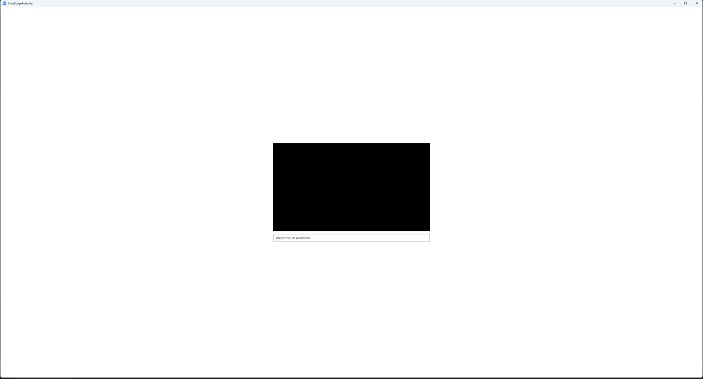

# Instalar los SDK .NET de VisioForge en una aplicación Avalonia

[Video Capture SDK .NET](https://www.visioforge.com/video-capture-sdk-net){ .md-button .md-button--primary target="_blank" } [Video Edit SDK .NET](https://www.visioforge.com/video-edit-sdk-net){ .md-button .md-button--primary target="_blank" } [Media Blocks SDK .NET](https://www.visioforge.com/media-blocks-sdk-net){ .md-button .md-button--primary target="_blank" } [Media Player SDK .NET](https://www.visioforge.com/media-player-sdk-net){ .md-button .md-button--primary target="_blank" }

Esta guía instala los SDK .NET de VisioForge en una aplicación Avalonia 12.1 con destinos Desktop, Android e iOS, y pone un `VideoView` en su vista principal. Termina con una aplicación que compila y se ejecuta en el destino Desktop en Windows.

Los cuatro SDK — Video Capture SDK .NET, Media Player SDK .NET, Video Edit SDK .NET y Media Blocks SDK .NET — vienen en un solo paquete NuGet, [VisioForge.DotNet.Core](https://www.nuget.org/packages/VisioForge.DotNet.Core). El `VideoView` de Avalonia está en [VisioForge.DotNet.Core.UI.Avalonia](https://www.nuget.org/packages/VisioForge.DotNet.Core.UI.Avalonia). Cada plataforma lleva además un paquete redist, su motor nativo (en Linux solo las bibliotecas propias del SDK; GStreamer viene del sistema), y Android lleva el proyecto de enlace de VisioForge, `AndroidDependency`, desde GitHub.

## Tutorial en vídeo

El vídeo crea la aplicación, instala los paquetes en Visual Studio 2026 y la ejecuta:

<div class="video-wrapper">
  <iframe src="https://www.youtube.com/embed/AOelvS3yVsw?controls=1" frameborder="0" allowfullscreen></iframe>
</div>

## Requisitos

- Windows 10 u 11, x64
- Visual Studio 2026 y el SDK de .NET 10, con las cargas de trabajo de Android e iOS para compilar esos destinos
- Git
- Un Mac con Xcode, emparejado con Visual Studio, para compilar el destino iOS
- Un Mac con Xcode y la carga de trabajo de macOS de .NET para compilar el destino Desktop para macOS
- En Linux, GStreamer instalado desde los paquetes de la distribución; consulte la [implementación en Ubuntu](../deployment-x/Ubuntu.md)

`VisioForge.DotNet.Core.UI.Avalonia` está compilado para Avalonia 12.1, así que la aplicación se crea con las plantillas de Avalonia 12.1.6.

## Crear la aplicación

En Developer PowerShell, instale las plantillas de Avalonia, cree la aplicación, quite su destino Browser y descargue el proyecto de enlace de Android:

```powershell
cd $HOME\source\repos
dotnet new install Avalonia.Templates@12.1.6
dotnet new avalonia.xplat -o VisioForgeAvalonia
cd VisioForgeAvalonia
dotnet sln remove VisioForgeAvalonia.Browser\VisioForgeAvalonia.Browser.csproj
git clone --depth 1 --filter=blob:none --sparse https://github.com/visioforge/.Net-SDK-s-samples.git samples
git -C samples sparse-checkout set AndroidDependency
dotnet sln add samples\AndroidDependency\VisioForge.Core.Android.X10.csproj
devenv VisioForgeAvalonia.slnx
```

`avalonia.xplat` genera un proyecto compartido para las vistas (`VisioForgeAvalonia`) y un proyecto de destino para cada plataforma: Desktop, Android, iOS y Browser. El SDK no tiene motor para el navegador, así que el destino Browser sale de la solución. El clon disperso extrae solo `AndroidDependency` del [repositorio de ejemplos](https://github.com/visioforge/.Net-SDK-s-samples/tree/master/AndroidDependency), y `dotnet sln add` lo añade a la solución, para que Visual Studio lo restaure junto con la aplicación.

Visual Studio puede pedirle que acepte la licencia del SDK de Android al cargar la solución. Al aceptarla se instala el SDK de Android, que el destino Android necesita para compilar.

## Instalar los paquetes

Haga clic derecho en el proyecto compartido, `VisioForgeAvalonia`, abra **Manage NuGet Packages** y la pestaña **Browse**. Instale `VisioForge.DotNet.Core`, después `VisioForge.DotNet.Core.UI.Avalonia`, y acepte la licencia.

La plantilla de Avalonia usa la administración central de paquetes, así que NuGet escribe las versiones en `Directory.Packages.props` y el archivo de proyecto recibe referencias sin ellas. La plantilla deja `Directory.Packages.props` fuera de la solución: ábralo con **File > Open > File** y añada una versión para cada redist debajo de los dos paquetes de VisioForge:

```xml
<ItemGroup>
  <PackageVersion Include="VisioForge.DotNet.Core" Version="2026.11.25" />
  <PackageVersion Include="VisioForge.DotNet.Core.UI.Avalonia" Version="2026.11.25" />
  <PackageVersion Include="VisioForge.CrossPlatform.Core.Windows.x64" Version="2026.11.25" />
  <PackageVersion Include="VisioForge.CrossPlatform.Libav.Windows.x64.UPX" Version="2026.11.25" />
  <PackageVersion Include="VisioForge.CrossPlatform.Core.macOS" Version="2026.11.22" />
  <PackageVersion Include="VisioForge.CrossPlatform.Core.Android" Version="2026.11.25" />
  <PackageVersion Include="VisioForge.CrossPlatform.Core.iOS" Version="2026.11.23" />
  <PackageVersion Include="VisioForge.CrossPlatform.Core.Linux.x64" Version="2026.10.26" />
  <PackageVersion Include="VisioForge.CrossPlatform.Core.Linux.arm64" Version="2026.10.26" />
</ItemGroup>
```

Tome las últimas versiones de [nuget.org](https://www.nuget.org/profiles/visioforge). Los redists de macOS, Android, iOS y Linux se publican con su propio calendario, por eso sus versiones difieren de las del SDK. Windows lleva dos redists, el motor nativo y los códecs Libav (`.UPX` es la compilación de tamaño reducido); macOS, Android e iOS llevan uno cada uno, y Linux lleva el paquete core de su arquitectura, que no contiene GStreamer. El video se grabó antes de añadir las líneas del paquete core de Linux, aquí y en el destino Desktop, por eso no aparecen en él.

## El destino Desktop

Cada destino lleva su redist en su propio archivo de proyecto. Haga clic derecho en `VisioForgeAvalonia.Desktop`, seleccione **Edit Project File** y añada estos bloques al final, antes de `</Project>`:

```xml
<PropertyGroup Condition="$([MSBuild]::IsOsPlatform('Windows'))">
  <TargetFramework>net10.0-windows</TargetFramework>
</PropertyGroup>
<PropertyGroup Condition="$([MSBuild]::IsOsPlatform('OSX'))">
  <TargetFramework>net10.0-macos</TargetFramework>
  <ApplicationId>com.companyname.visioforgeavalonia</ApplicationId>
  <OutputType>Exe</OutputType>
</PropertyGroup>
<ItemGroup Condition="$([MSBuild]::IsOsPlatform('Windows'))">
  <PackageReference Include="VisioForge.CrossPlatform.Core.Windows.x64" />
  <PackageReference Include="VisioForge.CrossPlatform.Libav.Windows.x64.UPX" />
</ItemGroup>
<ItemGroup Condition="$([MSBuild]::IsOsPlatform('OSX'))">
  <PackageReference Include="VisioForge.CrossPlatform.Core.macOS" />
</ItemGroup>
<ItemGroup Condition="$([MSBuild]::IsOsPlatform('Linux')) or $(RuntimeIdentifier.StartsWith('linux-'))">
  <PackageReference Include="VisioForge.CrossPlatform.Core.Linux.arm64" Condition="$(RuntimeIdentifier.EndsWith('-arm64')) or ('$(RuntimeIdentifier)' == '' and $(NETCoreSdkRuntimeIdentifier.EndsWith('-arm64')))" />
  <PackageReference Include="VisioForge.CrossPlatform.Core.Linux.x64" Condition="!($(RuntimeIdentifier.EndsWith('-arm64')) or ('$(RuntimeIdentifier)' == '' and $(NETCoreSdkRuntimeIdentifier.EndsWith('-arm64'))))" />
</ItemGroup>
```

La plantilla compila el destino Desktop para `net10.0` sin más, y los motores de Windows y macOS del SDK necesitan el framework propio del sistema operativo. Las propiedades posteriores sustituyen a las de la plantilla: `net10.0-windows` en Windows, y `net10.0-macos` en un Mac, un paquete de aplicación, que necesita un identificador de aplicación. Linux mantiene `net10.0` y usa el GStreamer instalado en el sistema, consulte la [implementación en Ubuntu](../deployment-x/Ubuntu.md); el último bloque, que se aplica cuando el destino se compila en Linux o se publica para un identificador de runtime `linux-*`, le añade el paquete core de su arquitectura, que contiene las bibliotecas nativas propias del SDK. Las referencias no llevan versiones: estas vienen de `Directory.Packages.props`.

## El destino Android

Abra **Edit Project File** en `VisioForgeAvalonia.Android`. En el primer `PropertyGroup` de la plantilla, cambie la línea `SupportedOSPlatformVersion` a 24:

```xml
<SupportedOSPlatformVersion>24</SupportedOSPlatformVersion>
```

Después añada el redist y `AndroidDependency` al final del archivo, antes de `</Project>`:

```xml
<ItemGroup>
  <PackageReference Include="VisioForge.CrossPlatform.Core.Android" />
  <ProjectReference Include="..\samples\AndroidDependency\VisioForge.Core.Android.X10.csproj" />
</ItemGroup>
```

Android 7 (nivel de API 24) es el mínimo del SDK en Android. `VisioForge.Core.Android.X10.csproj` tiene como destino `net10.0-android`, y una aplicación `net11.0-android` también lo referencia.

## El destino iOS

Abra **Edit Project File** en `VisioForgeAvalonia.iOS`. En el primer `PropertyGroup` de la plantilla, cambie la línea `SupportedOSPlatformVersion` a 18.0:

```xml
<SupportedOSPlatformVersion>18.0</SupportedOSPlatformVersion>
```

Después añada el redist al final del archivo, antes de `</Project>`:

```xml
<ItemGroup>
  <PackageReference Include="VisioForge.CrossPlatform.Core.iOS" />
</ItemGroup>
```

iOS 18.0 es el mínimo de las bibliotecas nativas de iOS. Después haga clic derecho en el `Info.plist` del destino iOS, elija **Open With** y **XML (Text) Editor**, cambie el valor bajo la clave `MinimumOSVersion` de la plantilla a `<string>18.0</string>`, la misma versión. Después añada un manifiesto de escenas, la única clave nueva, encima de `UIRequiredDeviceCapabilities`:

```xml
<key>UIApplicationSceneManifest</key>
<dict>
  <key>UIApplicationSupportsMultipleScenes</key>
  <false/>
</dict>
```

Una aplicación compilada con el SDK de iOS 27 debe usar el ciclo de vida de escenas de UIKit (si no, la compilación se detiene con `MT7199`). Basta con una escena: el delegado de aplicación de Avalonia 12.1 aporta él mismo la configuración de la escena.

Compile el destino iOS con el SDK de .NET 10. El SDK de .NET 11 asigna `net10.0-ios` a iOS 26.0, por debajo de los recursos de iOS de SkiaSharp 3.119.4 (`net10.0-ios26.2`), y la aplicación se detiene al iniciarse con `DllNotFoundException: libSkiaSharp`. Fije el SDK con un `global.json` si tiene ambos instalados.

## Añadir VideoView a la vista

En el proyecto compartido, abra `Views/MainView.axaml`. Asigne el espacio de nombres de VisioForge a un prefijo, aquí `vf`, junto a los espacios de nombres de la propia plantilla, y sustituya el `TextBox` de la plantilla por un `StackPanel` que contenga un `VideoView` encima del mismo `TextBox`:

El archivo completo después de la edición:

```xml
<UserControl xmlns="https://github.com/avaloniaui"
             xmlns:x="http://schemas.microsoft.com/winfx/2006/xaml"
             xmlns:d="http://schemas.microsoft.com/expression/blend/2008"
             xmlns:mc="http://schemas.openxmlformats.org/markup-compatibility/2006"
             xmlns:vm="using:VisioForgeAvalonia.ViewModels"
             xmlns:vf="using:VisioForge.Core.UI.Avalonia"
             mc:Ignorable="d" d:DesignWidth="800" d:DesignHeight="450"
             x:Class="VisioForgeAvalonia.Views.MainView"
             x:DataType="vm:MainViewModel">
    <Design.DataContext>
        <vm:MainViewModel />
    </Design.DataContext>

    <StackPanel HorizontalAlignment="Center" VerticalAlignment="Center" Spacing="12">
        <vf:VideoView Width="640" Height="360" Background="Black" />
        <TextBox Text="{Binding Greeting}" />
    </StackPanel>
</UserControl>
```

El espacio de nombres es `VisioForge.Core.UI.Avalonia`, del paquete `VisioForge.DotNet.Core.UI.Avalonia`. El tamaño es solo para esta demostración; dé al `VideoView` un `x:Name` para acceder a él desde el código.

## Ejecutarla

Haga clic derecho en `VisioForgeAvalonia.Desktop`, seleccione **Set as Startup Project** e inicie la aplicación sin depurar (Ctrl+F5). Visual Studio compila el destino Desktop para Windows con los redists de Windows. La aplicación se abre con el `VideoView` encima de *Welcome to Avalonia!*, en negro hasta que un motor del SDK dibuje en él.



## Inicializar el SDK

Antes del primer motor, inicialice el SDK y libérelo al salir. En el `App.axaml.cs` del proyecto compartido, añada `using VisioForge.Core;` y dos líneas al `OnFrameworkInitializationCompleted` de la plantilla:

```csharp
public override void OnFrameworkInitializationCompleted()
{
    VisioForgeX.InitSDK();

    if (ApplicationLifetime is IClassicDesktopStyleApplicationLifetime desktop)
    {
        desktop.Exit += (_, _) => VisioForgeX.DestroySDK();
        // ... el código de la plantilla
    }
    // ... las demás ramas de la plantilla y la llamada a base
}
```

`InitSDK` se ejecuta una vez en cada destino; `Exit` se produce en el destino Desktop. Para inicializar sin bloquear el hilo de la interfaz, llame en su lugar a `await VisioForgeX.InitSDKAsync()` desde un controlador de eventos `async`, como el `Loaded` de la ventana principal.

Android necesita los permisos de cámara y micrófono en `AndroidManifest.xml`, e iOS y macOS las descripciones de uso en `Info.plist` (`NSCameraUsageDescription`, `NSMicrophoneUsageDescription`). Las guías de implementación para [Windows](../deployment-x/Windows.md), [macOS](../deployment-x/macOS.md), [Ubuntu](../deployment-x/Ubuntu.md), [Android](../deployment-x/Android.md) e [iOS](../deployment-x/iOS.md) los describen, junto con las dependencias nativas y la solución de problemas. La [inicialización del SDK](../init.md) explica `InitSDKAsync` y `DestroySDK` en detalle.

## Aplicaciones de ejemplo

Aplicaciones Avalonia completas con un proyecto compartido y destinos Desktop, Android e iOS, como la aplicación de esta guía:

- [Media Player SDK X/Avalonia/SimplePlayerMVVM](https://github.com/visioforge/.Net-SDK-s-samples/tree/master/Media%20Player%20SDK%20X/Avalonia/SimplePlayerMVVM)
- [Media Blocks SDK/Avalonia/SimplePlayerMVVM](https://github.com/visioforge/.Net-SDK-s-samples/tree/master/Media%20Blocks%20SDK/Avalonia/SimplePlayerMVVM)
- [Media Blocks SDK/Avalonia/SimpleVideoCaptureMVVM](https://github.com/visioforge/.Net-SDK-s-samples/tree/master/Media%20Blocks%20SDK/Avalonia/SimpleVideoCaptureMVVM)
- [Media Blocks SDK/Avalonia/VideoMixerMVVM](https://github.com/visioforge/.Net-SDK-s-samples/tree/master/Media%20Blocks%20SDK/Avalonia/VideoMixerMVVM)

Los demás ejemplos de Avalonia son aplicaciones de escritorio: [Media Player SDK X/Avalonia](https://github.com/visioforge/.Net-SDK-s-samples/tree/master/Media%20Player%20SDK%20X/Avalonia), [Video Capture SDK X/Avalonia](https://github.com/visioforge/.Net-SDK-s-samples/tree/master/Video%20Capture%20SDK%20X/Avalonia) y [Media Blocks SDK/Avalonia](https://github.com/visioforge/.Net-SDK-s-samples/tree/master/Media%20Blocks%20SDK/Avalonia).

## Transcripción del vídeo

### Introducción

Instalemos los SDK .NET de VisioForge en una aplicación Avalonia, con destinos Desktop, Android e iOS, y pongamos un VideoView en su vista principal. Los cuatro SDK .NET de VisioForge vienen en un solo paquete NuGet, VisioForge.DotNet.Core. El VideoView de Avalonia está en VisioForge.DotNet.Core.UI.Avalonia. Cada plataforma lleva además un paquete redist, su motor nativo, y Android lleva el proyecto de enlace de VisioForge, AndroidDependency, desde GitHub. Necesita Windows 10 u 11, Visual Studio 2026 y el SDK de .NET 10, con las cargas de trabajo de Android e iOS para compilar esos destinos, y Git. El paquete de Avalonia de VisioForge está compilado para Avalonia 12.1, así que este vídeo crea la aplicación con las plantillas de Avalonia 12.1.6.

### Crear la aplicación

Abra Developer PowerShell desde el menú Inicio y vaya a su carpeta de proyectos. Instale las plantillas de Avalonia, versión 12.1.6. Cree la aplicación con dotnet new avalonia.xplat. Genera un proyecto compartido para las vistas y un proyecto de destino para cada plataforma: Desktop, Android, iOS y Browser. El SDK no tiene motor para el navegador, así que quite el destino Browser de la solución con dotnet sln remove. En la carpeta de la solución, clone el repositorio de ejemplos de VisioForge de forma dispersa, extraiga solo AndroidDependency, el proyecto de enlace de Android, y añádalo a la solución con dotnet sln add. Después abra la solución en Visual Studio. Aquí están todos los comandos. Visual Studio puede pedirle que acepte la licencia del SDK de Android al cargar la solución: así se instala el SDK de Android, que el destino Android necesita para compilar.

### NuGet

Ahora NuGet. Haga clic derecho en el proyecto compartido, VisioForgeAvalonia, abra Manage NuGet Packages y la pestaña Browse. Busque VisioForge.DotNet.Core e instálelo. Visual Studio muestra los cambios y la licencia: acéptelos. Después instale VisioForge.DotNet.Core.UI.Avalonia, que contiene el VideoView de Avalonia. Ambos están en la pestaña Installed. La plantilla usa la administración central de paquetes, así que sus versiones se escribieron en Directory.Packages.props.

### Redists

Ahora los redist. La plantilla deja Directory.Packages.props fuera de la solución, así que ábralo con File, Open, y añada una versión para cada redist debajo de los dos paquetes de VisioForge. Windows lleva dos, el motor nativo y los códecs de Libav. macOS, Android e iOS llevan uno cada uno. Esta es la lista completa: los dos paquetes de NuGet y los cinco redist. Use las versiones más recientes de nuget.org.

### Destino Desktop

Cada destino lleva su redist en su propio archivo de proyecto. Haga clic derecho en el destino Desktop y abra Edit Project File. Añada los bloques al final del archivo, cada uno con la condición del sistema operativo que lo compila, y guarde. La plantilla compila el destino Desktop para net10.0 sin más, y los motores de Windows y macOS del SDK necesitan el framework propio del sistema operativo. En Windows es net10.0-windows. En un Mac es net10.0-macos, un paquete de aplicación, que necesita un identificador de aplicación. Linux mantiene net10.0. Windows lleva el motor y Libav, y macOS su motor. Las referencias no llevan versiones: estas vienen de Directory.Packages.props. En Linux, el SDK usa el GStreamer instalado en el sistema.

### Android e iOS

Ahora el destino Android: de nuevo Edit Project File. Suba el mínimo a Android 7, nivel de API 24, el mínimo del SDK en Android. Después añada el redist de Android y una referencia al proyecto AndroidDependency de la carpeta samples. La versión mínima sustituye la línea de la propia plantilla. El resto va al final del archivo. Sigue el destino iOS. Suba su mínimo a iOS 18, el mínimo del SDK en iOS, y añada el redist de iOS. Los mismos dos cambios que en Android: la versión mínima y la referencia al redist al final. El destino iOS tiene un archivo más, Info.plist. Haga clic derecho en él, elija Open With y el editor de texto XML. Ponga MinimumOSVersion en 18.0, para que coincida con el proyecto, y añada un manifiesto de escenas encima de las capacidades del dispositivo. El SDK de iOS 27 rechaza una aplicación sin manifiesto de escenas. Basta con una escena, y Avalonia aporta su configuración.

### VideoView

Ahora la vista. En el proyecto compartido, abra MainView.axaml desde la carpeta Views. Asigne el espacio de nombres de VisioForge a un prefijo, aquí vf, junto a los espacios de nombres de la plantilla. Y sustituya el TextBox de la plantilla por un StackPanel que contenga un VideoView encima del mismo TextBox. Después guarde. En Avalonia, el espacio de nombres es VisioForge.Core.UI.Avalonia, del paquete VisioForge.DotNet.Core.UI.Avalonia. El tamaño es solo para esta demostración.

### Ejecutarla

Establezca el destino Desktop como proyecto de inicio. E inícielo sin depurar. Visual Studio compila el destino Desktop para Windows, con los redist de Windows. La aplicación se abre, con el VideoView encima del saludo. Queda en negro hasta que un motor del SDK dibuja en él.

### Próximos pasos

Antes del primer motor, inicialice el SDK con VisioForgeX.InitSDKAsync y libérelo con DestroySDK al salir. Android necesita los permisos de cámara y micrófono en su manifiesto, e iOS y macOS las descripciones de uso en Info.plist. La implementación de cada plataforma está en el sitio de ayuda.

## Consulte también

- [Inicialización del SDK](../init.md) — `InitSDKAsync` y `DestroySDK` en detalle
- Guías de instalación para [Visual Studio](visual-studio.md), [MAUI](maui.md), [Uno Platform](uno.md) y [Rider](rider.md)
- Implementación en [Windows](../deployment-x/Windows.md), [macOS](../deployment-x/macOS.md), [Ubuntu](../deployment-x/Ubuntu.md), [Android](../deployment-x/Android.md) e [iOS](../deployment-x/iOS.md)
