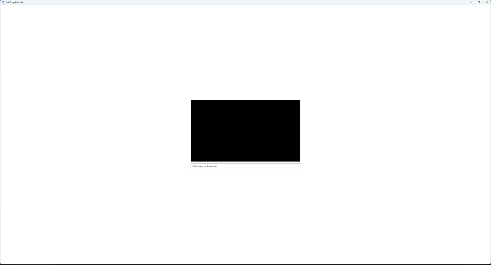

# Installer les SDK .NET VisioForge dans une application Avalonia

[Video Capture SDK .NET](https://www.visioforge.com/video-capture-sdk-net){ .md-button .md-button--primary target="_blank" } [Video Edit SDK .NET](https://www.visioforge.com/video-edit-sdk-net){ .md-button .md-button--primary target="_blank" } [Media Blocks SDK .NET](https://www.visioforge.com/media-blocks-sdk-net){ .md-button .md-button--primary target="_blank" } [Media Player SDK .NET](https://www.visioforge.com/media-player-sdk-net){ .md-button .md-button--primary target="_blank" }

Ce guide installe les SDK .NET VisioForge dans une application Avalonia 12.1 avec des cibles Desktop, Android et iOS, et place un `VideoView` dans sa vue principale. Il se termine par une application qui se compile et se lance sur la cible Desktop sous Windows.

Les quatre SDK — Video Capture SDK .NET, Media Player SDK .NET, Video Edit SDK .NET et Media Blocks SDK .NET — sont fournis dans un seul paquet NuGet, [VisioForge.DotNet.Core](https://www.nuget.org/packages/VisioForge.DotNet.Core). Le `VideoView` d'Avalonia se trouve dans [VisioForge.DotNet.Core.UI.Avalonia](https://www.nuget.org/packages/VisioForge.DotNet.Core.UI.Avalonia). Chaque plateforme prend en plus un paquet redist, son moteur natif (sous Linux, uniquement les bibliothèques propres au SDK ; GStreamer vient du système), et Android prend le projet de liaison VisioForge, `AndroidDependency`, depuis GitHub.

## Tutoriel vidéo

La vidéo crée l'application, installe les paquets dans Visual Studio 2026 et la lance :

<div class="video-wrapper">
  <iframe src="https://www.youtube.com/embed/AOelvS3yVsw?controls=1" frameborder="0" allowfullscreen></iframe>
</div>

## Prérequis

- Windows 10 ou 11, x64
- Visual Studio 2026 et le SDK .NET 10, avec les charges de travail Android et iOS pour compiler ces cibles
- Git
- Un Mac avec Xcode, couplé à Visual Studio, pour compiler la cible iOS
- Un Mac avec Xcode et la charge de travail macOS de .NET pour compiler la cible Desktop pour macOS
- Sous Linux, GStreamer installé depuis les paquets de la distribution ; voir le [déploiement sous Ubuntu](../deployment-x/Ubuntu.md)

`VisioForge.DotNet.Core.UI.Avalonia` est compilé pour Avalonia 12.1 : l'application est donc créée à partir des modèles Avalonia 12.1.6.

## Créer l'application

Dans Developer PowerShell, installez les modèles Avalonia, créez l'application, retirez sa cible Browser et récupérez le projet de liaison Android :

```powershell
cd $HOME\source\repos
dotnet new install Avalonia.Templates@12.1.6
dotnet new avalonia.xplat -o VisioForgeAvalonia
cd VisioForgeAvalonia
dotnet sln remove VisioForgeAvalonia.Browser\VisioForgeAvalonia.Browser.csproj
git clone --depth 1 --filter=blob:none --sparse https://github.com/visioforge/.Net-SDK-s-samples.git samples
git -C samples sparse-checkout set AndroidDependency
dotnet sln add samples\AndroidDependency\VisioForge.Core.Android.X10.csproj
devenv VisioForgeAvalonia.slnx
```

`avalonia.xplat` crée un projet partagé pour les vues (`VisioForgeAvalonia`) et un projet cible pour chaque plateforme : Desktop, Android, iOS et Browser. Le SDK n'a pas de moteur pour le navigateur : la cible Browser quitte donc la solution. Le clone clairsemé n'extrait qu'`AndroidDependency` du [dépôt d'exemples](https://github.com/visioforge/.Net-SDK-s-samples/tree/master/AndroidDependency), et `dotnet sln add` l'ajoute à la solution, pour que Visual Studio le restaure avec l'application.

Visual Studio peut vous demander d'accepter la licence du SDK Android au chargement de la solution. L'accepter installe le SDK Android, dont la cible Android a besoin pour compiler.

## Installer les paquets

Faites un clic droit sur le projet partagé, `VisioForgeAvalonia`, ouvrez **Manage NuGet Packages**, puis l'onglet **Browse**. Installez `VisioForge.DotNet.Core`, puis `VisioForge.DotNet.Core.UI.Avalonia`, et acceptez la licence.

Le modèle Avalonia utilise la gestion centralisée des paquets : NuGet écrit donc les versions dans `Directory.Packages.props`, et le fichier de projet reçoit des références sans version. Le modèle laisse `Directory.Packages.props` hors de la solution : ouvrez-le avec **File > Open > File** et ajoutez une version pour chaque redist sous les deux paquets VisioForge :

```xml
<ItemGroup>
  <PackageVersion Include="VisioForge.DotNet.Core" Version="2026.11.23" />
  <PackageVersion Include="VisioForge.DotNet.Core.UI.Avalonia" Version="2026.11.23" />
  <PackageVersion Include="VisioForge.CrossPlatform.Core.Windows.x64" Version="2026.11.16" />
  <PackageVersion Include="VisioForge.CrossPlatform.Libav.Windows.x64.UPX" Version="2026.11.16" />
  <PackageVersion Include="VisioForge.CrossPlatform.Core.macOS" Version="2026.11.22" />
  <PackageVersion Include="VisioForge.CrossPlatform.Core.Android" Version="2026.11.5" />
  <PackageVersion Include="VisioForge.CrossPlatform.Core.iOS" Version="2026.11.23" />
  <PackageVersion Include="VisioForge.CrossPlatform.Core.Linux.x64" Version="2026.10.26" />
  <PackageVersion Include="VisioForge.CrossPlatform.Core.Linux.arm64" Version="2026.10.26" />
</ItemGroup>
```

Prenez les dernières versions sur [nuget.org](https://www.nuget.org/profiles/visioforge). Les redists macOS, Android, iOS et Linux sont publiés à leur propre rythme : leurs versions diffèrent donc de celles du SDK. Windows prend deux redists, le moteur natif et les codecs Libav (`.UPX` est la version de taille réduite) ; macOS, Android et iOS en prennent un chacun, et Linux prend le paquet core de son architecture, qui ne contient pas GStreamer. La vidéo a été enregistrée avant l'ajout des lignes du paquet core Linux, ici et dans la cible Desktop : elle ne les montre donc pas.

## La cible Desktop

Chaque cible prend son redist dans son propre fichier de projet. Faites un clic droit sur `VisioForgeAvalonia.Desktop`, sélectionnez **Edit Project File** et ajoutez ces blocs à la fin, avant `</Project>` :

```xml
<PropertyGroup Condition="$([MSBuild]::IsOsPlatform('Windows'))">
  <TargetFramework>net10.0-windows</TargetFramework>
</PropertyGroup>
<PropertyGroup Condition="$([MSBuild]::IsOsPlatform('OSX'))">
  <TargetFramework>net10.0-macos</TargetFramework>
  <ApplicationId>com.companyname.visioforgeavalonia</ApplicationId>
  <OutputType>Exe</OutputType>
</PropertyGroup>
<ItemGroup Condition="$([MSBuild]::IsOsPlatform('Windows'))">
  <PackageReference Include="VisioForge.CrossPlatform.Core.Windows.x64" />
  <PackageReference Include="VisioForge.CrossPlatform.Libav.Windows.x64.UPX" />
</ItemGroup>
<ItemGroup Condition="$([MSBuild]::IsOsPlatform('OSX'))">
  <PackageReference Include="VisioForge.CrossPlatform.Core.macOS" />
</ItemGroup>
<ItemGroup Condition="$([MSBuild]::IsOsPlatform('Linux')) or $(RuntimeIdentifier.StartsWith('linux-'))">
  <PackageReference Include="VisioForge.CrossPlatform.Core.Linux.arm64" Condition="$(RuntimeIdentifier.EndsWith('-arm64')) or ('$(RuntimeIdentifier)' == '' and $(NETCoreSdkRuntimeIdentifier.EndsWith('-arm64')))" />
  <PackageReference Include="VisioForge.CrossPlatform.Core.Linux.x64" Condition="!($(RuntimeIdentifier.EndsWith('-arm64')) or ('$(RuntimeIdentifier)' == '' and $(NETCoreSdkRuntimeIdentifier.EndsWith('-arm64'))))" />
</ItemGroup>
```

Le modèle compile la cible Desktop pour `net10.0` tout court, et les moteurs Windows et macOS du SDK ont besoin du framework propre au système d'exploitation. Les propriétés placées après remplacent celles du modèle : `net10.0-windows` sous Windows, et `net10.0-macos` sur un Mac, un bundle d'application, qui a besoin d'un identifiant d'application. Linux garde `net10.0` et utilise le GStreamer installé sur le système, voir le [déploiement sous Ubuntu](../deployment-x/Ubuntu.md) ; le dernier bloc, appliqué lorsque la cible est compilée sous Linux ou publiée pour un identificateur de runtime `linux-*`, lui ajoute le paquet core de son architecture, qui contient les bibliothèques natives propres au SDK. Les références ne portent pas de version : celles-ci viennent de `Directory.Packages.props`.

## La cible Android

Ouvrez **Edit Project File** sur `VisioForgeAvalonia.Android`. Dans le premier `PropertyGroup` du modèle, passez la ligne `SupportedOSPlatformVersion` à 24 :

```xml
<SupportedOSPlatformVersion>24</SupportedOSPlatformVersion>
```

Ajoutez ensuite le redist et `AndroidDependency` à la fin du fichier, avant `</Project>` :

```xml
<ItemGroup>
  <PackageReference Include="VisioForge.CrossPlatform.Core.Android" />
  <ProjectReference Include="..\samples\AndroidDependency\VisioForge.Core.Android.X10.csproj" />
</ItemGroup>
```

Android 7 (niveau d'API 24) est le minimum du SDK sous Android. `VisioForge.Core.Android.X10.csproj` cible `net10.0-android`, et une application `net11.0-android` le référence aussi.

## La cible iOS

Ouvrez **Edit Project File** sur `VisioForgeAvalonia.iOS`. Dans le premier `PropertyGroup` du modèle, passez la ligne `SupportedOSPlatformVersion` à 18.0 :

```xml
<SupportedOSPlatformVersion>18.0</SupportedOSPlatformVersion>
```

Ajoutez ensuite le redist à la fin du fichier, avant `</Project>` :

```xml
<ItemGroup>
  <PackageReference Include="VisioForge.CrossPlatform.Core.iOS" />
</ItemGroup>
```

iOS 18.0 est le minimum des bibliothèques natives iOS. Faites ensuite un clic droit sur le `Info.plist` de la cible iOS, choisissez **Open With** et **XML (Text) Editor**, remplacez la valeur sous la clé `MinimumOSVersion` du modèle par `<string>18.0</string>`, la même version. Ajoutez ensuite un manifeste de scènes, la seule clé nouvelle, au-dessus de `UIRequiredDeviceCapabilities` :

```xml
<key>UIApplicationSceneManifest</key>
<dict>
  <key>UIApplicationSupportsMultipleScenes</key>
  <false/>
</dict>
```

Une application compilée avec le SDK iOS 27 doit utiliser le cycle de vie des scènes UIKit (sinon la compilation s'arrête avec `MT7199`). Une seule scène suffit : le délégué d'application d'Avalonia 12.1 fournit lui-même la configuration de la scène.

Compilez la cible iOS avec le SDK .NET 10. Le SDK .NET 11 associe `net10.0-ios` à iOS 26.0, en dessous des ressources iOS de SkiaSharp 3.119.4 (`net10.0-ios26.2`), et l'application s'arrête alors au lancement avec `DllNotFoundException: libSkiaSharp`. Fixez le SDK avec un `global.json` si les deux sont installés.

## Ajouter VideoView à la vue

Dans le projet partagé, ouvrez `Views/MainView.axaml`. Associez l'espace de noms VisioForge à un préfixe, ici `vf`, à côté des espaces de noms du modèle, et remplacez le `TextBox` du modèle par un `StackPanel` qui contient un `VideoView` au-dessus du même `TextBox` :

Le fichier complet après la modification :

```xml
<UserControl xmlns="https://github.com/avaloniaui"
             xmlns:x="http://schemas.microsoft.com/winfx/2006/xaml"
             xmlns:d="http://schemas.microsoft.com/expression/blend/2008"
             xmlns:mc="http://schemas.openxmlformats.org/markup-compatibility/2006"
             xmlns:vm="using:VisioForgeAvalonia.ViewModels"
             xmlns:vf="using:VisioForge.Core.UI.Avalonia"
             mc:Ignorable="d" d:DesignWidth="800" d:DesignHeight="450"
             x:Class="VisioForgeAvalonia.Views.MainView"
             x:DataType="vm:MainViewModel">
    <Design.DataContext>
        <vm:MainViewModel />
    </Design.DataContext>

    <StackPanel HorizontalAlignment="Center" VerticalAlignment="Center" Spacing="12">
        <vf:VideoView Width="640" Height="360" Background="Black" />
        <TextBox Text="{Binding Greeting}" />
    </StackPanel>
</UserControl>
```

L'espace de noms est `VisioForge.Core.UI.Avalonia`, du paquet `VisioForge.DotNet.Core.UI.Avalonia`. La taille ne sert qu'à cette démo ; donnez un `x:Name` au `VideoView` pour y accéder depuis le code.

## Lancement

Faites un clic droit sur `VisioForgeAvalonia.Desktop`, sélectionnez **Set as Startup Project** et lancez l'application sans débogage (Ctrl+F5). Visual Studio compile la cible Desktop pour Windows avec les redists Windows. L'application s'ouvre avec le `VideoView` au-dessus de *Welcome to Avalonia!*, noir tant qu'un moteur du SDK n'y dessine pas.



## Initialiser le SDK

Avant le premier moteur, initialisez le SDK, et libérez-le à la fermeture. Dans le `App.axaml.cs` du projet partagé, ajoutez `using VisioForge.Core;` et deux lignes dans le `OnFrameworkInitializationCompleted` du modèle :

```csharp
public override void OnFrameworkInitializationCompleted()
{
    VisioForgeX.InitSDK();

    if (ApplicationLifetime is IClassicDesktopStyleApplicationLifetime desktop)
    {
        desktop.Exit += (_, _) => VisioForgeX.DestroySDK();
        // ... le code du modèle
    }
    // ... les autres branches du modèle et l'appel à base
}
```

`InitSDK` s'exécute une fois sur chaque cible ; `Exit` est déclenché sur la cible Desktop. Pour initialiser sans bloquer le thread d'interface, appelez plutôt `await VisioForgeX.InitSDKAsync()` depuis un gestionnaire d'événements `async`, comme le `Loaded` de la fenêtre principale.

Android a besoin des autorisations de caméra et de microphone dans `AndroidManifest.xml`, et iOS et macOS des descriptions d'utilisation dans `Info.plist` (`NSCameraUsageDescription`, `NSMicrophoneUsageDescription`). Les guides de déploiement pour [Windows](../deployment-x/Windows.md), [macOS](../deployment-x/macOS.md), [Ubuntu](../deployment-x/Ubuntu.md), [Android](../deployment-x/Android.md) et [iOS](../deployment-x/iOS.md) les décrivent, avec les dépendances natives et le dépannage. L'[initialisation du SDK](../init.md) détaille `InitSDKAsync` et `DestroySDK`.

## Applications d'exemple

Des applications Avalonia complètes avec un projet partagé et des cibles Desktop, Android et iOS, comme l'application de ce guide :

- [Media Player SDK X/Avalonia/SimplePlayerMVVM](https://github.com/visioforge/.Net-SDK-s-samples/tree/master/Media%20Player%20SDK%20X/Avalonia/SimplePlayerMVVM)
- [Media Blocks SDK/Avalonia/SimplePlayerMVVM](https://github.com/visioforge/.Net-SDK-s-samples/tree/master/Media%20Blocks%20SDK/Avalonia/SimplePlayerMVVM)
- [Media Blocks SDK/Avalonia/SimpleVideoCaptureMVVM](https://github.com/visioforge/.Net-SDK-s-samples/tree/master/Media%20Blocks%20SDK/Avalonia/SimpleVideoCaptureMVVM)
- [Media Blocks SDK/Avalonia/VideoMixerMVVM](https://github.com/visioforge/.Net-SDK-s-samples/tree/master/Media%20Blocks%20SDK/Avalonia/VideoMixerMVVM)

Les autres exemples Avalonia sont des applications de bureau : [Media Player SDK X/Avalonia](https://github.com/visioforge/.Net-SDK-s-samples/tree/master/Media%20Player%20SDK%20X/Avalonia), [Video Capture SDK X/Avalonia](https://github.com/visioforge/.Net-SDK-s-samples/tree/master/Video%20Capture%20SDK%20X/Avalonia) et [Media Blocks SDK/Avalonia](https://github.com/visioforge/.Net-SDK-s-samples/tree/master/Media%20Blocks%20SDK/Avalonia).

## Transcription de la vidéo

### Présentation

Installons les SDK .NET VisioForge dans une application Avalonia, avec des cibles Desktop, Android et iOS, et plaçons un VideoView dans sa vue principale. Les quatre SDK .NET VisioForge sont livrés dans un seul paquet NuGet, VisioForge.DotNet.Core. Le VideoView d'Avalonia se trouve dans VisioForge.DotNet.Core.UI.Avalonia. Chaque plateforme prend aussi un paquet redist, son moteur natif, et Android prend le projet de liaison VisioForge, AndroidDependency, depuis GitHub. Il vous faut Windows 10 ou 11, Visual Studio 2026 et le SDK .NET 10, avec les charges de travail Android et iOS pour compiler ces cibles, ainsi que Git. Le paquet Avalonia de VisioForge est compilé pour Avalonia 12.1 : cette vidéo crée donc l'application à partir des modèles Avalonia 12.1.6.

### Créer l'application

Ouvrez Developer PowerShell depuis le menu Démarrer, puis allez dans votre dossier de projets. Installez les modèles Avalonia, version 12.1.6. Créez l'application avec dotnet new avalonia.xplat. Il crée un projet partagé pour les vues, et un projet cible pour chaque plateforme : Desktop, Android, iOS et Browser. Le SDK n'a pas de moteur pour le navigateur : retirez donc la cible Browser de la solution avec dotnet sln remove. Dans le dossier de la solution, clonez le dépôt d'exemples VisioForge en mode clairsemé, n'extrayez qu'AndroidDependency, le projet de liaison Android, et ajoutez-le à la solution avec dotnet sln add. Ouvrez ensuite la solution dans Visual Studio. Voici toutes les commandes. Visual Studio peut vous demander d'accepter la licence du SDK Android au chargement de la solution : cela installe le SDK Android, dont la cible Android a besoin pour compiler.

### NuGet

Passons à NuGet. Faites un clic droit sur le projet partagé, VisioForgeAvalonia, ouvrez Manage NuGet Packages, puis l'onglet Browse. Recherchez VisioForge.DotNet.Core et installez-le. Visual Studio affiche les modifications et la licence : acceptez-les. Installez ensuite VisioForge.DotNet.Core.UI.Avalonia, qui contient le VideoView d'Avalonia. Les deux figurent dans l'onglet Installed. Le modèle utilise la gestion centralisée des paquets : leurs versions ont donc été écrites dans Directory.Packages.props.

### Redists

Viennent ensuite les redists. Le modèle laisse Directory.Packages.props hors de la solution : ouvrez-le avec File, Open, et ajoutez une version pour chaque redist sous les deux paquets VisioForge. Windows en prend deux, le moteur natif et les codecs Libav. macOS, Android et iOS en prennent un chacun. Voici la liste complète : les deux paquets de NuGet et les cinq redists. Prenez les dernières versions sur nuget.org.

### Cible Desktop

Chaque cible prend son redist dans son propre fichier de projet. Faites un clic droit sur la cible Desktop et ouvrez Edit Project File. Ajoutez les blocs à la fin du fichier, chacun sous la condition du système d'exploitation qui le compile, puis enregistrez. Le modèle compile la cible Desktop pour net10.0 tout court, et les moteurs Windows et macOS du SDK ont besoin du framework propre au système d'exploitation. Sous Windows, c'est net10.0-windows. Sur un Mac, c'est net10.0-macos, un bundle d'application, qui a besoin d'un identifiant d'application. Linux garde net10.0. Windows prend le moteur et Libav, et macOS son moteur. Les références ne portent pas de version : celles-ci viennent de Directory.Packages.props. Sous Linux, le SDK utilise le GStreamer installé sur le système.

### Android et iOS

Passons à la cible Android : de nouveau Edit Project File. Relevez le minimum à Android 7, niveau d'API 24, le minimum du SDK sous Android. Ajoutez ensuite le redist Android, et une référence au projet AndroidDependency du dossier samples. La version minimale remplace la ligne du modèle. Le reste va à la fin du fichier. Vient ensuite la cible iOS. Relevez son minimum à iOS 18, le minimum du SDK sous iOS, et ajoutez le redist iOS. Les deux mêmes modifications que pour Android : la version minimale, et la référence au redist à la fin. La cible iOS a un fichier de plus, Info.plist. Faites un clic droit dessus, choisissez Open With, puis l'éditeur de texte XML. Réglez MinimumOSVersion sur 18.0, comme le projet, et ajoutez un manifeste de scènes au-dessus des capacités de l'appareil. Le SDK iOS 27 refuse une application sans manifeste de scènes. Une seule scène suffit, et Avalonia fournit sa configuration.

### VideoView

Passons à la vue. Dans le projet partagé, ouvrez MainView.axaml depuis le dossier Views. Associez l'espace de noms VisioForge à un préfixe, ici vf, à côté des espaces de noms du modèle. Et remplacez le TextBox du modèle par un StackPanel qui contient un VideoView au-dessus du même TextBox. Puis enregistrez. Dans Avalonia, l'espace de noms est VisioForge.Core.UI.Avalonia, du paquet VisioForge.DotNet.Core.UI.Avalonia. La taille ne sert qu'à cette démonstration.

### Lancement

Définissez la cible Desktop comme projet de démarrage. Et lancez-la sans débogage. Visual Studio compile la cible Desktop pour Windows, avec les redists Windows. L'application s'ouvre, avec le VideoView au-dessus du message d'accueil. Il reste noir tant qu'aucun moteur du SDK n'y dessine.

### Étapes suivantes

Avant le premier moteur, initialisez le SDK avec VisioForgeX.InitSDKAsync et libérez-le avec DestroySDK à la fermeture. Android a besoin des autorisations de caméra et de microphone dans son manifeste, et iOS et macOS des descriptions d'utilisation dans Info.plist. Le déploiement de chaque plateforme est décrit sur le site d'aide.

## Voir aussi

- [Initialisation du SDK](../init.md) — `InitSDKAsync` et `DestroySDK` en détail
- Guides d'installation pour [Visual Studio](visual-studio.md), [MAUI](maui.md), [Uno Platform](uno.md) et [Rider](rider.md)
- Déploiement sous [Windows](../deployment-x/Windows.md), [macOS](../deployment-x/macOS.md), [Ubuntu](../deployment-x/Ubuntu.md), [Android](../deployment-x/Android.md) et [iOS](../deployment-x/iOS.md)
