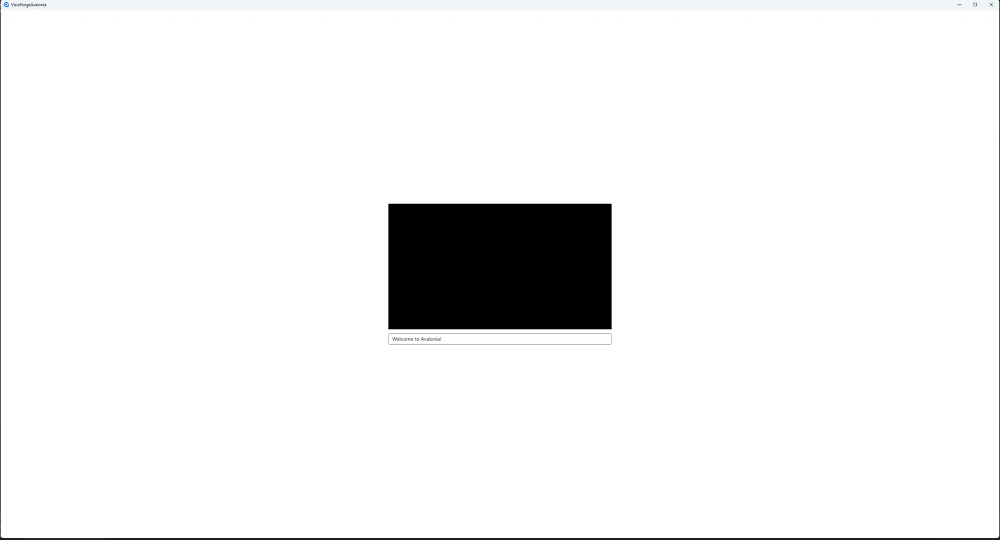

# Install the VisioForge .NET SDKs in an Avalonia app

[Video Capture SDK .NET](https://www.visioforge.com/video-capture-sdk-net){ .md-button .md-button--primary target="_blank" } [Video Edit SDK .NET](https://www.visioforge.com/video-edit-sdk-net){ .md-button .md-button--primary target="_blank" } [Media Blocks SDK .NET](https://www.visioforge.com/media-blocks-sdk-net){ .md-button .md-button--primary target="_blank" } [Media Player SDK .NET](https://www.visioforge.com/media-player-sdk-net){ .md-button .md-button--primary target="_blank" }

This guide installs the VisioForge .NET SDKs in an Avalonia 12.1 app with Desktop, Android and iOS heads, and puts a `VideoView` on its main view. It ends with an app that builds and runs on the Desktop head on Windows.

All four SDKs — Video Capture SDK .NET, Media Player SDK .NET, Video Edit SDK .NET and Media Blocks SDK .NET — come in one NuGet package, [VisioForge.DotNet.Core](https://www.nuget.org/packages/VisioForge.DotNet.Core). The Avalonia `VideoView` is in [VisioForge.DotNet.Core.UI.Avalonia](https://www.nuget.org/packages/VisioForge.DotNet.Core.UI.Avalonia). Each platform also takes a redist package, its native engine (on Linux only the SDK's own libraries; GStreamer comes from the system), and Android takes the VisioForge binding project, `AndroidDependency`, from GitHub.

## Video tutorial

The video creates the app, installs the packages in Visual Studio 2026 and runs it:

<div class="video-wrapper">
  <iframe src="https://www.youtube.com/embed/AOelvS3yVsw?controls=1" frameborder="0" allowfullscreen></iframe>
</div>

## Requirements

- Windows 10 or 11, x64
- Visual Studio 2026 and the .NET 10 SDK, with the Android and iOS workloads to build those heads
- Git
- A Mac with Xcode, paired with Visual Studio, to build the iOS head
- A Mac with Xcode and the .NET macOS workload to build the Desktop head for macOS
- On Linux, GStreamer installed from the distribution's packages, see [Ubuntu deployment](../deployment-x/Ubuntu.md)

`VisioForge.DotNet.Core.UI.Avalonia` is built for Avalonia 12.1, so the app is created from the Avalonia 12.1.6 templates.

## Create the app

In Developer PowerShell, install the Avalonia templates, create the app, take out its Browser head, and fetch the Android binding project:

```powershell
cd $HOME\source\repos
dotnet new install Avalonia.Templates@12.1.6
dotnet new avalonia.xplat -o VisioForgeAvalonia
cd VisioForgeAvalonia
dotnet sln remove VisioForgeAvalonia.Browser\VisioForgeAvalonia.Browser.csproj
git clone --depth 1 --filter=blob:none --sparse https://github.com/visioforge/.Net-SDK-s-samples.git samples
git -C samples sparse-checkout set AndroidDependency
dotnet sln add samples\AndroidDependency\VisioForge.Core.Android.X10.csproj
devenv VisioForgeAvalonia.slnx
```

`avalonia.xplat` makes a shared project for the views (`VisioForgeAvalonia`) and a head project for each platform: Desktop, Android, iOS and Browser. The SDK has no engine for the browser, so the Browser head leaves the solution. The sparse clone checks out only `AndroidDependency` from the [samples repository](https://github.com/visioforge/.Net-SDK-s-samples/tree/master/AndroidDependency), and `dotnet sln add` puts it into the solution, so Visual Studio restores it with the app.

Visual Studio may ask you to accept the Android SDK license as the solution loads. Accepting installs the Android SDK, which the Android head needs to build.

## Install the packages

Right-click the shared project, `VisioForgeAvalonia`, open **Manage NuGet Packages** and the **Browse** tab. Install `VisioForge.DotNet.Core`, then `VisioForge.DotNet.Core.UI.Avalonia`, and accept the license.

The Avalonia template uses central package management, so NuGet writes the versions to `Directory.Packages.props` and the project file gets references without them. The template leaves `Directory.Packages.props` out of the solution: open it with **File > Open > File** and add a version for each redist under the two VisioForge packages:

```xml
<ItemGroup>
  <PackageVersion Include="VisioForge.DotNet.Core" Version="2026.11.27" />
  <PackageVersion Include="VisioForge.DotNet.Core.UI.Avalonia" Version="2026.11.27" />
  <PackageVersion Include="VisioForge.CrossPlatform.Core.Windows.x64" Version="2026.11.26" />
  <PackageVersion Include="VisioForge.CrossPlatform.Libav.Windows.x64.UPX" Version="2026.11.26" />
  <PackageVersion Include="VisioForge.CrossPlatform.Core.macOS" Version="2026.11.22" />
  <PackageVersion Include="VisioForge.CrossPlatform.Core.Android" Version="2026.11.26" />
  <PackageVersion Include="VisioForge.CrossPlatform.Core.iOS" Version="2026.11.26" />
  <PackageVersion Include="VisioForge.CrossPlatform.Core.Linux.x64" Version="2026.10.26" />
  <PackageVersion Include="VisioForge.CrossPlatform.Core.Linux.arm64" Version="2026.10.26" />
</ItemGroup>
```

Take the latest versions from [nuget.org](https://www.nuget.org/profiles/visioforge). The macOS, Android, iOS and Linux redists are released on their own schedule, so their versions differ from the SDK's. Windows takes two redists, the native engine and the Libav codecs (`.UPX` is the size-optimized build); macOS, Android and iOS take one each, and Linux takes the core package for its architecture, which has no GStreamer inside. The video was recorded before the Linux core package lines were added here and in the Desktop head, so it does not show them.

## The Desktop head

Each head takes its redist in its own project file. Right-click `VisioForgeAvalonia.Desktop`, select **Edit Project File**, and add these blocks at the end, before `</Project>`:

```xml
<PropertyGroup Condition="$([MSBuild]::IsOsPlatform('Windows'))">
  <TargetFramework>net10.0-windows</TargetFramework>
</PropertyGroup>
<PropertyGroup Condition="$([MSBuild]::IsOsPlatform('OSX'))">
  <TargetFramework>net10.0-macos</TargetFramework>
  <ApplicationId>com.companyname.visioforgeavalonia</ApplicationId>
  <OutputType>Exe</OutputType>
</PropertyGroup>
<ItemGroup Condition="$([MSBuild]::IsOsPlatform('Windows'))">
  <PackageReference Include="VisioForge.CrossPlatform.Core.Windows.x64" />
  <PackageReference Include="VisioForge.CrossPlatform.Libav.Windows.x64.UPX" />
</ItemGroup>
<ItemGroup Condition="$([MSBuild]::IsOsPlatform('OSX'))">
  <PackageReference Include="VisioForge.CrossPlatform.Core.macOS" />
</ItemGroup>
<ItemGroup Condition="$([MSBuild]::IsOsPlatform('Linux')) or $(RuntimeIdentifier.StartsWith('linux-'))">
  <PackageReference Include="VisioForge.CrossPlatform.Core.Linux.arm64" Condition="$(RuntimeIdentifier.EndsWith('-arm64')) or ('$(RuntimeIdentifier)' == '' and $(NETCoreSdkRuntimeIdentifier.EndsWith('-arm64')))" />
  <PackageReference Include="VisioForge.CrossPlatform.Core.Linux.x64" Condition="!($(RuntimeIdentifier.EndsWith('-arm64')) or ('$(RuntimeIdentifier)' == '' and $(NETCoreSdkRuntimeIdentifier.EndsWith('-arm64'))))" />
</ItemGroup>
```

The template builds the Desktop head for plain `net10.0`, and the SDK's Windows and macOS engines need the operating system's own framework. The later properties replace the template's: `net10.0-windows` on Windows, and `net10.0-macos` on a Mac, an app bundle, which needs an application ID. Linux keeps `net10.0` and uses the GStreamer installed on the system, see [Ubuntu deployment](../deployment-x/Ubuntu.md); the last block, applied when the head is built on Linux or published for a `linux-*` runtime identifier, gives it the core package for its architecture, which holds the SDK's own native libraries. The references carry no versions: those come from `Directory.Packages.props`.

## The Android head

Open **Edit Project File** on `VisioForgeAvalonia.Android`. In the template's first `PropertyGroup`, change the `SupportedOSPlatformVersion` line to 24:

```xml
<SupportedOSPlatformVersion>24</SupportedOSPlatformVersion>
```

Then add the redist and `AndroidDependency` at the end of the file, before `</Project>`:

```xml
<ItemGroup>
  <PackageReference Include="VisioForge.CrossPlatform.Core.Android" />
  <ProjectReference Include="..\samples\AndroidDependency\VisioForge.Core.Android.X10.csproj" />
</ItemGroup>
```

Android 7 (API level 24) is the SDK's minimum on Android. `VisioForge.Core.Android.X10.csproj` targets `net10.0-android`, and a `net11.0-android` app references it as well.

## The iOS head

Open **Edit Project File** on `VisioForgeAvalonia.iOS`. In the template's first `PropertyGroup`, change the `SupportedOSPlatformVersion` line to 18.0:

```xml
<SupportedOSPlatformVersion>18.0</SupportedOSPlatformVersion>
```

Then add the redist at the end of the file, before `</Project>`:

```xml
<ItemGroup>
  <PackageReference Include="VisioForge.CrossPlatform.Core.iOS" />
</ItemGroup>
```

iOS 18.0 is the minimum of the native iOS libraries. Then right-click the iOS head's `Info.plist`, choose **Open With** and **XML (Text) Editor**, change the value under the template's `MinimumOSVersion` key to `<string>18.0</string>`, the same version. Then add a scene manifest, the one new key, above `UIRequiredDeviceCapabilities`:

```xml
<key>UIApplicationSceneManifest</key>
<dict>
  <key>UIApplicationSupportsMultipleScenes</key>
  <false/>
</dict>
```

An app built with the iOS 27 SDK must use the UIKit scene lifecycle (the build stops with `MT7199` otherwise). One scene is enough: the Avalonia 12.1 app delegate supplies the scene configuration itself.

Build the iOS head with the .NET 10 SDK. The .NET 11 SDK maps `net10.0-ios` to iOS 26.0, below the iOS assets of SkiaSharp 3.119.4 (`net10.0-ios26.2`), and the app then stops at launch with `DllNotFoundException: libSkiaSharp`. Pin the SDK with a `global.json` if both are installed.

## Add VideoView to the view

In the shared project, open `Views/MainView.axaml`. Map the VisioForge namespace to a prefix, here `vf`, next to the template's own namespaces, and replace the template's `TextBox` with a `StackPanel` that holds a `VideoView` above the same `TextBox`:

The whole file after the edit:

```xml
<UserControl xmlns="https://github.com/avaloniaui"
             xmlns:x="http://schemas.microsoft.com/winfx/2006/xaml"
             xmlns:d="http://schemas.microsoft.com/expression/blend/2008"
             xmlns:mc="http://schemas.openxmlformats.org/markup-compatibility/2006"
             xmlns:vm="using:VisioForgeAvalonia.ViewModels"
             xmlns:vf="using:VisioForge.Core.UI.Avalonia"
             mc:Ignorable="d" d:DesignWidth="800" d:DesignHeight="450"
             x:Class="VisioForgeAvalonia.Views.MainView"
             x:DataType="vm:MainViewModel">
    <Design.DataContext>
        <vm:MainViewModel />
    </Design.DataContext>

    <StackPanel HorizontalAlignment="Center" VerticalAlignment="Center" Spacing="12">
        <vf:VideoView Width="640" Height="360" Background="Black" />
        <TextBox Text="{Binding Greeting}" />
    </StackPanel>
</UserControl>
```

The namespace is `VisioForge.Core.UI.Avalonia`, from the `VisioForge.DotNet.Core.UI.Avalonia` package. The size is only for this demo; give the `VideoView` an `x:Name` to reach it from code.

## Run it

Right-click `VisioForgeAvalonia.Desktop`, select **Set as Startup Project**, and start the app without debugging (Ctrl+F5). Visual Studio builds the Desktop head for Windows with the Windows redists. The app opens with the `VideoView` above *Welcome to Avalonia!*, black until an SDK engine draws into it.



## Initialize the SDK

Before the first engine, initialize the SDK, and release it on exit. In the shared project's `App.axaml.cs`, add `using VisioForge.Core;` and two lines to the template's `OnFrameworkInitializationCompleted`:

```csharp
public override void OnFrameworkInitializationCompleted()
{
    VisioForgeX.InitSDK();

    if (ApplicationLifetime is IClassicDesktopStyleApplicationLifetime desktop)
    {
        desktop.Exit += (_, _) => VisioForgeX.DestroySDK();
        // ... the template's code
    }
    // ... the template's other branches and base call
}
```

`InitSDK` runs once for every head; `Exit` is raised on the Desktop head. To initialize without blocking the UI thread, call `await VisioForgeX.InitSDKAsync()` from an `async` event handler instead, such as the main window's `Loaded`.

Android needs the camera and microphone permissions in `AndroidManifest.xml`, and iOS and macOS the usage descriptions in `Info.plist` (`NSCameraUsageDescription`, `NSMicrophoneUsageDescription`). The deployment guides for [Windows](../deployment-x/Windows.md), [macOS](../deployment-x/macOS.md), [Ubuntu](../deployment-x/Ubuntu.md), [Android](../deployment-x/Android.md) and [iOS](../deployment-x/iOS.md) cover them, the native dependencies and troubleshooting. [SDK initialization](../init.md) covers `InitSDKAsync` and `DestroySDK` in detail.

## Sample applications

Complete Avalonia apps with a shared project and Desktop, Android and iOS heads, like the app in this guide:

- [Media Player SDK X/Avalonia/SimplePlayerMVVM](https://github.com/visioforge/.Net-SDK-s-samples/tree/master/Media%20Player%20SDK%20X/Avalonia/SimplePlayerMVVM)
- [Media Blocks SDK/Avalonia/SimplePlayerMVVM](https://github.com/visioforge/.Net-SDK-s-samples/tree/master/Media%20Blocks%20SDK/Avalonia/SimplePlayerMVVM)
- [Media Blocks SDK/Avalonia/SimpleVideoCaptureMVVM](https://github.com/visioforge/.Net-SDK-s-samples/tree/master/Media%20Blocks%20SDK/Avalonia/SimpleVideoCaptureMVVM)
- [Media Blocks SDK/Avalonia/VideoMixerMVVM](https://github.com/visioforge/.Net-SDK-s-samples/tree/master/Media%20Blocks%20SDK/Avalonia/VideoMixerMVVM)

The other Avalonia samples are desktop apps: [Media Player SDK X/Avalonia](https://github.com/visioforge/.Net-SDK-s-samples/tree/master/Media%20Player%20SDK%20X/Avalonia), [Video Capture SDK X/Avalonia](https://github.com/visioforge/.Net-SDK-s-samples/tree/master/Video%20Capture%20SDK%20X/Avalonia) and [Media Blocks SDK/Avalonia](https://github.com/visioforge/.Net-SDK-s-samples/tree/master/Media%20Blocks%20SDK/Avalonia).

## Video Transcript

### Overview

Let's install the VisioForge .NET SDKs in an Avalonia app, with Desktop, Android and iOS heads, and put a VideoView on its main view. All four VisioForge .NET SDKs come in one NuGet package, VisioForge.DotNet.Core. The Avalonia VideoView is in VisioForge.DotNet.Core.UI.Avalonia. Each platform also takes a redist package, its native engine, and Android takes the VisioForge binding project, AndroidDependency, from GitHub. You need Windows 10 or 11, Visual Studio 2026, and the .NET 10 SDK, with the Android and iOS workloads to build those heads, and Git. The VisioForge Avalonia package is built for Avalonia 12.1, so this video creates the app from the Avalonia 12.1.6 templates.

### Create the app

Open Developer PowerShell from the Start menu, and go to your projects folder. Install the Avalonia templates, version 12.1.6. Create the app with dotnet new avalonia.xplat. It makes a shared project for the views, and a head project for each platform: Desktop, Android, iOS and Browser. The SDK has no engine for the browser, so take the Browser head out of the solution with dotnet sln remove. In the solution folder, clone the VisioForge samples repository sparsely, check out only AndroidDependency, the Android binding project, and add it to the solution with dotnet sln add. Then open the solution in Visual Studio. Here are all the commands. Visual Studio may ask you to accept the Android SDK license as the solution loads: that installs the Android SDK, which the Android head needs to build.

### NuGet

Now NuGet. Right-click the shared project, VisioForgeAvalonia, open Manage NuGet Packages, and the Browse tab. Search for VisioForge.DotNet.Core and install it. Visual Studio shows the changes and the license: accept them. Then install VisioForge.DotNet.Core.UI.Avalonia, which holds the Avalonia VideoView. Both are on the Installed tab. The template uses central package management, so their versions went to Directory.Packages.props.

### Redists

The redists come next. The template leaves Directory.Packages.props out of the solution, so open it with File, Open, and add a version for each redist under the two VisioForge packages. Windows takes two, the native engine and the Libav codecs. macOS, Android and iOS take one each. Here is the whole list: the two packages from NuGet and the five redists. Take the latest versions from nuget.org.

### Desktop head

Each head takes its redist in its own project file. Right-click the Desktop head, and open Edit Project File. Add the blocks at the end of the file, each under the condition of the operating system that builds it, and save. The template builds the Desktop head for plain net10.0, and the SDK's Windows and macOS engines need the operating system's own framework. On Windows that is net10.0-windows. On a Mac it is net10.0-macos, an app bundle, which needs an application ID. Linux keeps net10.0. Windows takes the engine and Libav, and macOS its engine. The references carry no versions: those come from Directory.Packages.props. On Linux, the SDK uses the GStreamer installed on the system.

### Android and iOS

Now the Android head: Edit Project File again. Raise the minimum to Android 7, API level 24, the SDK's minimum on Android. Then add the Android redist, and a reference to the AndroidDependency project from the samples folder. The minimum version replaces the template's own line. The rest goes in at the end of the file. The iOS head is next. Raise its minimum to iOS 18, the SDK's minimum on iOS, and add the iOS redist. The same two edits as on Android: the minimum version, and the redist reference at the end. The iOS head has one more file, Info.plist. Right-click it, choose Open With, and the XML text editor. Set MinimumOSVersion to 18.0, to match the project, and add a scene manifest above the device capabilities. The iOS 27 SDK refuses an app without a scene manifest. One scene is enough, and Avalonia supplies its configuration.

### VideoView

Now the view. In the shared project, open MainView.axaml from the Views folder. Map the VisioForge namespace to a prefix, here vf, next to the template's own namespaces. And replace the template's TextBox with a StackPanel, holding a VideoView above the same TextBox. Then save. In Avalonia, the namespace is VisioForge.Core.UI.Avalonia, from the VisioForge.DotNet.Core.UI.Avalonia package. The size here is only for this demo.

### Run it

Set the Desktop head as the startup project. And start it without debugging. Visual Studio builds the Desktop head for Windows, with the Windows redists. The app opens, with the VideoView above the greeting. It stays black until an SDK engine draws into it.

### Next steps

Before the first engine, initialize the SDK with VisioForgeX.InitSDKAsync, and release it with DestroySDK on exit. Android needs the camera and microphone permissions in its manifest, and iOS and macOS the usage descriptions in Info.plist. Deployment for each platform is on the help site.

## See also

- [SDK initialization](../init.md) — `InitSDKAsync` and `DestroySDK` in detail
- Install guides for [Visual Studio](visual-studio.md), [MAUI](maui.md), [Uno Platform](uno.md) and [Rider](rider.md)
- [Windows](../deployment-x/Windows.md), [macOS](../deployment-x/macOS.md), [Ubuntu](../deployment-x/Ubuntu.md), [Android](../deployment-x/Android.md) and [iOS](../deployment-x/iOS.md) deployment
