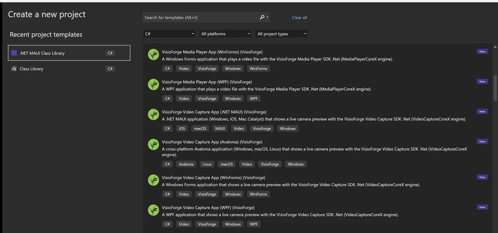

# Plantillas de proyecto VisioForge

[Video Capture SDK .NET](https://www.visioforge.com/video-capture-sdk-net){ .md-button .md-button--primary target="_blank" } [Media Blocks SDK .NET](https://www.visioforge.com/media-blocks-sdk-net){ .md-button .md-button--primary target="_blank" } [Media Player SDK .NET](https://www.visioforge.com/media-player-sdk-net){ .md-button .md-button--primary target="_blank" }

Las plantillas de proyecto VisioForge crean una aplicación .NET 10 pequeña y completa que ya funciona: una vista previa de cámara, un reproductor multimedia o un reproductor Media Blocks. Los paquetes NuGet están referenciados, el SDK se inicializa y se cierra, y la vista de video está en su sitio. Compile, pulse F5 y amplíela a partir de ahí.

Las plantillas se ofrecen de dos formas: la extensión **VisioForge .NET Media SDK Templates** para Visual Studio 2026 y el paquete `VisioForge.DotNet.Templates` para `dotnet new`. Ambas contienen las mismas ocho plantillas.

El instalador de Windows de los SDK instala el paquete de `dotnet new` al hacer clic en **Finish**, si el SDK de .NET 10 está instalado y el equipo tiene conexión. Se instala para la cuenta de Windows con la que se ejecutó el instalador: si escribió la contraseña de un administrador en el aviso de Windows, es la cuenta de ese administrador. Visual Studio 2026 muestra las plantillas instaladas de esta forma en **Create a new project**; si no aparecen, reinicie Visual Studio. Ejecute usted mismo el comando de [Instalar desde la línea de comandos](#instalar-desde-la-linea-de-comandos) con cualquier otra cuenta, si el instalador se ejecutó sin su página **Finish** (`/qn`, `/qb`, `/passive`) o si las plantillas no aparecen.

## Plantillas

| Plantilla | Nombre corto | SDK | Plataformas |
|-----------|--------------|-----|-------------|
| VisioForge Video Capture App (WPF) | `vf-capture-wpf` | Video Capture SDK .NET | Windows x64 |
| VisioForge Video Capture App (WinForms) | `vf-capture-winforms` | Video Capture SDK .NET | Windows x64 |
| VisioForge Video Capture App (Avalonia) | `vf-capture-avalonia` | Video Capture SDK .NET | Windows x64; macOS y Linux al compilar en ellos |
| VisioForge Video Capture App (.NET MAUI) | `vf-capture-maui` | Video Capture SDK .NET | Windows x64; iOS y Mac Catalyst al compilar en macOS |
| VisioForge Media Player App (WPF) | `vf-player-wpf` | Media Player SDK .NET | Windows x64 |
| VisioForge Media Player App (WinForms) | `vf-player-winforms` | Media Player SDK .NET | Windows x64 |
| VisioForge Media Blocks Player App (WPF) | `vf-mediablocks-wpf` | Media Blocks SDK .NET | Windows x64 |
| VisioForge Media Blocks Player App (WinForms) | `vf-mediablocks-winforms` | Media Blocks SDK .NET | Windows x64 |

Las plantillas de captura abren la primera cámara y muestran su vista previa; una lista o un botón cambia de cámara. Las plantillas de reproductor tienen los botones **Open file...** y **Stop** y reproducen cualquier archivo que el SDK pueda decodificar.

## Requisitos

- El SDK de .NET 10. Visual Studio 2026 lo instala; con Visual Studio 2022, instálelo por separado.
- Plantilla MAUI: la carga de trabajo `maui` (`dotnet workload install maui`, o la carga de trabajo .NET MAUI en el instalador de Visual Studio). Su aplicación de Windows es un paquete MSIX: ejecútela desde Visual Studio 2026, no con `dotnet run`. iOS y Mac Catalyst se compilan en un Mac con Xcode: ejecute Mac Catalyst con `dotnet run -f net10.0-maccatalyst`; para iOS, que necesita un dispositivo físico, consulte [MAUI](maui.md).
- Plantilla Avalonia: Xcode y la carga de trabajo `macos` (`dotnet workload install macos`) en un Mac; el GStreamer del sistema en Linux, instalado como se describe en [Ubuntu](../deployment-x/Ubuntu.md).

## Instalar en Visual Studio 2026

Si las plantillas ya aparecen en **Create a new project**, vaya al paso 3.

1. Abra **Extensions → Manage Extensions**, busque **VisioForge .NET Media SDK Templates** y haga clic en **Install**.
2. Reinicie Visual Studio para completar la instalación de la extensión.
3. Abra **File → New → Project** y busque **VisioForge**.
4. Elija una plantilla, asigne un nombre al proyecto y haga clic en **Create**.
5. Pulse **F5**.



!!! note "Visual Studio 2022"
    La extensión se instala solo en Visual Studio 2026. Las plantillas usan .NET 10, que Visual Studio 2022 no admite. Con Visual Studio 2022, use en su lugar la línea de comandos de abajo: las plantillas WPF, WinForms y Avalonia se compilan y ejecutan con `dotnet run`. La aplicación de Windows de la plantilla MAUI necesita Visual Studio 2026. Visual Studio 2022 puede mostrar las plantillas que instaló el instalador del SDK; cree el proyecto con `dotnet new` en su lugar. Para añadir el SDK a su propio proyecto, consulte [Visual Studio](visual-studio.md).

## Instalar desde la línea de comandos

```bash
dotnet new install VisioForge.DotNet.Templates
dotnet new vf-capture-wpf -n MyCaptureApp
cd MyCaptureApp
dotnet run
```

`dotnet new list VisioForge` muestra las plantillas VisioForge instaladas, y `dotnet new update` las actualiza a la última versión. El nombre de proyecto que indique con `-n` se convierte en el espacio de nombres y, en las plantillas MAUI y Avalonia, en parte del identificador del bundle `com.example.<nombre>`, en minúsculas y reducido a letras y dígitos (`app` si no queda nada). Sustituya `com.example` por su propio prefijo antes de firmar o publicar la aplicación.

## Contenido de una plantilla

- Los paquetes NuGet del SDK en versiones exactas: el SDK, el redist nativo de la plataforma de destino y, para MAUI y Avalonia, el paquete de interfaz.
- Una ventana principal que llama a `VisioForgeX.InitSDKAsync` al cargarse y a `VisioForgeX.DestroySDK` al cerrarse. El cierre espera primero a que el motor se detenga.
- El motor y su vista de video: `VideoCaptureCoreX` con la lista de cámaras, `MediaPlayerCoreX`, o un `MediaBlocksPipeline` con una fuente universal, un renderizador de video y un renderizador de audio.
- Un archivo `.mcp.json` que conecta los asistentes de programación con IA (Claude Code, Visual Studio) al [servidor MCP de VisioForge](../general/mcp-server-usage.md). Elimínelo si no usa ninguno.

El primer inicio en un equipo tarda más: el SDK crea una vez su registro de plugins. Sin clave de licencia, los SDK funcionan en modo de prueba.

## Siguientes pasos

- [Visual Studio](visual-studio.md) — añadir el SDK a un proyecto existente.
- [Avalonia](avalonia.md) y [MAUI](maui.md) — añadir el SDK a su propia aplicación multiplataforma.
- [Ejemplos en GitHub](https://github.com/visioforge/.Net-SDK-s-samples) — demos más completas para cada SDK.
