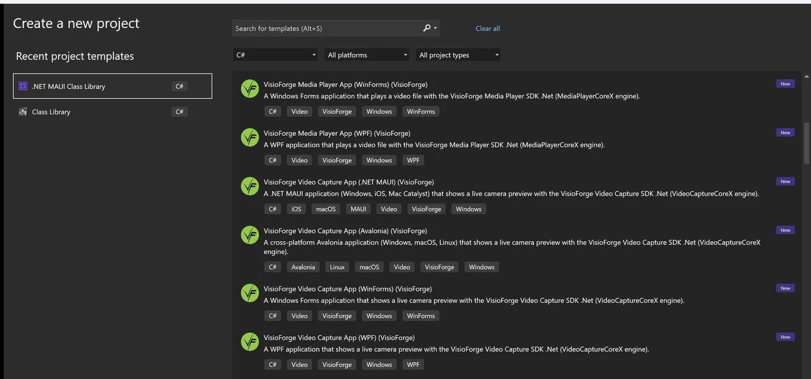

# Modèles de projet VisioForge

[Video Capture SDK .NET](https://www.visioforge.com/video-capture-sdk-net){ .md-button .md-button--primary target="_blank" } [Media Blocks SDK .NET](https://www.visioforge.com/media-blocks-sdk-net){ .md-button .md-button--primary target="_blank" } [Media Player SDK .NET](https://www.visioforge.com/media-player-sdk-net){ .md-button .md-button--primary target="_blank" }

Les modèles de projet VisioForge créent une petite application .NET 10 complète qui fonctionne déjà : un aperçu caméra, un lecteur multimédia ou un lecteur Media Blocks. Les paquets NuGet sont référencés, le SDK est initialisé puis arrêté, et la vue vidéo est en place. Compilez, appuyez sur F5 et développez à partir de là.

Les modèles sont disponibles de deux façons : l'extension **VisioForge .NET Media SDK Templates** pour Visual Studio 2026 et le paquet `VisioForge.DotNet.Templates` pour `dotnet new`. Les deux contiennent les mêmes huit modèles.

Le programme d'installation Windows des SDK installe le paquet `dotnet new` lorsque vous cliquez sur **Finish**, si le SDK .NET 10 est installé et que l'ordinateur est en ligne. Il est installé pour le compte Windows sous lequel l'installation s'est exécutée : si vous avez saisi le mot de passe d'un administrateur à l'invite de Windows, c'est le compte de cet administrateur. Visual Studio 2026 affiche les modèles installés de cette façon dans **Create a new project** ; s'ils n'apparaissent pas, redémarrez Visual Studio. Exécutez vous-même la commande de [Installer en ligne de commande](#installer-en-ligne-de-commande) sous tout autre compte, si l'installation s'est exécutée sans sa page **Finish** (`/qn`, `/qb`, `/passive`) ou si les modèles n'y figurent pas.

## Modèles

| Modèle | Nom court | SDK | Plateformes |
|--------|-----------|-----|-------------|
| VisioForge Video Capture App (WPF) | `vf-capture-wpf` | Video Capture SDK .NET | Windows x64 |
| VisioForge Video Capture App (WinForms) | `vf-capture-winforms` | Video Capture SDK .NET | Windows x64 |
| VisioForge Video Capture App (Avalonia) | `vf-capture-avalonia` | Video Capture SDK .NET | Windows x64 ; macOS et Linux en compilant sur ces systèmes |
| VisioForge Video Capture App (.NET MAUI) | `vf-capture-maui` | Video Capture SDK .NET | Windows x64 ; iOS et Mac Catalyst en compilant sous macOS |
| VisioForge Media Player App (WPF) | `vf-player-wpf` | Media Player SDK .NET | Windows x64 |
| VisioForge Media Player App (WinForms) | `vf-player-winforms` | Media Player SDK .NET | Windows x64 |
| VisioForge Media Blocks Player App (WPF) | `vf-mediablocks-wpf` | Media Blocks SDK .NET | Windows x64 |
| VisioForge Media Blocks Player App (WinForms) | `vf-mediablocks-winforms` | Media Blocks SDK .NET | Windows x64 |

Les modèles de capture ouvrent la première caméra et affichent son aperçu ; une liste ou un bouton change de caméra. Les modèles de lecteur ont les boutons **Open file...** et **Stop** et lisent tout fichier que le SDK sait décoder.

## Prérequis

- Le SDK .NET 10. Visual Studio 2026 l'installe ; avec Visual Studio 2022, installez-le séparément.
- Modèle MAUI : la charge de travail `maui` (`dotnet workload install maui`, ou la charge de travail .NET MAUI dans l'installateur de Visual Studio). Son application Windows est un paquet MSIX : lancez-la depuis Visual Studio 2026, pas avec `dotnet run`. iOS et Mac Catalyst se compilent sur un Mac avec Xcode : lancez Mac Catalyst avec `dotnet run -f net10.0-maccatalyst` ; pour iOS, qui nécessite un appareil physique, consultez [MAUI](maui.md).
- Modèle Avalonia : Xcode et la charge de travail `macos` (`dotnet workload install macos`) sur un Mac ; le GStreamer du système sous Linux, installé comme décrit dans [Ubuntu](../deployment-x/Ubuntu.md).

## Installer dans Visual Studio 2026

Si les modèles figurent déjà dans **Create a new project**, passez à l'étape 3.

1. Ouvrez **Extensions → Manage Extensions**, recherchez **VisioForge .NET Media SDK Templates** et cliquez sur **Install**.
2. Redémarrez Visual Studio pour terminer l'installation de l'extension.
3. Ouvrez **File → New → Project** et recherchez **VisioForge**.
4. Choisissez un modèle, nommez le projet et cliquez sur **Create**.
5. Appuyez sur **F5**.



!!! note "Visual Studio 2022"
    L'extension s'installe uniquement dans Visual Studio 2026. Les modèles ciblent .NET 10, que Visual Studio 2022 ne prend pas en charge. Avec Visual Studio 2022, utilisez plutôt la ligne de commande ci-dessous : les modèles WPF, WinForms et Avalonia se compilent et se lancent avec `dotnet run`. L'application Windows du modèle MAUI nécessite Visual Studio 2026. Visual Studio 2022 peut afficher les modèles installés par le programme d'installation du SDK ; créez plutôt le projet avec `dotnet new`. Pour ajouter le SDK à votre propre projet, consultez [Visual Studio](visual-studio.md).

## Installer en ligne de commande

```bash
dotnet new install VisioForge.DotNet.Templates
dotnet new vf-capture-wpf -n MyCaptureApp
cd MyCaptureApp
dotnet run
```

`dotnet new list VisioForge` affiche les modèles VisioForge installés, et `dotnet new update` les met à jour vers la dernière version. Le nom de projet passé avec `-n` devient l'espace de noms et, dans les modèles MAUI et Avalonia, une partie de l'identifiant du bundle `com.example.<nom>`, en minuscules et réduit aux lettres et chiffres (`app` s'il ne reste rien). Remplacez `com.example` par votre propre préfixe avant de signer ou de publier l'application.

## Contenu d'un modèle

- Les paquets NuGet du SDK en versions exactes : le SDK, le redist natif de la plateforme cible et, pour MAUI et Avalonia, le paquet d'interface.
- Une fenêtre principale qui appelle `VisioForgeX.InitSDKAsync` au chargement et `VisioForgeX.DestroySDK` à la fermeture. La fermeture attend d'abord l'arrêt du moteur.
- Le moteur et sa vue vidéo : `VideoCaptureCoreX` avec la liste des caméras, `MediaPlayerCoreX`, ou un `MediaBlocksPipeline` avec une source universelle, un rendu vidéo et un rendu audio.
- Un fichier `.mcp.json` qui connecte les assistants de programmation IA (Claude Code, Visual Studio) au [serveur MCP VisioForge](../general/mcp-server-usage.md). Supprimez-le si vous n'en utilisez pas.

Le premier démarrage sur une machine est plus long : le SDK construit une fois son registre de plugins. Sans clé de licence, les SDK fonctionnent en mode d'essai.

## Étapes suivantes

- [Visual Studio](visual-studio.md) — ajouter le SDK à un projet existant.
- [Avalonia](avalonia.md) et [MAUI](maui.md) — ajouter le SDK à votre propre application multiplateforme.
- [Exemples sur GitHub](https://github.com/visioforge/.Net-SDK-s-samples) — des démos plus complètes pour chaque SDK.
