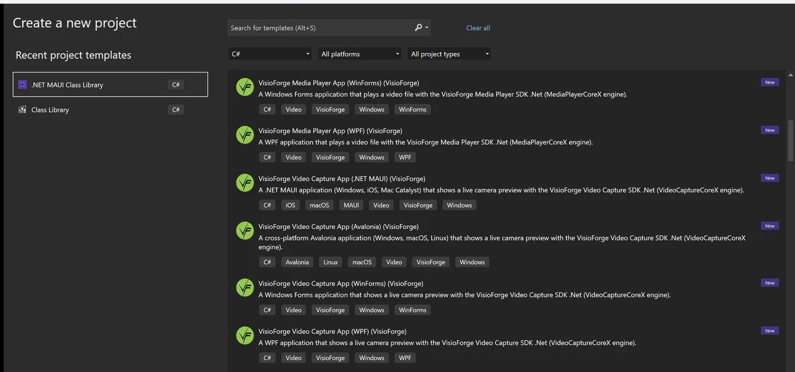

# VisioForge Project Templates

[Video Capture SDK .NET](https://www.visioforge.com/video-capture-sdk-net){ .md-button .md-button--primary target="_blank" } [Media Blocks SDK .NET](https://www.visioforge.com/media-blocks-sdk-net){ .md-button .md-button--primary target="_blank" } [Media Player SDK .NET](https://www.visioforge.com/media-player-sdk-net){ .md-button .md-button--primary target="_blank" }

The VisioForge project templates create a small, complete .NET 10 app that already works: a camera preview, a media player or a Media Blocks player. The NuGet packages are referenced, the SDK is initialized and shut down, and the video view is in place. Build it, press F5 and extend it from there.

The templates come two ways: the **VisioForge .NET Media SDK Templates** extension for Visual Studio 2026, and the `VisioForge.DotNet.Templates` package for `dotnet new`. Both carry the same eight templates.

## Templates

| Template | Short name | SDK | Platforms |
|----------|------------|-----|-----------|
| VisioForge Video Capture App (WPF) | `vf-capture-wpf` | Video Capture SDK .NET | Windows x64 |
| VisioForge Video Capture App (WinForms) | `vf-capture-winforms` | Video Capture SDK .NET | Windows x64 |
| VisioForge Video Capture App (Avalonia) | `vf-capture-avalonia` | Video Capture SDK .NET | Windows x64; macOS and Linux when built on them |
| VisioForge Video Capture App (.NET MAUI) | `vf-capture-maui` | Video Capture SDK .NET | Windows x64; iOS and Mac Catalyst when built on macOS |
| VisioForge Media Player App (WPF) | `vf-player-wpf` | Media Player SDK .NET | Windows x64 |
| VisioForge Media Player App (WinForms) | `vf-player-winforms` | Media Player SDK .NET | Windows x64 |
| VisioForge Media Blocks Player App (WPF) | `vf-mediablocks-wpf` | Media Blocks SDK .NET | Windows x64 |
| VisioForge Media Blocks Player App (WinForms) | `vf-mediablocks-winforms` | Media Blocks SDK .NET | Windows x64 |

The capture templates open the first camera and show its preview; a list or a button switches cameras. The player templates have **Open file...** and **Stop** buttons and play any file the SDK can decode.

## Requirements

- The .NET 10 SDK. Visual Studio 2026 installs it; with Visual Studio 2022, install it separately.
- MAUI template: the `maui` workload (`dotnet workload install maui`, or the .NET MAUI workload in the Visual Studio installer). Its Windows app is a packaged MSIX: run it from Visual Studio 2026, not with `dotnet run`. iOS and Mac Catalyst build on a Mac with Xcode: run Mac Catalyst with `dotnet run -f net10.0-maccatalyst`; for iOS, which needs a physical device, see [MAUI](maui.md).
- Avalonia template: Xcode and the `macos` workload (`dotnet workload install macos`) on a Mac; the system GStreamer on Linux, installed as described in [Ubuntu](../deployment-x/Ubuntu.md).

## Install in Visual Studio 2026

1. Open **Extensions → Manage Extensions**, search for **VisioForge .NET Media SDK Templates** and click **Install**.
2. Restart Visual Studio so the extension is installed.
3. Open **File → New → Project** and search for **VisioForge**.
4. Pick a template, name the project and click **Create**.
5. Press **F5**.



!!! note "Visual Studio 2022"
    The extension installs into Visual Studio 2026 only. The templates target .NET 10, which Visual Studio 2022 does not support. With Visual Studio 2022, use the command line below instead: the WPF, WinForms and Avalonia templates build and run with `dotnet run`. The Windows app of the MAUI template needs Visual Studio 2026. To add the SDK to a project of your own, see [Visual Studio](visual-studio.md).

## Install from the Command Line

```bash
dotnet new install VisioForge.DotNet.Templates
dotnet new vf-capture-wpf -n MyCaptureApp
cd MyCaptureApp
dotnet run
```

`dotnet new list VisioForge` shows the installed VisioForge templates, and `dotnet new update` moves them to the newest release. The project name you give with `-n` becomes the namespace and, in the MAUI and Avalonia templates, part of the bundle identifier `com.example.<name>`, lowercased and stripped to letters and digits (`app` when nothing is left). Replace `com.example` with your own prefix before you sign or publish the app.

## What a Template Contains

- The SDK NuGet packages at exact versions: the SDK, the native redist for the target platform and, for MAUI and Avalonia, the UI package.
- A main window that calls `VisioForgeX.InitSDKAsync` when it loads and `VisioForgeX.DestroySDK` when it closes. Closing waits for the engine to stop first.
- The engine and its video view: `VideoCaptureCoreX` with the camera list, `MediaPlayerCoreX`, or a `MediaBlocksPipeline` with a universal source, a video renderer and an audio renderer.

The first start on a machine takes longer: the SDK builds its plugin registry once. The SDKs run in trial mode without a license key.

## Next Steps

- [Visual Studio](visual-studio.md) — add the SDK to an existing project.
- [Avalonia](avalonia.md) and [MAUI](maui.md) — add the SDK to a cross-platform app of your own.
- [Samples on GitHub](https://github.com/visioforge/.Net-SDK-s-samples) — larger demos for every SDK.
