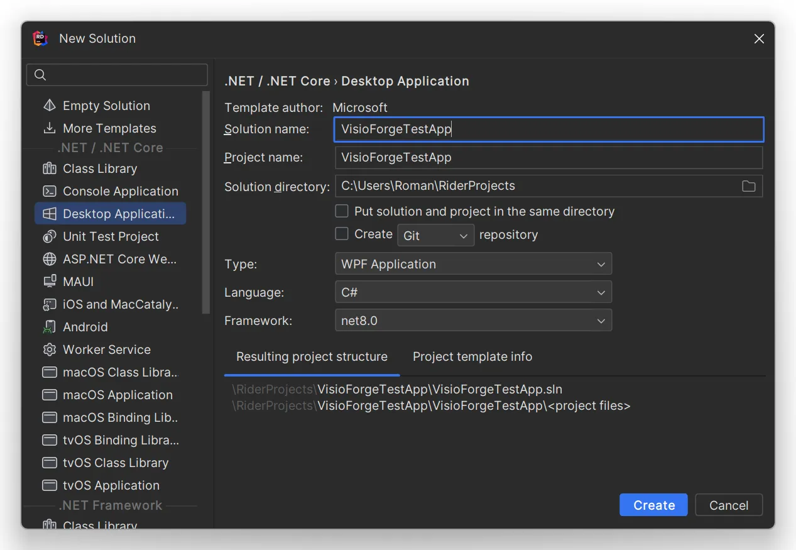
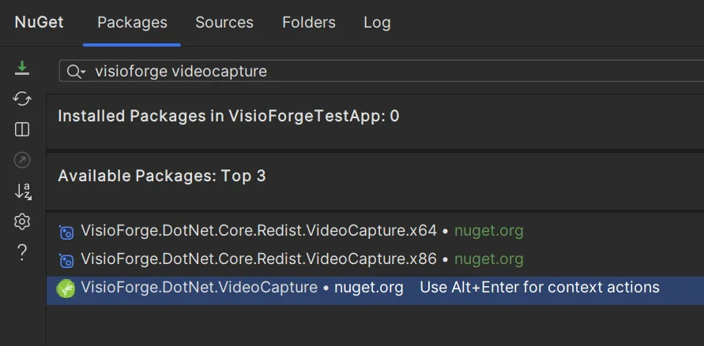

# Integración de SDKs .NET con JetBrains Rider

## Introducción

[Video Capture SDK .NET](https://www.visioforge.com/video-capture-sdk-net){ .md-button .md-button--primary target="_blank" } [Video Edit SDK .NET](https://www.visioforge.com/video-edit-sdk-net){ .md-button .md-button--primary target="_blank" } [Media Blocks SDK .NET](https://www.visioforge.com/media-blocks-sdk-net){ .md-button .md-button--primary target="_blank" } [Media Player SDK .NET](https://www.visioforge.com/media-player-sdk-net){ .md-button .md-button--primary target="_blank" }

Esta guía completa le lleva a través del proceso de instalación y configuración de SDKs .NET de VisioForge dentro de JetBrains Rider, un potente IDE multiplataforma para desarrollo .NET. Aunque usaremos una aplicación Windows con WPF como nuestro ejemplo principal, estos pasos de instalación pueden adaptarse fácilmente para aplicaciones macOS, iOS o Android también. JetBrains Rider proporciona una experiencia de desarrollo consistente a través de plataformas Windows, macOS y Linux, lo que lo convierte en una excelente opción para desarrollo .NET multiplataforma.

## Crear su proyecto

### Configurar una estructura de proyecto moderna

Comienza lanzando JetBrains Rider y creando un nuevo proyecto. Para este tutorial, usaremos WPF (Windows Presentation Foundation) como nuestro framework. Es crucial utilizar el formato de proyecto moderno, que proporciona compatibilidad mejorada con los SDKs de VisioForge y ofrece una experiencia de desarrollo más fluida.

1. Abra JetBrains Rider
2. Seleccione "Create New Solution" desde la pantalla de bienvenida
3. Elija "WPF Application" de las plantillas disponibles
4. Configure los ajustes de su proyecto, asegurándose de seleccionar el formato de proyecto moderno
5. Haga clic en "Create" para generar la estructura de su proyecto



## Agregar paquetes NuGet requeridos

### Instalar el paquete principal del SDK

Cada SDK de VisioForge tiene un paquete principal correspondiente que proporciona la funcionalidad central. Necesitará seleccionar el paquete apropiado basado en con qué SDK esté trabajando.

1. Haga clic derecho en su proyecto en el Solution Explorer
2. Seleccione el elemento de menú "Manage NuGet Packages"
3. En el NuGet Package Manager, busque el paquete de VisioForge que corresponda a su SDK deseado
4. Seleccione la última versión estable y haga clic en "Install"



### Paquetes principales del SDK disponibles

Elija entre los siguientes paquetes principales según sus necesidades de desarrollo:

- [VisioForge.DotNet.VideoCapture](https://www.nuget.org/packages/VisioForge.DotNet.VideoCapture) - Para aplicaciones que requieren funcionalidad de captura de video
- [VisioForge.DotNet.VideoEdit](https://www.nuget.org/packages/VisioForge.DotNet.VideoEdit) - Para aplicaciones de edición y procesamiento de video
- [VisioForge.DotNet.MediaPlayer](https://www.nuget.org/packages/VisioForge.DotNet.MediaPlayer) - Para aplicaciones de reproducción de medios
- [VisioForge.DotNet.MediaBlocks](https://www.nuget.org/packages/VisioForge.DotNet.MediaBlocks) - Para aplicaciones que requieren capacidades modulares de procesamiento de medios

### Agregar el paquete de UI, si es necesario

El paquete principal del SDK contiene los componentes de UI principales para WinForms, WPF, Android y Apple.

Para otras plataformas, necesitará instalar el paquete de UI apropiado que corresponda a su framework de UI elegido.

### Paquetes de UI disponibles

Dependiendo de su plataforma objetivo y framework de UI, elija entre estos paquetes de UI:

- El paquete principal contiene los componentes de UI principales para WinForms, WPF y Apple
- [VisioForge.DotNet.Core.UI.WinUI](https://www.nuget.org/packages/VisioForge.DotNet.Core.UI.WinUI) - Para aplicaciones Windows usando el framework moderno WinUI
- [VisioForge.DotNet.Core.UI.MAUI](https://www.nuget.org/packages/VisioForge.DotNet.Core.UI.MAUI) - Para aplicaciones multiplataforma usando .NET MAUI
- [VisioForge.DotNet.Core.UI.Avalonia](https://www.nuget.org/packages/VisioForge.DotNet.Core.UI.Avalonia) - Para aplicaciones de escritorio multiplataforma usando Avalonia UI

## Integrar el control VideoView (opcional)

### Agregar capacidades de vista previa de video

Si su aplicación requiere funcionalidad de vista previa de video, necesitará agregar el control VideoView a su interfaz de usuario. Esto puede lograrse ya sea a través de marcado XAML o programáticamente en su archivo code-behind. A continuación, demostraremos cómo agregarlo vía XAML.

#### Paso 1: Agregar el espacio de nombres WPF

Primero, agregue la referencia de espacio de nombres necesaria a su archivo XAML:

```xml
xmlns:wpf="clr-namespace:VisioForge.Core.UI.WPF;assembly=VisioForge.Core"
```

#### Paso 2: Agregar el control VideoView

Luego, agregue el control VideoView a su diseño:

```xml
<wpf:VideoView 
    Width="640" 
    Height="480" 
    Margin="10,10,0,0" 
    HorizontalAlignment="Left" 
    VerticalAlignment="Top"/>
```

Este control proporciona un lienzo donde el contenido de video puede mostrarse en tiempo real, esencial para aplicaciones que involucran captura, edición o reproducción de video.

## Agregar paquetes de redistribución requeridos

### Dependencias específicas de plataforma

Dependiendo de su plataforma objetivo, producto elegido y el motor específico que esté utilizando, pueden necesitarse paquetes de redistribución adicionales para asegurar la funcionalidad adecuada en todos los entornos de despliegue.

Para información completa sobre qué paquetes de redistribución se requieren para su escenario específico, por favor consulte la página de documentación de Despliegue para su producto VisioForge seleccionado. Estos recursos proporcionan guía detallada sobre:

- Dependencias del sistema requeridas
- Consideraciones específicas de plataforma
- Estrategias de optimización de despliegue
- Requisitos de tiempo de ejecución

Seguir estas guías de despliegue asegurará que su aplicación funcione correctamente en los sistemas de los usuarios finales sin dependencias faltantes o errores de tiempo de ejecución.

## Recursos adicionales

Para más ejemplos y guías de implementación detalladas, visite nuestro [repositorio de GitHub](https://github.com/visioforge/.Net-SDK-s-samples), que contiene numerosos ejemplos de código demostrando varias características y escenarios de integración.

Nuestro portal de documentación también ofrece referencias completas de API, tutoriales detallados y guías de mejores prácticas para ayudarle a aprovechar al máximo los SDKs de VisioForge en sus proyectos de JetBrains Rider.

## Conclusión

Siguiendo esta guía de instalación, ha integrado exitosamente los SDKs .NET de VisioForge con JetBrains Rider, estableciendo las bases para desarrollar aplicaciones de medios potentes. La combinación de las robustas capacidades de procesamiento de medios de VisioForge y el entorno de desarrollo inteligente de JetBrains Rider proporciona una plataforma ideal para crear aplicaciones de medios sofisticadas en múltiples plataformas.
