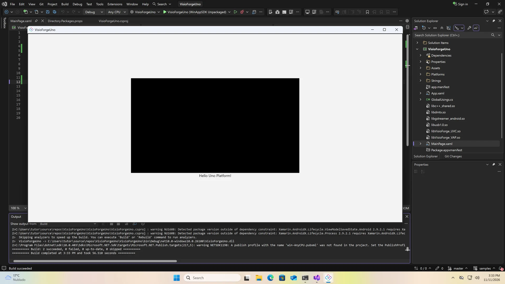

# Instalar los SDK .NET de VisioForge en una aplicación Uno Platform

[Video Capture SDK .NET](https://www.visioforge.com/video-capture-sdk-net){ .md-button .md-button--primary target="_blank" } [Video Edit SDK .NET](https://www.visioforge.com/video-edit-sdk-net){ .md-button .md-button--primary target="_blank" } [Media Blocks SDK .NET](https://www.visioforge.com/media-blocks-sdk-net){ .md-button .md-button--primary target="_blank" } [Media Player SDK .NET](https://www.visioforge.com/media-player-sdk-net){ .md-button .md-button--primary target="_blank" }

Esta guía instala los SDK .NET de VisioForge en una aplicación Uno Platform 6.5 con destinos Windows, Android e iOS, y pone un `VideoView` en su página. Termina con una aplicación que compila y se ejecuta en el destino Windows.

Los cuatro SDK — Video Capture SDK .NET, Media Player SDK .NET, Video Edit SDK .NET y Media Blocks SDK .NET — vienen en un solo paquete NuGet, [VisioForge.DotNet.Core](https://www.nuget.org/packages/VisioForge.DotNet.Core). El `VideoView` de Uno está en [VisioForge.DotNet.Core.UI.Uno](https://www.nuget.org/packages/VisioForge.DotNet.Core.UI.Uno). Cada plataforma lleva además un paquete redist, su motor nativo, y Android lleva el proyecto de enlace de VisioForge, `AndroidDependency`, desde GitHub.

## Tutorial en vídeo

El vídeo crea la aplicación, instala los paquetes en Visual Studio 2026 y la ejecuta:

<div class="video-wrapper">
  <iframe src="https://www.youtube.com/embed/76s5ZyFxiUc?controls=1" frameborder="0" allowfullscreen></iframe>
</div>

## Requisitos

- Windows 10 u 11, x64
- Visual Studio 2026 y el SDK de .NET 10, con las cargas de trabajo de Android e iOS para compilar esos destinos
- Git
- Un Mac con Xcode, emparejado con Visual Studio, para compilar el destino iOS

`VisioForge.DotNet.Core.UI.Uno` está compilado para Uno Platform 6.5, así que la aplicación se crea con las plantillas de Uno 6.5.

## Crear la aplicación

En Developer PowerShell, instale las plantillas de Uno 6.5, cree la aplicación y descargue el proyecto de enlace de Android:

```powershell
cd $HOME\source\repos
dotnet new install Uno.Templates@6.5.31
dotnet new unoapp -o VisioForgeUno -preset blank -platforms android ios windows -renderer native
cd VisioForgeUno
git clone --depth 1 --filter=blob:none --sparse https://github.com/visioforge/.Net-SDK-s-samples.git samples
git -C samples sparse-checkout set AndroidDependency
dotnet sln add samples\AndroidDependency\VisioForge.Core.Android.X10.csproj
devenv VisioForgeUno.sln
```

Las opciones de la plantilla eligen el preset blank, las tres plataformas y el renderizador nativo. El clon disperso extrae solo `AndroidDependency` del [repositorio de ejemplos](https://github.com/visioforge/.Net-SDK-s-samples/tree/master/AndroidDependency). `dotnet sln add` lo añade a la solución: Visual Studio solo restaura los proyectos que contiene su solución, y la aplicación hace referencia a este.

## Propiedades del proyecto

Haga clic derecho en el proyecto y seleccione **Edit Project File**. Añada estas propiedades al grupo de propiedades, encima de `UnoFeatures`:

```xml
<PropertyGroup>
  <WinAppSdkVersion>1.8.260921001</WinAppSdkVersion>
  <SupportedOSPlatformVersion Condition="$(TargetFramework.Contains('-android'))">24.0</SupportedOSPlatformVersion>
  <SupportedOSPlatformVersion Condition="$(TargetFramework.Contains('-ios'))">18.0</SupportedOSPlatformVersion>
</PropertyGroup>
```

`VisioForge.DotNet.Core.UI.Uno` necesita Windows App SDK 1.8, y Uno 6.5 trae la 1.7: `WinAppSdkVersion` la sube. El destino Android apunta a Android 7 (nivel de API 24), el mínimo del SDK en Android. El destino iOS apunta a iOS 18.0, el mínimo de las bibliotecas nativas de iOS; el vídeo muestra solo las dos primeras propiedades.

## Instalar los paquetes

Haga clic derecho en el proyecto, abra **Manage NuGet Packages** y la pestaña **Browse**. Instale `VisioForge.DotNet.Core`, después `VisioForge.DotNet.Core.UI.Uno`, y acepte la licencia.

La plantilla de Uno usa la administración central de paquetes, así que NuGet escribe las versiones en `Directory.Packages.props` y el archivo de proyecto recibe referencias sin ellas. Abra `Directory.Packages.props` desde **Solution Items** y añada una versión para cada redist debajo de los dos paquetes de VisioForge:

```xml
<ItemGroup>
  <PackageVersion Include="VisioForge.DotNet.Core" Version="[2026.11.12]" />
  <PackageVersion Include="VisioForge.DotNet.Core.UI.Uno" Version="[2026.11.12]" />
  <PackageVersion Include="VisioForge.CrossPlatform.Core.Windows.x64" Version="[2026.11.12]" />
  <PackageVersion Include="VisioForge.CrossPlatform.Libav.Windows.x64" Version="[2026.11.12]" />
  <PackageVersion Include="VisioForge.CrossPlatform.Core.Android" Version="[2026.11.5]" />
  <PackageVersion Include="VisioForge.CrossPlatform.Core.iOS" Version="[2026.11.5]" />
</ItemGroup>
```

Use las versiones más recientes de [nuget.org](https://www.nuget.org/profiles/visioforge). Windows lleva dos redist, el motor nativo y los códecs de Libav; Android e iOS llevan uno cada uno.

Después abra de nuevo **Edit Project File** y añada las referencias al final, cada una bajo la condición de su plataforma:

```xml
<ItemGroup Condition="$(TargetFramework.Contains('-windows'))">
  <PackageReference Include="VisioForge.CrossPlatform.Core.Windows.x64" />
  <PackageReference Include="VisioForge.CrossPlatform.Libav.Windows.x64" />
</ItemGroup>
<ItemGroup Condition="$(TargetFramework.Contains('-android'))">
  <PackageReference Include="VisioForge.CrossPlatform.Core.Android" />
  <ProjectReference Include="..\samples\AndroidDependency\VisioForge.Core.Android.X10.csproj" />
</ItemGroup>
<ItemGroup Condition="$(TargetFramework.Contains('-ios'))">
  <PackageReference Include="VisioForge.CrossPlatform.Core.iOS" />
</ItemGroup>
```

Cada destino lleva solo su propio motor nativo, y el destino Android además hace referencia a `AndroidDependency`. Las referencias no llevan versiones: estas vienen de `Directory.Packages.props`.

## Añadir VideoView a la página

Abra `MainPage.xaml`. Asigne el espacio de nombres de VisioForge a un prefijo, aquí `vf`, junto a los espacios de nombres de la plantilla, y ponga un `VideoView` en el `StackPanel`, encima del saludo:

```xml
<Page x:Class="VisioForgeUno.MainPage"
      xmlns="http://schemas.microsoft.com/winfx/2006/xaml/presentation"
      xmlns:x="http://schemas.microsoft.com/winfx/2006/xaml"
      xmlns:vf="using:VisioForge.Core.UI.Uno">
  <StackPanel HorizontalAlignment="Center" VerticalAlignment="Center">
    <vf:VideoView x:Name="videoView" Width="640" Height="360" Background="Black" />
  </StackPanel>
</Page>
```

El espacio de nombres es `VisioForge.Core.UI.Uno`, del paquete `VisioForge.DotNet.Core.UI.Uno`. El tamaño es solo para esta demostración.

## Ejecutarla

Inicie la aplicación sin depurar (Ctrl+F5) en el destino Windows, **WinAppSDK Unpackaged**. La primera compilación restaura los paquetes de Windows y tarda alrededor de un minuto. La aplicación se abre con el `VideoView` encima de *Hello Uno Platform!*, en negro hasta que un motor del SDK dibuja en él.



## Inicializar el SDK

Antes del primer motor, inicialice el SDK y libérelo al salir:

```csharp
using VisioForge.Core;

await VisioForgeX.InitSDKAsync();

// Al salir
VisioForgeX.DestroySDK();
```

Android necesita los permisos de cámara y micrófono en su manifiesto, e iOS las descripciones de uso en `Info.plist`. La [guía de implementación de Uno Platform](../deployment-x/uno.md) los describe, junto con los comandos de compilación para cada plataforma y la solución de problemas.

## Implementación de VideoView en código

Este es un ejemplo completo de uso de VideoView con el pipeline de Media Blocks. `App.xaml.cs` inicializa el SDK una vez al iniciar y lo libera cuando se cierra la ventana:

```csharp
using VisioForge.Core;

public partial class App : Application
{
    protected override async void OnLaunched(LaunchActivatedEventArgs args)
    {
        // Inicializar el SDK una vez, antes del primer motor
        await VisioForgeX.InitSDKAsync();

        MainWindow = new Window();

        // Liberar el SDK cuando la aplicación se cierra
        MainWindow.Closed += (sender, e) => VisioForgeX.DestroySDK();

        // El código de la plantilla: crear el Frame, navegar a MainPage, activar la ventana
    }
}
```

`MainPage.xaml.cs` reproduce un archivo o una URL en el `VideoView` al hacer clic en un botón:

```csharp
using VisioForge.Core.MediaBlocks;
using VisioForge.Core.MediaBlocks.Sources;
using VisioForge.Core.MediaBlocks.VideoRendering;
using VisioForge.Core.Types.X.Sources;

public sealed partial class MainPage : Page
{
    private MediaBlocksPipeline? _pipeline;
    private UniversalSourceBlock? _source;
    private VideoRendererBlock? _renderer;

    public MainPage()
    {
        this.InitializeComponent();
        this.Unloaded += MainPage_Unloaded;
    }

    // Un Button en MainPage.xaml con Click="PlayButton_Click"
    private async void PlayButton_Click(object sender, RoutedEventArgs e)
    {
        await PlayMediaAsync("https://example.com/video.mp4");
    }

    private async Task PlayMediaAsync(string mediaPath)
    {
        // Limpiar el pipeline anterior, si existe
        await CleanupPipelineAsync();

        _pipeline = new MediaBlocksPipeline();

        // Una ruta de archivo o una URL; solo vídeo, así que el audio no se reproduce
        var sourceSettings = await UniversalSourceSettings.CreateAsync(mediaPath, renderAudio: false);

        // Conectar la fuente al renderizador e iniciar la reproducción
        _source = new UniversalSourceBlock(sourceSettings);
        _renderer = new VideoRendererBlock(_pipeline, videoView);
        _pipeline.Connect(_source.VideoOutput, _renderer.Input);

        await _pipeline.StartAsync();
    }

    private async Task CleanupPipelineAsync()
    {
        if (_pipeline != null)
        {
            await _pipeline.StopAsync();
            await _pipeline.DisposeAsync();
            _pipeline = null;
        }

        _source?.Dispose();
        _source = null;

        _renderer?.Dispose();
        _renderer = null;
    }

    private async void MainPage_Unloaded(object sender, RoutedEventArgs e)
    {
        await CleanupPipelineAsync();
    }
}
```

## Aplicaciones de ejemplo

Para ejemplos completos y código de muestra, visite:

- Aplicaciones de ejemplo en la carpeta [Media Blocks SDK/Uno](https://github.com/visioforge/.Net-SDK-s-samples/tree/master/Media%20Blocks%20SDK/Uno)
- Aplicaciones de ejemplo en la carpeta [Media Player SDK X/Uno](https://github.com/visioforge/.Net-SDK-s-samples/tree/master/Media%20Player%20SDK%20X/Uno)
- Aplicaciones de ejemplo en la carpeta [Video Capture SDK X/Uno](https://github.com/visioforge/.Net-SDK-s-samples/tree/master/Video%20Capture%20SDK%20X/Uno)
- Nuestro [repositorio de GitHub](https://github.com/visioforge/.Net-SDK-s-samples)

Los ejemplos disponibles incluyen:

- **Simple Player** - Reproductor de medios básico con controles de reproducción
- **RTSP Viewer** - Visor de transmisión de cámaras de red
- **Video Capture** - Captura de cámara con funcionalidad de grabación

## Transcripción del vídeo

### Introducción

Instalemos los SDK .NET de VisioForge en una aplicación Uno Platform, con destinos para Windows, Android e iOS, y pongamos un VideoView en su página. Los cuatro SDK .NET de VisioForge vienen en un solo paquete NuGet, VisioForge.DotNet.Core. El VideoView de Uno está en VisioForge.DotNet.Core.UI.Uno. Cada plataforma lleva además un paquete redist, su motor nativo, y Android lleva el proyecto de enlace de VisioForge, AndroidDependency, desde GitHub. Necesita Windows 10 u 11, Visual Studio 2026 y el SDK de .NET 10, con las cargas de trabajo de Android e iOS para compilar esos destinos, y Git. El paquete de Uno de VisioForge está compilado para Uno Platform 6.5, así que este vídeo crea la aplicación con las plantillas de Uno 6.5.

### Crear la aplicación

Abra Developer PowerShell desde el menú Inicio y vaya a su carpeta de proyectos. Instale las plantillas de Uno Platform, versión 6.5.31. Cree la aplicación con dotnet new unoapp: el preset blank, los destinos Android, iOS y Windows, y el renderizador nativo. La plantilla restaura la nueva solución, lo que tarda un minuto. En la carpeta de la solución, clone de forma dispersa el repositorio de ejemplos de VisioForge y extraiga solo AndroidDependency, el proyecto de enlace de Android. Añádalo a la solución con dotnet sln add: Visual Studio solo restaura los proyectos que contiene su solución. Después abra la solución en Visual Studio. Aquí están todos los comandos. Las opciones de la plantilla eligen el preset blank, las tres plataformas y el renderizador nativo.

### Dos propiedades

Antes de NuGet, dos propiedades van al archivo de proyecto. Haga clic derecho en el proyecto y abra Edit Project File. Péguelas en el grupo de propiedades, encima de UnoFeatures, y guarde. El paquete de Uno de VisioForge necesita Windows App SDK 1.8, y Uno 6.5 trae la 1.7: WinAppSdkVersion la sube. El destino Android apunta a Android 7, nivel de API 24, el mínimo del SDK en Android.

### NuGet

Ahora NuGet. Haga clic derecho en el proyecto, abra Manage NuGet Packages y la pestaña Browse. Busque VisioForge.DotNet.Core e instálelo. Visual Studio muestra los cambios y la licencia: acéptelos. Después instale VisioForge.DotNet.Core.UI.Uno, que contiene el VideoView de Uno. Ambos están en la pestaña Installed. La plantilla usa la administración central de paquetes, así que sus versiones se escribieron en Directory.Packages.props.

### Redists

Ahora los redist. Abra Directory.Packages.props desde Solution Items y añada una versión para cada redist debajo de los dos paquetes de VisioForge. Windows lleva dos, el motor nativo y los códecs de Libav. Android e iOS llevan uno cada uno. Esta es la lista completa: los dos paquetes de NuGet y los cuatro redist. Use las versiones más recientes de nuget.org. Después abra de nuevo Edit Project File y añada las referencias al final, cada una bajo la condición de su plataforma. Cada destino lleva solo su propio motor nativo, y Android además hace referencia al proyecto AndroidDependency de la carpeta samples. Las condiciones comprueban el framework de destino. Las referencias no llevan versiones: estas vienen de Directory.Packages.props.

### VideoView

Ahora la página. Abra MainPage.xaml desde el Explorador de soluciones. Asigne el espacio de nombres de VisioForge a un prefijo, aquí vf, junto a los espacios de nombres de la plantilla. Y ponga un VideoView en el StackPanel, encima del saludo. Después guarde. En Uno, el espacio de nombres es VisioForge.Core.UI.Uno, del paquete VisioForge.DotNet.Core.UI.Uno. El tamaño es solo para esta demostración.

### Ejecutarla

Inícielo sin depurar, en el destino Windows, WinAppSDK Unpackaged. La primera compilación restaura los paquetes de Windows y tarda alrededor de un minuto. La aplicación se abre, con el VideoView encima de Hello Uno Platform. Queda en negro hasta que un motor del SDK dibuja en él.

### Próximos pasos

Antes del primer motor, inicialice el SDK con VisioForgeX.InitSDKAsync y libérelo con DestroySDK al salir. Android necesita los permisos de cámara y micrófono en su manifiesto, e iOS las descripciones de uso en Info.plist. La implementación y las demás plataformas están en la guía de Uno del sitio de ayuda.

## Consulte también

- [Guía de implementación de Uno Platform](../deployment-x/uno.md) — redists, permisos, comandos de compilación y solución de problemas
- [Inicialización del SDK](../init.md) — `InitSDKAsync` y `DestroySDK` en detalle
- Guías de instalación para [Visual Studio](visual-studio.md), [MAUI](maui.md), [Avalonia](avalonia.md) y [Rider](rider.md)
- Implementación en [Windows](../deployment-x/Windows.md), [Android](../deployment-x/Android.md) e [iOS](../deployment-x/iOS.md)
