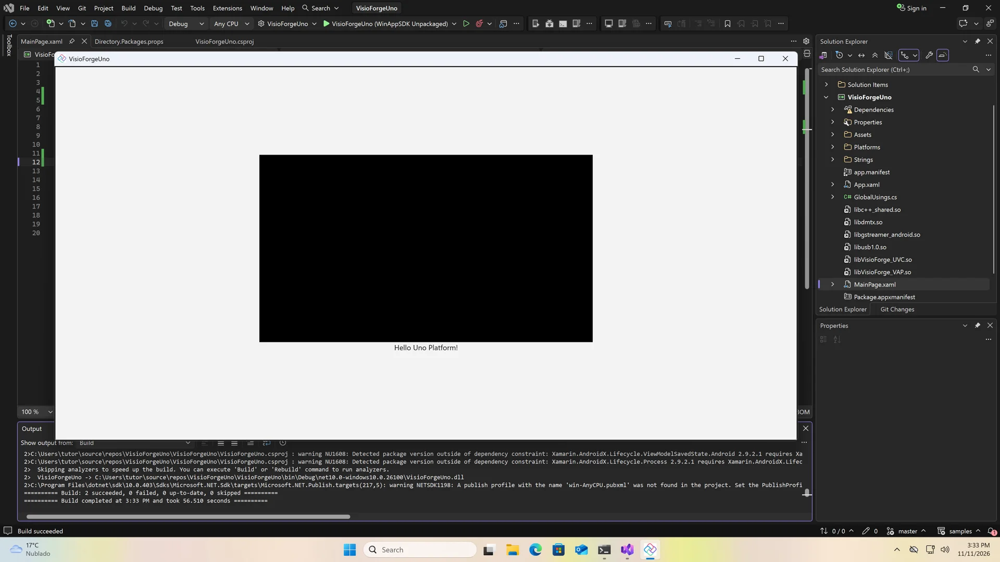

# Installer les SDK .NET VisioForge dans une application Uno Platform

[Video Capture SDK .NET](https://www.visioforge.com/video-capture-sdk-net){ .md-button .md-button--primary target="_blank" } [Video Edit SDK .NET](https://www.visioforge.com/video-edit-sdk-net){ .md-button .md-button--primary target="_blank" } [Media Blocks SDK .NET](https://www.visioforge.com/media-blocks-sdk-net){ .md-button .md-button--primary target="_blank" } [Media Player SDK .NET](https://www.visioforge.com/media-player-sdk-net){ .md-button .md-button--primary target="_blank" }

Ce guide installe les SDK .NET VisioForge dans une application Uno Platform 6.5 avec des cibles Windows, Android et iOS, et place un `VideoView` sur sa page. Il se termine par une application qui se compile et se lance sur la cible Windows.

Les quatre SDK — Video Capture SDK .NET, Media Player SDK .NET, Video Edit SDK .NET et Media Blocks SDK .NET — sont livrés dans un seul paquet NuGet, [VisioForge.DotNet.Core](https://www.nuget.org/packages/VisioForge.DotNet.Core). Le `VideoView` pour Uno se trouve dans [VisioForge.DotNet.Core.UI.Uno](https://www.nuget.org/packages/VisioForge.DotNet.Core.UI.Uno). Chaque plateforme prend aussi un paquet redist, son moteur natif, et Android prend le projet de liaison VisioForge, `AndroidDependency`, depuis GitHub.

## Tutoriel vidéo

La vidéo crée l'application, installe les paquets dans Visual Studio 2026 et la lance :

<div class="video-wrapper">
  <iframe src="https://www.youtube.com/embed/76s5ZyFxiUc?controls=1" frameborder="0" allowfullscreen></iframe>
</div>

## Prérequis

- Windows 10 ou 11, x64
- Visual Studio 2026 et le SDK .NET 10, avec les charges de travail Android et iOS pour compiler ces cibles
- Git
- Un Mac avec Xcode, couplé à Visual Studio, pour compiler la cible iOS

`VisioForge.DotNet.Core.UI.Uno` est compilé pour Uno Platform 6.5 : l'application est donc créée à partir des modèles Uno 6.5.

## Créer l'application

Dans Developer PowerShell, installez les modèles Uno 6.5, créez l'application et récupérez le projet de liaison Android :

```powershell
cd $HOME\source\repos
dotnet new install Uno.Templates@6.5.31
dotnet new unoapp -o VisioForgeUno -preset blank -platforms android ios windows -renderer native
cd VisioForgeUno
git clone --depth 1 --filter=blob:none --sparse https://github.com/visioforge/.Net-SDK-s-samples.git samples
git -C samples sparse-checkout set AndroidDependency
dotnet sln add samples\AndroidDependency\VisioForge.Core.Android.X10.csproj
devenv VisioForgeUno.sln
```

Les options du modèle choisissent le preset blank, les trois plateformes et le rendu natif. Le clone partiel n'extrait qu'`AndroidDependency` du [dépôt d'exemples](https://github.com/visioforge/.Net-SDK-s-samples/tree/master/AndroidDependency). `dotnet sln add` l'ajoute à la solution : Visual Studio ne restaure que les projets que contient sa solution, et l'application référence celui-ci.

## Propriétés du projet

Faites un clic droit sur le projet et sélectionnez **Edit Project File**. Ajoutez ces propriétés au groupe de propriétés, au-dessus d'`UnoFeatures` :

```xml
<PropertyGroup>
  <WinAppSdkVersion>1.8.260921001</WinAppSdkVersion>
  <SupportedOSPlatformVersion Condition="$(TargetFramework.Contains('-android'))">24.0</SupportedOSPlatformVersion>
  <SupportedOSPlatformVersion Condition="$(TargetFramework.Contains('-ios'))">18.0</SupportedOSPlatformVersion>
</PropertyGroup>
```

`VisioForge.DotNet.Core.UI.Uno` nécessite Windows App SDK 1.8, et Uno 6.5 apporte la 1.7 : `WinAppSdkVersion` la relève. La cible Android vise Android 7 (niveau d'API 24), le minimum du SDK sur Android. La cible iOS vise iOS 18.0, le minimum des bibliothèques natives iOS ; la vidéo ne montre que les deux premières propriétés.

## Installer les paquets

Faites un clic droit sur le projet, ouvrez **Manage NuGet Packages**, puis l'onglet **Browse**. Installez `VisioForge.DotNet.Core`, puis `VisioForge.DotNet.Core.UI.Uno`, et acceptez la licence.

Le modèle Uno utilise la gestion centralisée des paquets : NuGet écrit donc les versions dans `Directory.Packages.props`, et le fichier projet reçoit des références sans version. Ouvrez `Directory.Packages.props` depuis **Solution Items** et ajoutez une version pour chaque redist sous les deux paquets VisioForge :

```xml
<ItemGroup>
  <PackageVersion Include="VisioForge.DotNet.Core" Version="[2026.11.12]" />
  <PackageVersion Include="VisioForge.DotNet.Core.UI.Uno" Version="[2026.11.12]" />
  <PackageVersion Include="VisioForge.CrossPlatform.Core.Windows.x64" Version="[2026.11.12]" />
  <PackageVersion Include="VisioForge.CrossPlatform.Libav.Windows.x64" Version="[2026.11.12]" />
  <PackageVersion Include="VisioForge.CrossPlatform.Core.Android" Version="[2026.11.5]" />
  <PackageVersion Include="VisioForge.CrossPlatform.Core.iOS" Version="[2026.11.5]" />
</ItemGroup>
```

Prenez les dernières versions sur [nuget.org](https://www.nuget.org/profiles/visioforge). Windows prend deux redists, le moteur natif et les codecs Libav ; Android et iOS en prennent un chacun.

Ouvrez ensuite de nouveau **Edit Project File** et ajoutez les références à la fin, chacune sous la condition de sa plateforme :

```xml
<ItemGroup Condition="$(TargetFramework.Contains('-windows'))">
  <PackageReference Include="VisioForge.CrossPlatform.Core.Windows.x64" />
  <PackageReference Include="VisioForge.CrossPlatform.Libav.Windows.x64" />
</ItemGroup>
<ItemGroup Condition="$(TargetFramework.Contains('-android'))">
  <PackageReference Include="VisioForge.CrossPlatform.Core.Android" />
  <ProjectReference Include="..\samples\AndroidDependency\VisioForge.Core.Android.X10.csproj" />
</ItemGroup>
<ItemGroup Condition="$(TargetFramework.Contains('-ios'))">
  <PackageReference Include="VisioForge.CrossPlatform.Core.iOS" />
</ItemGroup>
```

Chaque cible ne prend que son propre moteur natif, et la cible Android référence aussi `AndroidDependency`. Les références ne portent pas de version : celles-ci viennent de `Directory.Packages.props`.

## Ajouter VideoView à la page

Ouvrez `MainPage.xaml`. Associez l'espace de noms VisioForge à un préfixe, ici `vf`, à côté des espaces de noms du modèle, et placez un `VideoView` dans le `StackPanel`, au-dessus du message d'accueil :

```xml
<Page x:Class="VisioForgeUno.MainPage"
      xmlns="http://schemas.microsoft.com/winfx/2006/xaml/presentation"
      xmlns:x="http://schemas.microsoft.com/winfx/2006/xaml"
      xmlns:vf="using:VisioForge.Core.UI.Uno">
  <StackPanel HorizontalAlignment="Center" VerticalAlignment="Center">
    <vf:VideoView x:Name="videoView" Width="640" Height="360" Background="Black" />
  </StackPanel>
</Page>
```

L'espace de noms est `VisioForge.Core.UI.Uno`, du paquet `VisioForge.DotNet.Core.UI.Uno`. La taille ne sert qu'à cette démonstration.

## Lancement

Lancez l'application sans débogage (Ctrl+F5) sur la cible Windows, **WinAppSDK Unpackaged**. La première compilation restaure les paquets Windows et prend environ une minute. L'application s'ouvre avec le `VideoView` au-dessus de *Hello Uno Platform!*, noir tant qu'aucun moteur du SDK n'y dessine.



## Initialiser le SDK

Avant le premier moteur, initialisez le SDK, et libérez-le à la fermeture :

```csharp
using VisioForge.Core;

await VisioForgeX.InitSDKAsync();

// À la fermeture
VisioForgeX.DestroySDK();
```

Android a besoin des autorisations caméra et microphone dans son manifeste, et iOS des descriptions d'utilisation dans `Info.plist`. Le [guide de déploiement Uno Platform](../deployment-x/uno.md) les décrit, ainsi que les commandes de build pour chaque plateforme et le dépannage.

## Implémenter VideoView dans le code

Voici un exemple complet d'utilisation de VideoView avec le pipeline Media Blocks. `App.xaml.cs` initialise le SDK une seule fois au démarrage et le libère à la fermeture de la fenêtre :

```csharp
using VisioForge.Core;

public partial class App : Application
{
    protected override async void OnLaunched(LaunchActivatedEventArgs args)
    {
        // Initialiser le SDK une seule fois, avant le premier moteur
        await VisioForgeX.InitSDKAsync();

        MainWindow = new Window();

        // Libérer le SDK à la fermeture de l'application
        MainWindow.Closed += (sender, e) => VisioForgeX.DestroySDK();

        // Le code du modèle : créer le Frame, naviguer vers MainPage, activer la fenêtre
    }
}
```

`MainPage.xaml.cs` lit un fichier ou une URL dans le `VideoView` lors d'un clic sur un bouton :

```csharp
using VisioForge.Core.MediaBlocks;
using VisioForge.Core.MediaBlocks.Sources;
using VisioForge.Core.MediaBlocks.VideoRendering;
using VisioForge.Core.Types.X.Sources;

public sealed partial class MainPage : Page
{
    private MediaBlocksPipeline? _pipeline;
    private UniversalSourceBlock? _source;
    private VideoRendererBlock? _renderer;

    public MainPage()
    {
        this.InitializeComponent();
        this.Unloaded += MainPage_Unloaded;
    }

    // Un Button dans MainPage.xaml avec Click="PlayButton_Click"
    private async void PlayButton_Click(object sender, RoutedEventArgs e)
    {
        await PlayMediaAsync("https://example.com/video.mp4");
    }

    private async Task PlayMediaAsync(string mediaPath)
    {
        // Nettoyer le pipeline précédent, le cas échéant
        await CleanupPipelineAsync();

        _pipeline = new MediaBlocksPipeline();

        // Un chemin de fichier ou une URL ; vidéo uniquement, l'audio n'est donc pas rendu
        var sourceSettings = await UniversalSourceSettings.CreateAsync(mediaPath, renderAudio: false);

        // Connecter la source au moteur de rendu et démarrer la lecture
        _source = new UniversalSourceBlock(sourceSettings);
        _renderer = new VideoRendererBlock(_pipeline, videoView);
        _pipeline.Connect(_source.VideoOutput, _renderer.Input);

        await _pipeline.StartAsync();
    }

    private async Task CleanupPipelineAsync()
    {
        if (_pipeline != null)
        {
            await _pipeline.StopAsync();
            await _pipeline.DisposeAsync();
            _pipeline = null;
        }

        _source?.Dispose();
        _source = null;

        _renderer?.Dispose();
        _renderer = null;
    }

    private async void MainPage_Unloaded(object sender, RoutedEventArgs e)
    {
        await CleanupPipelineAsync();
    }
}
```

## Applications d'exemple

Pour des exemples complets et du code d'exemple, consultez :

- Les applications d'exemple dans le dossier [Media Blocks SDK/Uno](https://github.com/visioforge/.Net-SDK-s-samples/tree/master/Media%20Blocks%20SDK/Uno)
- Les applications d'exemple dans le dossier [Media Player SDK X/Uno](https://github.com/visioforge/.Net-SDK-s-samples/tree/master/Media%20Player%20SDK%20X/Uno)
- Les applications d'exemple dans le dossier [Video Capture SDK X/Uno](https://github.com/visioforge/.Net-SDK-s-samples/tree/master/Video%20Capture%20SDK%20X/Uno)
- Notre [dépôt GitHub](https://github.com/visioforge/.Net-SDK-s-samples)

Les exemples disponibles incluent :

- **Simple Player** — lecteur multimédia basique avec contrôles de lecture
- **RTSP Viewer** — visionneuse de flux pour caméras réseau
- **Video Capture** — capture caméra avec fonctionnalité d'enregistrement

## Transcription de la vidéo

### Présentation

Installons les SDK .NET VisioForge dans une application Uno Platform, avec des cibles Windows, Android et iOS, et plaçons un VideoView sur sa page. Les quatre SDK .NET VisioForge sont livrés dans un seul paquet NuGet, VisioForge.DotNet.Core. Le VideoView pour Uno se trouve dans VisioForge.DotNet.Core.UI.Uno. Chaque plateforme prend aussi un paquet redist, son moteur natif, et Android prend le projet de liaison VisioForge, AndroidDependency, depuis GitHub. Il vous faut Windows 10 ou 11, Visual Studio 2026 et le SDK .NET 10, avec les charges de travail Android et iOS pour compiler ces cibles, ainsi que Git. Le paquet Uno de VisioForge est compilé pour Uno Platform 6.5 : cette vidéo crée donc l'application à partir des modèles Uno 6.5.

### Créer l'application

Ouvrez Developer PowerShell depuis le menu Démarrer, puis allez dans votre dossier de projets. Installez les modèles Uno Platform, version 6.5.31. Créez l'application avec dotnet new unoapp : le preset blank, les cibles Android, iOS et Windows, et le rendu natif. Le modèle restaure la nouvelle solution, ce qui prend une minute. Dans le dossier de la solution, clonez de façon partielle le dépôt d'exemples VisioForge et n'extrayez qu'AndroidDependency, le projet de liaison Android. Ajoutez-le à la solution avec dotnet sln add : Visual Studio ne restaure que les projets que contient sa solution. Ouvrez ensuite la solution dans Visual Studio. Voici toutes les commandes. Les options du modèle choisissent le preset blank, les trois plateformes et le rendu natif.

### Deux propriétés

Avant NuGet, deux propriétés vont dans le fichier projet. Faites un clic droit sur le projet et ouvrez Edit Project File. Collez-les dans le groupe de propriétés, au-dessus d'UnoFeatures, puis enregistrez. Le paquet Uno de VisioForge nécessite Windows App SDK 1.8, et Uno 6.5 apporte la 1.7 : WinAppSdkVersion la relève. La cible Android vise Android 7, niveau d'API 24, le minimum du SDK sur Android.

### NuGet

Passons à NuGet. Faites un clic droit sur le projet, ouvrez Manage NuGet Packages, puis l'onglet Browse. Recherchez VisioForge.DotNet.Core et installez-le. Visual Studio affiche les modifications et la licence : acceptez-les. Installez ensuite VisioForge.DotNet.Core.UI.Uno, qui contient le VideoView pour Uno. Les deux figurent dans l'onglet Installed. Le modèle utilise la gestion centralisée des paquets : leurs versions ont donc été écrites dans Directory.Packages.props.

### Redists

Viennent ensuite les redists. Ouvrez Directory.Packages.props depuis Solution Items et ajoutez une version pour chaque redist sous les deux paquets VisioForge. Windows en prend deux, le moteur natif et les codecs Libav. Android et iOS en prennent un chacun. Voici la liste complète : les deux paquets de NuGet et les quatre redists. Prenez les dernières versions sur nuget.org. Ouvrez ensuite de nouveau Edit Project File et ajoutez les références à la fin, chacune sous la condition de sa plateforme. Chaque cible ne prend que son propre moteur natif, et Android référence aussi le projet AndroidDependency du dossier samples. Les conditions testent le framework cible. Les références ne portent pas de version : celles-ci viennent de Directory.Packages.props.

### VideoView

Passons à la page. Ouvrez MainPage.xaml depuis l'Explorateur de solutions. Associez l'espace de noms VisioForge à un préfixe, ici vf, à côté des espaces de noms du modèle. Et placez un VideoView dans le StackPanel, au-dessus du message d'accueil. Puis enregistrez. Dans Uno, l'espace de noms est VisioForge.Core.UI.Uno, du paquet VisioForge.DotNet.Core.UI.Uno. La taille ne sert qu'à cette démonstration.

### Lancement

Lancez-la sans débogage, sur la cible Windows, WinAppSDK Unpackaged. La première compilation restaure les paquets Windows et prend environ une minute. L'application s'ouvre, avec le VideoView au-dessus de Hello Uno Platform. Il reste noir tant qu'aucun moteur du SDK n'y dessine.

### Étapes suivantes

Avant le premier moteur, initialisez le SDK avec VisioForgeX.InitSDKAsync et libérez-le avec DestroySDK à la fermeture. Android a besoin des autorisations caméra et microphone dans son manifeste, et iOS des descriptions d'utilisation dans Info.plist. Le déploiement et les autres plateformes sont décrits dans le guide Uno du site d'aide.

## Voir aussi

- [Guide de déploiement Uno Platform](../deployment-x/uno.md) — redists, autorisations, commandes de build et dépannage
- [Initialisation du SDK](../init.md) — `InitSDKAsync` et `DestroySDK` en détail
- Guides d'installation pour [Visual Studio](visual-studio.md), [MAUI](maui.md), [Avalonia](avalonia.md) et [Rider](rider.md)
- Déploiement [Windows](../deployment-x/Windows.md), [Android](../deployment-x/Android.md) et [iOS](../deployment-x/iOS.md)
