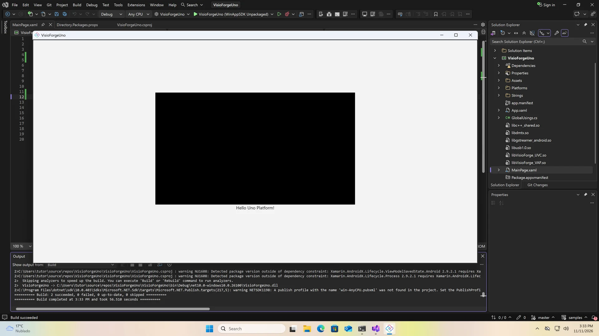

# Install the VisioForge .NET SDKs in an Uno Platform app

[Video Capture SDK .NET](https://www.visioforge.com/video-capture-sdk-net){ .md-button .md-button--primary target="_blank" } [Video Edit SDK .NET](https://www.visioforge.com/video-edit-sdk-net){ .md-button .md-button--primary target="_blank" } [Media Blocks SDK .NET](https://www.visioforge.com/media-blocks-sdk-net){ .md-button .md-button--primary target="_blank" } [Media Player SDK .NET](https://www.visioforge.com/media-player-sdk-net){ .md-button .md-button--primary target="_blank" }

This guide installs the VisioForge .NET SDKs in an Uno Platform 6.5 app with Windows, Android and iOS heads, and puts a `VideoView` on its page. It ends with an app that builds and runs on the Windows head.

All four SDKs — Video Capture SDK .NET, Media Player SDK .NET, Video Edit SDK .NET and Media Blocks SDK .NET — come in one NuGet package, [VisioForge.DotNet.Core](https://www.nuget.org/packages/VisioForge.DotNet.Core). The Uno `VideoView` is in [VisioForge.DotNet.Core.UI.Uno](https://www.nuget.org/packages/VisioForge.DotNet.Core.UI.Uno). Each platform also takes a redist package, its native engine, and Android takes the VisioForge binding project, `AndroidDependency`, from GitHub.

## Video tutorial

The video creates the app, installs the packages in Visual Studio 2026 and runs it:

<div class="video-wrapper">
  <iframe src="https://www.youtube.com/embed/76s5ZyFxiUc?controls=1" frameborder="0" allowfullscreen></iframe>
</div>

## Requirements

- Windows 10 or 11, x64
- Visual Studio 2026 and the .NET 10 SDK, with the Android and iOS workloads to build those heads
- Git
- A Mac with Xcode, paired with Visual Studio, to build the iOS head

`VisioForge.DotNet.Core.UI.Uno` is built for Uno Platform 6.5, so the app is created from the Uno 6.5 templates.

## Create the app

In Developer PowerShell, install the Uno 6.5 templates, create the app, and fetch the Android binding project:

```powershell
cd $HOME\source\repos
dotnet new install Uno.Templates@6.5.31
dotnet new unoapp -o VisioForgeUno -preset blank -platforms android ios windows -renderer native
cd VisioForgeUno
git clone --depth 1 --filter=blob:none --sparse https://github.com/visioforge/.Net-SDK-s-samples.git samples
git -C samples sparse-checkout set AndroidDependency
dotnet sln add samples\AndroidDependency\VisioForge.Core.Android.X10.csproj
devenv VisioForgeUno.sln
```

The template options pick the blank preset, the three platforms and the native renderer. The sparse clone checks out only `AndroidDependency` from the [samples repository](https://github.com/visioforge/.Net-SDK-s-samples/tree/master/AndroidDependency). `dotnet sln add` puts it into the solution: Visual Studio restores only the projects its solution holds, and the app references this one.

## Project properties

Right-click the project and select **Edit Project File**. Add these properties to the property group, above `UnoFeatures`:

```xml
<PropertyGroup>
  <WinAppSdkVersion>1.8.260921001</WinAppSdkVersion>
  <SupportedOSPlatformVersion Condition="$(TargetFramework.Contains('-android'))">24.0</SupportedOSPlatformVersion>
  <SupportedOSPlatformVersion Condition="$(TargetFramework.Contains('-ios'))">18.0</SupportedOSPlatformVersion>
</PropertyGroup>
```

`VisioForge.DotNet.Core.UI.Uno` needs Windows App SDK 1.8, and Uno 6.5 brings 1.7: `WinAppSdkVersion` raises it. The Android head targets Android 7 (API level 24), the SDK's minimum on Android. The iOS head targets iOS 18.0, the minimum of the native iOS libraries; the video shows only the first two properties.

## Install the packages

Right-click the project, open **Manage NuGet Packages** and the **Browse** tab. Install `VisioForge.DotNet.Core`, then `VisioForge.DotNet.Core.UI.Uno`, and accept the license.

The Uno template uses central package management, so NuGet writes the versions to `Directory.Packages.props` and the project file gets references without them. Open `Directory.Packages.props` from **Solution Items** and add a version for each redist under the two VisioForge packages:

```xml
<ItemGroup>
  <PackageVersion Include="VisioForge.DotNet.Core" Version="[2026.11.12]" />
  <PackageVersion Include="VisioForge.DotNet.Core.UI.Uno" Version="[2026.11.12]" />
  <PackageVersion Include="VisioForge.CrossPlatform.Core.Windows.x64" Version="[2026.11.12]" />
  <PackageVersion Include="VisioForge.CrossPlatform.Libav.Windows.x64" Version="[2026.11.12]" />
  <PackageVersion Include="VisioForge.CrossPlatform.Core.Android" Version="[2026.11.5]" />
  <PackageVersion Include="VisioForge.CrossPlatform.Core.iOS" Version="[2026.11.5]" />
</ItemGroup>
```

Take the latest versions from [nuget.org](https://www.nuget.org/profiles/visioforge). Windows takes two redists, the native engine and the Libav codecs; Android and iOS take one each.

Then open **Edit Project File** again and add the references at the end, each under the condition of its platform:

```xml
<ItemGroup Condition="$(TargetFramework.Contains('-windows'))">
  <PackageReference Include="VisioForge.CrossPlatform.Core.Windows.x64" />
  <PackageReference Include="VisioForge.CrossPlatform.Libav.Windows.x64" />
</ItemGroup>
<ItemGroup Condition="$(TargetFramework.Contains('-android'))">
  <PackageReference Include="VisioForge.CrossPlatform.Core.Android" />
  <ProjectReference Include="..\samples\AndroidDependency\VisioForge.Core.Android.X10.csproj" />
</ItemGroup>
<ItemGroup Condition="$(TargetFramework.Contains('-ios'))">
  <PackageReference Include="VisioForge.CrossPlatform.Core.iOS" />
</ItemGroup>
```

Each head takes only its own native engine, and the Android head also references `AndroidDependency`. The references carry no versions: those come from `Directory.Packages.props`.

## Add VideoView to the page

Open `MainPage.xaml`. Map the VisioForge namespace to a prefix, here `vf`, next to the template's own namespaces, and put a `VideoView` into the `StackPanel`, above the greeting:

```xml
<Page x:Class="VisioForgeUno.MainPage"
      xmlns="http://schemas.microsoft.com/winfx/2006/xaml/presentation"
      xmlns:x="http://schemas.microsoft.com/winfx/2006/xaml"
      xmlns:vf="using:VisioForge.Core.UI.Uno">
  <StackPanel HorizontalAlignment="Center" VerticalAlignment="Center">
    <vf:VideoView x:Name="videoView" Width="640" Height="360" Background="Black" />
  </StackPanel>
</Page>
```

The namespace is `VisioForge.Core.UI.Uno`, from the `VisioForge.DotNet.Core.UI.Uno` package. The size is only for this demo.

## Run it

Start the app without debugging (Ctrl+F5) on the Windows head, **WinAppSDK Unpackaged**. The first build restores the Windows packages and takes about a minute. The app opens with the `VideoView` above *Hello Uno Platform!*, black until an SDK engine draws into it.



## Initialize the SDK

Before the first engine, initialize the SDK, and release it on exit:

```csharp
using VisioForge.Core;

await VisioForgeX.InitSDKAsync();

// On exit
VisioForgeX.DestroySDK();
```

Android needs the camera and microphone permissions in its manifest, and iOS the usage descriptions in `Info.plist`. The [Uno Platform deployment guide](../deployment-x/uno.md) covers them, the build commands for each platform, and troubleshooting.

## Implement VideoView in code

Here's a complete example of using VideoView with the Media Blocks pipeline. `App.xaml.cs` initializes the SDK once at startup and releases it when the window closes:

```csharp
using VisioForge.Core;

public partial class App : Application
{
    protected override async void OnLaunched(LaunchActivatedEventArgs args)
    {
        // Initialize the SDK once, before the first engine
        await VisioForgeX.InitSDKAsync();

        MainWindow = new Window();

        // Release the SDK when the app closes
        MainWindow.Closed += (sender, e) => VisioForgeX.DestroySDK();

        // The template's code: create the Frame, navigate to MainPage, activate the window
    }
}
```

`MainPage.xaml.cs` plays a file or a URL in the `VideoView` when a button is clicked:

```csharp
using VisioForge.Core.MediaBlocks;
using VisioForge.Core.MediaBlocks.Sources;
using VisioForge.Core.MediaBlocks.VideoRendering;
using VisioForge.Core.Types.X.Sources;

public sealed partial class MainPage : Page
{
    private MediaBlocksPipeline? _pipeline;
    private UniversalSourceBlock? _source;
    private VideoRendererBlock? _renderer;

    public MainPage()
    {
        this.InitializeComponent();
        this.Unloaded += MainPage_Unloaded;
    }

    // A Button in MainPage.xaml with Click="PlayButton_Click"
    private async void PlayButton_Click(object sender, RoutedEventArgs e)
    {
        await PlayMediaAsync("https://example.com/video.mp4");
    }

    private async Task PlayMediaAsync(string mediaPath)
    {
        // Clean up the previous pipeline, if any
        await CleanupPipelineAsync();

        _pipeline = new MediaBlocksPipeline();

        // A file path or a URL; video only, so audio is not rendered
        var sourceSettings = await UniversalSourceSettings.CreateAsync(mediaPath, renderAudio: false);

        // Connect the source to the renderer and start playback
        _source = new UniversalSourceBlock(sourceSettings);
        _renderer = new VideoRendererBlock(_pipeline, videoView);
        _pipeline.Connect(_source.VideoOutput, _renderer.Input);

        await _pipeline.StartAsync();
    }

    private async Task CleanupPipelineAsync()
    {
        if (_pipeline != null)
        {
            await _pipeline.StopAsync();
            await _pipeline.DisposeAsync();
            _pipeline = null;
        }

        _source?.Dispose();
        _source = null;

        _renderer?.Dispose();
        _renderer = null;
    }

    private async void MainPage_Unloaded(object sender, RoutedEventArgs e)
    {
        await CleanupPipelineAsync();
    }
}
```

## Sample applications

For complete examples and sample code, visit:

- Sample applications in the [Media Blocks SDK/Uno](https://github.com/visioforge/.Net-SDK-s-samples/tree/master/Media%20Blocks%20SDK/Uno) folder
- Sample applications in the [Media Player SDK X/Uno](https://github.com/visioforge/.Net-SDK-s-samples/tree/master/Media%20Player%20SDK%20X/Uno) folder
- Sample applications in the [Video Capture SDK X/Uno](https://github.com/visioforge/.Net-SDK-s-samples/tree/master/Video%20Capture%20SDK%20X/Uno) folder
- Our [GitHub repository](https://github.com/visioforge/.Net-SDK-s-samples)

Available samples include:

- **Simple Player** - Basic media player with playback controls
- **RTSP Viewer** - Network camera streaming viewer
- **Video Capture** - Camera capture with recording functionality

## Video Transcript

### Overview

Let's install the VisioForge .NET SDKs in an Uno Platform app, with heads for Windows, Android and iOS, and put a VideoView on its page. All four VisioForge .NET SDKs come in one NuGet package, VisioForge.DotNet.Core. The Uno VideoView is in VisioForge.DotNet.Core.UI.Uno. Each platform also takes a redist package, its native engine, and Android takes the VisioForge binding project, AndroidDependency, from GitHub. You need Windows 10 or 11, Visual Studio 2026, and the .NET 10 SDK, with the Android and iOS workloads to build those heads, and Git. The VisioForge Uno package is built for Uno Platform 6.5, so this video creates the app from the Uno 6.5 templates.

### Create the app

Open Developer PowerShell from the Start menu, and go to your projects folder. Install the Uno Platform templates, version 6.5.31. Create the app with dotnet new unoapp: the blank preset, Android, iOS and Windows heads, and the native renderer. The template restores the new solution, which takes a minute. In the solution folder, clone the VisioForge samples repository sparsely, and check out only AndroidDependency, the Android binding project. Add it to the solution with dotnet sln add: Visual Studio restores only the projects its solution holds. Then open the solution in Visual Studio. Here are all the commands. The template options pick the blank preset, the three platforms, and the native renderer.

### Two properties

Two properties go into the project file before NuGet. Right-click the project, and open Edit Project File. Paste them into the property group, above UnoFeatures, and save. The VisioForge Uno package needs Windows App SDK 1.8, and Uno 6.5 brings 1.7: WinAppSdkVersion raises it. The Android head targets Android 7, API level 24, the SDK's minimum on Android.

### NuGet

Now NuGet. Right-click the project, open Manage NuGet Packages, and the Browse tab. Search for VisioForge.DotNet.Core and install it. Visual Studio shows the changes and the license: accept them. Then install VisioForge.DotNet.Core.UI.Uno, which holds the Uno VideoView. Both are on the Installed tab. The template uses central package management, so their versions went to Directory.Packages.props.

### Redists

The redists come next. Open Directory.Packages.props from Solution Items, and add a version for each redist under the two VisioForge packages. Windows takes two, the native engine and the Libav codecs. Android and iOS take one each. Here is the whole list: the two packages from NuGet and the four redists. Take the latest versions from nuget.org. Then open Edit Project File again, and add the references at the end, each under the condition of its platform. Each head takes only its own native engine, and Android also references the AndroidDependency project from the samples folder. The conditions check the target framework. The references carry no versions: those come from Directory.Packages.props.

### VideoView

Now the page. Open MainPage.xaml from Solution Explorer. Map the VisioForge namespace to a prefix, here vf, next to the template's own namespaces. And put a VideoView into the StackPanel, above the greeting. Then save. In Uno, the namespace is VisioForge.Core.UI.Uno, from the VisioForge.DotNet.Core.UI.Uno package. The size here is only for this demo.

### Run it

Start it without debugging, on the Windows head, WinAppSDK Unpackaged. The first build restores the Windows packages, and takes about a minute. The app opens, with the VideoView above Hello Uno Platform. It stays black until an SDK engine draws into it.

### Next steps

Before the first engine, initialize the SDK with VisioForgeX.InitSDKAsync, and release it with DestroySDK on exit. Android needs the camera and microphone permissions in its manifest, and iOS the usage descriptions in Info.plist. Deployment and the other platforms are in the Uno guide on the help site.

## See also

- [Uno Platform deployment guide](../deployment-x/uno.md) — redists, permissions, build commands and troubleshooting
- [SDK initialization](../init.md) — `InitSDKAsync` and `DestroySDK` in detail
- Install guides for [Visual Studio](visual-studio.md), [MAUI](maui.md), [Avalonia](avalonia.md) and [Rider](rider.md)
- [Windows](../deployment-x/Windows.md), [Android](../deployment-x/Android.md) and [iOS](../deployment-x/iOS.md) deployment
