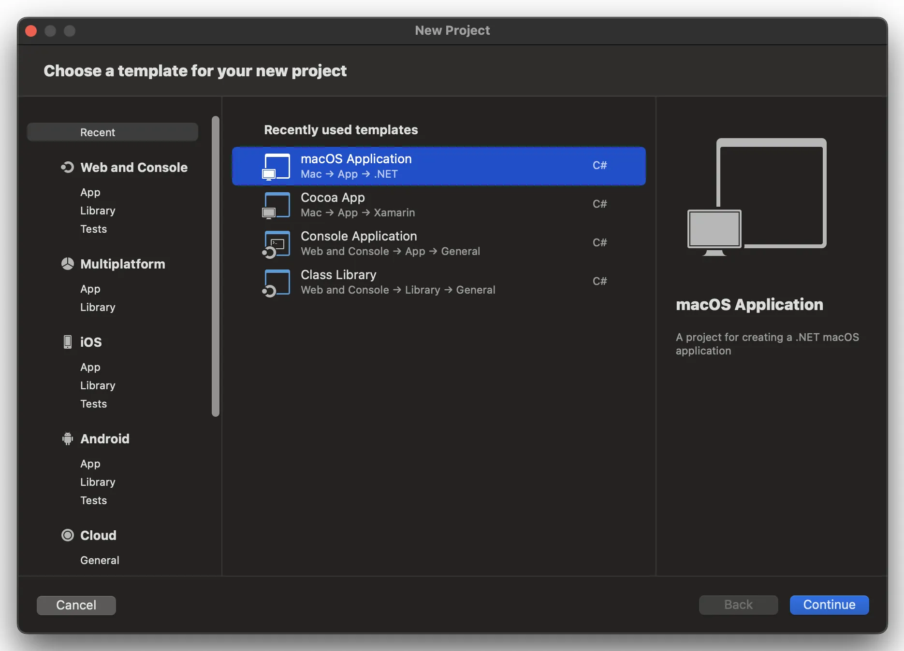
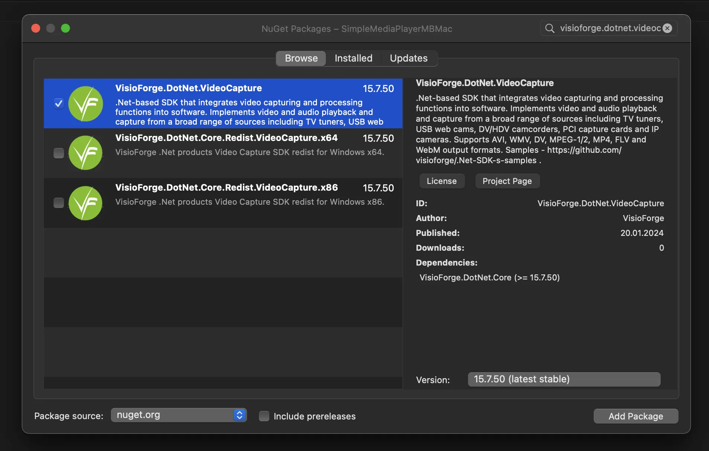
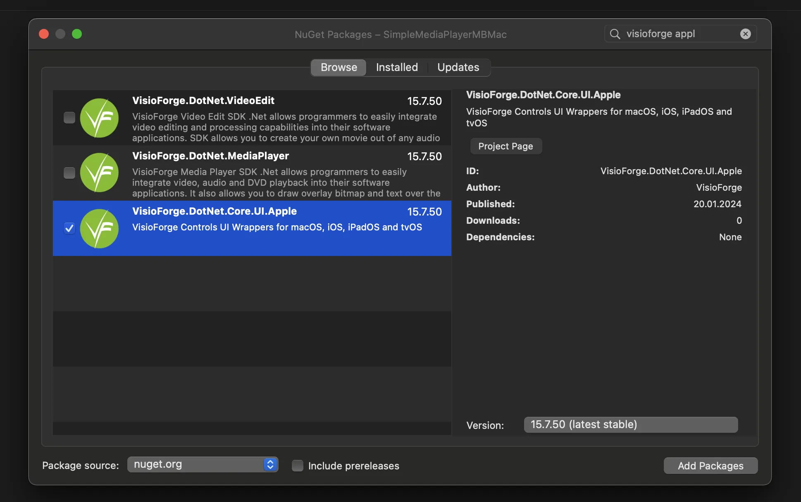
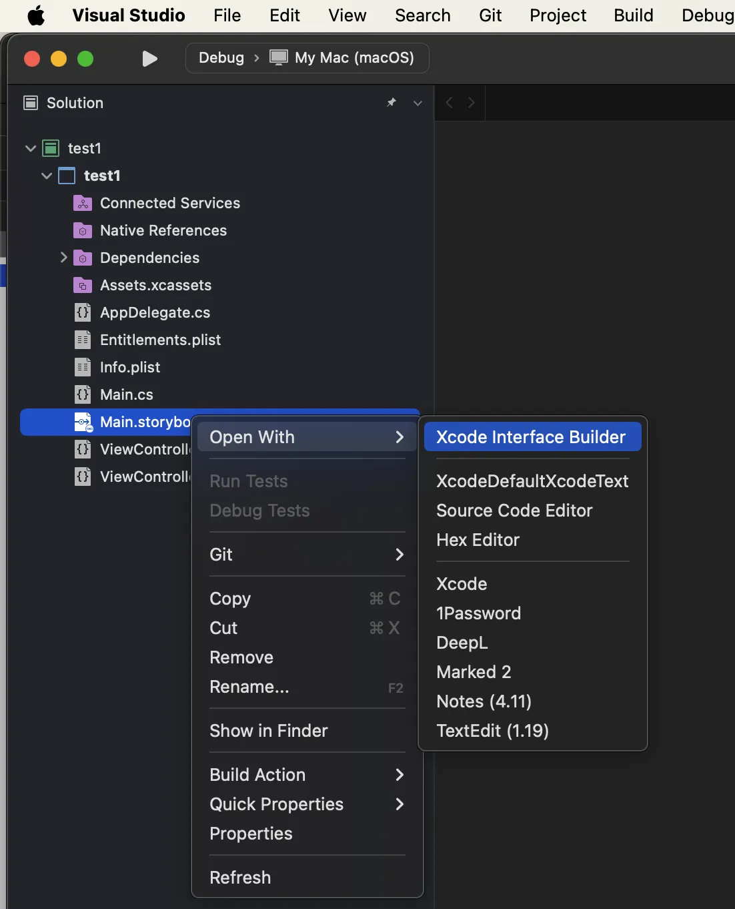
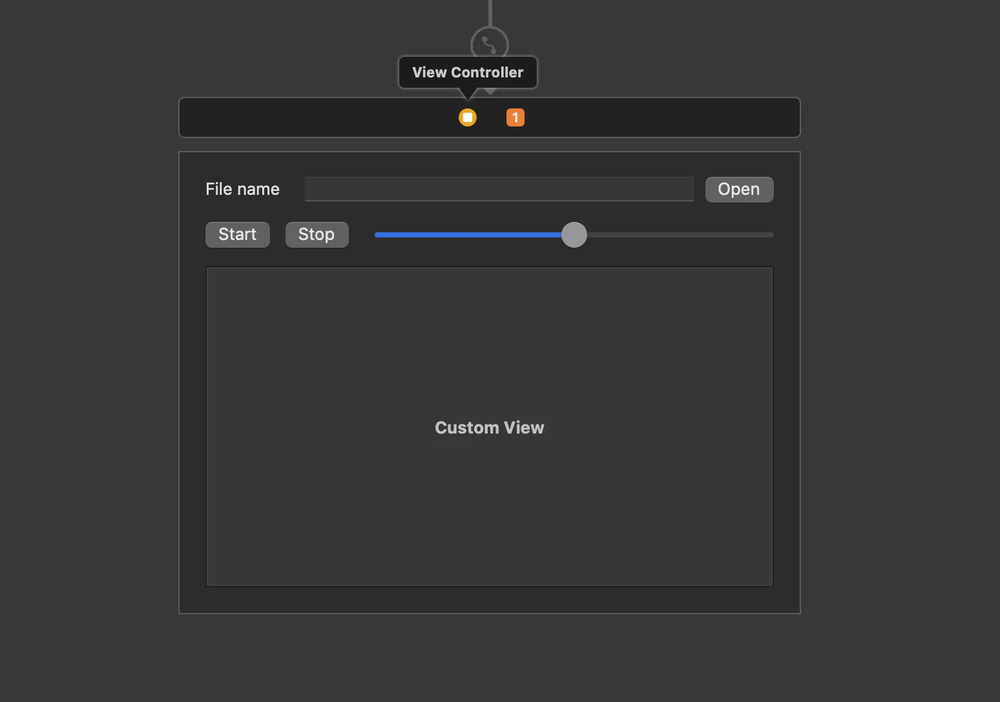

# Guía completa para integrar SDKs .NET de VisioForge con Visual Studio para Mac

[Video Capture SDK .NET](https://www.visioforge.com/video-capture-sdk-net){ .md-button .md-button--primary target="_blank" } [Video Edit SDK .NET](https://www.visioforge.com/video-edit-sdk-net){ .md-button .md-button--primary target="_blank" } [Media Blocks SDK .NET](https://www.visioforge.com/media-blocks-sdk-net){ .md-button .md-button--primary target="_blank" } [Media Player SDK .NET](https://www.visioforge.com/media-player-sdk-net){ .md-button .md-button--primary target="_blank" }

!!! warning "Visual Studio para Mac está descontinuado"
    Microsoft [retiró Visual Studio para Mac](https://learn.microsoft.com/en-us/visualstudio/releases/2022/what-happened-to-vs-for-mac) el 31 de agosto de 2024. No es posible realizar nuevas instalaciones y el IDE ya no recibe actualizaciones. Para desarrollo .NET en macOS con los SDKs de VisioForge, use **[JetBrains Rider](./rider.md)** o **Visual Studio Code con el C# Dev Kit** en su lugar. Los nombres de paquetes NuGet, controles de UI y fragmentos de C# de esta página aplican de manera idéntica a esos IDEs.

## Introducción a SDKs de VisioForge en macOS

VisioForge proporciona potentes SDKs multimedia para desarrolladores .NET que trabajan en plataformas macOS e iOS. Esta guía detallada le llevará a través de todo el proceso de integración de estos SDKs en sus proyectos de Visual Studio para Mac. Aunque este tutorial se enfoca principalmente en el desarrollo de aplicaciones macOS, los mismos principios se aplican a aplicaciones iOS con mínimas adaptaciones.

Siguiendo esta guía, aprenderá cómo configurar correctamente su entorno de desarrollo, instalar los paquetes necesarios, configurar componentes de UI y preparar su aplicación para el despliegue. Este conocimiento servirá como una base sólida para construir aplicaciones multimedia sofisticadas usando tecnología VisioForge.

## Prerrequisitos para el desarrollo

Antes de comenzar el proceso de integración, asegúrese de tener:

- Visual Studio para Mac (se recomienda la última versión)
- .NET SDK instalado (versión mínima 6.0)
- Conocimiento básico de C# y desarrollo .NET
- Acceso administrativo a su sistema macOS
- Conexión a internet activa para descargas de paquetes NuGet
- Opcional: XCode para edición de storyboards

Tener estos prerrequisitos en su lugar asegurará un proceso de instalación fluido y prevendrá problemas comunes de configuración.

## Configurar un nuevo proyecto macOS

Comencemos creando un nuevo proyecto macOS en Visual Studio para Mac. Esto servirá como la base para nuestra integración del SDK de VisioForge.

### Crear la estructura del proyecto

1. Lanza Visual Studio para Mac.
2. Seleccione **File > New Solution** desde la barra de menú.
3. En el diálogo de selección de plantillas, navegue a **.NET > App**.
4. Elija **macOS Application** como su plantilla de proyecto.
5. Configure los ajustes de su proyecto, incluyendo:
   - Nombre del proyecto (elija algo descriptivo)
   - Identificador de organización (típicamente en formato de dominio inverso)
   - Framework objetivo (.NET 6.0 o posterior recomendado)
   - Nombre de la solución (puede coincidir con el nombre de su proyecto)
6. Haga clic en **Create** para generar su plantilla de proyecto.

Esto crea una aplicación macOS básica con la estructura de proyecto estándar requerida para la integración del SDK de VisioForge.



## Instalar paquetes del SDK de VisioForge

Después de crear su proyecto, el siguiente paso es instalar los paquetes del SDK de VisioForge necesarios vía NuGet. Estos paquetes contienen la funcionalidad principal y los componentes de UI requeridos para operaciones multimedia.

### Agregar el paquete principal del SDK

Cada línea de productos de VisioForge tiene un paquete principal dedicado que contiene la funcionalidad central. Necesitará elegir el paquete apropiado según sus requisitos de desarrollo.

1. Haga clic derecho en su proyecto en el Solution Explorer.
2. Seleccione **Manage NuGet Packages** del menú contextual.
3. Haga clic en la pestaña **Browse** en el NuGet Package Manager.
4. En el cuadro de búsqueda, escribe "VisioForge" para encontrar todos los paquetes disponibles.
5. Seleccione uno de los siguientes paquetes según sus requisitos:

Paquetes NuGet disponibles:

- [VisioForge.DotNet.VideoCapture](https://www.nuget.org/packages/VisioForge.DotNet.VideoCapture) - Para captura de video, webcam y funcionalidad de grabación de pantalla
- [VisioForge.DotNet.VideoEdit](https://www.nuget.org/packages/VisioForge.DotNet.VideoEdit) - Para edición, procesamiento y conversión de video
- [VisioForge.DotNet.MediaPlayer](https://www.nuget.org/packages/VisioForge.DotNet.MediaPlayer) - Para reproducción de medios y streaming
- [VisioForge.DotNet.MediaBlocks](https://www.nuget.org/packages/VisioForge.DotNet.MediaBlocks) - Para flujos de trabajo avanzados de procesamiento de medios

6. Haga clic en **Add Package** para instalar su paquete seleccionado.
7. Acepta cualquier acuerdo de licencia que aparezca.

El proceso de instalación resolverá automáticamente las dependencias y agregará referencias a su proyecto.



### Controles de UI para Apple

Para aplicaciones macOS e iOS, los controles específicos de Apple (`VideoView`, `GLView`) **se distribuyen dentro del paquete principal `VisioForge.DotNet.Core`** — no existe un paquete NuGet `UI.Apple` separado. Una vez agregado `VisioForge.DotNet.Core` arriba, use los controles mediante el espacio de nombres `VisioForge.Core.UI.Apple`:

```csharp
using VisioForge.Core.UI.Apple;
```



## Integrar capacidades de vista previa de video

La mayoría de las aplicaciones multimedia requieren funcionalidad de vista previa de video. Los SDKs de VisioForge proporcionan controles especializados para este propósito que se integran perfectamente con aplicaciones macOS.

### Agregar el control VideoView

El control VideoView es el componente principal para mostrar contenido de video en su aplicación. Aquí está cómo agregarlo a su interfaz:

1. Abra el archivo de storyboard principal de su aplicación haciendo doble clic en el Solution Explorer.
2. Visual Studio para Mac abrirá XCode Interface Builder para edición de storyboard.
3. Desde la Object Library, encuentra el control **Custom View**.
4. Arrastre el control Custom View a su ventana donde quiere que aparezca el video.
5. Establezca restricciones apropiadas para asegurar dimensionamiento y posicionamiento adecuados.
6. Usando el Identity Inspector, establezca un nombre descriptivo para su Custom View (por ejemplo, "videoViewHost").
7. Guarde sus cambios y regrese a Visual Studio para Mac.

Este Custom View servirá como contenedor para el control VideoView de VisioForge, que se agregará programáticamente.





### Inicializar el VideoView en código

Después de agregar el Custom View contenedor, necesita inicializar el control VideoView programáticamente:

1. Abra su archivo ViewController.cs.
2. Agregue las directivas using necesarias en la parte superior del archivo:

```csharp
using VisioForge.Core.UI.Apple;
using CoreGraphics;
```

3. Agregue un campo privado a su clase ViewController para mantener la referencia del VideoView:

```csharp
private VideoView _videoView;
```

4. Modifica el método ViewDidLoad para inicializar y agregar el VideoView:

```csharp
public override void ViewDidLoad()
{
    base.ViewDidLoad();

    // Crear y agregar VideoView
    _videoView = new VideoView(new CGRect(0, 0, videoViewHost.Bounds.Width, videoViewHost.Bounds.Height));
    this.videoViewHost.AddSubview(_videoView);

    // Configurar propiedades del VideoView
    _videoView.AutoresizingMask = Foundation.NSViewResizingMask.WidthSizable | Foundation.NSViewResizingMask.HeightSizable;

    // Código de inicialización adicional
    InitializeMediaComponents();
}

private async void InitializeMediaComponents()
{
    // Inicializar sus componentes del SDK de VisioForge aquí. En macOS, siempre
    // usar los motores X multiplataforma — los clásicos VideoCaptureCore /
    // MediaPlayerCore / VideoEditCore son solo Windows.
    await VisioForgeX.InitSDKAsync();

    // Por ejemplo, para reproducción:
    // var player = new MediaPlayerCoreX(_videoView);
    // var settings = await UniversalSourceSettings.CreateAsync(new Uri("https://example.com/video.mp4"));
    // await player.OpenAsync(settings);
    // await player.PlayAsync();
}
```

Este código crea una instancia de `VideoView`, la dimensiona para coincidir con su vista contenedora y la agrega como subvista. La propiedad `AutoresizingMask` asegura que la vista de video se redimensione correctamente cuando cambia el tamaño de la ventana.

## Agregar paquetes de redistribución requeridos

Los SDKs de VisioForge dependen de varias bibliotecas nativas y componentes que deben incluirse en el bundle de su aplicación. Estas dependencias varían según el SDK específico que esté usando y su plataforma objetivo.

Consulte la [documentación de despliegue](../deployment-x/index.md) para información detallada sobre qué paquetes de redistribución se requieren para su escenario específico.

## Solución de problemas comunes

Si encuentra problemas durante la instalación o integración, considere estas soluciones comunes:

1. **Dependencias faltantes**: Asegúrese de que todos los paquetes de redistribución requeridos estén instalados
2. **Errores de compilación**: Verifique que su proyecto tenga como objetivo una versión compatible de .NET
3. **Bloqueos en tiempo de ejecución**: Verifique problemas de inicialización específicos de la plataforma
4. **Pantalla de video negra**: Verifique que el VideoView esté correctamente inicializado y agregado a la jerarquía de vistas
5. **Problemas de rendimiento**: Considere habilitar la aceleración de hardware donde esté disponible

Para guía de solución de problemas más específica, consulte la documentación de VisioForge o contacte a su equipo de soporte.

## Próximos pasos y recursos

Ahora que ha integrado exitosamente los SDKs de VisioForge en su proyecto de Visual Studio para Mac, puede explorar características y capacidades más avanzadas:

- Crear flujos de trabajo personalizados de procesamiento de video
- Implementar funcionalidad de grabación y captura
- Desarrollar características sofisticadas de edición de medios
- Construir aplicaciones de medios de streaming

### Recursos adicionales

- Visite nuestro [repositorio de GitHub](https://github.com/visioforge/.Net-SDK-s-samples) para ejemplos de código y proyectos de ejemplo
- Únase al [foro de desarrolladores](https://helpdesk.visioforge.com/helpdesk/my-tickets/new) para conectar con otros desarrolladores
- Suscríbase a nuestro boletín para actualizaciones sobre nuevas características y mejores prácticas

Siguiendo esta guía, ha establecido una base sólida para desarrollar potentes aplicaciones multimedia en macOS e iOS usando SDKs de VisioForge y Visual Studio para Mac.
