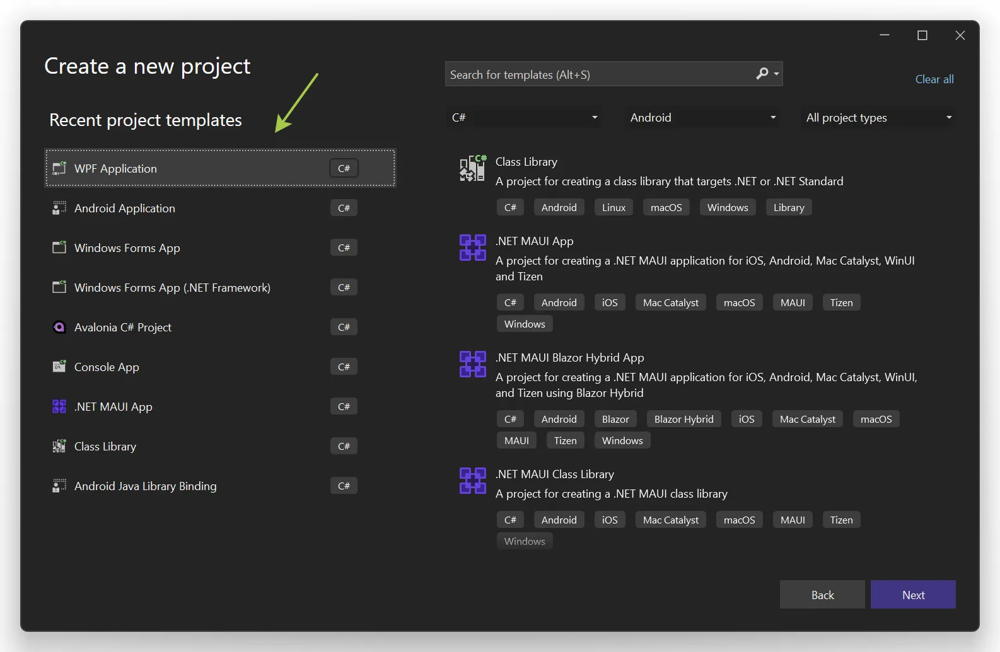
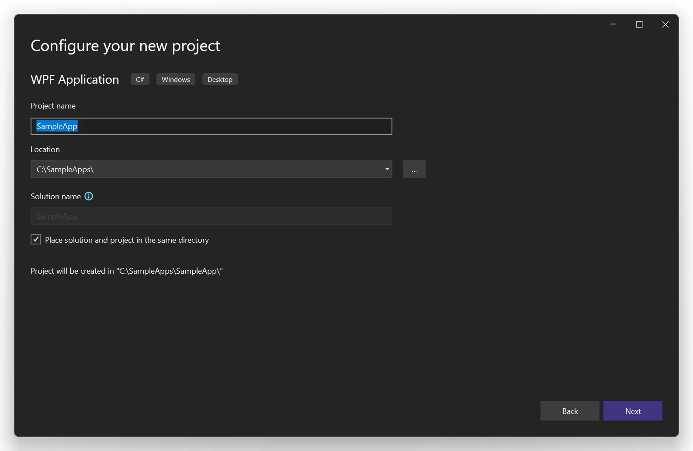
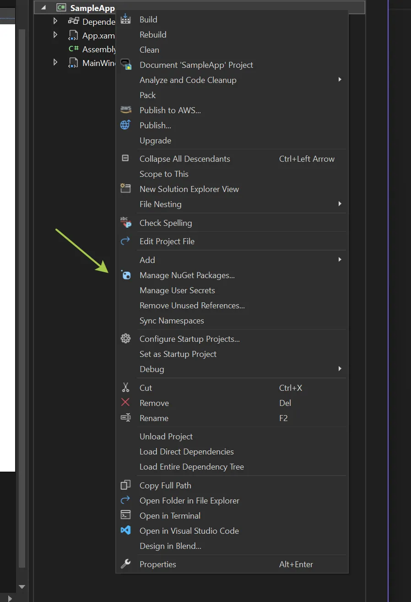
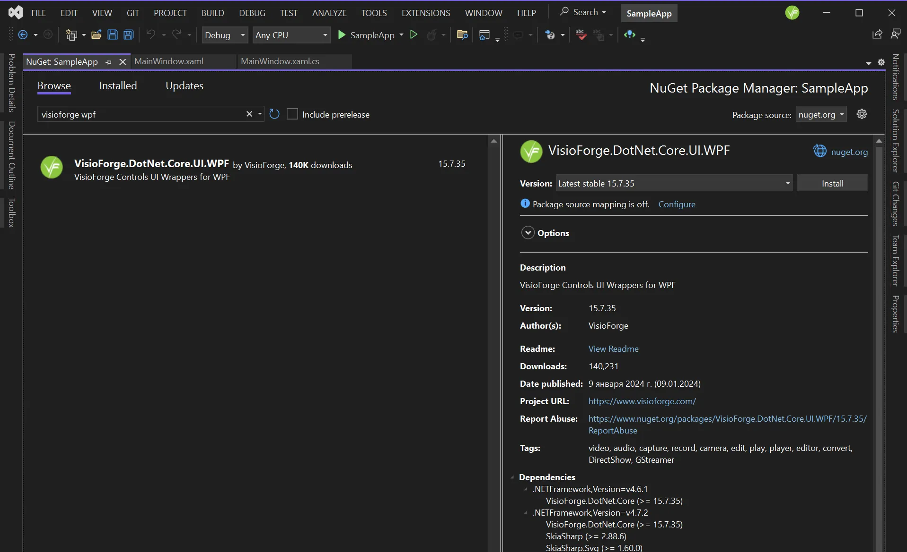
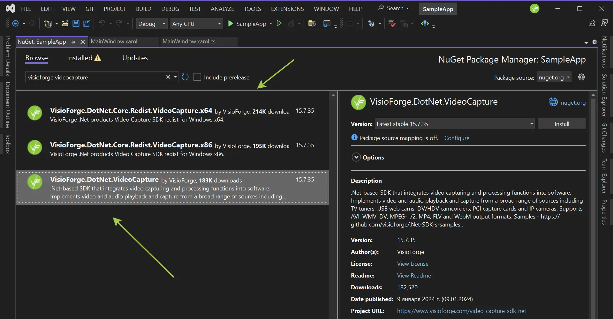
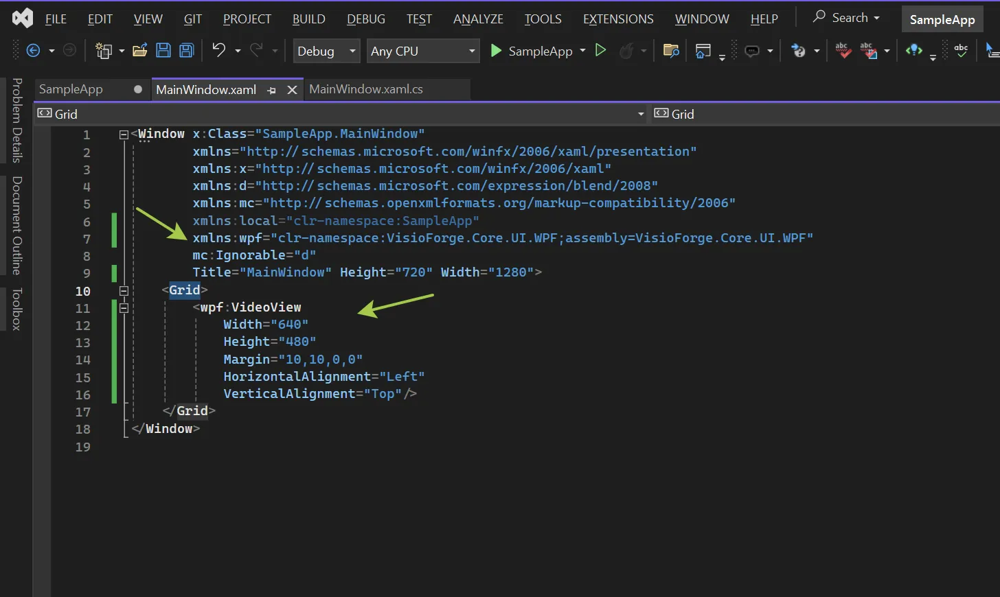
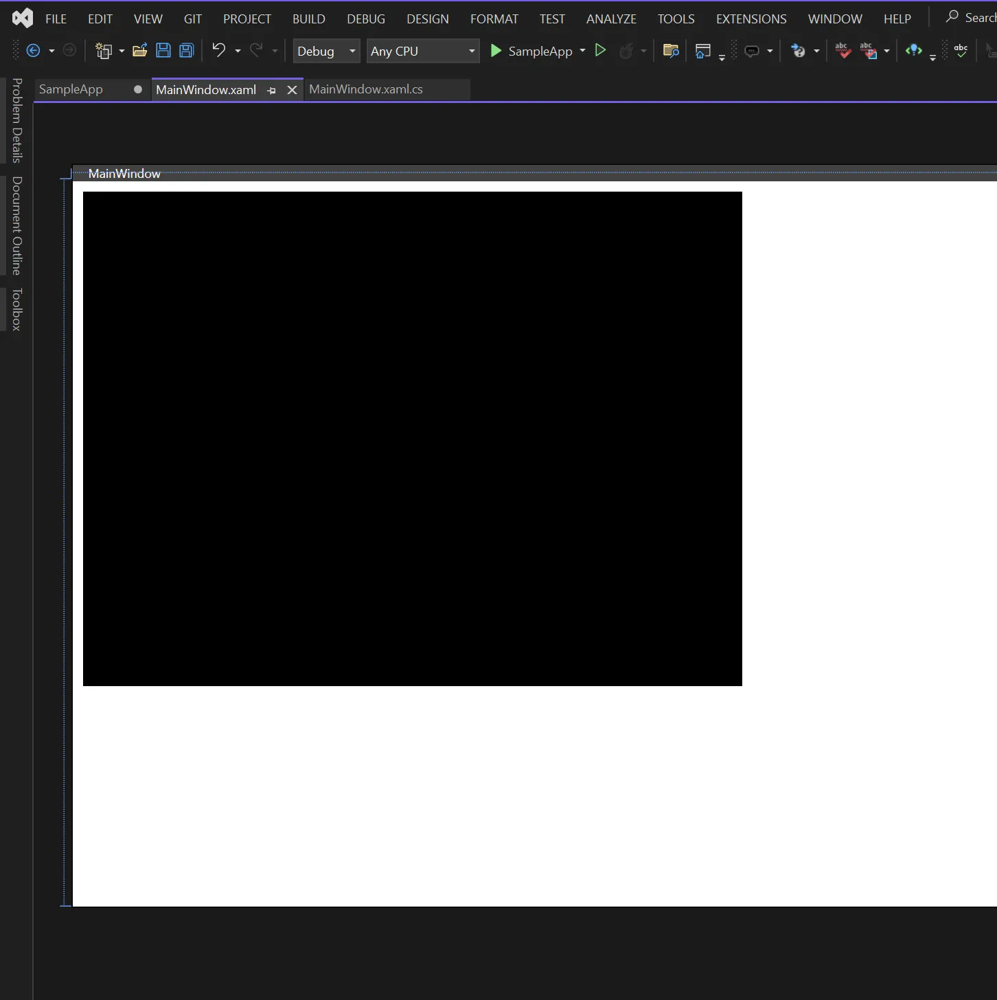
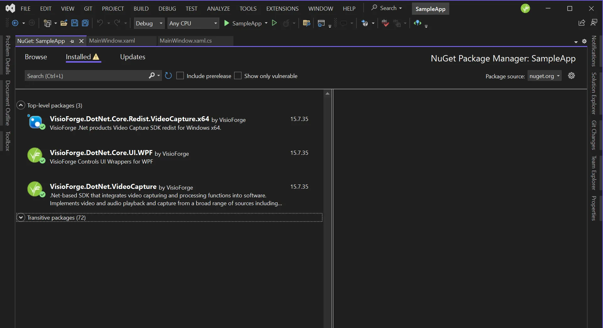

# Guía completa para integrar SDKs .NET con Visual Studio

[Video Capture SDK .NET](https://www.visioforge.com/video-capture-sdk-net){ .md-button .md-button--primary target="_blank" } [Video Edit SDK .NET](https://www.visioforge.com/video-edit-sdk-net){ .md-button .md-button--primary target="_blank" } [Media Blocks SDK .NET](https://www.visioforge.com/media-blocks-sdk-net){ .md-button .md-button--primary target="_blank" } [Media Player SDK .NET](https://www.visioforge.com/media-player-sdk-net){ .md-button .md-button--primary target="_blank" }

## Introducción a los SDKs .NET de VisioForge

VisioForge ofrece una potente suite de SDKs multimedia para desarrolladores .NET, permitiéndole construir aplicaciones ricas en características con capacidades avanzadas de captura, edición, reproducción y procesamiento de video. Esta guía completa le llevará a través del proceso de integración de estos SDKs en sus proyectos de Visual Studio, asegurando una experiencia de desarrollo fluida.

Para desarrolladores profesionales que trabajan en aplicaciones multimedia, integrar correctamente estos SDKs es crucial para un rendimiento y funcionalidad óptimos. Nuestro enfoque recomendado es usar paquetes NuGet, lo que simplifica la gestión de dependencias y asegura que siempre esté usando las últimas características y correcciones de errores.

## Descripción general de métodos de instalación

Hay dos métodos principales para instalar los SDKs .NET de VisioForge:

1. **Instalación de Paquetes NuGet** (Recomendado): El enfoque moderno y simplificado que maneja las dependencias automáticamente y simplifica las actualizaciones.
2. **Instalación Manual**: Un enfoque tradicional para escenarios especializados, aunque generalmente no se recomienda para la mayoría de los proyectos.

Cubriremos ambos métodos en detalle, pero recomendamos encarecidamente el enfoque NuGet para la mayoría de los escenarios de desarrollo.

## Instalación de paquetes NuGet (método recomendado)

NuGet es el gestor de paquetes para .NET, proporcionando una forma centralizada de incorporar bibliotecas en sus proyectos sin la molestia de la gestión manual de archivos. Aquí hay un recorrido detallado de la integración de SDKs de VisioForge usando NuGet.

### Paso 1: crear o abrir su proyecto .NET

Primero, necesitará un proyecto WinForms, WPF u otro proyecto .NET. Recomendamos usar el formato de proyecto moderno estilo SDK para compatibilidad óptima.

#### Crear un nuevo proyecto

1. Lanza Visual Studio (2019 o 2022 recomendado)
2. Seleccione "Create a new project"
3. Filtra plantillas por "C#" y ya sea "WPF" o "Windows Forms"
4. Elija "WPF Application" o "Windows Forms Application" con el framework .NET Core/5/6+
5. Asegúrese de seleccionar el formato de proyecto moderno estilo SDK (este es el predeterminado en versiones más recientes de Visual Studio)



#### Configurar el proyecto

Después de crear un nuevo proyecto, necesitará configurar los ajustes básicos:

1. Ingrese el nombre de su proyecto (use un nombre descriptivo relevante para su aplicación)
2. Elija una ubicación apropiada y nombre de solución
3. Seleccione su framework objetivo (.NET 6 o más reciente recomendado para mejor rendimiento y características)
4. Haga clic en "Create" para generar la estructura del proyecto



### Paso 2: acceder al gestor de paquetes NuGet

Una vez que su proyecto esté abierto en Visual Studio:

1. Haga clic derecho en su proyecto en el Solution Explorer
2. Seleccione "Manage NuGet Packages..." del menú contextual
3. El NuGet Package Manager se abrirá en el panel central

Esta interfaz proporciona funcionalidad de búsqueda y navegación de paquetes para encontrar e instalar fácilmente los componentes de VisioForge que necesita.



### Paso 3: instalar el paquete de UI para su framework

Los SDKs de VisioForge ofrecen componentes de UI especializados para diferentes frameworks .NET. Necesitará seleccionar el paquete de UI apropiado según su tipo de proyecto.

1. En el NuGet Package Manager, cambie a la pestaña "Browse"
2. Busque "VisioForge.DotNet.Core.UI"
3. Seleccione el paquete de UI apropiado para su tipo de proyecto de los resultados de búsqueda



#### Paquetes de UI disponibles

VisioForge soporta una amplia gama de frameworks de UI. Elija el que coincida con su proyecto:

- **[VisioForge.DotNet.Core.UI.WinUI](https://www.nuget.org/packages/VisioForge.DotNet.Core.UI.WinUI)**: Para aplicaciones modernas de Windows UI
- **[VisioForge.DotNet.Core.UI.MAUI](https://www.nuget.org/packages/VisioForge.DotNet.Core.UI.MAUI)**: Para aplicaciones multiplataforma usando .NET MAUI
- **[VisioForge.DotNet.Core.UI.Avalonia](https://www.nuget.org/packages/VisioForge.DotNet.Core.UI.Avalonia)**: Para aplicaciones de escritorio multiplataforma usando Avalonia UI

Estos paquetes de UI proporcionan los controles y componentes necesarios diseñados específicamente para renderizado de video e interacción dentro de su framework elegido.

### Paso 4: instalar el paquete principal del SDK

Después de instalar el paquete de UI, necesitará agregar el paquete principal del SDK para sus necesidades multimedia específicas:

1. Regresa a la pestaña "Browse" del NuGet Package Manager
2. Busque el SDK específico de VisioForge que necesita (por ejemplo, "VisioForge.DotNet.VideoCapture")
3. Haga clic en "Install" en el paquete apropiado



#### Paquetes principales del SDK disponibles

Elija el SDK que se alinee con los requisitos de su aplicación:

- **[VisioForge.DotNet.VideoCapture](https://www.nuget.org/packages/VisioForge.DotNet.VideoCapture)**: Para aplicaciones que necesitan capturar video de cámaras, grabación de pantalla u otras fuentes
- **[VisioForge.DotNet.VideoEdit](https://www.nuget.org/packages/VisioForge.DotNet.VideoEdit)**: Para aplicaciones de edición, procesamiento y conversión de video
- **[VisioForge.DotNet.MediaPlayer](https://www.nuget.org/packages/VisioForge.DotNet.MediaPlayer)**: Para crear reproductores de medios con controles de reproducción avanzados
- **[VisioForge.DotNet.MediaBlocks](https://www.nuget.org/packages/VisioForge.DotNet.MediaBlocks)**: Para construir pipelines de procesamiento de medios complejos

Cada paquete incluye documentación completa, y puede instalar múltiples paquetes si su aplicación requiere diferentes capacidades multimedia.

### Paso 5: implementar el control VideoView (opcional)

El control VideoView es crucial para aplicaciones que necesitan mostrar contenido de video. Puede agregarlo a su UI usando XAML (para WPF) o a través del diseñador (para WinForms).

#### Para aplicaciones WPF

Agregue el espacio de nombres requerido a su archivo XAML:

```xml
xmlns:wpf="clr-namespace:VisioForge.Core.UI.WPF;assembly=VisioForge.Core"
```

Luego agregue el control VideoView a su diseño:

```xml
<wpf:VideoView 
    Width="640" 
    Height="480" 
    Margin="10,10,0,0" 
    HorizontalAlignment="Left" 
    VerticalAlignment="Top"/>
```



El control VideoView aparecerá en su diseñador:



#### Para aplicaciones WinForms

1. Abra el formulario en modo diseñador
2. Localice los controles de VisioForge en la caja de herramientas (si no aparecen, haga clic derecho en la caja de herramientas y seleccione "Choose Items...")
3. Arrastre y suelte el control VideoView en su formulario
4. Ajuste las propiedades de tamaño y posición según sea necesario

### Paso 6: instalar paquetes de redistribución requeridos

Dependiendo de su implementación específica, puede necesitar paquetes de redistribución adicionales:

1. Regrese al NuGet Package Manager
2. Busque "VisioForge.DotNet.Core.Redist" para ver los paquetes de redistribución disponibles
3. Instale los relevantes para su plataforma y elección de SDK



Los paquetes de redistribución requeridos varían según:

- Sistema operativo objetivo (Windows, macOS, Linux)
- Requisitos de aceleración de hardware
- Codecs y formatos específicos que su aplicación usará
- Configuración del motor backend

Consulte la página de documentación de Despliegue específica para su producto seleccionado para determinar qué paquetes de redistribución son necesarios para su aplicación.

## Instalación manual (método alternativo)

Aunque generalmente no recomendamos la instalación manual debido a su complejidad y potencial de problemas de configuración, hay escenarios específicos donde podría ser necesaria. Siga estos pasos si NuGet no es una opción para su proyecto:

1. Descargue el [instalador completo del SDK](https://files.visioforge.com/trials/visioforge_sdks_installer_dotnet_setup.exe) de nuestro sitio web
2. Ejecute el instalador con privilegios de administrador y siga las instrucciones en pantalla
3. Cree su proyecto WinForms o WPF en Visual Studio
4. Agregue referencias a las bibliotecas del SDK instaladas:
   - Haga clic derecho en "References" en el Solution Explorer
   - Seleccione "Add Reference"
   - Navegue a la ubicación de instalación del SDK
   - Seleccione los archivos DLL requeridos
5. Configure la Caja de Herramientas de Visual Studio:
   - Haga clic derecho en la Caja de Herramientas y seleccione "Add Tab"
   - Nombra la nueva pestaña "VisioForge"
   - Haga clic derecho en la pestaña y seleccione "Choose Items..."
   - Navegue al directorio de instalación del SDK
   - Seleccione `VisioForge.Core.dll`
6. Arrastre y suelte el control VideoView en su formulario o ventana

Este enfoque manual requiere configuración adicional para el despliegue y las actualizaciones deben gestionarse manualmente.

## Configuración avanzada y mejores prácticas

Para aplicaciones de producción, considere estos detalles de implementación adicionales:

- **Gestión de Licencias**: Implemente validación de licencia adecuada al inicio de la aplicación
- **Manejo de Errores**: Agregue manejo de errores completo alrededor de la inicialización y operación del SDK
- **Optimización de Rendimiento**: Configure la aceleración de hardware y threading según sus dispositivos objetivo
- **Gestión de Recursos**: Implemente eliminación adecuada de recursos del SDK para prevenir fugas de memoria

## Solución de problemas comunes

Si encuentra problemas durante la instalación o implementación:

- Verifique que su proyecto tenga como objetivo una versión .NET soportada
- Asegúrese de que todos los paquetes redistributables requeridos estén instalados
- Verifique la compatibilidad de versiones de paquetes NuGet
- Revise la documentación del SDK para requisitos específicos de plataforma

## Conclusión y próximos pasos

Con los SDKs .NET de VisioForge correctamente instalados en su proyecto de Visual Studio, ahora está listo para aprovechar sus potentes capacidades multimedia. El método de instalación NuGet asegura que tenga las dependencias correctas y simplifica las actualizaciones futuras.

Para profundizar su comprensión y maximizar el potencial de estos SDKs:

- Explora nuestros [ejemplos de código completos en GitHub](https://github.com/visioforge/.Net-SDK-s-samples)
- Revise la documentación específica del producto para características avanzadas
- Únete a nuestros foros de la comunidad de desarrolladores para soporte y mejores prácticas

Siguiendo esta guía, ha establecido una base sólida para desarrollar aplicaciones multimedia sofisticadas con VisioForge y Visual Studio.
