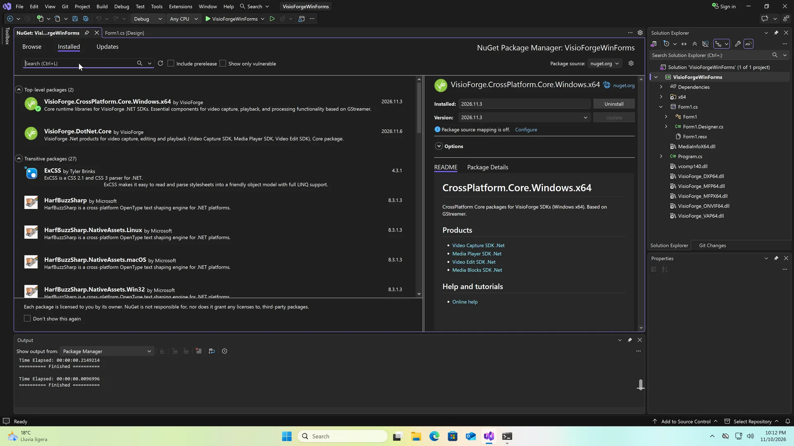
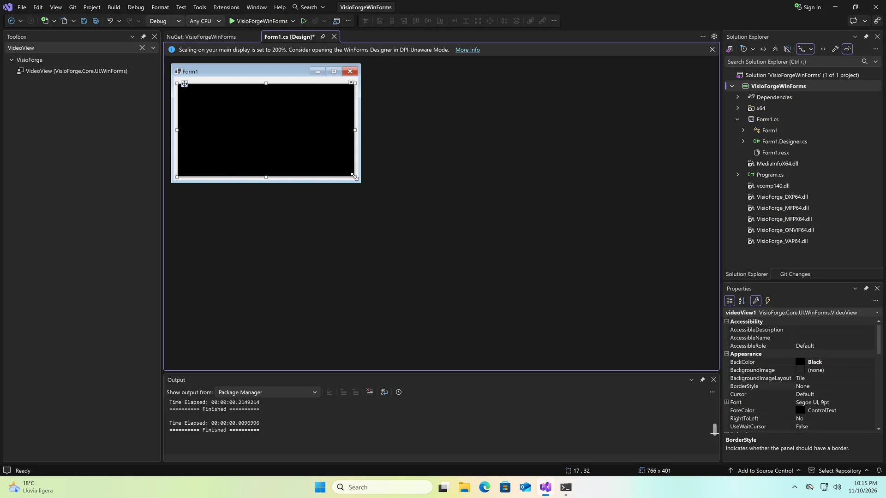
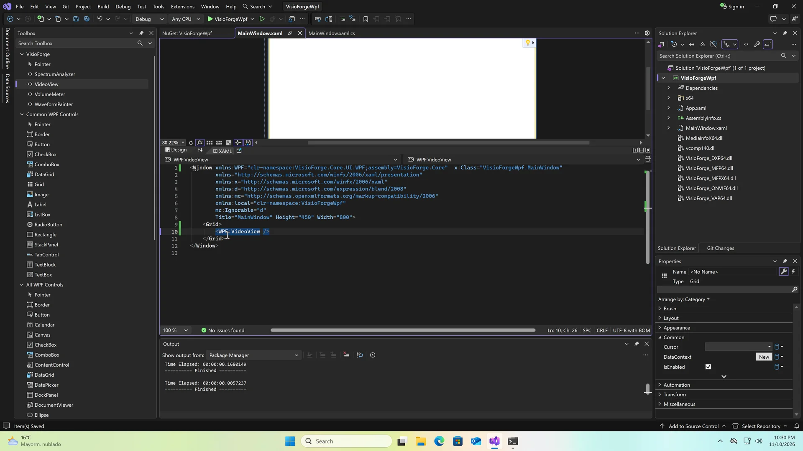
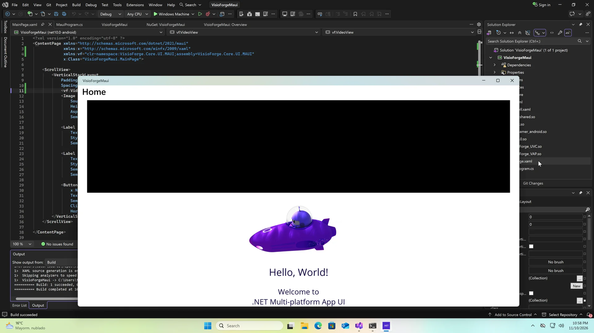
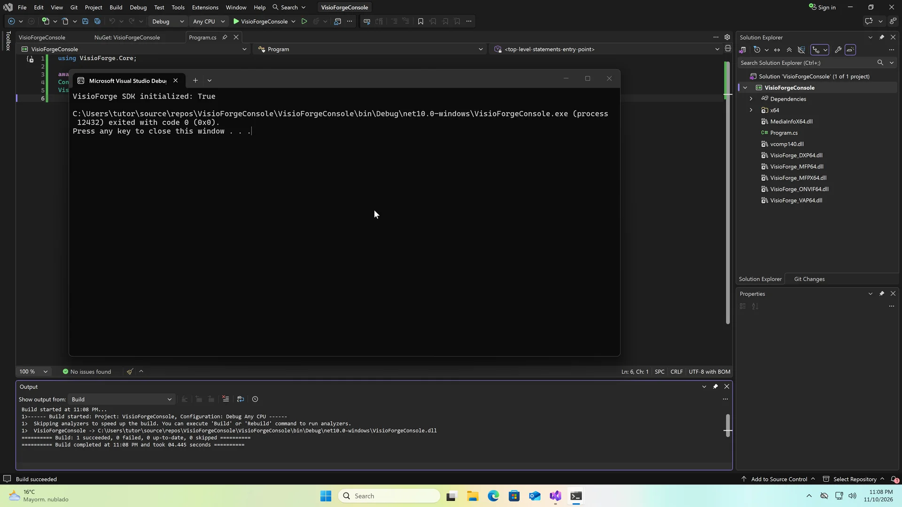

# Installer les SDK .NET VisioForge dans Visual Studio

[Video Capture SDK .NET](https://www.visioforge.com/video-capture-sdk-net){ .md-button .md-button--primary target="_blank" } [Video Edit SDK .NET](https://www.visioforge.com/video-edit-sdk-net){ .md-button .md-button--primary target="_blank" } [Media Blocks SDK .NET](https://www.visioforge.com/media-blocks-sdk-net){ .md-button .md-button--primary target="_blank" } [Media Player SDK .NET](https://www.visioforge.com/media-player-sdk-net){ .md-button .md-button--primary target="_blank" }

Ce guide installe les SDK .NET VisioForge dans Visual Studio depuis NuGet, dans quatre types de projet : WinForms, WPF, .NET MAUI et une application console. Chaque partie se termine par un projet vide qui se compile et se lance.

Les quatre SDK — Video Capture SDK .NET, Media Player SDK .NET, Video Edit SDK .NET et Media Blocks SDK .NET — tiennent dans un seul paquet NuGet, [VisioForge.DotNet.Core](https://www.nuget.org/packages/VisioForge.DotNet.Core). À côté vient un paquet redist, le moteur natif de la plateforme. Sous Windows x64, c'est [VisioForge.CrossPlatform.Core.Windows.x64](https://www.nuget.org/packages/VisioForge.CrossPlatform.Core.Windows.x64). Une application MAUI prend aussi [VisioForge.DotNet.Core.UI.MAUI](https://www.nuget.org/packages/VisioForge.DotNet.Core.UI.MAUI).

## Tutoriel vidéo

La vidéo montre les quatre types de projet dans Visual Studio 2026 :

<div class="video-wrapper">
  <iframe src="https://www.youtube.com/embed/o6wL9r6t6Lk?controls=1" frameborder="0" allowfullscreen></iframe>
</div>

## Prérequis

- Windows 10 ou 11
- Visual Studio 2026, ou Visual Studio 2022 pour les projets .NET 8 et .NET 9
- La charge de travail **.NET desktop development** pour WinForms, WPF et console, et la charge de travail **.NET Multi-platform App UI development** pour MAUI

## Les paquets

| Projet | Paquets |
|---|---|
| WinForms, WPF, console (Windows x64) | `VisioForge.DotNet.Core`, `VisioForge.CrossPlatform.Core.Windows.x64` |
| .NET MAUI | `VisioForge.DotNet.Core`, `VisioForge.DotNet.Core.UI.MAUI`, plus un redist par plateforme dans le fichier projet |

Hors de Visual Studio, `dotnet add package` installe les mêmes paquets en ligne de commande :

```bash
dotnet add package VisioForge.DotNet.Core
dotnet add package VisioForge.CrossPlatform.Core.Windows.x64
```

Des paquets par produit, comme `VisioForge.DotNet.VideoCapture`, sont aussi publiés ; ils référencent `VisioForge.DotNet.Core`, qui suffit à un projet.

## WinForms

1. Dans la fenêtre de démarrage, cliquez sur **Create a new project**, cherchez *Windows Forms* et choisissez **Windows Forms App** pour C#.
2. Nommez le projet, choisissez **.NET 10** et cliquez sur **Create**.
3. Faites un clic droit sur le projet dans le **Solution Explorer** et ouvrez **Manage NuGet Packages**, sur l'onglet **Browse**.
4. Cherchez `VisioForge.DotNet.Core` et installez-le. Visual Studio affiche les modifications et la licence : acceptez-les.
5. Installez `VisioForge.CrossPlatform.Core.Windows.x64` de la même façon. Les deux paquets figurent maintenant dans l'onglet **Installed**.



Le paquet ajoute aussi `VideoView` à la **Toolbox**, sous **VisioForge**. Cherchez-le et dessinez-le sur le formulaire : c'est là que le SDK affiche la vidéo. Lancez l'application sans débogage (Ctrl+F5), et le formulaire s'ouvre avec le `VideoView`, noir tant qu'aucun moteur n'y dessine.



## WPF

Créez une **WPF Application** pour C# sur .NET 10 et installez les deux mêmes paquets. Faites ensuite glisser `VideoView` de la **Toolbox** dans le `Grid` de `MainWindow.xaml`. Visual Studio écrit la balise, et l'espace de noms avec :

```xml
<Window xmlns:WPF="clr-namespace:VisioForge.Core.UI.WPF;assembly=VisioForge.Core" x:Class="VisioForgeWpf.MainWindow"
        xmlns="http://schemas.microsoft.com/winfx/2006/xaml/presentation"
        xmlns:x="http://schemas.microsoft.com/winfx/2006/xaml"
        xmlns:d="http://schemas.microsoft.com/expression/blend/2008"
        xmlns:mc="http://schemas.openxmlformats.org/markup-compatibility/2006"
        xmlns:local="clr-namespace:VisioForgeWpf"
        mc:Ignorable="d"
        Title="MainWindow" Height="450" Width="800">
    <Grid>
        <WPF:VideoView />
    </Grid>
</Window>
```

L'espace de noms est `VisioForge.Core.UI.WPF`, dans l'assembly `VisioForge.Core`. Le préfixe est à vous : la Toolbox écrit `WPF`, et `vf` est plus court.



## .NET MAUI

Un projet .NET MAUI App compile pour Windows, Mac Catalyst, Android et iOS. Depuis NuGet, installez `VisioForge.DotNet.Core` et `VisioForge.DotNet.Core.UI.MAUI`, qui contient le `VideoView` de MAUI.

Les moteurs natifs vont, eux, dans le fichier projet, chacun sous la condition de sa plateforme, si bien que chaque cible n'embarque que le moteur de sa propre plateforme. Ouvrez **Edit Project File** et ajoutez-les à la fin :

```xml
<ItemGroup Condition="$(TargetFramework.Contains('-windows'))">
  <PackageReference Include="VisioForge.CrossPlatform.Core.Windows.x64" Version="[2026.11.12]" />
</ItemGroup>
<ItemGroup Condition="$(TargetFramework.Contains('-maccatalyst'))">
  <PackageReference Include="VisioForge.CrossPlatform.Core.macCatalyst" Version="[2026.11.5]" />
</ItemGroup>
<ItemGroup Condition="$(TargetFramework.Contains('-android'))">
  <PackageReference Include="VisioForge.CrossPlatform.Core.Android" Version="[2026.11.5]" />
</ItemGroup>
<ItemGroup Condition="$(TargetFramework.Contains('-ios'))">
  <PackageReference Include="VisioForge.CrossPlatform.Core.iOS" Version="[2026.11.5]" />
</ItemGroup>
```

Sur un Mac, Mac Catalyst compile pour le processeur du Mac lui-même :

```xml
<!-- Mac Catalyst : compiler pour le processeur du Mac lui-même -->
<PropertyGroup Condition="$([MSBuild]::IsOSPlatform('osx')) AND '$([System.Runtime.InteropServices.RuntimeInformation]::OSArchitecture)' == 'X64' AND $(TargetFramework.Contains('-maccatalyst'))">
  <RuntimeIdentifier>maccatalyst-x64</RuntimeIdentifier>
</PropertyGroup>
<PropertyGroup Condition="$([MSBuild]::IsOSPlatform('osx')) AND '$([System.Runtime.InteropServices.RuntimeInformation]::OSArchitecture)' == 'Arm64' AND $(TargetFramework.Contains('-maccatalyst'))">
  <RuntimeIdentifier>maccatalyst-arm64</RuntimeIdentifier>
</PropertyGroup>
```

Deux plateformes demandent un peu plus :

- **Android** prend aussi le projet de liaison VisioForge pour Android du [dossier AndroidDependency](https://github.com/visioforge/.Net-SDK-s-samples/tree/master/AndroidDependency), et les autorisations caméra et micro dans son manifeste.
- **iOS et Mac Catalyst** demandent des descriptions d'usage (`NSCameraUsageDescription`, `NSMicrophoneUsageDescription`) dans `Info.plist`. iOS se teste sur un appareil, pas sur le simulateur.

Le [guide d'installation MAUI](maui.md) détaille les deux.

Dans `MauiProgram.cs`, ajoutez deux usings, puis `UseSkiaSharp` et les handlers VisioForge au builder. `UseSkiaSharp` active SkiaSharp, qu'utilisent les vues VisioForge, et `AddVisioForgeHandlers` enregistre leurs handlers de plateforme :

```csharp
using SkiaSharp.Views.Maui.Controls.Hosting;
using VisioForge.Core.UI.MAUI;

var builder = MauiApp.CreateBuilder();
builder
    .UseMauiApp<App>()
    .UseSkiaSharp()
    .ConfigureMauiHandlers(handlers => handlers.AddVisioForgeHandlers())
    .ConfigureFonts(fonts =>
    {
        fonts.AddFont("OpenSans-Regular.ttf", "OpenSansRegular");
        fonts.AddFont("OpenSans-Semibold.ttf", "OpenSansSemibold");
    });
```

Dans `MainPage.xaml`, déclarez l'espace de noms VisioForge — `VisioForge.Core.UI.MAUI`, dans l'assembly `VisioForge.Core.UI.MAUI` — et placez un `VideoView` sur la page :

```xml
<ContentPage xmlns="http://schemas.microsoft.com/dotnet/2021/maui"
             xmlns:x="http://schemas.microsoft.com/winfx/2009/xaml"
             xmlns:vf="clr-namespace:VisioForge.Core.UI.MAUI;assembly=VisioForge.Core.UI.MAUI"
             x:Class="VisioForgeMaui.MainPage">
    <ScrollView>
        <VerticalStackLayout Padding="30,0" Spacing="25">
            <vf:VideoView HeightRequest="300" />
        </VerticalStackLayout>
    </ScrollView>
</ContentPage>
```

Lancez-la sur **Windows Machine**, et le `VideoView` se place au-dessus du contenu du modèle.



## Application console

Créez une **Console App** pour C# et installez les deux mêmes paquets que pour WinForms. Une application console demande une étape de plus : son modèle cible `net10.0`, et cette version du SDK est celle de Linux. Sans `-windows`, l'application cherche la bibliothèque GStreamer de Linux et échoue avec une `DllNotFoundException`. Ouvrez **Edit Project File** et ajoutez `-windows` au framework cible :

```xml
<PropertyGroup>
  <OutputType>Exe</OutputType>
  <!-- net10.0 est la version Linux du SDK : sous Windows, ajoutez -windows -->
  <TargetFramework>net10.0-windows</TargetFramework>
</PropertyGroup>
```

Les projets WinForms et WPF ciblent déjà `net10.0-windows`.

`Program.cs` initialise le SDK, affiche s'il est prêt, puis le libère :

```csharp
using VisioForge.Core;

await VisioForgeX.InitSDKAsync();
Console.WriteLine($"VisioForge SDK initialized: {VisioForgeX.IsSDKInitialized}");
VisioForgeX.DestroySDK();
```

La dernière ligne de la sortie indique que le SDK s'est initialisé.



## Autres paquets

- **Moteurs réservés à Windows.** `VideoCaptureCore`, `MediaPlayerCore` et `VideoEditCore` prennent à la place les redist classiques : `VisioForge.DotNet.Core.Redist.VideoCapture.x64`, `…MediaPlayer.x64` ou `…VideoEdit.x64`. Voir les pages de déploiement de [Video Capture SDK .NET](../videocapture/deployment.md), [Media Player SDK .NET](../mediaplayer/deployment.md) et [Video Edit SDK .NET](../videoedit/deployment.md).
- **x86 et ARM64.** Une application compilée pour un autre processeur prend le redist de ce processeur, comme `VisioForge.CrossPlatform.Core.Windows.x86` ou `VisioForge.CrossPlatform.Core.Windows.arm64`.
- **Autres frameworks d'interface.** WinUI, Avalonia et Uno ont chacun leur propre paquet d'interface : `VisioForge.DotNet.Core.UI.WinUI`, `VisioForge.DotNet.Core.UI.Avalonia` et `VisioForge.DotNet.Core.UI.Uno`.

Le [guide de déploiement](../deployment-x/index.md) liste les paquets redist de chaque plateforme.

## Installation manuelle

Quand NuGet n'est pas envisageable, le SDK est aussi fourni sous forme d'installateur :

1. Téléchargez l'[installateur du SDK](https://files.visioforge.com/trials/visioforge_sdks_installer_dotnet_setup.exe) et lancez-le.
2. Dans votre projet, ajoutez une référence au `VisioForge.Core.dll` installé.
3. Pour avoir `VideoView` dans la Toolbox, faites un clic droit sur la Toolbox, choisissez **Choose Items...** et sélectionnez `VisioForge.Core.dll`.

NuGet reste la voie recommandée : il apporte le moteur natif avec le paquet et se met à jour en un clic.

## Transcription de la vidéo

### Présentation

Installons les SDK .NET de VisioForge dans Visual Studio, dans quatre types de projet : WinForms, WPF, MAUI et une application console. Les quatre SDK .NET de VisioForge tiennent dans un seul paquet NuGet, VisioForge.DotNet.Core : Video Capture, Media Player, Video Edit et Media Blocks. À côté vient un paquet redist, le moteur natif de la plateforme. Sous Windows x64, c'est VisioForge.CrossPlatform.Core.Windows.x64. Une application MAUI prend aussi le paquet d'interface MAUI. Il vous faut Windows 10 ou 11, et Visual Studio 2026, ou 2022 pour les projets .NET 8 et 9. Les applications WinForms, WPF et console demandent la charge de travail .NET desktop development, et MAUI la charge de travail .NET Multi-platform App UI. Cette vidéo utilise Visual Studio 2026 et .NET 10.

### WinForms

Commencez par WinForms. Dans la fenêtre de démarrage, cliquez sur Create a new project, cherchez Windows Forms et choisissez Windows Forms App pour C#. Nommez le projet, ici VisioForgeWinForms, choisissez .NET 10 et cliquez sur Create. Faites un clic droit sur le projet dans le Solution Explorer et ouvrez Manage NuGet Packages, sur l'onglet Browse. Cherchez VisioForge.DotNet.Core et installez-le. Visual Studio affiche les modifications et la licence : acceptez-les. Installez ensuite VisioForge.CrossPlatform.Core.Windows.x64, le moteur natif pour Windows x64. Les deux paquets figurent maintenant dans l'onglet Installed. Le paquet ajoute aussi VideoView à la Toolbox, sous VisioForge. Cherchez-le et dessinez-le sur le formulaire. C'est là que le SDK affiche la vidéo. Lancez-le sans débogage. Le formulaire s'ouvre avec le VideoView, noir tant qu'aucun moteur n'y dessine.

### WPF

WPF suit les mêmes étapes. Créez une WPF Application pour C#, ici VisioForgeWpf, sur .NET 10. Installez les deux mêmes paquets depuis NuGet : VisioForge.DotNet.Core et le redist Windows x64. Faites glisser VideoView de la Toolbox dans le Grid de MainWindow.xaml. Visual Studio écrit la balise, et l'espace de noms avec. L'espace de noms est VisioForge.Core.UI.WPF, dans l'assembly VisioForge.Core. Le préfixe est à vous : la Toolbox écrit WPF, et vf est plus court. Lancez-le, et la fenêtre affiche le VideoView.

### MAUI

Passons à MAUI. Créez une .NET MAUI App, ici VisioForgeMaui. Un seul projet compile pour Windows, Mac Catalyst, Android et iOS. Depuis NuGet, installez VisioForge.DotNet.Core et VisioForge.DotNet.Core.UI.MAUI, qui contient le VideoView de MAUI. Les moteurs natifs vont, eux, dans le fichier projet, chacun sous la condition de sa plateforme. Ouvrez Edit Project File et ajoutez-les à la fin. La cible Windows prend le redist Windows x64, et Mac Catalyst, Android et iOS prennent chacun le leur. Chaque cible n'embarque que le moteur natif de sa plateforme. Sur un Mac, Mac Catalyst compile pour le processeur du Mac lui-même : Intel ou Apple silicon choisit son RuntimeIdentifier. Deux plateformes demandent un peu plus. Android prend aussi le projet de liaison VisioForge pour Android, depuis le dossier AndroidDependency sur GitHub, et les autorisations caméra et micro dans son manifeste. iOS et Mac Catalyst demandent des descriptions d'usage dans Info.plist, et iOS se teste sur un appareil, pas sur le simulateur. Dans MauiProgram.cs, ajoutez deux usings, puis UseSkiaSharp et les handlers VisioForge au builder. UseSkiaSharp active SkiaSharp, qu'utilisent les vues VisioForge, et AddVisioForgeHandlers enregistre leurs handlers de plateforme. Dans MainPage.xaml, déclarez l'espace de noms VisioForge et placez un VideoView en haut de la page. Dans MAUI, l'espace de noms est VisioForge.Core.UI.MAUI, dans l'assembly VisioForge.Core.UI.MAUI. Lancez-le sur Windows Machine. Le VideoView se place au-dessus du contenu du modèle.

### Console

Pour finir, une application console. Créez une Console App pour C#, ici VisioForgeConsole. Installez les deux mêmes paquets que pour WinForms. Une étape de plus pour une application console. Son modèle cible net10.0, et cette version du SDK est celle de Linux. Ajoutez -windows au framework cible. Sans cela, l'application cherche la bibliothèque GStreamer de Linux et échoue avec une DllNotFoundException. WinForms et WPF ciblent déjà net10.0-windows. Program.cs initialise le SDK, affiche s'il est prêt, puis le libère. Lancez-le. La dernière ligne indique que le SDK s'est initialisé.

### Autres paquets

Encore quelques paquets. Les moteurs réservés à Windows, VideoCaptureCore, MediaPlayerCore et VideoEditCore, prennent les redist classiques : Redist.VideoCapture, MediaPlayer ou VideoEdit. Les applications x86 et ARM64 prennent le redist de leur processeur. Et WinUI, Avalonia et Uno ont chacun leur propre paquet d'interface. Hors de Visual Studio, dotnet add package installe les deux mêmes paquets en ligne de commande.

### Étapes suivantes

Ensuite, enregistrez une webcam en MP4 dans le tutoriel WinForms ou WPF. Les guides de déploiement listent les paquets redist de chaque plateforme, et il existe des guides d'installation pour Rider, Avalonia, Uno et Unity. La documentation se trouve sur visioforge.com/help. Merci de votre attention.

## Voir aussi

- [Webcam vers MP4 en WinForms](../videocapture/video-tutorials/video-capture-webcam-mp4.md) et [en WPF](../videocapture/video-tutorials/video-capture-webcam-mp4-wpf.md) — l'étape suivante après l'installation
- [Initialisation du SDK](../init.md) — `InitSDKAsync` et `DestroySDK` en détail
- Guides d'installation pour [MAUI](maui.md), [Rider](rider.md), [Avalonia](avalonia.md), [Uno](uno.md) et [Unity](unity.md)

---
Consultez notre page [GitHub](https://github.com/visioforge/.Net-SDK-s-samples) pour plus d'exemples de code.
