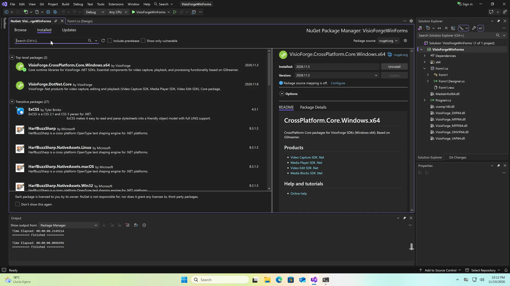
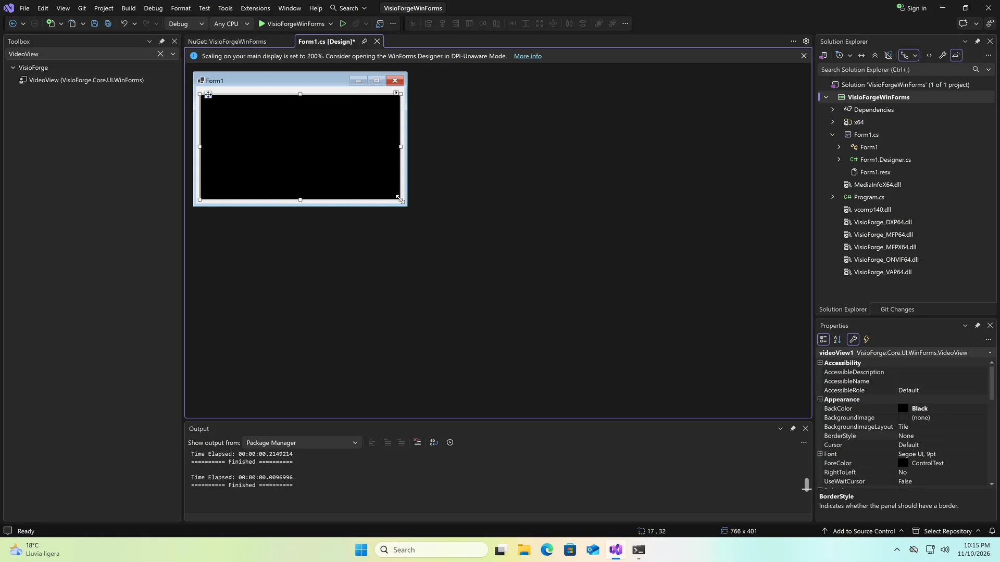
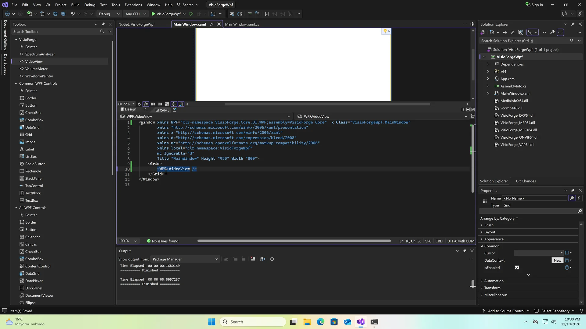
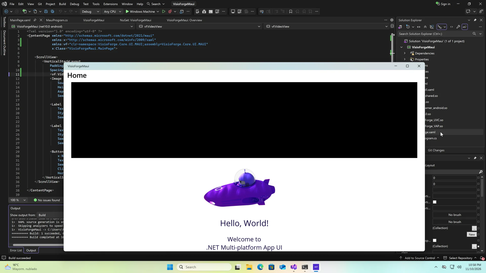
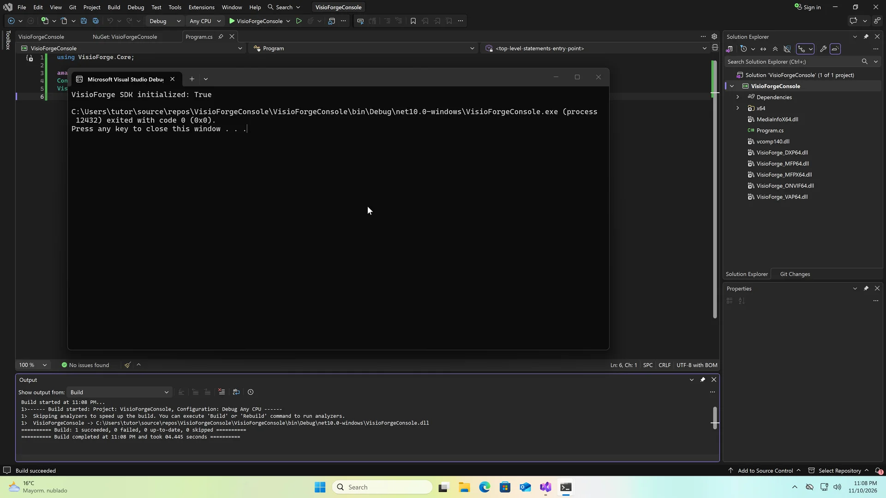

# Install the VisioForge .NET SDKs in Visual Studio

[Video Capture SDK .NET](https://www.visioforge.com/video-capture-sdk-net){ .md-button .md-button--primary target="_blank" } [Video Edit SDK .NET](https://www.visioforge.com/video-edit-sdk-net){ .md-button .md-button--primary target="_blank" } [Media Blocks SDK .NET](https://www.visioforge.com/media-blocks-sdk-net){ .md-button .md-button--primary target="_blank" } [Media Player SDK .NET](https://www.visioforge.com/media-player-sdk-net){ .md-button .md-button--primary target="_blank" }

This guide installs the VisioForge .NET SDKs in Visual Studio from NuGet, in four kinds of project: WinForms, WPF, .NET MAUI and a console app. Each part ends with an empty project that builds and runs.

All four SDKs — Video Capture SDK .NET, Media Player SDK .NET, Video Edit SDK .NET and Media Blocks SDK .NET — come in one NuGet package, [VisioForge.DotNet.Core](https://www.nuget.org/packages/VisioForge.DotNet.Core). Next to it goes a redist package, the native engine for the platform. On Windows x64 that is [VisioForge.CrossPlatform.Core.Windows.x64](https://www.nuget.org/packages/VisioForge.CrossPlatform.Core.Windows.x64). A MAUI app also takes [VisioForge.DotNet.Core.UI.MAUI](https://www.nuget.org/packages/VisioForge.DotNet.Core.UI.MAUI).

## Video tutorial

The video shows all four project types in Visual Studio 2026:

<div class="video-wrapper">
  <iframe src="https://www.youtube.com/embed/o6wL9r6t6Lk?controls=1" frameborder="0" allowfullscreen></iframe>
</div>

## Requirements

- Windows 10 or 11
- Visual Studio 2026, or Visual Studio 2022 for .NET 8 and .NET 9 projects
- The **.NET desktop development** workload for WinForms, WPF and console apps, and the **.NET Multi-platform App UI development** workload for MAUI

## The packages

| Project | Packages |
|---|---|
| WinForms, WPF, console (Windows x64) | `VisioForge.DotNet.Core`, `VisioForge.CrossPlatform.Core.Windows.x64` |
| .NET MAUI | `VisioForge.DotNet.Core`, `VisioForge.DotNet.Core.UI.MAUI`, plus one redist per platform in the project file |

Outside Visual Studio, `dotnet add package` installs the same packages from the command line:

```bash
dotnet add package VisioForge.DotNet.Core
dotnet add package VisioForge.CrossPlatform.Core.Windows.x64
```

Per-product packages such as `VisioForge.DotNet.VideoCapture` are also published; they reference `VisioForge.DotNet.Core`, which is all a project needs.

## WinForms

1. On the start window, click **Create a new project**, search for *Windows Forms*, and pick **Windows Forms App** for C#.
2. Name the project, choose **.NET 10**, and click **Create**.
3. Right-click the project in **Solution Explorer** and open **Manage NuGet Packages**, on the **Browse** tab.
4. Search for `VisioForge.DotNet.Core` and install it. Visual Studio shows the changes and the license: accept them.
5. Install `VisioForge.CrossPlatform.Core.Windows.x64` the same way. Both packages are now on the **Installed** tab.



The package also puts `VideoView` in the **Toolbox**, under **VisioForge**. Search for it and draw it on the form: this is where the SDK shows video. Start the app without debugging (Ctrl+F5), and the form opens with the `VideoView`, black until an engine draws into it.



## WPF

Create a **WPF Application** for C# on .NET 10 and install the same two packages. Then drag `VideoView` from the **Toolbox** into the `Grid` of `MainWindow.xaml`. Visual Studio writes the tag and the namespace with it:

```xml
<Window xmlns:WPF="clr-namespace:VisioForge.Core.UI.WPF;assembly=VisioForge.Core" x:Class="VisioForgeWpf.MainWindow"
        xmlns="http://schemas.microsoft.com/winfx/2006/xaml/presentation"
        xmlns:x="http://schemas.microsoft.com/winfx/2006/xaml"
        xmlns:d="http://schemas.microsoft.com/expression/blend/2008"
        xmlns:mc="http://schemas.openxmlformats.org/markup-compatibility/2006"
        xmlns:local="clr-namespace:VisioForgeWpf"
        mc:Ignorable="d"
        Title="MainWindow" Height="450" Width="800">
    <Grid>
        <WPF:VideoView />
    </Grid>
</Window>
```

The namespace is `VisioForge.Core.UI.WPF`, in the `VisioForge.Core` assembly. The prefix is yours to pick: the Toolbox writes `WPF`, and `vf` is shorter.



## .NET MAUI

A .NET MAUI App project builds for Windows, Mac Catalyst, Android and iOS. From NuGet, install `VisioForge.DotNet.Core` and `VisioForge.DotNet.Core.UI.MAUI`, which holds the MAUI `VideoView`.

The native engines go into the project file instead, each under the condition of its platform, so every head ships only the engine of its own platform. Open **Edit Project File** and add them at the end:

```xml
<ItemGroup Condition="$(TargetFramework.Contains('-windows'))">
  <PackageReference Include="VisioForge.CrossPlatform.Core.Windows.x64" Version="2026.11.3" />
</ItemGroup>
<ItemGroup Condition="$(TargetFramework.Contains('-maccatalyst'))">
  <PackageReference Include="VisioForge.CrossPlatform.Core.macCatalyst" Version="2026.11.5" />
</ItemGroup>
<ItemGroup Condition="$(TargetFramework.Contains('-android'))">
  <PackageReference Include="VisioForge.CrossPlatform.Core.Android" Version="2026.11.5" />
</ItemGroup>
<ItemGroup Condition="$(TargetFramework.Contains('-ios'))">
  <PackageReference Include="VisioForge.CrossPlatform.Core.iOS" Version="2026.11.5" />
</ItemGroup>
```

On a Mac, Mac Catalyst builds for the Mac's own processor:

```xml
<!-- Mac Catalyst: build for the Mac's own CPU -->
<PropertyGroup Condition="$([MSBuild]::IsOSPlatform('osx')) AND '$([System.Runtime.InteropServices.RuntimeInformation]::OSArchitecture)' == 'X64' AND $(TargetFramework.Contains('-maccatalyst'))">
  <RuntimeIdentifier>maccatalyst-x64</RuntimeIdentifier>
</PropertyGroup>
<PropertyGroup Condition="$([MSBuild]::IsOSPlatform('osx')) AND '$([System.Runtime.InteropServices.RuntimeInformation]::OSArchitecture)' == 'Arm64' AND $(TargetFramework.Contains('-maccatalyst'))">
  <RuntimeIdentifier>maccatalyst-arm64</RuntimeIdentifier>
</PropertyGroup>
```

Two platforms need a little more:

- **Android** also takes the VisioForge Android binding project from the [AndroidDependency folder](https://github.com/visioforge/.Net-SDK-s-samples/tree/master/AndroidDependency), and the camera and microphone permissions in its manifest.
- **iOS and Mac Catalyst** need usage descriptions (`NSCameraUsageDescription`, `NSMicrophoneUsageDescription`) in `Info.plist`. iOS is tested on a device, not the simulator.

The [MAUI install guide](maui.md) covers both in detail.

In `MauiProgram.cs`, add two usings, then `UseSkiaSharp` and the VisioForge handlers to the builder. `UseSkiaSharp` turns on SkiaSharp, which the VisioForge views use, and `AddVisioForgeHandlers` registers their platform handlers:

```csharp
using SkiaSharp.Views.Maui.Controls.Hosting;
using VisioForge.Core.UI.MAUI;

var builder = MauiApp.CreateBuilder();
builder
    .UseMauiApp<App>()
    .UseSkiaSharp()
    .ConfigureMauiHandlers(handlers => handlers.AddVisioForgeHandlers())
    .ConfigureFonts(fonts =>
    {
        fonts.AddFont("OpenSans-Regular.ttf", "OpenSansRegular");
        fonts.AddFont("OpenSans-Semibold.ttf", "OpenSansSemibold");
    });
```

In `MainPage.xaml`, map the VisioForge namespace — `VisioForge.Core.UI.MAUI`, in the `VisioForge.Core.UI.MAUI` assembly — and put a `VideoView` on the page:

```xml
<ContentPage xmlns="http://schemas.microsoft.com/dotnet/2021/maui"
             xmlns:x="http://schemas.microsoft.com/winfx/2009/xaml"
             xmlns:vf="clr-namespace:VisioForge.Core.UI.MAUI;assembly=VisioForge.Core.UI.MAUI"
             x:Class="VisioForgeMaui.MainPage">
    <ScrollView>
        <VerticalStackLayout Padding="30,0" Spacing="25">
            <vf:VideoView HeightRequest="300" />
        </VerticalStackLayout>
    </ScrollView>
</ContentPage>
```

Run it on **Windows Machine**, and the `VideoView` sits above the template's content.



## Console app

Create a **Console App** for C# and install the same two packages as for WinForms. A console app needs one more step: its template targets `net10.0`, and that build of the SDK is the Linux one. Without `-windows`, the app looks for the Linux GStreamer library and fails with a `DllNotFoundException`. Open **Edit Project File** and add `-windows` to the target framework:

```xml
<PropertyGroup>
  <OutputType>Exe</OutputType>
  <!-- net10.0 is the Linux build of the SDK: on Windows, add -windows -->
  <TargetFramework>net10.0-windows</TargetFramework>
</PropertyGroup>
```

WinForms and WPF projects already target `net10.0-windows`.

`Program.cs` initializes the SDK, prints whether it is ready, and releases it again:

```csharp
using VisioForge.Core;

await VisioForgeX.InitSDKAsync();
Console.WriteLine($"VisioForge SDK initialized: {VisioForgeX.IsSDKInitialized}");
VisioForgeX.DestroySDK();
```

The last line of the output reports that the SDK initialized.



## Other packages

- **Windows-only engines.** `VideoCaptureCore`, `MediaPlayerCore` and `VideoEditCore` take the classic redists instead: `VisioForge.DotNet.Core.Redist.VideoCapture.x64`, `…MediaPlayer.x64` or `…VideoEdit.x64`. See the deployment pages of [Video Capture SDK .NET](../videocapture/deployment.md), [Media Player SDK .NET](../mediaplayer/deployment.md) and [Video Edit SDK .NET](../videoedit/deployment.md).
- **x86 and ARM64.** An app built for another CPU takes the redist for that CPU, such as `VisioForge.CrossPlatform.Core.Windows.x86` or `VisioForge.CrossPlatform.Core.Windows.arm64`.
- **Other UI frameworks.** WinUI, Avalonia and Uno each have their own UI package: `VisioForge.DotNet.Core.UI.WinUI`, `VisioForge.DotNet.Core.UI.Avalonia` and `VisioForge.DotNet.Core.UI.Uno`.

The [deployment guide](../deployment-x/index.md) lists the redist packages for every platform.

## Manual installation

Where NuGet is not an option, the SDK also ships as an installer:

1. Download the [SDK installer](https://files.visioforge.com/trials/visioforge_sdks_installer_dotnet_setup.exe) and run it.
2. In your project, add a reference to the installed `VisioForge.Core.dll`.
3. To get `VideoView` in the Toolbox, right-click the Toolbox, select **Choose Items...**, and browse to `VisioForge.Core.dll`.

NuGet is the recommended way: it brings the native engine with the package and updates with one click.

## Video Transcript

### Overview

Let's install the VisioForge .NET SDKs in Visual Studio, in four kinds of project: WinForms, WPF, MAUI and a console app. All four VisioForge .NET SDKs come in one NuGet package, VisioForge.DotNet.Core: Video Capture, Media Player, Video Edit and Media Blocks. Next to it goes a redist package, the native engine for the platform. On Windows x64, that is VisioForge.CrossPlatform.Core.Windows.x64. A MAUI app also takes the MAUI UI package. You need Windows 10 or 11, and Visual Studio 2026, or 2022 for .NET 8 and 9 projects. WinForms, WPF and console apps need the .NET desktop development workload, and MAUI needs the .NET Multi-platform App UI workload. This video uses Visual Studio 2026 and .NET 10.

### WinForms

Start with WinForms. On the start window, click Create a new project, search for Windows Forms, and pick Windows Forms App for C#. Name the project, here VisioForgeWinForms, choose .NET 10, and click Create. Right-click the project in Solution Explorer, and open Manage NuGet Packages, on the Browse tab. Search for VisioForge.DotNet.Core and install it. Visual Studio shows the changes and the license: accept them. Then install VisioForge.CrossPlatform.Core.Windows.x64, the native engine for Windows x64. Both packages are now on the Installed tab. The package also puts VideoView in the Toolbox, under VisioForge. Search for it, and draw it on the form. This is where the SDK shows video. Start it without debugging. The form opens with the VideoView, black until an engine draws into it.

### WPF

WPF takes the same steps. Create a WPF Application for C#, here VisioForgeWpf, on .NET 10. Install the same two packages from NuGet: VisioForge.DotNet.Core and the Windows x64 redist. Drag VideoView from the Toolbox into the Grid of MainWindow.xaml. Visual Studio writes the tag, and the namespace with it. The namespace is VisioForge.Core.UI.WPF, in the VisioForge.Core assembly. The prefix is yours to pick: the Toolbox writes WPF, and vf is shorter. Run it, and the window shows the VideoView.

### MAUI

Now MAUI. Create a .NET MAUI App, here VisioForgeMaui. One project builds for Windows, Mac Catalyst, Android and iOS. From NuGet, install VisioForge.DotNet.Core and VisioForge.DotNet.Core.UI.MAUI, which holds the MAUI VideoView. The native engines go into the project file instead, each under the condition of its platform. Open Edit Project File and add them at the end. The Windows head takes the Windows x64 redist, and Mac Catalyst, Android and iOS each take their own. Every head ships only the native engine of its platform. On a Mac, Mac Catalyst builds for the Mac's own processor: Intel or Apple silicon picks its RuntimeIdentifier. Two platforms need a little more. Android also takes the VisioForge Android binding project, from the AndroidDependency folder on GitHub, and the camera and microphone permissions in its manifest. iOS and Mac Catalyst need usage descriptions in Info.plist, and iOS is tested on a device, not the simulator. In MauiProgram.cs, add two usings, then UseSkiaSharp and the VisioForge handlers to the builder. UseSkiaSharp turns on SkiaSharp, which the VisioForge views use, and AddVisioForgeHandlers registers their platform handlers. In MainPage.xaml, map the VisioForge namespace, and put a VideoView at the top of the page. In MAUI, the namespace is VisioForge.Core.UI.MAUI, in the VisioForge.Core.UI.MAUI assembly. Run it on Windows Machine. The VideoView sits above the template's content.

### Console

Last, a console app. Create a Console App for C#, here VisioForgeConsole. Install the same two packages as for WinForms. One more step for a console app. Its template targets net10.0, and that build of the SDK is the Linux one. Add dash windows to the target framework. Without it, the app looks for the Linux GStreamer library, and fails with a DllNotFoundException. WinForms and WPF already target net10.0-windows. Program.cs initializes the SDK, prints whether it is ready, and releases it again. Run it. The last line reports that the SDK initialized.

### Other packages

A few more packages. The Windows-only engines, VideoCaptureCore, MediaPlayerCore and VideoEditCore, take the classic redists: Redist.VideoCapture, MediaPlayer or VideoEdit. x86 and ARM64 apps take the redist for their CPU. And WinUI, Avalonia and Uno each have their own UI package. Outside Visual Studio, dotnet add package installs the same two packages from the command line.

### Next steps

Next, record a webcam to MP4 in the WinForms or WPF tutorial. The deployment guides list the redist packages for each platform, and there are install guides for Rider, Avalonia, Uno and Unity. The docs are at visioforge.com/help. Thanks for watching.

## See also

- [Webcam to MP4 in WinForms](../videocapture/video-tutorials/video-capture-webcam-mp4.md) and [in WPF](../videocapture/video-tutorials/video-capture-webcam-mp4-wpf.md) — the next step after installing
- [SDK initialization](../init.md) — `InitSDKAsync` and `DestroySDK` in detail
- Install guides for [MAUI](maui.md), [Rider](rider.md), [Avalonia](avalonia.md), [Uno](uno.md) and [Unity](unity.md)

---
Visit our [GitHub](https://github.com/visioforge/.Net-SDK-s-samples) page to get more code samples and implementation examples.
