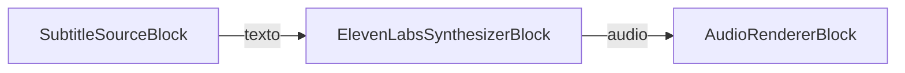
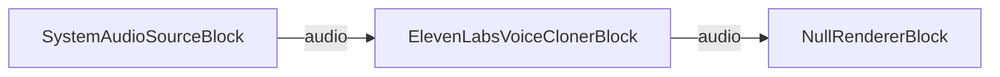

# Bloques de ElevenLabs

[Media Blocks SDK .Net](https://www.visioforge.com/media-blocks-sdk-net){ .md-button .md-button--primary target="_blank" }

## Resumen

Los bloques de ElevenLabs incorporan el audio con IA de [ElevenLabs](https://elevenlabs.io/) directamente en sus pipelines de [Media Blocks SDK .NET](https://www.visioforge.com/media-blocks-sdk-net). Hay dos bloques respaldados por la nube disponibles:

- [`ElevenLabsSynthesizerBlock`](#sintetizador-de-elevenlabs) — texto a voz: toma una entrada de texto y produce audio de voz.
- [`ElevenLabsVoiceClonerBlock`](#clonador-de-voz-de-elevenlabs) — clonación de voz: clona la voz del hablante a partir de una entrada de audio en su cuenta de ElevenLabs y deja pasar el audio sin cambios.

Ambos bloques llaman a la API en la nube de ElevenLabs, por lo que requieren una **clave de API de ElevenLabs** válida y acceso a la red. Obtenga una clave desde el [panel de ElevenLabs](https://elevenlabs.io/app). Cada bloque expone un método estático `IsAvailable()` para que pueda verificar que el plugin subyacente de ElevenLabs para GStreamer esté presente antes de crear una instancia.

## Sintetizador de ElevenLabs

El `ElevenLabsSynthesizerBlock` convierte un flujo de texto en audio hablado usando la API de texto a voz de ElevenLabs. Tiene un pad de entrada de texto y un pad de salida de audio, de modo que puede dirigir la voz sintetizada hacia un codificador, un renderizador o un mezclador.

Configúrelo con `ElevenLabsSynthesizerSettings`. El constructor toma la clave de API; los ajustes adicionales más comunes son el `VoiceId` (qué voz de ElevenLabs usar), el `ModelId` y un `LanguageCode` ISO 639-1 opcional.

### Información del bloque

Nombre: ElevenLabsSynthesizerBlock.

| Dirección del pin | Tipo de medio | Número de pines |
| --- | :---: | :---: |
| Entrada | text | uno |
| Salida de audio | audio/x-raw | uno |

### Ajustes

| Propiedad | Tipo | Predeterminado | Descripción |
| --- | --- | --- | --- |
| `ApiKey` | `string` | — | Clave de API de ElevenLabs (se establece mediante el constructor). |
| `VoiceId` | `string` | `"9BWtsMINqrJLrRacOk9x"` | ID de voz de ElevenLabs. Consulte la [biblioteca de voces](https://elevenlabs.io/app/voice-library). |
| `ModelId` | `string` | `"eleven_flash_v2_5"` | ID de modelo de ElevenLabs. |
| `LanguageCode` | `string` | `null` | Código de idioma ISO 639-1 opcional, útil con ciertos modelos. |
| `Latency` | `uint` | `2000` | Milisegundos de latencia que se permiten a ElevenLabs. |
| `MaxOverflow` | `uint` | `2000` | Milisegundos que una entrada de texto puede exceder su duración (modo de compresión). |
| `MaxPreviousRequests` | `uint` | `0` | Cuántos ID de solicitudes anteriores rastrear para mantener la continuidad. |
| `Overflow` | `ElevenLabsOverflow` | `Clip` | Cómo se gestiona el audio más largo que el texto de entrada: `Clip`, `Overlap` o `Shift`. |
| `RetryWithSpeed` | `bool` | `true` | Reintentar con mayor velocidad cuando la síntesis produce una duración más larga. |
| `UseVoiceIdEvents` | `bool` | `true` | Usar los eventos `elevenlabs/speaker-voice` recibidos para elegir la voz actual. |

### El pipeline de ejemplo



### Código de ejemplo

```csharp
using VisioForge.Core.MediaBlocks;
using VisioForge.Core.MediaBlocks.AudioRendering;
using VisioForge.Core.MediaBlocks.ElevenLabs;
using VisioForge.Core.MediaBlocks.Sources;
using VisioForge.Core.Types.X.ElevenLabs;
using VisioForge.Core.Types.X.Sources;

var pipeline = new MediaBlocksPipeline();

// Ajustes de texto a voz. Reemplace con su clave de API de ElevenLabs.
var ttsSettings = new ElevenLabsSynthesizerSettings("YOUR_ELEVENLABS_API_KEY")
{
    VoiceId = "9BWtsMINqrJLrRacOk9x",
    ModelId = "eleven_flash_v2_5",
    Overflow = ElevenLabsOverflow.Clip
};

var synthesizer = new ElevenLabsSynthesizerBlock(ttsSettings);

// Fuente del texto a hablar (p. ej. un archivo de subtítulos/texto).
var textSource = new SubtitleSourceBlock(new SubtitleSourceSettings("script.srt"));

// Renderizar la voz sintetizada en el dispositivo de salida de audio predeterminado.
var audioRenderer = new AudioRendererBlock();

pipeline.Connect(textSource.Output, synthesizer.Input);
pipeline.Connect(synthesizer.Output, audioRenderer.Input);

await pipeline.StartAsync();
```

## Clonador de Voz de ElevenLabs

El `ElevenLabsVoiceClonerBlock` toma un flujo de audio y clona la voz del hablante con la API de ElevenLabs. El audio en sí atraviesa el bloque sin cambios. El bloque solo acepta PCM entrelazado de 16 bits (S16LE), así que coloque un `AudioConverterBlock` delante de él para cualquier otro formato. El clon se crea en su cuenta de ElevenLabs como una voz con el nombre del hablante y se actualiza con cada nuevo segmento de audio. Cada ejecución del pipeline crea una voz nueva, incluso con el mismo nombre de hablante. Para hablar con la voz clonada, tome su ID de voz del evento `OnVoiceCreated` del bloque (véase abajo) y establézcalo como `VoiceId` en un `ElevenLabsSynthesizerBlock`. El bloque nunca elimina las voces que crea: elimínelas en el panel; de lo contrario, la cuenta se queda sin espacios para voces y ya no se pueden crear voces nuevas. La clonación de voz requiere un plan de ElevenLabs que incluya Instant Voice Cloning.

No realice búsquedas ni reproducción en bucle en un pipeline que contenga el bloque, y no establezca su `StartPosition`, su `StopPosition` ni una velocidad de reproducción distinta de 1.0: estos ajustes realizan una búsqueda al iniciar el pipeline. Una búsqueda con vaciado (flushing seek) reinicia el bloque y, a partir de entonces, ni sube audio ni deja pasar el audio.

Al detenerse, el bloque retiene el fin de flujo mientras sube los segmentos que siguen en cola, incluido el último, parcial. El pipeline espera el fin de flujo unos 10 segundos; después se detiene de todos modos, la subida en curso sigue retrasando `StopAsync` hasta que termina (las subidas no tienen tiempo de espera de red) y los segmentos aún no subidos se descartan. Mantenga el bloque fuera de la ruta hacia un destino de archivo: una grabación situada detrás de él puede quedar sin finalizar. En su lugar, aliméntelo desde su propia rama de un `TeeBlock`, para que la grabación reciba su fin de flujo de forma independiente.

No todos los fallos llegan a `OnError`. Un rechazo de la API de ElevenLabs (una clave incorrecta, un plan sin clonación de voz, una cuota agotada, ningún espacio libre para voces) o una respuesta ilegible del servidor no se notifica: si se rechaza la primera subida, la ejecución se queda sin voz, y una actualización rechazada omite ese segmento. Tras un error de red notificado, el bloque no sube nada más durante el resto de la ejecución. Compruebe la creación mediante el evento `OnVoiceCreated`: si no se ha disparado al final de la ejecución, no se creó ninguna voz.

Configúrelo con `ElevenLabsVoiceClonerSettings`. El constructor toma la clave de API. De forma predeterminada, el bloque almacena 10 segundos de audio por cada actualización de voz y pide a ElevenLabs que elimine el ruido de fondo de los segmentos de más de 5 segundos. Establezca siempre `Speaker`: trata todo el audio entrante como un único hablante y da nombre a la voz. Sin él, el pipeline se niega a construirse y notifica un error.

### Información del bloque

Nombre: ElevenLabsVoiceClonerBlock.

| Dirección del pin | Tipo de medio | Número de pines |
| --- | :---: | :---: |
| Entrada de audio | audio/x-raw (S16LE) | uno |
| Salida de audio | audio/x-raw (S16LE) | uno |

### Ajustes

| Propiedad | Tipo | Predeterminado | Descripción |
| --- | --- | --- | --- |
| `ApiKey` | `string` | — | Clave de API de ElevenLabs (se establece mediante el constructor). |
| `RemoveBackgroundNoise` | `bool` | `true` | Pedir a ElevenLabs que elimine el ruido de fondo (se aplica a segmentos de más de 5 segundos). |
| `SegmentDuration` | `uint` | `10000` | Milisegundos de audio a almacenar antes de crear/actualizar una voz. Un segmento se envía cuando supera esta duración o alcanza unos 10 MB; el resto se envía al detener. No cambie el formato de audio durante una ejecución: el bloque no inicia un segmento nuevo por ello. |
| `Speaker` | `string` | `null` | Nombre del hablante, usado también como nombre de la voz. Todo el audio se trata como un único hablante. Obligatorio: el pipeline se niega a construirse sin él. |

### Eventos

- `OnVoiceCreated`: se produce cuando el bloque ha creado o actualizado una voz. Proporciona `ElevenLabsVoiceCreatedEventArgs` con el nombre del hablante (`Speaker`) y el ID de voz de ElevenLabs (`VoiceId`).

### El pipeline de ejemplo



### Código de ejemplo

```csharp
using VisioForge.Core.MediaBlocks;
using VisioForge.Core.MediaBlocks.ElevenLabs;
using VisioForge.Core.MediaBlocks.Sources;
using VisioForge.Core.MediaBlocks.Special;
using VisioForge.Core.Types.X.ElevenLabs;

var pipeline = new MediaBlocksPipeline();

// Ajustes de clonación de voz. Reemplace con su clave de API de ElevenLabs.
var clonerSettings = new ElevenLabsVoiceClonerSettings("YOUR_ELEVENLABS_API_KEY")
{
    RemoveBackgroundNoise = true,
    SegmentDuration = 10000,
    Speaker = "narrator"
};

var cloner = new ElevenLabsVoiceClonerBlock(clonerSettings);

// El ID de voz llega aquí una vez que ElevenLabs ha creado la voz.
cloner.OnVoiceCreated += (s, e) => Console.WriteLine($"Voice '{e.Speaker}' created: {e.VoiceId}");

// Fuente de audio a clonar (captura de audio del sistema en este ejemplo).
var audioSource = new SystemAudioSourceBlock();

// El audio pasa sin cambios; se descarta para no reproducir el audio capturado de vuelta en el micrófono.
var nullRenderer = new NullRendererBlock(MediaBlockPadMediaType.Audio);

pipeline.Connect(audioSource.Output, cloner.Input);
pipeline.Connect(cloner.Output, nullRenderer.Input);

await pipeline.StartAsync();
```

## Disponibilidad

Llame a `ElevenLabsSynthesizerBlock.IsAvailable()` o `ElevenLabsVoiceClonerBlock.IsAvailable()` para verificar que los bloques de ElevenLabs estén disponibles en el entorno actual antes de crear una instancia.

## Plataformas

Windows, macOS, Linux, iOS, Android.
