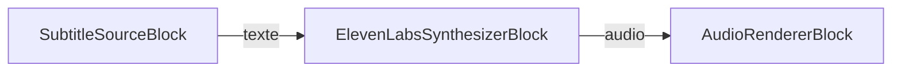
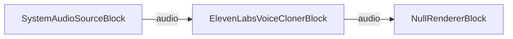

# Blocs ElevenLabs

[Media Blocks SDK .Net](https://www.visioforge.com/media-blocks-sdk-net){ .md-button .md-button--primary target="_blank" }

## Vue d'ensemble

Les blocs ElevenLabs intègrent l'audio IA d'[ElevenLabs](https://elevenlabs.io/) directement dans vos pipelines [Media Blocks SDK .NET](https://www.visioforge.com/media-blocks-sdk-net). Deux blocs reposant sur le cloud sont disponibles :

- [`ElevenLabsSynthesizerBlock`](#synthetiseur-elevenlabs) — synthèse vocale : reçoit du texte en entrée et produit de l'audio vocal.
- [`ElevenLabsVoiceClonerBlock`](#cloneur-de-voix-elevenlabs) — clonage de voix : clone la voix du locuteur à partir de l'audio d'entrée dans votre compte ElevenLabs et laisse passer l'audio sans modification.

Les deux blocs appellent l'API cloud d'ElevenLabs : ils nécessitent donc une **clé d'API ElevenLabs** valide et un accès réseau. Obtenez une clé depuis le [tableau de bord ElevenLabs](https://elevenlabs.io/app). Chaque bloc expose une méthode statique `IsAvailable()` qui vous permet de vérifier que le plugin GStreamer ElevenLabs sous-jacent est présent avant de créer une instance.

## Synthétiseur ElevenLabs

Le bloc `ElevenLabsSynthesizerBlock` convertit un flux de texte en audio parlé à l'aide de l'API de synthèse vocale d'ElevenLabs. Il possède un pad d'entrée de texte et un pad de sortie audio, ce qui vous permet d'acheminer la parole synthétisée vers un encodeur, un moteur de rendu ou un mélangeur.

Configurez-le avec `ElevenLabsSynthesizerSettings`. Le constructeur prend la clé d'API ; les paramètres supplémentaires les plus courants sont le `VoiceId` (la voix ElevenLabs à utiliser), le `ModelId` et un `LanguageCode` ISO 639-1 facultatif.

### Informations sur le bloc

Nom : ElevenLabsSynthesizerBlock.

| Direction du pad | Type de média | Nombre de pads |
| --- | :---: | :---: |
| Entrée | text | un |
| Sortie audio | audio/x-raw | un |

### Paramètres

| Propriété | Type | Valeur par défaut | Description |
| --- | --- | --- | --- |
| `ApiKey` | `string` | — | Clé d'API ElevenLabs (définie via le constructeur). |
| `VoiceId` | `string` | `"9BWtsMINqrJLrRacOk9x"` | ID de voix ElevenLabs. Voir la [bibliothèque de voix](https://elevenlabs.io/app/voice-library). |
| `ModelId` | `string` | `"eleven_flash_v2_5"` | ID de modèle ElevenLabs. |
| `LanguageCode` | `string` | `null` | Code de langue ISO 639-1 facultatif, utile avec certains modèles. |
| `Latency` | `uint` | `2000` | Millisecondes de latence à autoriser pour ElevenLabs. |
| `MaxOverflow` | `uint` | `2000` | Millisecondes pendant lesquelles un repère textuel peut dépasser sa durée (mode compression). |
| `MaxPreviousRequests` | `uint` | `0` | Nombre d'identifiants de requêtes précédentes à suivre pour la continuité. |
| `Overflow` | `ElevenLabsOverflow` | `Clip` | Traitement de l'audio plus long que le texte d'entrée : `Clip`, `Overlap` ou `Shift`. |
| `RetryWithSpeed` | `bool` | `true` | Réessayer avec une vitesse plus élevée lorsque la synthèse produit une durée plus longue. |
| `UseVoiceIdEvents` | `bool` | `true` | Utiliser les événements `elevenlabs/speaker-voice` reçus pour choisir la voix actuelle. |

### Le pipeline d'exemple



### Exemple de code

```csharp
using VisioForge.Core.MediaBlocks;
using VisioForge.Core.MediaBlocks.AudioRendering;
using VisioForge.Core.MediaBlocks.ElevenLabs;
using VisioForge.Core.MediaBlocks.Sources;
using VisioForge.Core.Types.X.ElevenLabs;
using VisioForge.Core.Types.X.Sources;

var pipeline = new MediaBlocksPipeline();

// Paramètres de synthèse vocale. Remplacez par votre clé d'API ElevenLabs.
var ttsSettings = new ElevenLabsSynthesizerSettings("YOUR_ELEVENLABS_API_KEY")
{
    VoiceId = "9BWtsMINqrJLrRacOk9x",
    ModelId = "eleven_flash_v2_5",
    Overflow = ElevenLabsOverflow.Clip
};

var synthesizer = new ElevenLabsSynthesizerBlock(ttsSettings);

// Source du texte à énoncer (par ex. un fichier de sous-titres/texte).
var textSource = new SubtitleSourceBlock(new SubtitleSourceSettings("script.srt"));

// Restitue la parole synthétisée vers le périphérique de sortie audio par défaut.
var audioRenderer = new AudioRendererBlock();

pipeline.Connect(textSource.Output, synthesizer.Input);
pipeline.Connect(synthesizer.Output, audioRenderer.Input);

await pipeline.StartAsync();
```

## Cloneur de voix ElevenLabs

Le bloc `ElevenLabsVoiceClonerBlock` reçoit un flux audio et clone la voix du locuteur avec l'API ElevenLabs. L'audio lui-même traverse le bloc sans modification. Le bloc n'accepte que du PCM entrelacé 16 bits (S16LE) : pour tout autre format, placez un `AudioConverterBlock` devant lui. Le clone est créé dans votre compte ElevenLabs sous la forme d'une voix portant le nom du locuteur, puis mis à jour à chaque nouveau segment audio. Chaque exécution du pipeline crée une nouvelle voix, même avec le même nom de locuteur. Pour parler avec la voix clonée, prenez son ID dans l'événement `OnVoiceCreated` du bloc (voir ci-dessous) et définissez-le comme `VoiceId` d'un `ElevenLabsSynthesizerBlock`. Le bloc ne supprime jamais les voix qu'il crée : supprimez-les dans le tableau de bord, sinon le compte manque d'emplacements de voix et aucune nouvelle voix ne peut plus être créée. Le clonage de voix nécessite une offre ElevenLabs incluant Instant Voice Cloning.

N'effectuez ni recherche ni lecture en boucle dans un pipeline contenant le bloc, et ne définissez ni son `StartPosition`, ni son `StopPosition`, ni une vitesse de lecture différente de 1.0 : ces réglages effectuent une recherche au démarrage du pipeline. Une recherche avec vidage (flushing seek) réinitialise le bloc, après quoi il n'envoie plus rien et ne laisse plus passer l'audio.

À l'arrêt, le bloc retient la fin de flux pendant qu'il envoie les segments encore en attente, y compris le dernier, partiel. Le pipeline attend la fin de flux environ 10 secondes ; ensuite il s'arrête quand même, l'envoi en cours retarde encore `StopAsync` jusqu'à sa fin (les envois n'ont pas de délai d'expiration réseau) et les segments non encore envoyés sont abandonnés. Tenez le bloc à l'écart du chemin vers un puits de fichier : un enregistrement placé derrière lui risque de ne pas être finalisé. Alimentez-le plutôt depuis sa propre branche d'un `TeeBlock`, afin que l'enregistrement reçoive sa fin de flux indépendamment.

Toutes les erreurs n'atteignent pas `OnError`. Un refus de l'API ElevenLabs (clé incorrecte, offre sans clonage de voix, quota épuisé, aucun emplacement de voix libre) ou une réponse illisible du serveur n'est pas signalé : un premier envoi refusé laisse l'exécution sans voix, et une mise à jour refusée ignore ce segment. Après une erreur réseau signalée, le bloc n'envoie plus rien pour le reste de l'exécution. Vérifiez la création via l'événement `OnVoiceCreated` : s'il ne s'est pas déclenché à la fin de l'exécution, aucune voix n'a été créée.

Configurez-le avec `ElevenLabsVoiceClonerSettings`. Le constructeur prend la clé d'API. Par défaut, le bloc stocke 10 secondes d'audio par mise à jour de voix et demande à ElevenLabs de supprimer le bruit de fond des segments de plus de 5 secondes. Définissez toujours `Speaker` : tout l'audio entrant est alors traité comme un seul locuteur, et ce nom est donné à la voix. Sans lui, le pipeline refuse de se construire et signale une erreur.

### Informations sur le bloc

Nom : ElevenLabsVoiceClonerBlock.

| Direction du pad | Type de média | Nombre de pads |
| --- | :---: | :---: |
| Entrée audio | audio/x-raw (S16LE) | un |
| Sortie audio | audio/x-raw (S16LE) | un |

### Paramètres

| Propriété | Type | Valeur par défaut | Description |
| --- | --- | --- | --- |
| `ApiKey` | `string` | — | Clé d'API ElevenLabs (définie via le constructeur). |
| `RemoveBackgroundNoise` | `bool` | `true` | Demander à ElevenLabs de supprimer le bruit de fond (appliqué aux segments de plus de 5 secondes). |
| `SegmentDuration` | `uint` | `10000` | Millisecondes d'audio à stocker avant de créer/mettre à jour une voix. Un segment est envoyé dès qu'il dépasse cette durée ou atteint environ 10 Mo ; le reste est envoyé à l'arrêt. Ne changez pas le format audio en cours d'exécution : le bloc ne commence pas de nouveau segment pour autant. |
| `Speaker` | `string` | `null` | Nom du locuteur, utilisé aussi comme nom de la voix. Tout l'audio est traité comme un seul locuteur. Obligatoire : le pipeline refuse de se construire sans lui. |

### Événements

- `OnVoiceCreated` : se produit quand le bloc a créé ou mis à jour une voix. Fournit `ElevenLabsVoiceCreatedEventArgs` avec le nom du locuteur (`Speaker`) et l'ID de voix ElevenLabs (`VoiceId`).

### Le pipeline d'exemple



### Exemple de code

```csharp
using VisioForge.Core.MediaBlocks;
using VisioForge.Core.MediaBlocks.ElevenLabs;
using VisioForge.Core.MediaBlocks.Sources;
using VisioForge.Core.MediaBlocks.Special;
using VisioForge.Core.Types.X.ElevenLabs;

var pipeline = new MediaBlocksPipeline();

// Paramètres de clonage de voix. Remplacez par votre clé d'API ElevenLabs.
var clonerSettings = new ElevenLabsVoiceClonerSettings("YOUR_ELEVENLABS_API_KEY")
{
    RemoveBackgroundNoise = true,
    SegmentDuration = 10000,
    Speaker = "narrator"
};

var cloner = new ElevenLabsVoiceClonerBlock(clonerSettings);

// L'ID de voix arrive ici une fois qu'ElevenLabs a créé la voix.
cloner.OnVoiceCreated += (s, e) => Console.WriteLine($"Voice '{e.Speaker}' created: {e.VoiceId}");

// Source audio à cloner (capture de l'audio système dans cet exemple).
var audioSource = new SystemAudioSourceBlock();

// L'audio passe sans modification ; il est ignoré pour ne pas renvoyer l'audio capturé vers le microphone.
var nullRenderer = new NullRendererBlock(MediaBlockPadMediaType.Audio);

pipeline.Connect(audioSource.Output, cloner.Input);
pipeline.Connect(cloner.Output, nullRenderer.Input);

await pipeline.StartAsync();
```

## Disponibilité

Appelez `ElevenLabsSynthesizerBlock.IsAvailable()` ou `ElevenLabsVoiceClonerBlock.IsAvailable()` pour vérifier que les blocs ElevenLabs sont disponibles dans l'environnement actuel avant de créer une instance.

## Plateformes

Windows, macOS, Linux, iOS, Android.
