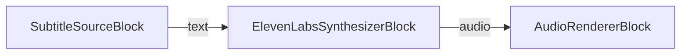
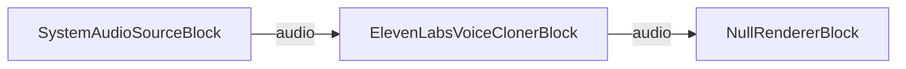

# ElevenLabs Blocks

[Media Blocks SDK .Net](https://www.visioforge.com/media-blocks-sdk-net){ .md-button .md-button--primary target="_blank" }

## Overview

The ElevenLabs blocks bring [ElevenLabs](https://elevenlabs.io/) AI audio directly into your [Media Blocks SDK .NET](https://www.visioforge.com/media-blocks-sdk-net) pipelines. Two cloud-backed blocks are available:

- [`ElevenLabsSynthesizerBlock`](#elevenlabs-synthesizer) — text-to-speech: takes text input and produces speech audio.
- [`ElevenLabsVoiceClonerBlock`](#elevenlabs-voice-cloner) — voice cloning: clones the speaker's voice from audio input into your ElevenLabs account and passes the audio through unchanged.

Both blocks call the ElevenLabs cloud API, so they require a valid **ElevenLabs API key** and network access. Get a key from the [ElevenLabs dashboard](https://elevenlabs.io/app). Each block exposes a static `IsAvailable()` method so you can verify the underlying GStreamer ElevenLabs plugin is present before creating an instance.

## ElevenLabs Synthesizer

The `ElevenLabsSynthesizerBlock` converts a text stream into spoken audio using the ElevenLabs text-to-speech API. It has a text input pad and an audio output pad, so you can route the synthesized speech into an encoder, a renderer, or a mixer.

Configure it with `ElevenLabsSynthesizerSettings`. The constructor takes the API key; the most common extra settings are the `VoiceId` (which ElevenLabs voice to use), the `ModelId`, and an optional ISO 639-1 `LanguageCode`.

### Block info

Name: ElevenLabsSynthesizerBlock.

| Pin direction | Media type | Pins count |
| --- | :---: | :---: |
| Input | text | one |
| Output audio | audio/x-raw | one |

### Settings

| Property | Type | Default | Description |
| --- | --- | --- | --- |
| `ApiKey` | `string` | — | ElevenLabs API key (set via the constructor). |
| `VoiceId` | `string` | `"9BWtsMINqrJLrRacOk9x"` | ElevenLabs Voice ID. See the [voice library](https://elevenlabs.io/app/voice-library). |
| `ModelId` | `string` | `"eleven_flash_v2_5"` | ElevenLabs Model ID. |
| `LanguageCode` | `string` | `null` | Optional ISO 639-1 language code, useful with certain models. |
| `Latency` | `uint` | `2000` | Milliseconds of latency to allow ElevenLabs. |
| `MaxOverflow` | `uint` | `2000` | Milliseconds a text cue may overflow its duration (compress mode). |
| `MaxPreviousRequests` | `uint` | `0` | How many previous request IDs to track for continuity. |
| `Overflow` | `ElevenLabsOverflow` | `Clip` | How audio longer than the input text is handled: `Clip`, `Overlap`, or `Shift`. |
| `RetryWithSpeed` | `bool` | `true` | Retry with higher speed when synthesis produces a longer duration. |
| `UseVoiceIdEvents` | `bool` | `true` | Use received `elevenlabs/speaker-voice` events to pick the current voice. |

### The sample pipeline



### Sample code

```csharp
using VisioForge.Core.MediaBlocks;
using VisioForge.Core.MediaBlocks.AudioRendering;
using VisioForge.Core.MediaBlocks.ElevenLabs;
using VisioForge.Core.MediaBlocks.Sources;
using VisioForge.Core.Types.X.ElevenLabs;
using VisioForge.Core.Types.X.Sources;

var pipeline = new MediaBlocksPipeline();

// Text-to-speech settings. Replace with your ElevenLabs API key.
var ttsSettings = new ElevenLabsSynthesizerSettings("YOUR_ELEVENLABS_API_KEY")
{
    VoiceId = "9BWtsMINqrJLrRacOk9x",
    ModelId = "eleven_flash_v2_5",
    Overflow = ElevenLabsOverflow.Clip
};

var synthesizer = new ElevenLabsSynthesizerBlock(ttsSettings);

// Source of text to speak (e.g. a subtitle/text file).
var textSource = new SubtitleSourceBlock(new SubtitleSourceSettings("script.srt"));

// Render the synthesized speech to the default audio output device.
var audioRenderer = new AudioRendererBlock();

pipeline.Connect(textSource.Output, synthesizer.Input);
pipeline.Connect(synthesizer.Output, audioRenderer.Input);

await pipeline.StartAsync();
```

## ElevenLabs Voice Cloner

The `ElevenLabsVoiceClonerBlock` takes an audio stream and clones the speaker's voice with the ElevenLabs API. The audio itself passes through the block unchanged. The block accepts 16-bit interleaved PCM (S16LE) only, so put an `AudioConverterBlock` in front of it for any other format. The clone is created in your ElevenLabs account as a voice named after the speaker and is updated with each further segment of audio. Every pipeline run creates a new voice, even with the same speaker name. To speak with the cloned voice, take its voice ID from the block's `OnVoiceCreated` event (see below) and set it as `VoiceId` on an `ElevenLabsSynthesizerBlock`. The block never deletes the voices it creates — remove them in the dashboard, or the account runs out of voice slots and new voices can no longer be created. Voice cloning requires an ElevenLabs plan that includes Instant Voice Cloning.

Do not seek or loop a pipeline that contains the block, and do not set its `StartPosition`, `StopPosition` or a playback rate other than 1.0 — those seek when the pipeline starts. A flushing seek resets the block, and after that it neither uploads nor passes audio through.

On stop, the block holds end-of-stream while it uploads the segments still queued, including the last, partial one. The pipeline waits about 10 seconds for end-of-stream; after that it stops anyway, the upload in progress still delays `StopAsync` until it finishes (the uploads have no network timeout), and the segments not yet uploaded are dropped. Keep the block off the path to a file sink — a recorder behind it may be left unfinalized. Feed it from its own `TeeBlock` branch instead, so the recording gets its end-of-stream independently.

Not every failure reaches `OnError`. An ElevenLabs API refusal (a wrong key, a plan without voice cloning, an exhausted quota, no free voice slot) or an unreadable server reply is not reported: a refused first upload leaves the run without a voice, and a refused update skips that segment. After a reported network error, the block uploads nothing more for the rest of the run. Confirm the create through the `OnVoiceCreated` event — if it has not fired by the end of the run, no voice was created.

Configure it with `ElevenLabsVoiceClonerSettings`. The constructor takes the API key. By default the block stores 10 seconds of audio per voice update and asks ElevenLabs to remove background noise from segments longer than 5 seconds. Always set `Speaker`: it treats all incoming audio as a single speaker and names the voice. Without it the pipeline refuses to build and reports an error.

### Block info

Name: ElevenLabsVoiceClonerBlock.

| Pin direction | Media type | Pins count |
| --- | :---: | :---: |
| Input audio | audio/x-raw (S16LE) | one |
| Output audio | audio/x-raw (S16LE) | one |

### Settings

| Property | Type | Default | Description |
| --- | --- | --- | --- |
| `ApiKey` | `string` | — | ElevenLabs API key (set via the constructor). |
| `RemoveBackgroundNoise` | `bool` | `true` | Ask ElevenLabs to remove background noise (applied to segments longer than 5 seconds). |
| `SegmentDuration` | `uint` | `10000` | Milliseconds of audio to store before creating/updating a voice. A segment is sent once it passes this length or reaches about 10 MB; the remainder is sent on stop. Do not change the audio format during a run: the block does not start a new segment for it. |
| `Speaker` | `string` | `null` | Speaker name, also used as the voice name. All audio is treated as one speaker. Required: the pipeline refuses to build without it. |

### Events

- `OnVoiceCreated`: Occurs when the block has created or updated a voice. Provides `ElevenLabsVoiceCreatedEventArgs` with the speaker name (`Speaker`) and the ElevenLabs voice ID (`VoiceId`).

### The sample pipeline



### Sample code

```csharp
using VisioForge.Core.MediaBlocks;
using VisioForge.Core.MediaBlocks.ElevenLabs;
using VisioForge.Core.MediaBlocks.Sources;
using VisioForge.Core.MediaBlocks.Special;
using VisioForge.Core.Types.X.ElevenLabs;

var pipeline = new MediaBlocksPipeline();

// Voice cloning settings. Replace with your ElevenLabs API key.
var clonerSettings = new ElevenLabsVoiceClonerSettings("YOUR_ELEVENLABS_API_KEY")
{
    RemoveBackgroundNoise = true,
    SegmentDuration = 10000,
    Speaker = "narrator"
};

var cloner = new ElevenLabsVoiceClonerBlock(clonerSettings);

// The voice ID arrives here once ElevenLabs has created the voice.
cloner.OnVoiceCreated += (s, e) => Console.WriteLine($"Voice '{e.Speaker}' created: {e.VoiceId}");

// Audio source to clone (system audio capture in this example).
var audioSource = new SystemAudioSourceBlock();

// The audio passes through unchanged; discard it so captured audio is not played back into the microphone.
var nullRenderer = new NullRendererBlock(MediaBlockPadMediaType.Audio);

pipeline.Connect(audioSource.Output, cloner.Input);
pipeline.Connect(cloner.Output, nullRenderer.Input);

await pipeline.StartAsync();
```

## Availability

Call `ElevenLabsSynthesizerBlock.IsAvailable()` or `ElevenLabsVoiceClonerBlock.IsAvailable()` to verify the ElevenLabs blocks are available in the current environment before creating an instance.

## Platforms

Windows, macOS, Linux, iOS, Android.
