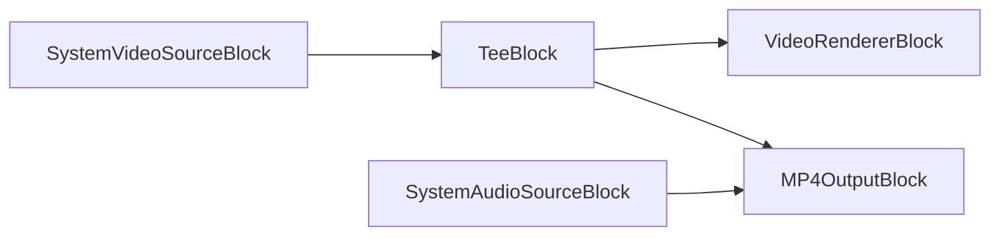

# Vista previa de webcam y grabación MP4 con Media Blocks SDK

[Media Blocks SDK .NET](https://www.visioforge.com/media-blocks-sdk-net){ .md-button .md-button--primary target="_blank" }

## Descripción general

Esta página construye de principio a fin la primera aplicación de Media Blocks más habitual: una ventana WPF que muestra una webcam y la graba, con el micrófono, en un archivo MP4. Un solo pipeline hace ambas cosas:

- `SystemVideoSourceBlock` captura la cámara, en Full HD o HD cuando la cámara ofrece uno de ellos;
- `TeeBlock` divide el video en dos: una copia va a la pantalla y la otra al archivo;
- `VideoRendererBlock` dibuja la imagen en vivo en un `VideoView`;
- `SystemAudioSourceBlock` captura el micrófono;
- `MP4OutputBlock` codifica el video en H.264 y el audio en AAC y escribe el archivo MP4;
- `StartAsync` inicia la vista previa y la grabación a la vez, y `StopAsync` finaliza el archivo.

La misma aplicación con un motor de captura listo para usar en lugar de un pipeline es [Guardar video de webcam en C#](../../videocapture/guides/save-webcam-video.md), en Video Capture SDK .NET.



## Paquetes necesarios

- [VisioForge.DotNet.MediaBlocks](https://www.nuget.org/packages/VisioForge.DotNet.MediaBlocks/) — el SDK; el `VideoView` de WPF viene incluido en él
- [VisioForge.CrossPlatform.Core.Windows.x64](https://www.nuget.org/packages/VisioForge.CrossPlatform.Core.Windows.x64/) — el runtime de GStreamer sobre el que se ejecuta el pipeline, con las fuentes de cámara y los codificadores H.264
- [VisioForge.CrossPlatform.Libav.Windows.x64](https://www.nuget.org/packages/VisioForge.CrossPlatform.Libav.Windows.x64/) — el codificador AAC de FFmpeg; sin él se usa el codificador AAC de Media Foundation
- [VisioForge.CrossPlatform.Core.Windows.Intel.x64](https://www.nuget.org/packages/VisioForge.CrossPlatform.Core.Windows.Intel.x64/) — opcional: el codificador H.264 Intel Quick Sync; sin él, un PC cuya única GPU es Intel codifica con OpenH264 en la CPU

```bash
dotnet add package VisioForge.DotNet.MediaBlocks
dotnet add package VisioForge.CrossPlatform.Core.Windows.x64
dotnet add package VisioForge.CrossPlatform.Libav.Windows.x64
```

Los paquetes de runtime son x64, por lo que el archivo de proyecto establece `PlatformTarget`; una aplicación de 32 bits usa los paquetes `.x86`. Mantenga los paquetes de runtime en la versión de `VisioForge.DotNet.MediaBlocks` o en la inmediatamente anterior, como explica la [guía de inicio](index.md).

```xml
<Project Sdk="Microsoft.NET.Sdk">
  <PropertyGroup>
    <OutputType>WinExe</OutputType>
    <TargetFramework>net10.0-windows</TargetFramework>
    <PlatformTarget>x64</PlatformTarget>
    <UseWPF>true</UseWPF>
    <Nullable>enable</Nullable>
    <ImplicitUsings>enable</ImplicitUsings>
  </PropertyGroup>
  <!-- los elementos PackageReference que escribió dotnet add package -->
</Project>
```

## La ventana

`MainWindow.xaml` tiene un `VideoView` para la imagen y los botones **Start** y **Stop**, ambos deshabilitados hasta que se puedan usar. Los eventos `Loaded` y `Closing` de la ventana están conectados a los controladores del código siguiente.

```xml
<Window x:Class="CameraToMp4.MainWindow"
        xmlns="http://schemas.microsoft.com/winfx/2006/xaml/presentation"
        xmlns:x="http://schemas.microsoft.com/winfx/2006/xaml"
        xmlns:wpf="clr-namespace:VisioForge.Core.UI.WPF;assembly=VisioForge.Core"
        Title="Camera to MP4" Width="800" Height="520"
        Loaded="Window_Loaded" Closing="Window_Closing">
    <DockPanel>
        <StackPanel DockPanel.Dock="Bottom" Orientation="Horizontal" Margin="8">
            <Button x:Name="btStart" Content="Start" Width="100" IsEnabled="False" Click="btStart_Click" />
            <Button x:Name="btStop" Content="Stop" Width="100" Margin="8,0,0,0" IsEnabled="False" Click="btStop_Click" />
        </StackPanel>
        <wpf:VideoView x:Name="VideoView1" Background="Black" />
    </DockPanel>
</Window>
```

## El código

`MainWindow.xaml.cs`:

```csharp
using System.ComponentModel;
using System.IO;
using System.Windows;
using VisioForge.Core;
using VisioForge.Core.MediaBlocks;
using VisioForge.Core.MediaBlocks.Sinks;
using VisioForge.Core.MediaBlocks.Sources;
using VisioForge.Core.MediaBlocks.Special;
using VisioForge.Core.MediaBlocks.VideoRendering;
using VisioForge.Core.Types.X.Sources;

namespace CameraToMp4;

public partial class MainWindow : Window
{
    private MediaBlocksPipeline? _pipeline;

    private string _outputFile = string.Empty;

    private bool _failed;

    public MainWindow()
    {
        InitializeComponent();
    }

    private async void Window_Loaded(object sender, RoutedEventArgs e)
    {
        await VisioForgeX.InitSDKAsync();
        btStart.IsEnabled = true;
    }

    private async void btStart_Click(object sender, RoutedEventArgs e)
    {
        btStart.IsEnabled = false;

        var camera = (await DeviceEnumerator.Shared.VideoSourcesAsync()).FirstOrDefault();
        // Omitir las fuentes que graban lo que reproduce una salida (loopback de WASAPI2, monitores de PulseAudio)
        var microphone = (await DeviceEnumerator.Shared.AudioSourcesAsync()).FirstOrDefault(d => !d.IsLoopback);
        if (camera == null)
        {
            Title = "No camera found";
            btStart.IsEnabled = true;
            return;
        }

        _failed = false;
        _pipeline = new MediaBlocksPipeline();
        _pipeline.OnError += (_, args) => Dispatcher.BeginInvoke(() =>
        {
            _failed = true;
            Title = args.Message;
        });

        // La cámara, en Full HD o HD cuando ofrece uno de ellos
        var videoSource = new SystemVideoSourceBlock(new VideoCaptureDeviceSourceSettings(camera));

        // El tee envía una copia del video a la pantalla y otra al archivo
        var videoTee = new TeeBlock(2, MediaBlockPadMediaType.Video);
        var videoRenderer = new VideoRendererBlock(_pipeline, VideoView1) { IsSync = false };

        // H.264 en el codificador de la GPU cuando lo hay, OpenH264 en caso contrario; audio AAC
        _outputFile = Path.Combine(Environment.GetFolderPath(Environment.SpecialFolder.MyVideos), $"camera_{DateTime.Now:yyyyMMdd_HHmmss}.mp4");
        var mp4Output = new MP4OutputBlock(_outputFile);

        _pipeline.Connect(videoSource.Output, videoTee.Input);
        _pipeline.Connect(videoTee.Outputs[0], videoRenderer.Input);
        _pipeline.Connect(videoTee.Outputs[1], mp4Output.CreateNewInput(MediaBlockPadMediaType.Video));

        // Sin micrófono: el archivo solo tiene video
        if (microphone != null)
        {
            var audioSource = new SystemAudioSourceBlock(microphone.CreateSourceSettings());
            _pipeline.Connect(audioSource.Output, mp4Output.CreateNewInput(MediaBlockPadMediaType.Audio));
        }

        if (await _pipeline.StartAsync())
        {
            Title = "Recording...";
            btStop.IsEnabled = true;
        }
        else
        {
            if (!_failed)
            {
                Title = "The pipeline did not start";
            }

            await _pipeline.DisposeAsync();
            _pipeline = null;
            btStart.IsEnabled = true;
        }
    }

    private async void btStop_Click(object sender, RoutedEventArgs e)
    {
        btStop.IsEnabled = false;
        await StopAsync();
        btStart.IsEnabled = true;
    }

    private async Task StopAsync()
    {
        if (_pipeline == null)
        {
            return;
        }

        await _pipeline.StopAsync(); // finaliza el archivo MP4
        await _pipeline.DisposeAsync();
        _pipeline = null;
        if (!_failed) // tras un error, el título conserva el error
        {
            Title = "Saved: " + _outputFile;
        }
    }

    private async void Window_Closing(object? sender, CancelEventArgs e)
    {
        if (!btStart.IsEnabled && !btStop.IsEnabled)
        {
            e.Cancel = true; // cargando, iniciando o deteniendo: espere
            return;
        }

        if (btStop.IsEnabled)
        {
            e.Cancel = true; // grabando: primero finalice el MP4
            btStop.IsEnabled = false;
            await StopAsync();
            btStart.IsEnabled = true;
            _ = Dispatcher.BeginInvoke(Close);
            return;
        }

        VisioForgeX.DestroySDK();
    }
}
```

## Cómo funciona

1. **Inicialización del SDK** - `VisioForgeX.InitSDKAsync` se ejecuta una vez, cuando se carga la ventana; **Start** se habilita cuando retorna. `VisioForgeX.DestroySDK` libera el SDK cuando se cierra la ventana
2. **Dispositivos** - la aplicación toma la primera cámara y el primer micrófono que lista `DeviceEnumerator`, omitiendo las entradas `IsLoopback`, que graban lo que reproduce un dispositivo de salida (`IsLoopback` llegó en la primera versión posterior a la 2026.11.21; con la 2026.11.21 o anterior, sustituya `!d.IsLoopback` por `d.API != AudioCaptureDeviceAPI.WASAPI2`, que no tiene efecto fuera de Windows; esas versiones no marcan las fuentes monitor de Linux, así que allí elija el micrófono por nombre). Para que el usuario elija, rellene dos cuadros combinados con las mismas listas y busque por `Name` y `DisplayName`; [Enumeración de dispositivos](device-enum.md) muestra las listas, y el [tutorial de cámara](camera.md) muestra cómo elegir una resolución y una velocidad de fotogramas
3. **El tee** - una salida de fuente se conecta a una sola entrada, por lo que `TeeBlock` copia el video a dos salidas: `Outputs[0]` va al renderizador y `Outputs[1]` al codificador MP4. `IsSync = false` dibuja cada fotograma cuando llega, de modo que la vista previa de una cámara en vivo no espera al reloj del pipeline
4. **El archivo MP4** - En Windows, `MP4OutputBlock(filename)` elige H.264 en NVIDIA NVENC, AMD AMF o Intel Quick Sync (Quick Sync requiere el paquete de Intel anterior), y OpenH264 en la CPU cuando no hay ninguno de ellos; en Linux, NVENC o Quick Sync cuando el GStreamer del sistema los incluye, y OpenH264 en caso contrario. En macOS, Mac Catalyst e iOS usa Apple VideoToolbox, y en Android el codificador MediaCodec del dispositivo; cuando ese codificador no está disponible, OpenH264. El audio es AAC. `CreateNewInput` le añade una entrada de video y una de audio. La [página de salida MP4](../../general/output-formats/mp4.md) muestra cómo elegir los codificadores y sus tasas de bits
5. **Inicio y detención** - `StartAsync` inicia la vista previa y la grabación a la vez. `StopAsync` finaliza el archivo MP4; un archivo que no se detuvo no se puede reproducir. Cada grabación obtiene un pipeline nuevo y un nombre de archivo nuevo, con la fecha y la hora, en la carpeta Vídeos
6. **Cierre** - cerrar la ventana durante una grabación cancela el cierre, espera a `StopAsync` y vuelve a cerrar, por lo que el archivo siempre queda finalizado

Para escuchar el micrófono mientras graba, coloque un segundo `TeeBlock` con `MediaBlockPadMediaType.Audio` después de `SystemAudioSourceBlock` y conecte su primera salida a un `AudioRendererBlock`; use auriculares, o los altavoces se acoplarán con el micrófono. Otros bloques que aceptan una salida del tee (transmisiones de red, un segundo archivo) están en la [página de sumideros](../Sinks/index.md); el propio [bloque Tee](../Special/index.md#tee) tiene ajustes para sus colas.

## Notas por plataforma

El pipeline, los bloques y las llamadas anteriores son los mismos en todas las plataformas; lo que cambia es el control de la interfaz y el paquete de runtime.

- **Windows** - la aplicación anterior. WinForms usa `VisioForge.Core.UI.WinForms.VideoView` del mismo paquete. El acceso de las aplicaciones de escritorio a la cámara y al micrófono se configura en **Configuración > Privacidad y seguridad**; cuando está desactivado, los dispositivos no se pueden abrir
- **macOS y Mac Catalyst** - el runtime `VisioForge.CrossPlatform.Core.macOS` y el `VideoView` del paquete de interfaz de Avalonia o MAUI. El paquete de la aplicación necesita `NSCameraUsageDescription` y `NSMicrophoneUsageDescription` en su `Info.plist`, o macOS cierra la aplicación cuando se abre la cámara. Consulte [Implementación en macOS](../../deployment-x/macOS.md)
- **iOS** - el runtime `VisioForge.CrossPlatform.Core.iOS`, las mismas dos claves de `Info.plist` y el `VideoView` de MAUI. Consulte [Implementación en iOS](../../deployment-x/iOS.md)
- **Android** - el runtime `VisioForge.CrossPlatform.Core.Android` y los permisos `CAMERA` y `RECORD_AUDIO`, declarados en el manifiesto y concedidos en tiempo de ejecución antes de `StartAsync`. Escriba el archivo en el almacenamiento propio de la aplicación, no en la carpeta Vídeos. Consulte [Implementación en Android](../../deployment-x/Android.md)
- **Linux** - el runtime `VisioForge.CrossPlatform.Core.Linux.x64` y GStreamer 1.20+ de la distribución, con un `VideoView` de Avalonia. Consulte [Implementación en Ubuntu](../../deployment-x/Ubuntu.md)

## Solución de problemas

- **El título muestra un error al pulsar Start** - otra aplicación está usando la cámara, o el acceso a la cámara está desactivado en la configuración de privacidad del sistema
- **Se usa una cámara o un micrófono equivocado** - el primer dispositivo de la lista no es el que usted quiere; una tarjeta de captura o una cámara virtual puede aparecer primero. Elija el dispositivo por nombre, como indica el punto 2 anterior
- **El archivo no tiene sonido** - no se encontró ningún micrófono, o el acceso al micrófono del sistema está desactivado para las aplicaciones de escritorio
- **El archivo no se reproduce** - el depurador cerró la aplicación, o esta terminó antes de que `StopAsync` finalizara el archivo

## Páginas relacionadas

- [Guía de inicio](index.md) - instalación, paquetes para cada plataforma y los fundamentos del pipeline
- [Tutorial de cámara](camera.md) - selección de dispositivo y formato, capturas de imagen
- [Salida MP4](../../general/output-formats/mp4.md) - elección del codificador, tasas de bits y división de archivos
- [Sumideros](../Sinks/index.md) - todos los bloques de salida, incluido el [sumidero MP4](../Sinks/index.md#mp4) para flujos ya codificados
- [Simple Capture Demo](https://github.com/visioforge/.Net-SDK-s-samples/tree/master/Media%20Blocks%20SDK/WPF/CSharp/Simple%20Capture%20Demo) - la demo WPF completa en GitHub, con listas de dispositivos, salidas MP4, MPEG-TS y WebM y monitorización de audio
