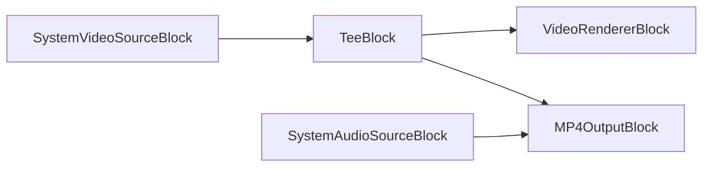

# Aperçu webcam et enregistrement MP4 avec Media Blocks SDK

[Media Blocks SDK .NET](https://www.visioforge.com/media-blocks-sdk-net){ .md-button .md-button--primary target="_blank" }

## Vue d'ensemble

Cette page construit de bout en bout la première application Media Blocks la plus courante : une fenêtre WPF qui affiche une webcam et l'enregistre, avec le micro, dans un fichier MP4. Un seul pipeline fait les deux :

- `SystemVideoSourceBlock` capture la caméra, en Full HD ou en HD lorsque la caméra propose l'une de ces résolutions ;
- `TeeBlock` divise la vidéo en deux : une copie va à l'écran, l'autre au fichier ;
- `VideoRendererBlock` affiche l'image en direct dans un `VideoView` ;
- `SystemAudioSourceBlock` capture le micro ;
- `MP4OutputBlock` encode la vidéo en H.264 et l'audio en AAC, et écrit le fichier MP4 ;
- `StartAsync` démarre l'aperçu et l'enregistrement ensemble, et `StopAsync` finalise le fichier.

La même application avec un moteur de capture prêt à l'emploi au lieu d'un pipeline est décrite dans [Enregistrer la vidéo d'une webcam en C#](../../videocapture/guides/save-webcam-video.md), avec Video Capture SDK .NET.



## Paquets requis

- [VisioForge.DotNet.MediaBlocks](https://www.nuget.org/packages/VisioForge.DotNet.MediaBlocks/) — le SDK ; le `VideoView` WPF y est inclus
- [VisioForge.CrossPlatform.Core.Windows.x64](https://www.nuget.org/packages/VisioForge.CrossPlatform.Core.Windows.x64/) — le runtime GStreamer sur lequel tourne le pipeline, avec les sources caméra et les encodeurs H.264
- [VisioForge.CrossPlatform.Libav.Windows.x64](https://www.nuget.org/packages/VisioForge.CrossPlatform.Libav.Windows.x64/) — l'encodeur AAC de FFmpeg ; sans lui, l'encodeur AAC de Media Foundation est utilisé
- [VisioForge.CrossPlatform.Core.Windows.Intel.x64](https://www.nuget.org/packages/VisioForge.CrossPlatform.Core.Windows.Intel.x64/) — facultatif : l'encodeur H.264 Intel Quick Sync ; sans lui, un PC dont le seul GPU est Intel encode avec OpenH264 sur le CPU

```bash
dotnet add package VisioForge.DotNet.MediaBlocks
dotnet add package VisioForge.CrossPlatform.Core.Windows.x64
dotnet add package VisioForge.CrossPlatform.Libav.Windows.x64
```

Les paquets runtime sont en x64, le fichier de projet définit donc `PlatformTarget` ; une application 32 bits utilise les paquets `.x86`. Gardez les paquets runtime à la version de `VisioForge.DotNet.MediaBlocks` ou à celle qui la précède juste, comme l'explique le [guide de démarrage](index.md).

```xml
<Project Sdk="Microsoft.NET.Sdk">
  <PropertyGroup>
    <OutputType>WinExe</OutputType>
    <TargetFramework>net10.0-windows</TargetFramework>
    <PlatformTarget>x64</PlatformTarget>
    <UseWPF>true</UseWPF>
    <Nullable>enable</Nullable>
    <ImplicitUsings>enable</ImplicitUsings>
  </PropertyGroup>
  <!-- les éléments PackageReference écrits par dotnet add package -->
</Project>
```

## La fenêtre

`MainWindow.xaml` contient un `VideoView` pour l'image et les boutons **Start** et **Stop**, tous deux désactivés tant qu'ils ne peuvent pas servir. Les événements `Loaded` et `Closing` de la fenêtre sont reliés aux gestionnaires du code ci-dessous.

```xml
<Window x:Class="CameraToMp4.MainWindow"
        xmlns="http://schemas.microsoft.com/winfx/2006/xaml/presentation"
        xmlns:x="http://schemas.microsoft.com/winfx/2006/xaml"
        xmlns:wpf="clr-namespace:VisioForge.Core.UI.WPF;assembly=VisioForge.Core"
        Title="Camera to MP4" Width="800" Height="520"
        Loaded="Window_Loaded" Closing="Window_Closing">
    <DockPanel>
        <StackPanel DockPanel.Dock="Bottom" Orientation="Horizontal" Margin="8">
            <Button x:Name="btStart" Content="Start" Width="100" IsEnabled="False" Click="btStart_Click" />
            <Button x:Name="btStop" Content="Stop" Width="100" Margin="8,0,0,0" IsEnabled="False" Click="btStop_Click" />
        </StackPanel>
        <wpf:VideoView x:Name="VideoView1" Background="Black" />
    </DockPanel>
</Window>
```

## Le code

`MainWindow.xaml.cs` :

```csharp
using System.ComponentModel;
using System.IO;
using System.Windows;
using VisioForge.Core;
using VisioForge.Core.MediaBlocks;
using VisioForge.Core.MediaBlocks.Sinks;
using VisioForge.Core.MediaBlocks.Sources;
using VisioForge.Core.MediaBlocks.Special;
using VisioForge.Core.MediaBlocks.VideoRendering;
using VisioForge.Core.Types.X.Sources;

namespace CameraToMp4;

public partial class MainWindow : Window
{
    private MediaBlocksPipeline? _pipeline;

    private string _outputFile = string.Empty;

    private bool _failed;

    public MainWindow()
    {
        InitializeComponent();
    }

    private async void Window_Loaded(object sender, RoutedEventArgs e)
    {
        await VisioForgeX.InitSDKAsync();
        btStart.IsEnabled = true;
    }

    private async void btStart_Click(object sender, RoutedEventArgs e)
    {
        btStart.IsEnabled = false;

        var camera = (await DeviceEnumerator.Shared.VideoSourcesAsync()).FirstOrDefault();
        // Ignorer les sources qui enregistrent ce que joue une sortie (loopback WASAPI2, moniteurs PulseAudio)
        var microphone = (await DeviceEnumerator.Shared.AudioSourcesAsync()).FirstOrDefault(d => !d.IsLoopback);
        if (camera == null)
        {
            Title = "No camera found";
            btStart.IsEnabled = true;
            return;
        }

        _failed = false;
        _pipeline = new MediaBlocksPipeline();
        _pipeline.OnError += (_, args) => Dispatcher.BeginInvoke(() =>
        {
            _failed = true;
            Title = args.Message;
        });

        // La caméra, en Full HD ou en HD lorsqu'elle propose l'une de ces résolutions
        var videoSource = new SystemVideoSourceBlock(new VideoCaptureDeviceSourceSettings(camera));

        // Le tee envoie une copie de la vidéo à l'écran et une autre au fichier
        var videoTee = new TeeBlock(2, MediaBlockPadMediaType.Video);
        var videoRenderer = new VideoRendererBlock(_pipeline, VideoView1) { IsSync = false };

        // H.264 sur l'encodeur GPU s'il existe, OpenH264 sinon ; audio AAC
        _outputFile = Path.Combine(Environment.GetFolderPath(Environment.SpecialFolder.MyVideos), $"camera_{DateTime.Now:yyyyMMdd_HHmmss}.mp4");
        var mp4Output = new MP4OutputBlock(_outputFile);

        _pipeline.Connect(videoSource.Output, videoTee.Input);
        _pipeline.Connect(videoTee.Outputs[0], videoRenderer.Input);
        _pipeline.Connect(videoTee.Outputs[1], mp4Output.CreateNewInput(MediaBlockPadMediaType.Video));

        // Pas de micro : le fichier ne contient que la vidéo
        if (microphone != null)
        {
            var audioSource = new SystemAudioSourceBlock(microphone.CreateSourceSettings());
            _pipeline.Connect(audioSource.Output, mp4Output.CreateNewInput(MediaBlockPadMediaType.Audio));
        }

        if (await _pipeline.StartAsync())
        {
            Title = "Recording...";
            btStop.IsEnabled = true;
        }
        else
        {
            if (!_failed)
            {
                Title = "The pipeline did not start";
            }

            await _pipeline.DisposeAsync();
            _pipeline = null;
            btStart.IsEnabled = true;
        }
    }

    private async void btStop_Click(object sender, RoutedEventArgs e)
    {
        btStop.IsEnabled = false;
        await StopAsync();
        btStart.IsEnabled = true;
    }

    private async Task StopAsync()
    {
        if (_pipeline == null)
        {
            return;
        }

        await _pipeline.StopAsync(); // finalise le fichier MP4
        await _pipeline.DisposeAsync();
        _pipeline = null;
        if (!_failed) // après une erreur, le titre garde l'erreur
        {
            Title = "Saved: " + _outputFile;
        }
    }

    private async void Window_Closing(object? sender, CancelEventArgs e)
    {
        if (!btStart.IsEnabled && !btStop.IsEnabled)
        {
            e.Cancel = true; // chargement, démarrage ou arrêt : attendre
            return;
        }

        if (btStop.IsEnabled)
        {
            e.Cancel = true; // enregistrement : finaliser d'abord le MP4
            btStop.IsEnabled = false;
            await StopAsync();
            btStart.IsEnabled = true;
            _ = Dispatcher.BeginInvoke(Close);
            return;
        }

        VisioForgeX.DestroySDK();
    }
}
```

## Fonctionnement

1. **Initialisation du SDK** - `VisioForgeX.InitSDKAsync` s'exécute une fois, au chargement de la fenêtre ; **Start** est activé après son retour. `VisioForgeX.DestroySDK` libère le SDK à la fermeture de la fenêtre
2. **Périphériques** - l'application prend la première caméra et le premier micro listés par `DeviceEnumerator`, en ignorant les entrées `IsLoopback`, qui enregistrent ce que joue un périphérique de sortie (`IsLoopback` est arrivé avec la première version postérieure à 2026.11.21 ; avec 2026.11.21 ou une version antérieure, remplacez `!d.IsLoopback` par `d.API != AudioCaptureDeviceAPI.WASAPI2`, sans effet hors de Windows ; ces versions ne marquent pas les sources moniteur de Linux, choisissez donc le micro par son nom sous Linux). Pour laisser l'utilisateur choisir, remplissez deux listes déroulantes à partir des mêmes listes et cherchez par `Name` et `DisplayName` ; [Énumération de périphériques](device-enum.md) présente les listes, et le [tutoriel caméra](camera.md) montre comment choisir une résolution et une fréquence d'images
3. **Le tee** - une sortie de source ne se connecte qu'à une seule entrée, `TeeBlock` copie donc la vidéo vers deux sorties : `Outputs[0]` va au moteur de rendu, `Outputs[1]` à l'encodeur MP4. `IsSync = false` affiche chaque image dès son arrivée, de sorte que l'aperçu d'une caméra en direct n'attend pas l'horloge du pipeline
4. **Le fichier MP4** - Sous Windows, `MP4OutputBlock(filename)` choisit H.264 sur NVIDIA NVENC, AMD AMF ou Intel Quick Sync (Quick Sync nécessite le paquet Intel ci-dessus), et OpenH264 sur le CPU quand aucun d'eux n'est présent ; sous Linux, NVENC ou Quick Sync lorsque le GStreamer du système les fournit, sinon OpenH264. Sous macOS, Mac Catalyst et iOS, il utilise Apple VideoToolbox, et sous Android l'encodeur MediaCodec de l'appareil ; lorsque cet encodeur manque, OpenH264. L'audio est en AAC. `CreateNewInput` lui ajoute une entrée vidéo et une entrée audio. La [page de sortie MP4](../../general/output-formats/mp4.md) montre comment choisir les encodeurs et leurs débits
5. **Démarrage et arrêt** - `StartAsync` démarre l'aperçu et l'enregistrement ensemble. `StopAsync` finalise le fichier MP4 ; un fichier qui n'a pas été arrêté n'est pas lisible. Chaque enregistrement reçoit un nouveau pipeline et un nouveau nom de fichier, avec la date et l'heure, dans le dossier Vidéos
6. **Fermeture** - fermer la fenêtre pendant un enregistrement annule la fermeture, attend `StopAsync` puis ferme à nouveau, de sorte que le fichier est toujours finalisé

Pour écouter le micro pendant l'enregistrement, placez un second `TeeBlock` avec `MediaBlockPadMediaType.Audio` après `SystemAudioSourceBlock` et reliez sa première sortie à un `AudioRendererBlock` ; utilisez un casque, sinon les haut-parleurs provoquent un effet Larsen dans le micro. D'autres blocs qui acceptent une sortie du tee (flux réseau, second fichier) se trouvent sur la [page des puits](../Sinks/index.md) ; le [bloc Tee](../Special/index.md#tee) lui-même propose des réglages pour ses files d'attente.

## Notes par plateforme

Le pipeline, les blocs et les appels ci-dessus sont les mêmes sur toutes les plateformes ; seuls le contrôle d'interface et le paquet runtime changent.

- **Windows** - l'application ci-dessus. WinForms utilise `VisioForge.Core.UI.WinForms.VideoView` du même paquet. L'accès des applications de bureau à la caméra et au micro se règle dans **Paramètres > Confidentialité et sécurité** ; lorsqu'il est désactivé, les périphériques ne peuvent pas être ouverts
- **macOS et Mac Catalyst** - le runtime `VisioForge.CrossPlatform.Core.macOS` et le `VideoView` du paquet d'interface Avalonia ou MAUI. Le bundle de l'application doit contenir `NSCameraUsageDescription` et `NSMicrophoneUsageDescription` dans son `Info.plist`, sinon macOS ferme l'application à l'ouverture de la caméra. Voir [Déploiement macOS](../../deployment-x/macOS.md)
- **iOS** - le runtime `VisioForge.CrossPlatform.Core.iOS`, les deux mêmes clés `Info.plist` et le `VideoView` MAUI. Voir [Déploiement iOS](../../deployment-x/iOS.md)
- **Android** - le runtime `VisioForge.CrossPlatform.Core.Android` et les autorisations `CAMERA` et `RECORD_AUDIO`, déclarées dans le manifeste et accordées à l'exécution avant `StartAsync`. Écrivez le fichier dans le stockage propre de l'application, pas dans le dossier Vidéos. Voir [Déploiement Android](../../deployment-x/Android.md)
- **Linux** - le runtime `VisioForge.CrossPlatform.Core.Linux.x64` et GStreamer 1.20+ fourni par la distribution, avec un `VideoView` Avalonia. Voir [Déploiement Ubuntu](../../deployment-x/Ubuntu.md)

## Dépannage

- **Le titre affiche une erreur au clic sur Start** - une autre application utilise la caméra, ou l'accès à la caméra est désactivé dans les paramètres de confidentialité du système
- **La mauvaise caméra ou le mauvais micro est utilisé** - le premier périphérique de la liste n'est pas celui que vous voulez ; une carte d'acquisition ou une caméra virtuelle peut apparaître en premier. Choisissez le périphérique par son nom, comme l'indique le point 2 ci-dessus
- **Le fichier n'a pas de son** - aucun micro n'a été trouvé, ou l'accès au micro est désactivé pour les applications de bureau
- **Le fichier ne se lit pas** - le débogueur a fermé l'application, ou celle-ci s'est terminée avant que `StopAsync` ait finalisé le fichier

## Pages associées

- [Guide de démarrage](index.md) - installation, paquets pour chaque plateforme et bases du pipeline
- [Tutoriel caméra](camera.md) - choix du périphérique et du format, captures d'image
- [Sortie MP4](../../general/output-formats/mp4.md) - choix de l'encodeur, débits et découpage des fichiers
- [Puits](../Sinks/index.md) - tous les blocs de sortie, dont le [puits MP4](../Sinks/index.md#mp4) pour les flux déjà encodés
- [Simple Capture Demo](https://github.com/visioforge/.Net-SDK-s-samples/tree/master/Media%20Blocks%20SDK/WPF/CSharp/Simple%20Capture%20Demo) - la démo WPF complète sur GitHub, avec listes de périphériques, sorties MP4, MPEG-TS et WebM et écoute de l'audio
