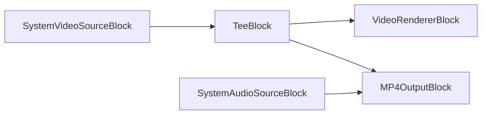

# Webcam Preview and MP4 Recording with Media Blocks SDK

[Media Blocks SDK .NET](https://www.visioforge.com/media-blocks-sdk-net){ .md-button .md-button--primary target="_blank" }

## Overview

This page builds the most common first Media Blocks app from start to finish: a WPF window that shows a webcam and records it, with the microphone, to an MP4 file. One pipeline does both:

- `SystemVideoSourceBlock` captures the camera, in Full HD or HD when the camera offers one of them;
- `TeeBlock` splits the video in two: one copy goes to the screen, the other to the file;
- `VideoRendererBlock` draws the live picture in a `VideoView`;
- `SystemAudioSourceBlock` captures the microphone;
- `MP4OutputBlock` encodes H.264 video and AAC audio and writes the MP4 file;
- `StartAsync` starts the preview and the recording together, and `StopAsync` finishes the file.

The same app with a ready-made capture engine instead of a pipeline is [Save Webcam Video in C#](../../videocapture/guides/save-webcam-video.md), in Video Capture SDK .NET.



## Required Packages

- [VisioForge.DotNet.MediaBlocks](https://www.nuget.org/packages/VisioForge.DotNet.MediaBlocks/) — the SDK; the WPF `VideoView` ships in it
- [VisioForge.CrossPlatform.Core.Windows.x64](https://www.nuget.org/packages/VisioForge.CrossPlatform.Core.Windows.x64/) — the GStreamer runtime the pipeline runs on, with the camera sources and the H.264 encoders
- [VisioForge.CrossPlatform.Libav.Windows.x64](https://www.nuget.org/packages/VisioForge.CrossPlatform.Libav.Windows.x64/) — the FFmpeg AAC encoder; without it the AAC encoder of Media Foundation is used
- [VisioForge.CrossPlatform.Core.Windows.Intel.x64](https://www.nuget.org/packages/VisioForge.CrossPlatform.Core.Windows.Intel.x64/) — optional: the Intel Quick Sync H.264 encoder; without it a PC whose only GPU is Intel encodes with OpenH264 on the CPU

```bash
dotnet add package VisioForge.DotNet.MediaBlocks
dotnet add package VisioForge.CrossPlatform.Core.Windows.x64
dotnet add package VisioForge.CrossPlatform.Libav.Windows.x64
```

The runtime packages are x64, so the project file sets `PlatformTarget`; a 32-bit app takes the `.x86` packages instead. Keep the runtime packages at the release of `VisioForge.DotNet.MediaBlocks` or just before it, as the [Getting Started guide](index.md) explains.

```xml
<Project Sdk="Microsoft.NET.Sdk">
  <PropertyGroup>
    <OutputType>WinExe</OutputType>
    <TargetFramework>net10.0-windows</TargetFramework>
    <PlatformTarget>x64</PlatformTarget>
    <UseWPF>true</UseWPF>
    <Nullable>enable</Nullable>
    <ImplicitUsings>enable</ImplicitUsings>
  </PropertyGroup>
  <!-- the PackageReference items that dotnet add package wrote -->
</Project>
```

## The Window

`MainWindow.xaml` has a `VideoView` for the picture and the **Start** and **Stop** buttons, both disabled until they can be used. The window's `Loaded` and `Closing` events are wired to the handlers in the code below.

```xml
<Window x:Class="CameraToMp4.MainWindow"
        xmlns="http://schemas.microsoft.com/winfx/2006/xaml/presentation"
        xmlns:x="http://schemas.microsoft.com/winfx/2006/xaml"
        xmlns:wpf="clr-namespace:VisioForge.Core.UI.WPF;assembly=VisioForge.Core"
        Title="Camera to MP4" Width="800" Height="520"
        Loaded="Window_Loaded" Closing="Window_Closing">
    <DockPanel>
        <StackPanel DockPanel.Dock="Bottom" Orientation="Horizontal" Margin="8">
            <Button x:Name="btStart" Content="Start" Width="100" IsEnabled="False" Click="btStart_Click" />
            <Button x:Name="btStop" Content="Stop" Width="100" Margin="8,0,0,0" IsEnabled="False" Click="btStop_Click" />
        </StackPanel>
        <wpf:VideoView x:Name="VideoView1" Background="Black" />
    </DockPanel>
</Window>
```

## The Code

`MainWindow.xaml.cs`:

```csharp
using System.ComponentModel;
using System.IO;
using System.Windows;
using VisioForge.Core;
using VisioForge.Core.MediaBlocks;
using VisioForge.Core.MediaBlocks.Sinks;
using VisioForge.Core.MediaBlocks.Sources;
using VisioForge.Core.MediaBlocks.Special;
using VisioForge.Core.MediaBlocks.VideoRendering;
using VisioForge.Core.Types.X.Sources;

namespace CameraToMp4;

public partial class MainWindow : Window
{
    private MediaBlocksPipeline? _pipeline;

    private string _outputFile = string.Empty;

    private bool _failed;

    public MainWindow()
    {
        InitializeComponent();
    }

    private async void Window_Loaded(object sender, RoutedEventArgs e)
    {
        await VisioForgeX.InitSDKAsync();
        btStart.IsEnabled = true;
    }

    private async void btStart_Click(object sender, RoutedEventArgs e)
    {
        btStart.IsEnabled = false;

        var camera = (await DeviceEnumerator.Shared.VideoSourcesAsync()).FirstOrDefault();
        // Skip the sources that record what an output plays (WASAPI2 loopbacks, PulseAudio monitors)
        var microphone = (await DeviceEnumerator.Shared.AudioSourcesAsync()).FirstOrDefault(d => !d.IsLoopback);
        if (camera == null)
        {
            Title = "No camera found";
            btStart.IsEnabled = true;
            return;
        }

        _failed = false;
        _pipeline = new MediaBlocksPipeline();
        _pipeline.OnError += (_, args) => Dispatcher.BeginInvoke(() =>
        {
            _failed = true;
            Title = args.Message;
        });

        // The camera, in Full HD or HD when it offers one of them
        var videoSource = new SystemVideoSourceBlock(new VideoCaptureDeviceSourceSettings(camera));

        // The tee sends one copy of the video to the screen and one to the file
        var videoTee = new TeeBlock(2, MediaBlockPadMediaType.Video);
        var videoRenderer = new VideoRendererBlock(_pipeline, VideoView1) { IsSync = false };

        // H.264 on the GPU encoder when there is one, OpenH264 otherwise; AAC audio
        _outputFile = Path.Combine(Environment.GetFolderPath(Environment.SpecialFolder.MyVideos), $"camera_{DateTime.Now:yyyyMMdd_HHmmss}.mp4");
        var mp4Output = new MP4OutputBlock(_outputFile);

        _pipeline.Connect(videoSource.Output, videoTee.Input);
        _pipeline.Connect(videoTee.Outputs[0], videoRenderer.Input);
        _pipeline.Connect(videoTee.Outputs[1], mp4Output.CreateNewInput(MediaBlockPadMediaType.Video));

        // No microphone: the file is video-only
        if (microphone != null)
        {
            var audioSource = new SystemAudioSourceBlock(microphone.CreateSourceSettings());
            _pipeline.Connect(audioSource.Output, mp4Output.CreateNewInput(MediaBlockPadMediaType.Audio));
        }

        if (await _pipeline.StartAsync())
        {
            Title = "Recording...";
            btStop.IsEnabled = true;
        }
        else
        {
            if (!_failed)
            {
                Title = "The pipeline did not start";
            }

            await _pipeline.DisposeAsync();
            _pipeline = null;
            btStart.IsEnabled = true;
        }
    }

    private async void btStop_Click(object sender, RoutedEventArgs e)
    {
        btStop.IsEnabled = false;
        await StopAsync();
        btStart.IsEnabled = true;
    }

    private async Task StopAsync()
    {
        if (_pipeline == null)
        {
            return;
        }

        await _pipeline.StopAsync(); // finishes the MP4 file
        await _pipeline.DisposeAsync();
        _pipeline = null;
        if (!_failed) // after an error the title keeps the error
        {
            Title = "Saved: " + _outputFile;
        }
    }

    private async void Window_Closing(object? sender, CancelEventArgs e)
    {
        if (!btStart.IsEnabled && !btStop.IsEnabled)
        {
            e.Cancel = true; // loading, starting or stopping: wait for it
            return;
        }

        if (btStop.IsEnabled)
        {
            e.Cancel = true; // recording: finish the MP4 first
            btStop.IsEnabled = false;
            await StopAsync();
            btStart.IsEnabled = true;
            _ = Dispatcher.BeginInvoke(Close);
            return;
        }

        VisioForgeX.DestroySDK();
    }
}
```

## How It Works

1. **SDK initialization** - `VisioForgeX.InitSDKAsync` runs once, when the window loads; **Start** is enabled after it returns. `VisioForgeX.DestroySDK` releases the SDK when the window closes
2. **Devices** - the app takes the first camera and the first microphone that `DeviceEnumerator` lists, skipping the `IsLoopback` entries that record what an output device plays (`IsLoopback` came in the first release after 2026.11.21; with 2026.11.21 or earlier, replace `!d.IsLoopback` with `d.API != AudioCaptureDeviceAPI.WASAPI2`, which has no effect outside Windows; those releases do not mark the Linux monitor sources, so pick the microphone by name there). To let the user choose, fill two combo boxes from the same lists and match by `Name` and `DisplayName`; [Device Enumeration](device-enum.md) shows the lists, and the [Camera tutorial](camera.md) shows how to pick a resolution and a frame rate
3. **The tee** - a source output connects to one input only, so `TeeBlock` copies the video to two outputs: `Outputs[0]` goes to the renderer, `Outputs[1]` to the MP4 encoder. `IsSync = false` draws each frame when it arrives, so the preview of a live camera does not wait for the pipeline clock
4. **The MP4 file** - On Windows `MP4OutputBlock(filename)` picks H.264 on NVIDIA NVENC, AMD AMF or Intel Quick Sync (Quick Sync needs the Intel package above), and OpenH264 on the CPU when none of them is present; on Linux, NVENC or Quick Sync when the system GStreamer has them, otherwise OpenH264. On macOS, Mac Catalyst and iOS it uses Apple VideoToolbox, and on Android the device's MediaCodec encoder; when that encoder is missing, OpenH264. Audio is AAC. `CreateNewInput` adds one video and one audio input to it. The [MP4 output page](../../general/output-formats/mp4.md) shows how to choose the encoders and their bitrates
5. **Start and stop** - `StartAsync` starts the preview and the recording together. `StopAsync` finishes the MP4 file; a file that was not stopped is not playable. Each recording gets a new pipeline and a new file name, with the date and time, in the Videos folder
6. **Closing** - closing the window during a recording cancels the close, awaits `StopAsync` and closes again, so the file is always finished

To hear the microphone while recording, put a second `TeeBlock` with `MediaBlockPadMediaType.Audio` after `SystemAudioSourceBlock` and connect its first output to an `AudioRendererBlock` — use headphones, or the speakers feed back into the microphone. More blocks that take a tee output — network streams, a second file — are on the [Sinks page](../Sinks/index.md); the [Tee block](../Special/index.md#tee) itself has settings for its queues.

## Platform Notes

The pipeline, the blocks and the calls above are the same on every platform; what changes is the UI control and the runtime package.

- **Windows** - the app above. WinForms uses `VisioForge.Core.UI.WinForms.VideoView` from the same package. Camera and microphone access for desktop apps is set under **Settings > Privacy & security**; when it is off, the devices cannot be opened
- **macOS and Mac Catalyst** - the `VisioForge.CrossPlatform.Core.macOS` runtime and the `VideoView` of the Avalonia or MAUI UI package. The app bundle needs `NSCameraUsageDescription` and `NSMicrophoneUsageDescription` in its `Info.plist`, or macOS ends the app when the camera opens. See [macOS deployment](../../deployment-x/macOS.md)
- **iOS** - the `VisioForge.CrossPlatform.Core.iOS` runtime, the same two `Info.plist` keys, and the MAUI `VideoView`. See [iOS deployment](../../deployment-x/iOS.md)
- **Android** - the `VisioForge.CrossPlatform.Core.Android` runtime, and the `CAMERA` and `RECORD_AUDIO` permissions, declared in the manifest and granted at run time before `StartAsync`. Write the file to the app's own storage, not to the Videos folder. See [Android deployment](../../deployment-x/Android.md)
- **Linux** - the `VisioForge.CrossPlatform.Core.Linux.x64` runtime and GStreamer 1.20+ from the distribution, with an Avalonia `VideoView`. See [Ubuntu deployment](../../deployment-x/Ubuntu.md)

## Troubleshooting

- **The title shows an error at Start** - the camera is in use by another app, or camera access is turned off in the system privacy settings
- **The wrong camera or microphone is used** - the first device in the list is not the one you want; a capture card or a virtual camera can come first. Choose the device by name, as point 2 above says
- **The file has no sound** - no microphone was found, or the system's microphone access is off for desktop apps
- **The file does not play** - the app was closed by the debugger or ended before `StopAsync` finished the file

## Related Pages

- [Getting Started guide](index.md) - installation, packages for every platform and the pipeline basics
- [Camera tutorial](camera.md) - device and format selection, snapshots
- [MP4 output](../../general/output-formats/mp4.md) - encoder choice, bitrates and file splitting
- [Sinks](../Sinks/index.md) - every output block, including the [MP4 sink](../Sinks/index.md#mp4) for already-encoded streams
- [Simple Capture Demo](https://github.com/visioforge/.Net-SDK-s-samples/tree/master/Media%20Blocks%20SDK/WPF/CSharp/Simple%20Capture%20Demo) - the full WPF demo on GitHub, with device lists, MP4, MPEG-TS and WebM outputs and audio monitoring
