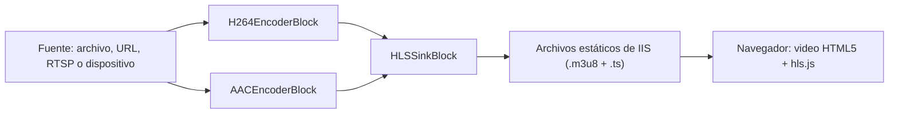

# Reproductor de video HLS en ASP.NET Web Forms con C#

[Media Blocks SDK .Net](https://www.visioforge.com/media-blocks-sdk-net){ .md-button .md-button--primary target="_blank" }

## Cómo funciona

Un navegador no puede alojar un reproductor de video nativo, por lo que el SDK no se ejecuta en el navegador. Se ejecuta dentro del proceso de ASP.NET en el servidor: un `MediaBlocksPipeline` lee la fuente, la codifica a H.264 y AAC y escribe una lista de reproducción HLS con sus segmentos en una carpeta del sitio web. IIS sirve esos archivos como contenido estático. El control de servidor `HlsPlayer` genera un elemento HTML5 `<video>` que reproduce la lista con [hls.js](https://github.com/video-dev/hls.js); Safari reproduce HLS de forma nativa.



El control construye y administra este pipeline por usted a través de `HlsStreamManager`. Usted solo coloca el control en la página y establece su `Source`.

## Requisitos

- Un proyecto **Web Application** de ASP.NET Web Forms para **.NET Framework 4.7.2**.
- Un grupo de aplicaciones de **64 bits** (las bibliotecas nativas del SDK son x64). Para IIS Express, use el `C:\Program Files\IIS Express\iisexpress.exe` de 64 bits.
- Los paquetes NuGet y la configuración de la carpeta de salida que se muestran abajo. Los paquetes redist copian las bibliotecas nativas a `bin\x64` solo cuando la salida va directamente a `bin\`.

```xml
<PropertyGroup>
  <TargetFramework>net472</TargetFramework>
  <OutputPath>bin\</OutputPath>
  <AppendTargetFrameworkToOutputPath>false</AppendTargetFrameworkToOutputPath>
  <AutoGenerateBindingRedirects>true</AutoGenerateBindingRedirects>
  <GenerateBindingRedirectsOutputType>true</GenerateBindingRedirectsOutputType>
</PropertyGroup>

<ItemGroup>
  <Reference Include="System.Web" />
  <PackageReference Include="VisioForge.DotNet.Core.UI.WebForms" Version="2026.10.15" />
  <PackageReference Include="VisioForge.DotNet.Core" Version="2026.10.15" />
  <PackageReference Include="VisioForge.CrossPlatform.Core.Windows.x64" Version="2026.9.11" />
  <PackageReference Include="VisioForge.CrossPlatform.Libav.Windows.x64.UPX" Version="2026.9.11" />
</ItemGroup>
```

## web.config

Tres elementos son obligatorios:

- **`shadowCopyBinAssemblies="false"`.** El SDK carga sus bibliotecas nativas desde la carpeta `x64` junto a `VisioForge.Core.dll`. ASP.NET normalmente copia los ensamblados de `bin` a `Temporary ASP.NET Files`, donde esa carpeta no existe, y las bibliotecas nativas no se encuentran.
- **El tipo MIME de `.m3u8`.** Sin él, IIS e IIS Express no sirven los archivos `.m3u8`.
- **Las redirecciones de enlace.** Una aplicación web las lee solo de `web.config`. La compilación genera las entradas `<dependentAssembly>` en `bin\<YourAssembly>.dll.config`; después de la primera compilación, cópielas de allí a `web.config`.

```xml
<?xml version="1.0" encoding="utf-8"?>
<configuration>
  <system.web>
    <compilation debug="true" targetFramework="4.7.2" />
    <httpRuntime targetFramework="4.7.2" />
    <!-- El SDK carga sus bibliotecas nativas desde bin\x64; la copia shadow ocultaría esa carpeta. -->
    <hostingEnvironment shadowCopyBinAssemblies="false" />
  </system.web>
  <system.webServer>
    <staticContent>
      <remove fileExtension=".m3u8" />
      <mimeMap fileExtension=".m3u8" mimeType="application/vnd.apple.mpegurl" />
    </staticContent>
  </system.webServer>
  <runtime>
    <assemblyBinding xmlns="urn:schemas-microsoft-com:asm.v1">
      <!-- Pegue aquí las entradas <dependentAssembly> de bin\<YourAssembly>.dll.config. -->
    </assemblyBinding>
  </runtime>
</configuration>
```

## Agregar el reproductor a una página

La página debe ser asíncrona, porque el control inicia el stream en una tarea asíncrona de la página. Registre el espacio de nombres del control y colóquelo en la página:

```aspx
<%@ Page Language="C#" Async="true" AutoEventWireup="true" CodeBehind="Default.aspx.cs" Inherits="MyWebApp.Default" %>
<%@ Register TagPrefix="vf" Namespace="VisioForge.Core.UI.WebForms" Assembly="VisioForge.Core.UI.WebForms" %>

<vf:HlsPlayer ID="player" runat="server" Width="960px" Height="540px" Source="~/Media/sample.mp4" />
```

En la primera solicitud de una fuente, el control inicia su pipeline, espera la primera lista de reproducción y genera el elemento de video. Las solicitudes posteriores de la misma fuente reutilizan el stream en ejecución.

### Formas de la fuente

| Valor de `Source` | Qué se reproduce |
| --- | --- |
| `C:\Videos\clip.mp4` o `~/Media/clip.mp4` | Un archivo local; una ruta `~/` se resuelve dentro del sitio web |
| `https://example.com/clip.mp4` | Un archivo o stream por HTTP o HTTPS |
| `rtsp://192.168.1.21:554/stream` | Una cámara IP; establezca `Login` y `Password` con sus credenciales |
| `device://<camera name>` | Un dispositivo de captura por nombre, o la primera cámara con `device://`; agregue `AudioSource="device://<microphone name>"` para el sonido |

Otras propiedades del control:

| Propiedad | Valor predeterminado | Propósito |
| --- | --- | --- |
| `OutputFolder` | `~/hls` | Carpeta del sitio donde se escriben la lista de reproducción y los segmentos, una subcarpeta por fuente |
| `AutoPlay` | `false` | Iniciar la reproducción al cargar la página |
| `Muted` | `false` | Iniciar sin sonido (los navegadores suelen permitir la reproducción automática solo sin sonido) |
| `HlsJsUrl` | `https://cdn.jsdelivr.net/npm/hls.js@1` | Desde dónde la página carga hls.js |
| `PlaylistUrl` | (solo lectura) | La URL de la lista de reproducción, establecida cuando el stream ha iniciado |

Si el stream no puede iniciarse, el control muestra el mensaje de error en un elemento `<p class="vf-hls-error">` en lugar del video.

### Elegir la fuente en el code-behind

```csharp
using System;
using System.Web.UI;
using System.Web.UI.WebControls;
using VisioForge.Core.UI.WebForms;

namespace MyWebApp
{
    public partial class Default : Page
    {
        protected TextBox edSource;
        protected TextBox edLogin;
        protected TextBox edPassword;
        protected HlsPlayer player;

        protected void btPlay_Click(object sender, EventArgs e)
        {
            // El stream se inicia cuando se genera la página.
            player.Source = edSource.Text.Trim();
            player.Login = edLogin.Text;
            player.Password = edPassword.Text;
        }

        protected void btStop_Click(object sender, EventArgs e)
        {
            // Detiene el stream para todos los espectadores de esta fuente y vacía Source.
            player.Stop();
        }
    }
}
```

`HlsStreamManager.Stop(source)` y `HlsStreamManager.StopAll()` son la API de nivel inferior detrás de `Stop()`: detienen un stream por su fuente resuelta, o todos los streams, sin un control.

## Licencia y cierre

Establezca el certificado de licencia una vez en `Application_Start`; todos los pipelines iniciados después lo usan. Sin él, el SDK se ejecuta en modo de prueba. Detenga todos los streams y libere el SDK en `Application_End`:

```csharp
using System;
using System.IO;
using System.Web;
using VisioForge.Core.UI.WebForms;

namespace MyWebApp
{
    public class Global : HttpApplication
    {
        protected void Application_Start(object sender, EventArgs e)
        {
            // Su archivo de certificado de licencia, guardado fuera del contenido público del sitio.
            HlsStreamManager.LicenseCertificate =
                File.ReadAllBytes(Server.MapPath("~/App_Data/license.vfcert"));
        }

        protected void Application_End(object sender, EventArgs e)
        {
            HlsStreamManager.StopAll();
        }
    }
}
```

## Notas para producción

- **Los streams se comparten y se ejecutan hasta que se detienen.** Todos los espectadores de la misma fuente ven el mismo pipeline. Un stream en vivo (una cámara o una fuente RTSP) sigue ejecutándose después de que sus espectadores se van, hasta que se llama a `Stop()` del control, `HlsStreamManager.Stop(source)` o `HlsStreamManager.StopAll()`; un stream de archivo también termina cuando termina el archivo.
- **La primera solicitud define el stream.** Los streams se comparten por `Source`, por lo que `AudioSource`, `Login` y `Password` de la primera solicitud se aplican a todos los espectadores posteriores de esa fuente.
- **Un archivo se reproduce en tiempo real y vuelve a empezar en la siguiente solicitud.** Una fuente de archivo o HTTP se transmite desde su inicio al ritmo del tiempo real, para que la lista de reproducción en vivo vaya al paso de sus espectadores. El control solicita su stream en cada solicitud de la página mientras `Source` está establecido, por lo que, cuando el archivo ha terminado, el siguiente postback de esa página lo reproduce de nuevo desde el inicio; llame a `Stop()` o vacíe `Source` para terminarlo. Un stream que falla con un error del pipeline se descarta de la misma manera; la siguiente solicitud de ese `Source` lo inicia de nuevo, y el error se escribe en la traza del servidor.
- **Acceso de escritura.** La identidad del grupo de aplicaciones necesita acceso de escritura a la carpeta de salida HLS (`~/hls` de forma predeterminada).
- **Dispositivos de captura en IIS.** Que un proceso de trabajo de IIS pueda abrir una cámara o un micrófono depende de la configuración de sesiones y servicios del servidor. En servidores, prefiera fuentes de archivo y RTSP.
- **Sin acceso a CDN.** En un servidor de intranet sin acceso a internet, aloje hls.js en el sitio y apunte `HlsJsUrl` a su URL, por ejemplo `HlsJsUrl="/Scripts/hls.min.js"`.

## Ejemplos

- **[HLS Media Web Forms](https://github.com/visioforge/.Net-SDK-s-samples/tree/master/Media%20Blocks%20SDK/WebForms/HLS%20Media%20Web%20Forms)** - reproduce un archivo, una URL HTTP o una cámara RTSP introducidos en la página.
- **[HLS Webcam Web Forms](https://github.com/visioforge/.Net-SDK-s-samples/tree/master/Media%20Blocks%20SDK/WebForms/HLS%20Webcam%20Web%20Forms)** - transmite una cámara web y un micrófono elegidos de las listas de dispositivos del servidor.

## Ver también

- [Bloque sink HLS](../Sinks/index.md#hls) - configuración de `HLSSinkBlock` en detalle
- [Streaming HLS](../../general/network-streaming/hls-streaming.md) - streaming HLS en todos los SDK
- [Visor de Streams RTSP](rtsp-player-csharp.md) - fuentes RTSP y autenticación
- [Media Blocks SDK .Net](https://www.visioforge.com/media-blocks-sdk-net) - página del producto y descargas
