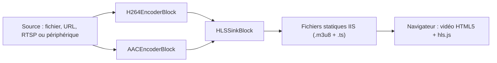

# Lecteur vidéo HLS pour ASP.NET Web Forms en C#

[Media Blocks SDK .Net](https://www.visioforge.com/media-blocks-sdk-net){ .md-button .md-button--primary target="_blank" }

## Fonctionnement

Un navigateur ne peut pas héberger un lecteur vidéo natif : le SDK ne s'exécute donc pas dans le navigateur. Il s'exécute dans le processus ASP.NET sur le serveur : un `MediaBlocksPipeline` lit la source, l'encode en H.264 et AAC et écrit une playlist HLS avec ses segments dans un dossier du site web. IIS sert ces fichiers comme contenu statique. Le contrôle serveur `HlsPlayer` génère un élément HTML5 `<video>` qui lit la playlist avec [hls.js](https://github.com/video-dev/hls.js) ; Safari lit HLS nativement.



Le contrôle construit et gère ce pipeline pour vous via `HlsStreamManager`. Il vous suffit de placer le contrôle sur la page et de définir sa propriété `Source`.

## Prérequis

- Un projet ASP.NET Web Forms de type **Web Application** ciblant **.NET Framework 4.7.2**.
- Un pool d'applications **64 bits** (les bibliothèques natives du SDK sont x64). Pour IIS Express, utilisez le `C:\Program Files\IIS Express\iisexpress.exe` 64 bits.
- Les packages NuGet et les paramètres du dossier de sortie ci-dessous. Les packages redist copient les bibliothèques natives dans `bin\x64` uniquement lorsque la sortie va directement dans `bin\`.

```xml
<PropertyGroup>
  <TargetFramework>net472</TargetFramework>
  <OutputPath>bin\</OutputPath>
  <AppendTargetFrameworkToOutputPath>false</AppendTargetFrameworkToOutputPath>
  <AutoGenerateBindingRedirects>true</AutoGenerateBindingRedirects>
  <GenerateBindingRedirectsOutputType>true</GenerateBindingRedirectsOutputType>
</PropertyGroup>

<ItemGroup>
  <Reference Include="System.Web" />
  <PackageReference Include="VisioForge.DotNet.Core.UI.WebForms" Version="[2026.10.20]"/>
  <PackageReference Include="VisioForge.DotNet.Core" Version="[2026.10.20]"/>
  <PackageReference Include="VisioForge.CrossPlatform.Core.Windows.x64" Version="[2026.10.20]"/>
  <PackageReference Include="VisioForge.CrossPlatform.Libav.Windows.x64.UPX" Version="[2026.10.16]"/>
</ItemGroup>
```

## web.config

Trois éléments sont obligatoires :

- **`shadowCopyBinAssemblies="false"`.** Le SDK charge ses bibliothèques natives depuis le dossier `x64` situé à côté de `VisioForge.Core.dll`. ASP.NET copie normalement les assemblys de `bin` dans `Temporary ASP.NET Files`, où ce dossier n'existe pas, et les bibliothèques natives sont introuvables.
- **Le type MIME `.m3u8`.** Sans lui, IIS et IIS Express ne servent pas les fichiers `.m3u8`.
- **Les redirections de liaison.** Une application web les lit uniquement dans `web.config`. La compilation génère les entrées `<dependentAssembly>` dans `bin\<YourAssembly>.dll.config` ; après la première compilation, copiez-les de ce fichier vers `web.config`.

```xml
<?xml version="1.0" encoding="utf-8"?>
<configuration>
  <system.web>
    <compilation debug="true" targetFramework="4.7.2" />
    <httpRuntime targetFramework="4.7.2" />
    <!-- Le SDK charge ses bibliothèques natives depuis bin\x64 ; la copie shadow masquerait ce dossier. -->
    <hostingEnvironment shadowCopyBinAssemblies="false" />
  </system.web>
  <system.webServer>
    <staticContent>
      <remove fileExtension=".m3u8" />
      <mimeMap fileExtension=".m3u8" mimeType="application/vnd.apple.mpegurl" />
    </staticContent>
  </system.webServer>
  <runtime>
    <assemblyBinding xmlns="urn:schemas-microsoft-com:asm.v1">
      <!-- Collez ici les entrées <dependentAssembly> de bin\<YourAssembly>.dll.config. -->
    </assemblyBinding>
  </runtime>
</configuration>
```

## Ajouter le lecteur à une page

La page doit être asynchrone, car le contrôle démarre le flux dans une tâche asynchrone de la page. Enregistrez l'espace de noms du contrôle et placez-le sur la page :

```aspx
<%@ Page Language="C#" Async="true" AutoEventWireup="true" CodeBehind="Default.aspx.cs" Inherits="MyWebApp.Default" %>
<%@ Register TagPrefix="vf" Namespace="VisioForge.Core.UI.WebForms" Assembly="VisioForge.Core.UI.WebForms" %>

<vf:HlsPlayer ID="player" runat="server" Width="960px" Height="540px" Source="~/Media/sample.mp4" />
```

À la première requête pour une source, le contrôle démarre son pipeline, attend la première playlist et génère l'élément vidéo. Les requêtes suivantes pour la même source réutilisent le flux en cours.

### Formes de la source

| Valeur de `Source` | Ce qui est lu |
| --- | --- |
| `C:\Videos\clip.mp4` ou `~/Media/clip.mp4` | Un fichier local ; un chemin `~/` est résolu dans le site web |
| `https://example.com/clip.mp4` | Un fichier ou un flux via HTTP ou HTTPS |
| `rtsp://192.168.1.21:554/stream` | Une caméra IP ; définissez `Login` et `Password` pour ses identifiants |
| `device://<camera name>` | Un périphérique de capture par son nom, ou la première caméra avec `device://` ; ajoutez `AudioSource="device://<microphone name>"` pour le son |

Autres propriétés du contrôle :

| Propriété | Valeur par défaut | Rôle |
| --- | --- | --- |
| `OutputFolder` | `~/hls` | Dossier du site où la playlist et les segments sont écrits, un sous-dossier par source |
| `AutoPlay` | `false` | Démarrer la lecture au chargement de la page |
| `Muted` | `false` | Démarrer sans le son (les navigateurs n'autorisent généralement la lecture automatique que sans le son) |
| `HlsJsUrl` | `https://cdn.jsdelivr.net/npm/hls.js@1` | L'emplacement depuis lequel la page charge hls.js |
| `PlaylistUrl` | (lecture seule) | L'URL de la playlist, définie une fois le flux démarré |

Si le flux ne peut pas démarrer, le contrôle affiche le message d'erreur dans un élément `<p class="vf-hls-error">` à la place de la vidéo.

### Choisir la source dans le code-behind

```csharp
using System;
using System.Web.UI;
using System.Web.UI.WebControls;
using VisioForge.Core.UI.WebForms;

namespace MyWebApp
{
    public partial class Default : Page
    {
        protected TextBox edSource;
        protected TextBox edLogin;
        protected TextBox edPassword;
        protected HlsPlayer player;

        protected void btPlay_Click(object sender, EventArgs e)
        {
            // Le flux démarre au rendu de la page.
            player.Source = edSource.Text.Trim();
            player.Login = edLogin.Text;
            player.Password = edPassword.Text;
        }

        protected void btStop_Click(object sender, EventArgs e)
        {
            // Arrête le flux pour tous les spectateurs de cette source et vide Source.
            player.Stop();
        }
    }
}
```

`HlsStreamManager.Stop(source)` et `HlsStreamManager.StopAll()` sont l'API de plus bas niveau derrière `Stop()` : elles arrêtent un flux par sa source résolue, ou tous les flux, sans contrôle.

## Licence et arrêt

Définissez le certificat de licence une seule fois dans `Application_Start` ; tous les pipelines démarrés ensuite l'utilisent. Sans lui, le SDK fonctionne en mode d'essai. Arrêtez tous les flux et libérez le SDK dans `Application_End` :

```csharp
using System;
using System.IO;
using System.Web;
using VisioForge.Core.UI.WebForms;

namespace MyWebApp
{
    public class Global : HttpApplication
    {
        protected void Application_Start(object sender, EventArgs e)
        {
            // Votre fichier de certificat de licence, conservé hors du contenu public du site.
            HlsStreamManager.LicenseCertificate =
                File.ReadAllBytes(Server.MapPath("~/App_Data/license.vfcert"));
        }

        protected void Application_End(object sender, EventArgs e)
        {
            HlsStreamManager.StopAll();
        }
    }
}
```

## Remarques pour la production

- **Les flux sont partagés et tournent jusqu'à leur arrêt.** Tous les spectateurs d'une même source regardent le même pipeline. Un flux en direct (une caméra ou une source RTSP) continue après le départ de ses spectateurs, jusqu'à l'appel de `Stop()` sur le contrôle, de `HlsStreamManager.Stop(source)` ou de `HlsStreamManager.StopAll()` ; un flux de fichier se termine aussi à la fin du fichier.
- **La première requête fixe le flux.** Les flux sont partagés par `Source` : les valeurs `AudioSource`, `Login` et `Password` de la première requête s'appliquent à tous les spectateurs suivants de cette source.
- **Un fichier est lu en temps réel et recommence à la requête suivante.** Une source fichier ou HTTP est diffusée depuis son début au rythme du temps réel, afin que la playlist en direct suive ses spectateurs. Le contrôle demande son flux à chaque requête de la page tant que `Source` est défini : une fois le fichier terminé, le postback suivant de cette page le relit depuis le début ; appelez `Stop()` ou videz `Source` pour l'arrêter. Un flux qui échoue sur une erreur du pipeline est supprimé de la même façon ; la requête suivante pour cette `Source` le redémarre, et l'erreur est écrite dans la trace du serveur.
- **Accès en écriture.** L'identité du pool d'applications doit avoir un accès en écriture au dossier de sortie HLS (`~/hls` par défaut).
- **Périphériques de capture sous IIS.** La possibilité pour un processus de travail IIS d'ouvrir une caméra ou un microphone dépend de la configuration des sessions et des services du serveur. Sur un serveur, préférez les sources fichier et RTSP.
- **Sans accès au CDN.** Sur un serveur intranet sans accès à internet, hébergez hls.js sur le site et indiquez son URL dans `HlsJsUrl`, par exemple `HlsJsUrl="/Scripts/hls.min.js"`.

## Exemples

- **[HLS Media Web Forms](https://github.com/visioforge/.Net-SDK-s-samples/tree/master/Media%20Blocks%20SDK/WebForms/HLS%20Media%20Web%20Forms)** - lit un fichier, une URL HTTP ou une caméra RTSP saisis sur la page.
- **[HLS Webcam Web Forms](https://github.com/visioforge/.Net-SDK-s-samples/tree/master/Media%20Blocks%20SDK/WebForms/HLS%20Webcam%20Web%20Forms)** - diffuse une webcam et un microphone choisis dans les listes de périphériques du serveur.

## Voir aussi

- [Bloc sink HLS](../Sinks/index.md#hls) - paramètres de `HLSSinkBlock` en détail
- [Streaming HLS](../../general/network-streaming/hls-streaming.md) - le streaming HLS dans les différents SDK
- [Visionneuse RTSP](rtsp-player-csharp.md) - sources RTSP et authentification
- [Media Blocks SDK .Net](https://www.visioforge.com/media-blocks-sdk-net) - page produit et téléchargements
