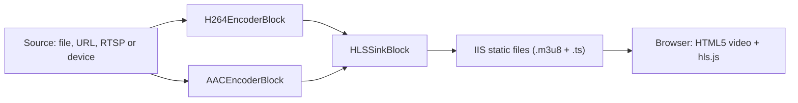

# ASP.NET Web Forms Video Player with HLS in C#

[Media Blocks SDK .Net](https://www.visioforge.com/media-blocks-sdk-net){ .md-button .md-button--primary target="_blank" }

## How it works

A browser cannot host a native video player, so the SDK does not run in the browser at all. It runs inside the ASP.NET process on the server: a `MediaBlocksPipeline` reads the source, encodes it to H.264 and AAC and writes an HLS playlist with its segments into a folder under the web site. IIS serves those files as static content. The `HlsPlayer` server control renders an HTML5 `<video>` element that plays the playlist with [hls.js](https://github.com/video-dev/hls.js); Safari plays HLS natively.



The control builds and manages this pipeline for you through `HlsStreamManager`. You only place the control on the page and set its `Source`.

## Requirements

- An ASP.NET Web Forms **Web Application** project targeting **.NET Framework 4.7.2**.
- A **64-bit** application pool (the SDK native libraries are x64). For IIS Express, use the 64-bit `C:\Program Files\IIS Express\iisexpress.exe`.
- The NuGet packages and the output folder settings below. The redist packages copy the native libraries to `bin\x64` only when the output goes straight to `bin\`.

```xml
<PropertyGroup>
  <TargetFramework>net472</TargetFramework>
  <OutputPath>bin\</OutputPath>
  <AppendTargetFrameworkToOutputPath>false</AppendTargetFrameworkToOutputPath>
  <AutoGenerateBindingRedirects>true</AutoGenerateBindingRedirects>
  <GenerateBindingRedirectsOutputType>true</GenerateBindingRedirectsOutputType>
</PropertyGroup>

<ItemGroup>
  <Reference Include="System.Web" />
  <PackageReference Include="VisioForge.DotNet.Core.UI.WebForms" Version="2026.10.15" />
  <PackageReference Include="VisioForge.DotNet.Core" Version="2026.10.15" />
  <PackageReference Include="VisioForge.CrossPlatform.Core.Windows.x64" Version="2026.9.11" />
  <PackageReference Include="VisioForge.CrossPlatform.Libav.Windows.x64.UPX" Version="2026.9.11" />
</ItemGroup>
```

## web.config

Three items are mandatory:

- **`shadowCopyBinAssemblies="false"`.** The SDK loads its native libraries from the `x64` folder next to `VisioForge.Core.dll`. ASP.NET normally shadow-copies the `bin` assemblies to `Temporary ASP.NET Files`, where that folder does not exist, and the natives are not found.
- **The `.m3u8` MIME type.** IIS and IIS Express do not serve `.m3u8` files without it.
- **Binding redirects.** A web application reads them from `web.config` only. The build generates the `<dependentAssembly>` entries into `bin\<YourAssembly>.dll.config`; after the first build, copy them from there into `web.config`.

```xml
<?xml version="1.0" encoding="utf-8"?>
<configuration>
  <system.web>
    <compilation debug="true" targetFramework="4.7.2" />
    <httpRuntime targetFramework="4.7.2" />
    <!-- The SDK loads its native libraries from bin\x64; shadow copying would hide that folder. -->
    <hostingEnvironment shadowCopyBinAssemblies="false" />
  </system.web>
  <system.webServer>
    <staticContent>
      <remove fileExtension=".m3u8" />
      <mimeMap fileExtension=".m3u8" mimeType="application/vnd.apple.mpegurl" />
    </staticContent>
  </system.webServer>
  <runtime>
    <assemblyBinding xmlns="urn:schemas-microsoft-com:asm.v1">
      <!-- Paste the <dependentAssembly> entries from bin\<YourAssembly>.dll.config here. -->
    </assemblyBinding>
  </runtime>
</configuration>
```

## Add the player to a page

The page must be asynchronous, because the control starts the stream in a page async task. Register the control's namespace and place it on the page:

```aspx
<%@ Page Language="C#" Async="true" AutoEventWireup="true" CodeBehind="Default.aspx.cs" Inherits="MyWebApp.Default" %>
<%@ Register TagPrefix="vf" Namespace="VisioForge.Core.UI.WebForms" Assembly="VisioForge.Core.UI.WebForms" %>

<vf:HlsPlayer ID="player" runat="server" Width="960px" Height="540px" Source="~/Media/sample.mp4" />
```

On the first request for a source, the control starts its pipeline, waits for the first playlist and renders the video element. Later requests for the same source reuse the running stream.

### Source forms

| `Source` value | What is played |
| --- | --- |
| `C:\Videos\clip.mp4` or `~/Media/clip.mp4` | A local file; a `~/` path is resolved under the web site |
| `https://example.com/clip.mp4` | A file or stream over HTTP or HTTPS |
| `rtsp://192.168.1.21:554/stream` | An IP camera; set `Login` and `Password` for its credentials |
| `device://<camera name>` | A capture device by name, or the first camera for `device://`; add `AudioSource="device://<microphone name>"` for sound |

Other control properties:

| Property | Default | Purpose |
| --- | --- | --- |
| `OutputFolder` | `~/hls` | Folder under the site where the playlist and segments are written, one subfolder per source |
| `AutoPlay` | `false` | Start playback when the page loads |
| `Muted` | `false` | Start muted (browsers usually allow autoplay only when muted) |
| `HlsJsUrl` | `https://cdn.jsdelivr.net/npm/hls.js@1` | Where the page loads hls.js from |
| `PlaylistUrl` | (read-only) | The playlist URL, set once the stream has started |

If the stream cannot start, the control renders the error message in a `<p class="vf-hls-error">` element instead of the video.

### Choose the source in code-behind

```csharp
using System;
using System.Web.UI;
using System.Web.UI.WebControls;
using VisioForge.Core.UI.WebForms;

namespace MyWebApp
{
    public partial class Default : Page
    {
        protected TextBox edSource;
        protected TextBox edLogin;
        protected TextBox edPassword;
        protected HlsPlayer player;

        protected void btPlay_Click(object sender, EventArgs e)
        {
            // The stream starts when the page renders.
            player.Source = edSource.Text.Trim();
            player.Login = edLogin.Text;
            player.Password = edPassword.Text;
        }

        protected void btStop_Click(object sender, EventArgs e)
        {
            // Stops the stream for every viewer of this source and clears Source.
            player.Stop();
        }
    }
}
```

`HlsStreamManager.Stop(source)` and `HlsStreamManager.StopAll()` are the lower-level API behind `Stop()`: they stop a stream by its resolved source, or every stream, without a control.

## Licensing and shutdown

Set the license certificate once in `Application_Start`; every pipeline started afterwards uses it. Without it the SDK runs in trial mode. Stop all streams and release the SDK in `Application_End`:

```csharp
using System;
using System.IO;
using System.Web;
using VisioForge.Core.UI.WebForms;

namespace MyWebApp
{
    public class Global : HttpApplication
    {
        protected void Application_Start(object sender, EventArgs e)
        {
            // Your license certificate file, kept outside the public site content.
            HlsStreamManager.LicenseCertificate =
                File.ReadAllBytes(Server.MapPath("~/App_Data/license.vfcert"));
        }

        protected void Application_End(object sender, EventArgs e)
        {
            HlsStreamManager.StopAll();
        }
    }
}
```

## Notes for production

- **Streams are shared and run until stopped.** Every viewer of the same source watches the same pipeline. A live stream (a camera or RTSP source) keeps running after its viewers leave, until `Stop()` on the control, `HlsStreamManager.Stop(source)` or `HlsStreamManager.StopAll()` is called; a file stream also ends when the file does.
- **The first request sets the stream.** Streams are shared per `Source`, so the `AudioSource`, `Login` and `Password` of the first request apply to every later viewer of that source.
- **A file plays in real time and starts over on the next request.** A file or HTTP source is streamed from its beginning at real-time pace, so the live playlist keeps up with its viewers. The control requests its stream on every page request while `Source` is set, so after the file has ended, the next postback of that page plays it again from the beginning; call `Stop()` or clear `Source` to end it. A stream that fails with a pipeline error is dropped the same way; the next request for that `Source` starts it again, and the error is written to the server trace.
- **Write access.** The application pool identity needs write access to the HLS output folder (`~/hls` by default).
- **Capture devices under IIS.** Whether an IIS worker process can open a camera or microphone depends on the server's session and service configuration. On servers, prefer file and RTSP sources.
- **No CDN access.** On an intranet server without internet access, host hls.js on the site and point `HlsJsUrl` at its URL, for example `HlsJsUrl="/Scripts/hls.min.js"`.

## Samples

- **[HLS Media Web Forms](https://github.com/visioforge/.Net-SDK-s-samples/tree/master/Media%20Blocks%20SDK/WebForms/HLS%20Media%20Web%20Forms)** - plays a file, an HTTP URL or an RTSP camera entered on the page.
- **[HLS Webcam Web Forms](https://github.com/visioforge/.Net-SDK-s-samples/tree/master/Media%20Blocks%20SDK/WebForms/HLS%20Webcam%20Web%20Forms)** - streams a webcam and a microphone picked from the server's device lists.

## See Also

- [HLS sink block](../Sinks/index.md#hls) - `HLSSinkBlock` settings in detail
- [HLS streaming](../../general/network-streaming/hls-streaming.md) - HLS streaming across the SDKs
- [RTSP Stream Viewer](rtsp-player-csharp.md) - RTSP sources and authentication
- [Media Blocks SDK .Net](https://www.visioforge.com/media-blocks-sdk-net) - product page and downloads
