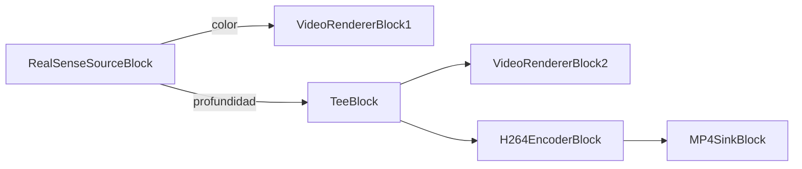

# Cámara de profundidad Intel RealSense en C# .NET

[Media Blocks SDK .NET](https://www.visioforge.com/media-blocks-sdk-net){ .md-button .md-button--primary target="_blank" }

Esta guía muestra cómo usar una cámara de profundidad Intel RealSense (serie D400, como la D435) desde una aplicación C# con `RealSenseSourceBlock`: listar las cámaras y sus modos, mostrar color y profundidad lado a lado, leer la distancia en un píxel y grabar la vista de profundidad en un archivo MP4. El mismo código de pipeline funciona en Windows x64 y Linux x64.

El flujo de color de una cámara RealSense es vídeo UVC normal, por lo que cualquier fuente de captura puede mostrarlo. Los flujos de profundidad (una distancia de 16 bits por píxel) e infrarrojo no lo son: las API de captura de Windows los etiquetan mal o los rechazan. `RealSenseSourceBlock` abre la cámara mediante librealsense y da a cada flujo su propia salida en un formato que el resto del pipeline entiende.

## Qué entrega el bloque

| Salida | Formato | Se activa con |
|---|---|---|
| `ColorOutput` | RGB | `RealSenseSourceSettings.Color` |
| `DepthOutput` | RGB (coloreado, por defecto) o `GRAY16_LE` (sin procesar) | `RealSenseSourceSettings.Depth`, `DepthMode` |
| `InfraredOutput` | `GRAY8` | `RealSenseSourceSettings.Infrared` |

Los flujos provienen de un único pipeline de librealsense, por lo que sus fotogramas están sincronizados. Con `AlignDepthToColor` la imagen de profundidad se proyecta sobre la imagen de color: toma el tamaño del color y el mismo píxel muestra el mismo punto en ambas. `GetDistance(x, y)` devuelve la distancia en metros en un píxel del último fotograma de profundidad.



## Requisitos previos

### Windows x64

Agregue los paquetes NuGet:

- [VisioForge.DotNet.MediaBlocks](https://www.nuget.org/packages/VisioForge.DotNet.MediaBlocks/) — el SDK
- [VisioForge.CrossPlatform.Core.Windows.x64](https://www.nuget.org/packages/VisioForge.CrossPlatform.Core.Windows.x64/) — runtime de GStreamer para Windows x64
- [VisioForge.CrossPlatform.RealSense.Windows.x64](https://www.nuget.org/packages/VisioForge.CrossPlatform.RealSense.Windows.x64/) — librealsense 2.58.1 (`realsense2.dll`)

No se necesita ningún controlador RealSense: Windows 10 y 11 abren la cámara con el controlador de vídeo USB integrado.

### Linux x64

El bloque usa la librealsense del sistema, versión 2.58 o una versión 2.x posterior, del repositorio apt de RealSense. Carga `librealsense2.so`, que proporciona el paquete `librealsense2-dev`; los paquetes también instalan las reglas udev que permiten a un usuario normal abrir la cámara. Los parches de kernel `librealsense2-dkms` no son necesarios.

```bash
sudo mkdir -p /etc/apt/keyrings
curl -sSf https://librealsense.realsenseai.com/Debian/librealsenseai.asc | gpg --dearmor | sudo tee /etc/apt/keyrings/librealsenseai.gpg > /dev/null
echo "deb [signed-by=/etc/apt/keyrings/librealsenseai.gpg] https://librealsense.realsenseai.com/Debian/apt-repo $(lsb_release -cs) main" | sudo tee /etc/apt/sources.list.d/librealsense.list
sudo apt-get update
sudo apt-get install librealsense2-dev
```

Agregue [VisioForge.DotNet.MediaBlocks](https://www.nuget.org/packages/VisioForge.DotNet.MediaBlocks/) y configure GStreamer como se describe en la [guía de despliegue en Ubuntu](../../deployment-x/Ubuntu.md). Para una interfaz de escritorio en Linux, use el `VideoView` de Avalonia de [VisioForge.DotNet.Core.UI.Avalonia](https://www.nuget.org/packages/VisioForge.DotNet.Core.UI.Avalonia/); el código del pipeline que sigue no cambia, solo difieren las llamadas de interfaz como `Dispatcher`.

## Paso 1: listar las cámaras y sus modos

`EnumerateDevicesAsync` devuelve cada cámara RealSense conectada con los modos que informa. Elija los modos de esa lista en lugar de escribir los tamaños a mano: `FindProfile` devuelve `null` para un modo que la cámara no tiene.

```csharp
using System.Diagnostics;
using VisioForge.Core;
using VisioForge.Core.MediaBlocks;
using VisioForge.Core.MediaBlocks.Sinks;
using VisioForge.Core.MediaBlocks.Sources;
using VisioForge.Core.MediaBlocks.Special;
using VisioForge.Core.MediaBlocks.VideoEncoders;
using VisioForge.Core.MediaBlocks.VideoRendering;
using VisioForge.Core.Types.X.Sinks;
using VisioForge.Core.Types.X.Sources;

await VisioForgeX.InitSDKAsync();

var cameras = await RealSenseSourceBlock.EnumerateDevicesAsync();
foreach (var camera in cameras)
{
    // El nombre, el número de serie y la versión de firmware.
    Console.WriteLine($"{camera} firmware {camera.FirmwareVersion}");

    foreach (var profile in camera.Profiles)
    {
        Console.WriteLine($"  {profile}");
    }
}
```

Cuando falta librealsense o es anterior a 2.58, `EnumerateDevicesAsync` lanza una excepción cuyo mensaje indica qué instalar (consulte [Solución de problemas](#solucion-de-problemas)). Un arreglo vacío significa que librealsense funciona pero no hay ninguna cámara conectada.

## Paso 2: mostrar color y profundidad lado a lado

Llame a `await VisioForgeX.InitSDKAsync()` una vez antes de crear un pipeline, por ejemplo en el controlador `Loaded` de la ventana. Esta ventana WPF tiene dos controles `VideoView`, `VideoViewColor` y `VideoViewDepth`. La profundidad está alineada con la imagen de color y coloreada, por lo que puede ir directamente a un renderizador. El código de la ventana necesita las directivas `using` del paso 1. `StartAsync` devuelve `false` cuando la cámara no tiene el modo (`FindProfile` devolvió `null`) o el pipeline no se inicia; el motivo por el que un pipeline no se inició llega en `OnError`.

```csharp
private MediaBlocksPipeline _pipeline;
private RealSenseSourceBlock _source;
private readonly System.Timers.Timer _distanceTimer = new System.Timers.Timer(500);

private async Task<bool> StartAsync(RealSenseDeviceInfo camera)
{
    var settings = new RealSenseSourceSettings(camera.SerialNumber)
    {
        Color = camera.FindProfile(RealSenseStreamType.Color, 640, 480, 30),
        Depth = camera.FindProfile(RealSenseStreamType.Depth, 640, 480, 30),
        AlignDepthToColor = true,
        DepthMode = RealSenseDepthMode.Colorized,
    };

    // FindProfile devuelve null para un modo que la cámara no tiene: elija otro de camera.Profiles.
    if (settings.Color == null || settings.Depth == null)
    {
        return false;
    }

    _pipeline = new MediaBlocksPipeline();
    _pipeline.OnError += (s, e) => Debug.WriteLine(e.Message);

    _source = new RealSenseSourceBlock(settings);
    _pipeline.Connect(_source.ColorOutput, new VideoRendererBlock(_pipeline, VideoViewColor) { IsSync = false }.Input);
    _pipeline.Connect(_source.DepthOutput, new VideoRendererBlock(_pipeline, VideoViewDepth) { IsSync = false }.Input);

    if (await _pipeline.StartAsync())
    {
        return true;
    }

    // El inicio falló: libere el pipeline para que suelte la cámara.
    await StopAsync();
    return false;
}

private async Task StopAsync()
{
    _distanceTimer.Stop();
    var pipeline = _pipeline;
    _pipeline = null;
    _source = null;
    if (pipeline == null)
    {
        return;
    }

    try
    {
        await pipeline.StopAsync();
    }
    finally
    {
        await pipeline.DisposeAsync();
    }
}
```

`IsSync = false` muestra cada fotograma en cuanto llega, que es lo que necesita una vista previa de cámara en vivo. Deje en `null` el perfil de un flujo para mantenerlo desactivado; una salida activada pero no conectada se descarta.

## Paso 3: medir la distancia en un píxel

`GetDistance(x, y)` lee el último fotograma de profundidad. Devuelve metros, o 0 cuando la cámara no tiene profundidad para ese píxel (demasiado cerca, demasiado lejos o una superficie que no puede ver) o antes del primer fotograma. Con `AlignDepthToColor = true` las coordenadas son píxeles de la imagen de color, por lo que la misma posición sirve para ambas imágenes. Una posición del ratón sobre un `VideoView` no es un píxel del fotograma: la vista escala el fotograma para ajustarlo, así que convierta la posición a coordenadas del fotograma antes de llamar a `GetDistance`.

```csharp
public MainWindow()
{
    InitializeComponent();
    _distanceTimer.Elapsed += (s, e) => UpdateDistance();
}

private void UpdateDistance()
{
    var source = _source;
    if (source == null)
    {
        return;
    }

    // Con la alineación, el fotograma de profundidad tiene el tamaño del color.
    var profile = source.Settings.AlignDepthToColor ? source.Settings.Color : source.Settings.Depth;
    float meters;
    try
    {
        meters = source.GetDistance(profile.Width / 2, profile.Height / 2);
    }
    catch (Exception ex)
    {
        // El temporizador la ocultaría.
        Debug.WriteLine(ex);
        return;
    }

    Dispatcher.BeginInvoke((Action)(() => lbDistance.Text = $"Distance at center: {meters:F2} m"));
}
```

Inicie el temporizador cuando `StartAsync` devuelva `true`; `StopAsync` del paso 2 lo detiene y el controlador `Closing` del paso 4 lo libera. Un píxel fuera del fotograma de profundidad lanza `ArgumentOutOfRangeException`; el temporizador oculta las excepciones lanzadas por su controlador `Elapsed`, así que captúrelas y regístrelas en `UpdateDistance`.

## Paso 4: grabar la vista de profundidad en MP4

La profundidad coloreada es un vídeo RGB normal, por lo que puede codificarse como cualquier cámara. Divídala con un `TeeBlock`: una rama a la pantalla y otra a un codificador H.264 y un archivo MP4. En `StartAsync`, estas líneas sustituyen la línea del paso 2 que conecta `DepthOutput` al renderizador, antes de `await _pipeline.StartAsync()`; una salida se conecta a un solo bloque.

```csharp
var tee = new TeeBlock(2, MediaBlockPadMediaType.Video);
_pipeline.Connect(_source.DepthOutput, tee.Input);
_pipeline.Connect(tee.Outputs[0], new VideoRendererBlock(_pipeline, VideoViewDepth) { IsSync = false }.Input);

var encoder = new H264EncoderBlock();
var mp4 = new MP4SinkBlock(new MP4SinkSettings(System.IO.Path.Combine(Environment.GetFolderPath(Environment.SpecialFolder.MyVideos, Environment.SpecialFolderOption.Create), "depth.mp4")));
_pipeline.Connect(tee.Outputs[1], encoder.Input);
_pipeline.Connect(encoder.Output, mp4.CreateNewInput(MediaBlockPadMediaType.Video));
```

`StopAsync` finaliza el archivo, así que espérelo antes de que se cierre la ventana y antes de que termine la aplicación. Con `Closing="Window_Closing"` en la ventana, cancele el primer cierre, detenga y vuelva a cerrar:

```csharp
private async void Window_Closing(object sender, System.ComponentModel.CancelEventArgs e)
{
    // Primero detenga la cámara y después cierre de verdad, una vez que este controlador haya vuelto.
    if (_pipeline != null)
    {
        e.Cancel = true;
        IsEnabled = false;
        try
        {
            await StopAsync();
        }
        catch (Exception ex)
        {
            Debug.WriteLine(ex);
        }

        Dispatcher.BeginInvoke(new Action(Close));
        return;
    }

    _distanceTimer.Dispose();

    // La última ventana del SDK de la aplicación: cierre el SDK.
    VisioForgeX.DestroySDK();
}
```

Una imagen coloreada es para que la vean las personas: los colores representan distancias, pero los valores exactos se pierden. Para conservar las distancias, llame a `GetDistance` mientras captura o establezca `DepthMode = RealSenseDepthMode.Raw`. La salida de profundidad lleva entonces los valores de 16 bits de la cámara (`GRAY16_LE`); multiplique un valor por `DepthScale` para obtener metros. `DepthScale` se conoce una vez iniciado el pipeline. La profundidad sin procesar es para su propio procesamiento: la cadena H.264 anterior la reduce a 8 bits, así que no la grabe de esa forma.

## Infrarrojo

Las cámaras D400 tienen dos sensores infrarrojos, índice 1 (izquierdo) y 2 (derecho). Pida el que desee con el último argumento de `FindProfile` y conecte `InfraredOutput`:

```csharp
settings.Infrared = camera.FindProfile(RealSenseStreamType.Infrared, 640, 480, 30, 1);
// ...
_pipeline.Connect(_source.InfraredOutput, new VideoRendererBlock(_pipeline, VideoViewInfrared) { IsSync = false }.Input);
```

## Solución de problemas

| Mensaje o síntoma | Causa | Qué hacer |
|---|---|---|
| `librealsense (realsense2) 2.58 or a later 2.x is needed: ... Add the VisioForge.CrossPlatform.RealSense.Windows.x64 NuGet package.` | Windows: `realsense2.dll` no está junto a la aplicación. | Agregue el paquete al proyecto de la aplicación. |
| `... Install librealsense2-dev (librealsense2.so) from the RealSense apt repository.` | Linux: `librealsense2.so` no está instalado. El paquete de runtime por sí solo incluye únicamente el `librealsense2.so.2.x` versionado. | `sudo apt-get install librealsense2-dev`. |
| `... librealsense 2.5x.x was loaded. Install 2.58 or a later 2.x, ...` | Una librealsense más antigua aparece primero en la ruta de búsqueda de bibliotecas. | Instale 2.58 o posterior y elimine la copia antigua. |
| `EnumerateDevicesAsync` no devuelve cámaras | La cámara no está conectada o (Linux) el usuario no puede abrirla. | Vuelva a conectar la cámara. En Linux compruebe que `librealsense2-udev-rules` está instalado y vuelva a conectarla. |
| `StartAsync` devuelve `false`, nada en `OnError` | La cámara no tiene ese modo: `FindProfile` devolvió `null`. | Tome los modos de `RealSenseDeviceInfo.Profiles`. |
| `StartAsync` devuelve `false`, un mensaje en `OnError` | El pipeline no se inició, por ejemplo porque otra aplicación usa la cámara. | El mensaje indica qué falló; cierre las demás aplicaciones de cámara. |

En Linux, `rs-enumerate-devices` del paquete opcional `librealsense2-utils` lista las cámaras que ve librealsense y todos los modos que informan.

## Documentación relacionada

- [Referencia del bloque fuente Intel RealSense](../Sources/index.md#bloque-fuente-intel-realsense) — la descripción completa del bloque
- [Renderizado de vídeo](../VideoRendering/index.md) — opciones de `VideoRendererBlock`
- [Bloque Tee](../Special/index.md#tee) — dividir un flujo en varias salidas
- [Despliegue en Ubuntu](../../deployment-x/Ubuntu.md) — ejecutar aplicaciones Media Blocks en Linux
