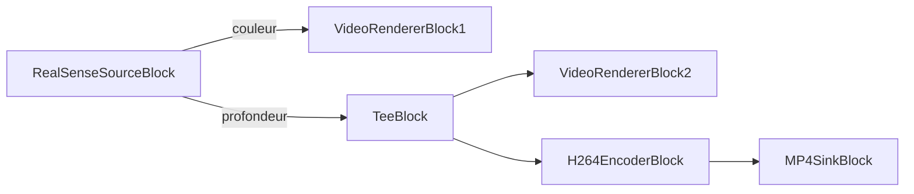

# Caméra de profondeur Intel RealSense en C# .NET

[Media Blocks SDK .NET](https://www.visioforge.com/media-blocks-sdk-net){ .md-button .md-button--primary target="_blank" }

Ce guide montre comment utiliser une caméra de profondeur Intel RealSense (série D400, comme la D435) depuis une application C# avec `RealSenseSourceBlock` : lister les caméras et leurs modes, afficher la couleur et la profondeur côte à côte, lire la distance d'un pixel et enregistrer la vue de profondeur dans un fichier MP4. Le même code de pipeline fonctionne sous Windows x64 et Linux x64.

Le flux couleur d'une caméra RealSense est une vidéo UVC ordinaire, que n'importe quelle source de capture peut afficher. Les flux de profondeur (une distance sur 16 bits par pixel) et infrarouge ne le sont pas : les API de capture de Windows les étiquettent mal ou les refusent. `RealSenseSourceBlock` ouvre la caméra via librealsense et donne à chaque flux sa propre sortie, dans un format que le reste du pipeline comprend.

## Ce que fournit le bloc

| Sortie | Format | Activée par |
|---|---|---|
| `ColorOutput` | RGB | `RealSenseSourceSettings.Color` |
| `DepthOutput` | RGB (colorisée, par défaut) ou `GRAY16_LE` (brute) | `RealSenseSourceSettings.Depth`, `DepthMode` |
| `InfraredOutput` | `GRAY8` | `RealSenseSourceSettings.Infrared` |

Les flux proviennent d'un seul pipeline librealsense : leurs images sont donc synchronisées. Avec `AlignDepthToColor`, l'image de profondeur est projetée sur l'image couleur : elle prend la taille de la couleur, et le même pixel montre le même point dans les deux. `GetDistance(x, y)` renvoie la distance en mètres pour un pixel de la dernière image de profondeur.



## Prérequis

### Windows x64

Ajoutez les paquets NuGet :

- [VisioForge.DotNet.MediaBlocks](https://www.nuget.org/packages/VisioForge.DotNet.MediaBlocks/) — le SDK
- [VisioForge.CrossPlatform.Core.Windows.x64](https://www.nuget.org/packages/VisioForge.CrossPlatform.Core.Windows.x64/) — runtime GStreamer pour Windows x64
- [VisioForge.CrossPlatform.RealSense.Windows.x64](https://www.nuget.org/packages/VisioForge.CrossPlatform.RealSense.Windows.x64/) — librealsense 2.58.1 (`realsense2.dll`)

Aucun pilote RealSense n'est nécessaire : Windows 10 et 11 ouvrent la caméra avec le pilote vidéo USB intégré.

### Linux x64

Le bloc utilise la librealsense du système, version 2.58 ou une version 2.x ultérieure, depuis le dépôt apt RealSense. Il charge `librealsense2.so`, fourni par le paquet `librealsense2-dev` ; les paquets installent aussi les règles udev qui permettent à un utilisateur ordinaire d'ouvrir la caméra. Les correctifs du noyau `librealsense2-dkms` ne sont pas nécessaires.

```bash
sudo mkdir -p /etc/apt/keyrings
curl -sSf https://librealsense.realsenseai.com/Debian/librealsenseai.asc | gpg --dearmor | sudo tee /etc/apt/keyrings/librealsenseai.gpg > /dev/null
echo "deb [signed-by=/etc/apt/keyrings/librealsenseai.gpg] https://librealsense.realsenseai.com/Debian/apt-repo $(lsb_release -cs) main" | sudo tee /etc/apt/sources.list.d/librealsense.list
sudo apt-get update
sudo apt-get install librealsense2-dev
```

Ajoutez [VisioForge.DotNet.MediaBlocks](https://www.nuget.org/packages/VisioForge.DotNet.MediaBlocks/) et installez GStreamer comme décrit dans le [guide de déploiement Ubuntu](../../deployment-x/Ubuntu.md). Pour une interface de bureau sous Linux, utilisez le `VideoView` Avalonia de [VisioForge.DotNet.Core.UI.Avalonia](https://www.nuget.org/packages/VisioForge.DotNet.Core.UI.Avalonia/) ; le code du pipeline ci-dessous ne change pas, seuls les appels d'interface comme `Dispatcher` diffèrent.

## Étape 1 : lister les caméras et leurs modes

`EnumerateDevicesAsync` renvoie chaque caméra RealSense connectée avec les modes qu'elle annonce. Choisissez les modes dans cette liste plutôt que de saisir les tailles à la main : `FindProfile` renvoie `null` pour un mode que la caméra n'a pas.

```csharp
using System.Diagnostics;
using VisioForge.Core;
using VisioForge.Core.MediaBlocks;
using VisioForge.Core.MediaBlocks.Sinks;
using VisioForge.Core.MediaBlocks.Sources;
using VisioForge.Core.MediaBlocks.Special;
using VisioForge.Core.MediaBlocks.VideoEncoders;
using VisioForge.Core.MediaBlocks.VideoRendering;
using VisioForge.Core.Types.X.Sinks;
using VisioForge.Core.Types.X.Sources;

await VisioForgeX.InitSDKAsync();

var cameras = await RealSenseSourceBlock.EnumerateDevicesAsync();
foreach (var camera in cameras)
{
    // Le nom, le numéro de série et la version du firmware.
    Console.WriteLine($"{camera} firmware {camera.FirmwareVersion}");

    foreach (var profile in camera.Profiles)
    {
        Console.WriteLine($"  {profile}");
    }
}
```

Lorsque librealsense est absente ou antérieure à 2.58, `EnumerateDevicesAsync` lève une exception dont le message indique quoi installer (voir [Dépannage](#depannage)). Un tableau vide signifie que librealsense fonctionne mais qu'aucune caméra n'est connectée.

## Étape 2 : afficher la couleur et la profondeur côte à côte

Appelez `await VisioForgeX.InitSDKAsync()` une fois avant de créer un pipeline, par exemple dans le gestionnaire `Loaded` de la fenêtre. Cette fenêtre WPF contient deux contrôles `VideoView`, `VideoViewColor` et `VideoViewDepth`. La profondeur est alignée sur l'image couleur et colorisée : elle peut donc aller directement à un moteur de rendu. Le code de la fenêtre a besoin des directives `using` de l'étape 1. `StartAsync` renvoie `false` lorsque la caméra n'a pas le mode (`FindProfile` a renvoyé `null`) ou que le pipeline ne démarre pas ; la raison pour laquelle un pipeline n'a pas démarré arrive dans `OnError`.

```csharp
private MediaBlocksPipeline _pipeline;
private RealSenseSourceBlock _source;
private readonly System.Timers.Timer _distanceTimer = new System.Timers.Timer(500);

private async Task<bool> StartAsync(RealSenseDeviceInfo camera)
{
    var settings = new RealSenseSourceSettings(camera.SerialNumber)
    {
        Color = camera.FindProfile(RealSenseStreamType.Color, 640, 480, 30),
        Depth = camera.FindProfile(RealSenseStreamType.Depth, 640, 480, 30),
        AlignDepthToColor = true,
        DepthMode = RealSenseDepthMode.Colorized,
    };

    // FindProfile renvoie null pour un mode que la caméra n'a pas : choisissez-en un autre dans camera.Profiles.
    if (settings.Color == null || settings.Depth == null)
    {
        return false;
    }

    _pipeline = new MediaBlocksPipeline();
    _pipeline.OnError += (s, e) => Debug.WriteLine(e.Message);

    _source = new RealSenseSourceBlock(settings);
    _pipeline.Connect(_source.ColorOutput, new VideoRendererBlock(_pipeline, VideoViewColor) { IsSync = false }.Input);
    _pipeline.Connect(_source.DepthOutput, new VideoRendererBlock(_pipeline, VideoViewDepth) { IsSync = false }.Input);

    if (await _pipeline.StartAsync())
    {
        return true;
    }

    // Le démarrage a échoué : libérez le pipeline pour qu'il rende la caméra.
    await StopAsync();
    return false;
}

private async Task StopAsync()
{
    _distanceTimer.Stop();
    var pipeline = _pipeline;
    _pipeline = null;
    _source = null;
    if (pipeline == null)
    {
        return;
    }

    try
    {
        await pipeline.StopAsync();
    }
    finally
    {
        await pipeline.DisposeAsync();
    }
}
```

`IsSync = false` affiche chaque image dès son arrivée, ce dont a besoin un aperçu de caméra en direct. Laissez le profil d'un flux à `null` pour le désactiver ; une sortie activée mais non connectée est ignorée.

## Étape 3 : mesurer la distance d'un pixel

`GetDistance(x, y)` lit la dernière image de profondeur. Elle renvoie des mètres, ou 0 lorsque la caméra n'a pas de profondeur pour ce pixel (trop près, trop loin, ou une surface qu'elle ne voit pas) ou avant la première image. Avec `AlignDepthToColor = true`, les coordonnées sont des pixels de l'image couleur : la même position vaut pour les deux images. Une position de la souris sur un `VideoView` n'est pas un pixel de l'image : la vue met l'image à l'échelle, convertissez donc la position en coordonnées de l'image avant d'appeler `GetDistance`.

```csharp
public MainWindow()
{
    InitializeComponent();
    _distanceTimer.Elapsed += (s, e) => UpdateDistance();
}

private void UpdateDistance()
{
    var source = _source;
    if (source == null)
    {
        return;
    }

    // Avec l'alignement, l'image de profondeur a la taille de la couleur.
    var profile = source.Settings.AlignDepthToColor ? source.Settings.Color : source.Settings.Depth;
    float meters;
    try
    {
        meters = source.GetDistance(profile.Width / 2, profile.Height / 2);
    }
    catch (Exception ex)
    {
        // Le minuteur la masquerait.
        Debug.WriteLine(ex);
        return;
    }

    Dispatcher.BeginInvoke((Action)(() => lbDistance.Text = $"Distance at center: {meters:F2} m"));
}
```

Démarrez le minuteur lorsque `StartAsync` renvoie `true` ; `StopAsync` de l'étape 2 l'arrête et le gestionnaire `Closing` de l'étape 4 le libère. Un pixel hors de l'image de profondeur lève `ArgumentOutOfRangeException` ; le minuteur masque les exceptions levées par son gestionnaire `Elapsed`, interceptez-les donc et journalisez-les dans `UpdateDistance`.

## Étape 4 : enregistrer la vue de profondeur en MP4

La profondeur colorisée est une vidéo RGB ordinaire : elle s'encode comme n'importe quelle caméra. Divisez-la avec un `TeeBlock` : une branche vers l'écran, l'autre vers un encodeur H.264 et un fichier MP4. Dans `StartAsync`, ces lignes remplacent la ligne de l'étape 2 qui connecte `DepthOutput` au moteur de rendu, avant `await _pipeline.StartAsync()` ; une sortie ne se connecte qu'à un seul bloc.

```csharp
var tee = new TeeBlock(2, MediaBlockPadMediaType.Video);
_pipeline.Connect(_source.DepthOutput, tee.Input);
_pipeline.Connect(tee.Outputs[0], new VideoRendererBlock(_pipeline, VideoViewDepth) { IsSync = false }.Input);

var encoder = new H264EncoderBlock();
var mp4 = new MP4SinkBlock(new MP4SinkSettings(System.IO.Path.Combine(Environment.GetFolderPath(Environment.SpecialFolder.MyVideos, Environment.SpecialFolderOption.Create), "depth.mp4")));
_pipeline.Connect(tee.Outputs[1], encoder.Input);
_pipeline.Connect(encoder.Output, mp4.CreateNewInput(MediaBlockPadMediaType.Video));
```

`StopAsync` finalise le fichier : attendez-le donc avant la fermeture de la fenêtre et avant la fin de l'application. Avec `Closing="Window_Closing"` sur la fenêtre, annulez la première fermeture, arrêtez, puis fermez de nouveau :

```csharp
private async void Window_Closing(object sender, System.ComponentModel.CancelEventArgs e)
{
    // Arrêtez d'abord la caméra, puis fermez pour de bon une fois ce gestionnaire revenu.
    if (_pipeline != null)
    {
        e.Cancel = true;
        IsEnabled = false;
        try
        {
            await StopAsync();
        }
        catch (Exception ex)
        {
            Debug.WriteLine(ex);
        }

        Dispatcher.BeginInvoke(new Action(Close));
        return;
    }

    _distanceTimer.Dispose();

    // La dernière fenêtre SDK de l'application : arrêtez le SDK.
    VisioForgeX.DestroySDK();
}
```

Une image colorisée est faite pour être regardée : les couleurs représentent des distances, mais les valeurs exactes sont perdues. Pour conserver les distances, appelez `GetDistance` pendant la capture ou définissez `DepthMode = RealSenseDepthMode.Raw`. La sortie de profondeur transporte alors les valeurs 16 bits de la caméra (`GRAY16_LE`) ; multipliez une valeur par `DepthScale` pour obtenir des mètres. `DepthScale` est connu une fois le pipeline démarré. La profondeur brute sert à vos propres traitements : la chaîne H.264 ci-dessus la réduit à 8 bits, ne l'enregistrez donc pas ainsi.

## Infrarouge

Les caméras D400 ont deux capteurs infrarouges, index 1 (gauche) et 2 (droite). Demandez celui que vous voulez avec le dernier argument de `FindProfile` et connectez `InfraredOutput` :

```csharp
settings.Infrared = camera.FindProfile(RealSenseStreamType.Infrared, 640, 480, 30, 1);
// ...
_pipeline.Connect(_source.InfraredOutput, new VideoRendererBlock(_pipeline, VideoViewInfrared) { IsSync = false }.Input);
```

## Dépannage

| Message ou symptôme | Cause | Que faire |
|---|---|---|
| `librealsense (realsense2) 2.58 or a later 2.x is needed: ... Add the VisioForge.CrossPlatform.RealSense.Windows.x64 NuGet package.` | Windows : `realsense2.dll` n'est pas à côté de l'application. | Ajoutez le paquet au projet de l'application. |
| `... Install librealsense2-dev (librealsense2.so) from the RealSense apt repository.` | Linux : `librealsense2.so` n'est pas installée. Le paquet d'exécution seul ne fournit que la `librealsense2.so.2.x` versionnée. | `sudo apt-get install librealsense2-dev`. |
| `... librealsense 2.5x.x was loaded. Install 2.58 or a later 2.x, ...` | Une librealsense plus ancienne arrive en premier dans le chemin de recherche des bibliothèques. | Installez la 2.58 ou ultérieure et supprimez l'ancienne copie. |
| `EnumerateDevicesAsync` ne renvoie aucune caméra | La caméra n'est pas connectée ou (Linux) l'utilisateur ne peut pas l'ouvrir. | Rebranchez la caméra. Sous Linux, vérifiez que `librealsense2-udev-rules` est installé, puis rebranchez-la. |
| `StartAsync` renvoie `false`, rien dans `OnError` | La caméra n'a pas ce mode : `FindProfile` a renvoyé `null`. | Prenez les modes dans `RealSenseDeviceInfo.Profiles`. |
| `StartAsync` renvoie `false`, un message dans `OnError` | Le pipeline n'a pas démarré, par exemple parce qu'une autre application utilise la caméra. | Le message indique ce qui a échoué ; fermez les autres applications de caméra. |

Sous Linux, `rs-enumerate-devices` du paquet facultatif `librealsense2-utils` liste les caméras que voit librealsense et tous les modes qu'elles annoncent.

## Documentation associée

- [Référence du bloc source Intel RealSense](../Sources/index.md#bloc-source-intel-realsense) — la description complète du bloc
- [Rendu vidéo](../VideoRendering/index.md) — options de `VideoRendererBlock`
- [Bloc Tee](../Special/index.md#tee) — diviser un flux vers plusieurs sorties
- [Déploiement Ubuntu](../../deployment-x/Ubuntu.md) — exécuter des applications Media Blocks sous Linux
