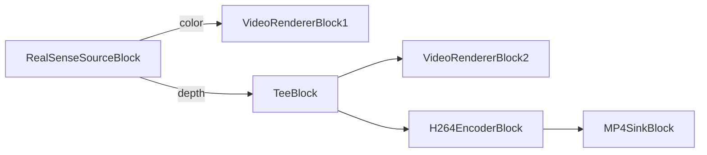

# Intel RealSense Depth Camera in C# .NET

[Media Blocks SDK .NET](https://www.visioforge.com/media-blocks-sdk-net){ .md-button .md-button--primary target="_blank" }

This guide shows how to use an Intel RealSense depth camera (D400 series, such as the D435) from a C# application with the `RealSenseSourceBlock`: list the cameras and their modes, show color and depth side by side, read the distance at a pixel, and record the depth view to an MP4 file. The same pipeline code runs on Windows x64 and Linux x64.

A RealSense camera's color stream is ordinary UVC video, so any capture source can show it. The depth (16-bit distance per pixel) and infrared streams are not: Windows capture APIs mislabel or reject them. `RealSenseSourceBlock` opens the camera through librealsense instead and gives every stream its own output in a format the rest of the pipeline understands.

## What the Block Delivers

| Output | Format | Enabled by |
|---|---|---|
| `ColorOutput` | RGB | `RealSenseSourceSettings.Color` |
| `DepthOutput` | RGB (colorized, default) or `GRAY16_LE` (raw) | `RealSenseSourceSettings.Depth`, `DepthMode` |
| `InfraredOutput` | `GRAY8` | `RealSenseSourceSettings.Infrared` |

The streams come from one librealsense pipeline, so their frames are synchronized. With `AlignDepthToColor` the depth image is mapped onto the color image: it gets the color size, and the same pixel shows the same point in both. `GetDistance(x, y)` returns the distance in meters at a pixel of the latest depth frame.



## Prerequisites

### Windows x64

Add the NuGet packages:

- [VisioForge.DotNet.MediaBlocks](https://www.nuget.org/packages/VisioForge.DotNet.MediaBlocks/) — the SDK
- [VisioForge.CrossPlatform.Core.Windows.x64](https://www.nuget.org/packages/VisioForge.CrossPlatform.Core.Windows.x64/) — GStreamer runtime for Windows x64
- [VisioForge.CrossPlatform.RealSense.Windows.x64](https://www.nuget.org/packages/VisioForge.CrossPlatform.RealSense.Windows.x64/) — librealsense 2.58.1 (`realsense2.dll`)

No RealSense driver is needed: Windows 10 and 11 open the camera with the built-in USB video driver.

### Linux x64

The block uses the system librealsense, version 2.58 or a later 2.x, from the RealSense apt repository. It loads `librealsense2.so`, which the `librealsense2-dev` package provides; the packages also install the udev rules that let a normal user open the camera. The `librealsense2-dkms` kernel patches are not needed.

```bash
sudo mkdir -p /etc/apt/keyrings
curl -sSf https://librealsense.realsenseai.com/Debian/librealsenseai.asc | gpg --dearmor | sudo tee /etc/apt/keyrings/librealsenseai.gpg > /dev/null
echo "deb [signed-by=/etc/apt/keyrings/librealsenseai.gpg] https://librealsense.realsenseai.com/Debian/apt-repo $(lsb_release -cs) main" | sudo tee /etc/apt/sources.list.d/librealsense.list
sudo apt-get update
sudo apt-get install librealsense2-dev
```

Add [VisioForge.DotNet.MediaBlocks](https://www.nuget.org/packages/VisioForge.DotNet.MediaBlocks/) and set up GStreamer as described in the [Ubuntu deployment guide](../../deployment-x/Ubuntu.md). For a desktop UI on Linux, use the Avalonia `VideoView` from [VisioForge.DotNet.Core.UI.Avalonia](https://www.nuget.org/packages/VisioForge.DotNet.Core.UI.Avalonia/); the pipeline code below does not change, only UI calls such as `Dispatcher` differ.

## Step 1: List the Cameras and Their Modes

`EnumerateDevicesAsync` returns every connected RealSense camera with the modes it reports. Pick modes from that list rather than typing sizes in: `FindProfile` returns `null` for a mode the camera does not have.

```csharp
using System.Diagnostics;
using VisioForge.Core;
using VisioForge.Core.MediaBlocks;
using VisioForge.Core.MediaBlocks.Sinks;
using VisioForge.Core.MediaBlocks.Sources;
using VisioForge.Core.MediaBlocks.Special;
using VisioForge.Core.MediaBlocks.VideoEncoders;
using VisioForge.Core.MediaBlocks.VideoRendering;
using VisioForge.Core.Types.X.Sinks;
using VisioForge.Core.Types.X.Sources;

await VisioForgeX.InitSDKAsync();

var cameras = await RealSenseSourceBlock.EnumerateDevicesAsync();
foreach (var camera in cameras)
{
    // The name, serial number and firmware version.
    Console.WriteLine($"{camera} firmware {camera.FirmwareVersion}");

    foreach (var profile in camera.Profiles)
    {
        Console.WriteLine($"  {profile}");
    }
}
```

When librealsense is missing or older than 2.58, `EnumerateDevicesAsync` throws an exception whose message says what to install (see [Troubleshooting](#troubleshooting)). An empty array means librealsense works but no camera is connected.

## Step 2: Show Color and Depth Side by Side

Call `await VisioForgeX.InitSDKAsync()` once before you build a pipeline, for example in the window's `Loaded` handler. This WPF window has two `VideoView` controls, `VideoViewColor` and `VideoViewDepth`. The depth is aligned to the color image and colorized, so it can go straight to a renderer. The window's code-behind needs the `using` directives from Step 1. `StartAsync` returns `false` when the camera lacks the mode (`FindProfile` returned `null`) or the pipeline does not start; why a pipeline did not start comes in `OnError`.

```csharp
private MediaBlocksPipeline _pipeline;
private RealSenseSourceBlock _source;
private readonly System.Timers.Timer _distanceTimer = new System.Timers.Timer(500);

private async Task<bool> StartAsync(RealSenseDeviceInfo camera)
{
    var settings = new RealSenseSourceSettings(camera.SerialNumber)
    {
        Color = camera.FindProfile(RealSenseStreamType.Color, 640, 480, 30),
        Depth = camera.FindProfile(RealSenseStreamType.Depth, 640, 480, 30),
        AlignDepthToColor = true,
        DepthMode = RealSenseDepthMode.Colorized,
    };

    // FindProfile returns null for a mode the camera does not have: pick another one from camera.Profiles.
    if (settings.Color == null || settings.Depth == null)
    {
        return false;
    }

    _pipeline = new MediaBlocksPipeline();
    _pipeline.OnError += (s, e) => Debug.WriteLine(e.Message);

    _source = new RealSenseSourceBlock(settings);
    _pipeline.Connect(_source.ColorOutput, new VideoRendererBlock(_pipeline, VideoViewColor) { IsSync = false }.Input);
    _pipeline.Connect(_source.DepthOutput, new VideoRendererBlock(_pipeline, VideoViewDepth) { IsSync = false }.Input);

    if (await _pipeline.StartAsync())
    {
        return true;
    }

    // The start failed: dispose the pipeline so that it releases the camera.
    await StopAsync();
    return false;
}

private async Task StopAsync()
{
    _distanceTimer.Stop();
    var pipeline = _pipeline;
    _pipeline = null;
    _source = null;
    if (pipeline == null)
    {
        return;
    }

    try
    {
        await pipeline.StopAsync();
    }
    finally
    {
        await pipeline.DisposeAsync();
    }
}
```

`IsSync = false` shows each frame as soon as it arrives, which is what a live camera preview needs. Leave a stream's profile `null` to keep it off; an output that is enabled but not connected is discarded.

## Step 3: Measure the Distance at a Pixel

`GetDistance(x, y)` reads the latest depth frame. It returns meters, or 0 when the camera has no depth for that pixel (too close, too far, or a surface it cannot see) or before the first frame. With `AlignDepthToColor = true` the coordinates are color-image pixels, so one pixel position works for both images. A mouse position on a `VideoView` is not a frame pixel: the view scales the frame to fit, so convert the position to frame coordinates before you call `GetDistance`.

```csharp
public MainWindow()
{
    InitializeComponent();
    _distanceTimer.Elapsed += (s, e) => UpdateDistance();
}

private void UpdateDistance()
{
    var source = _source;
    if (source == null)
    {
        return;
    }

    // With alignment the depth frame has the color size.
    var profile = source.Settings.AlignDepthToColor ? source.Settings.Color : source.Settings.Depth;
    float meters;
    try
    {
        meters = source.GetDistance(profile.Width / 2, profile.Height / 2);
    }
    catch (Exception ex)
    {
        // The timer would swallow it.
        Debug.WriteLine(ex);
        return;
    }

    Dispatcher.BeginInvoke((Action)(() => lbDistance.Text = $"Distance at center: {meters:F2} m"));
}
```

Start the timer when `StartAsync` returns `true`; `StopAsync` in Step 2 stops it, and the `Closing` handler in Step 4 disposes it. A pixel outside the depth frame throws `ArgumentOutOfRangeException`; the timer swallows exceptions thrown by its `Elapsed` handler, so catch and log them in `UpdateDistance`.

## Step 4: Record the Depth View to MP4

The colorized depth is a normal RGB video, so it can be encoded like any camera. Split it with a `TeeBlock`: one branch to the screen, one to an H.264 encoder and an MP4 file. In `StartAsync`, these lines replace the Step 2 line that connects `DepthOutput` to the renderer, before `await _pipeline.StartAsync()`; an output connects to one block only.

```csharp
var tee = new TeeBlock(2, MediaBlockPadMediaType.Video);
_pipeline.Connect(_source.DepthOutput, tee.Input);
_pipeline.Connect(tee.Outputs[0], new VideoRendererBlock(_pipeline, VideoViewDepth) { IsSync = false }.Input);

var encoder = new H264EncoderBlock();
var mp4 = new MP4SinkBlock(new MP4SinkSettings(System.IO.Path.Combine(Environment.GetFolderPath(Environment.SpecialFolder.MyVideos, Environment.SpecialFolderOption.Create), "depth.mp4")));
_pipeline.Connect(tee.Outputs[1], encoder.Input);
_pipeline.Connect(encoder.Output, mp4.CreateNewInput(MediaBlockPadMediaType.Video));
```

`StopAsync` finishes the file, so await it before the window closes and before the application exits. With `Closing="Window_Closing"` on the window, cancel the first close, stop, then close again:

```csharp
private async void Window_Closing(object sender, System.ComponentModel.CancelEventArgs e)
{
    // Stop the camera first, then close for real once this handler has returned.
    if (_pipeline != null)
    {
        e.Cancel = true;
        IsEnabled = false;
        try
        {
            await StopAsync();
        }
        catch (Exception ex)
        {
            Debug.WriteLine(ex);
        }

        Dispatcher.BeginInvoke(new Action(Close));
        return;
    }

    _distanceTimer.Dispose();

    // The application's last SDK window: shut the SDK down.
    VisioForgeX.DestroySDK();
}
```

A colorized image is for people to look at: the colors stand for distances, but the exact values are gone. To keep distances, either call `GetDistance` while you capture, or set `DepthMode = RealSenseDepthMode.Raw`. The depth output then carries the camera's 16-bit values (`GRAY16_LE`); multiply a value by `DepthScale` to get meters. `DepthScale` is known once the pipeline has started. Raw depth is for your own processing: the H.264 chain above reduces it to 8 bits, so do not record it that way.

## Infrared

The D400 cameras have two infrared imagers, index 1 (left) and 2 (right). Ask for the one you want with the last argument of `FindProfile` and connect `InfraredOutput`:

```csharp
settings.Infrared = camera.FindProfile(RealSenseStreamType.Infrared, 640, 480, 30, 1);
// ...
_pipeline.Connect(_source.InfraredOutput, new VideoRendererBlock(_pipeline, VideoViewInfrared) { IsSync = false }.Input);
```

## Troubleshooting

| Message or symptom | Cause | What to do |
|---|---|---|
| `librealsense (realsense2) 2.58 or a later 2.x is needed: ... Add the VisioForge.CrossPlatform.RealSense.Windows.x64 NuGet package.` | Windows: `realsense2.dll` is not next to the application. | Add the package to the application project. |
| `... Install librealsense2-dev (librealsense2.so) from the RealSense apt repository.` | Linux: `librealsense2.so` is not installed. The runtime package alone ships only the versioned `librealsense2.so.2.x`. | `sudo apt-get install librealsense2-dev`. |
| `... librealsense 2.5x.x was loaded. Install 2.58 or a later 2.x, ...` | An older librealsense comes first on the library search path. | Install 2.58 or later, and remove the older copy. |
| `EnumerateDevicesAsync` returns no cameras | The camera is not connected, or (Linux) the user cannot open it. | Reconnect the camera. On Linux check that `librealsense2-udev-rules` is installed, then reconnect. |
| `StartAsync` returns `false`, nothing in `OnError` | The camera has no such mode: `FindProfile` returned `null`. | Take the modes from `RealSenseDeviceInfo.Profiles`. |
| `StartAsync` returns `false`, a message in `OnError` | The pipeline did not start, for example because another application uses the camera. | The message says what failed; close other camera applications. |

On Linux, `rs-enumerate-devices` from the optional `librealsense2-utils` package lists the cameras librealsense sees and every mode they report.

## Related Documentation

- [Intel RealSense Source Block reference](../Sources/index.md#intel-realsense-source-block) — the full block description
- [Video rendering](../VideoRendering/index.md) — `VideoRendererBlock` options
- [Tee block](../Special/index.md#tee) — splitting one stream to several outputs
- [Ubuntu deployment](../../deployment-x/Ubuntu.md) — running Media Blocks applications on Linux
