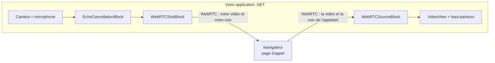

# Appel vidéo WebRTC bidirectionnel entre une application C# et un navigateur

[Media Blocks SDK .NET](https://www.visioforge.com/media-blocks-sdk-net){ .md-button .md-button--primary target="_blank" }

!!! info "Exemple de démonstration"
    Ce guide suit la [WebRTC Video Call Demo (WPF)](https://github.com/visioforge/.Net-SDK-s-samples/tree/master/Media%20Blocks%20SDK/WPF/CSharp/WebRTC%20Video%20Call%20Demo) : une caméra et un microphone avec annulation d'écho, sourdine et caméra coupée, la vidéo et la voix de l'appelant, et une page d'appel servie par l'application.

    La référence des blocs se trouve dans [Blocs source → WebRTC](../Sources/index.md#bloc-source-webrtc), [Blocs sink → WebRTC](../Sinks/index.md#webrtc) et [Traitement audio → Annulation d'écho](../AudioProcessing/index.md#annulation-decho).

## Ce que vous allez construire

Un appel vidéo entre une application .NET de bureau et une personne dans un navigateur web : un agent de support et un client, une borne et un opérateur, un instrument de laboratoire et un expert à distance. Les deux côtés se voient et s'entendent avec une latence inférieure à la seconde, et rien ne tourne entre eux : ni serveur multimédia, ni service cloud, ni plugin de navigateur.



Trois blocs font le travail :

| Bloc | Rôle dans l'appel |
| --- | --- |
| `WebRTCSinkBlock` | Envoie votre caméra et votre microphone au navigateur. Exécute le serveur de signalisation et sert la page d'appel. |
| `WebRTCSourceBlock` | Reçoit la caméra et le microphone du navigateur, décodés, pour un `VideoRendererBlock` et les haut-parleurs. |
| `EchoCancellationBlock` | Supprime la voix de l'appelant que vos haut-parleurs diffusent et que votre microphone capte à nouveau, pour que l'appelant n'entende pas d'écho. Supprime aussi le bruit et règle le niveau du microphone. |

## Quand l'utiliser

- **Une application, un appelant à la fois**, sur le même réseau ou via internet avec un serveur TURN.
- Vous voulez l'appel dans votre propre application, à côté de vos commandes, enregistrements ou mesures, et que l'appelant n'ait besoin que d'un lien.
- Vous ne voulez ni exécuter ni payer un serveur multimédia.

Pour un flux vers de nombreux spectateurs, utilisez le `WebRTCSinkBlock` seul ([Écran et caméra vers le navigateur](webrtc-whip.md)), et pour publier via un serveur multimédia, utilisez WHIP et WHEP ([Lecteur WebRTC (WHEP)](webrtc-whep-player.md)).

## Prérequis

- Windows x64 (la plateforme sur laquelle tournent la démo et les tests), .NET 10.
- Media Blocks SDK .NET 2026.11.26 ou ultérieur, avec les paquets `VisioForge.CrossPlatform.Core.Windows.x64` et `VisioForge.CrossPlatform.Core.Windows.Adds.x64`. Le paquet `.Adds` contient les plugins WebRTC et d'annulation d'écho.
- Une caméra et un microphone, et Chrome, Edge, Firefox ou Safari pour l'appelant.

Vérifiez `WebRTCSinkBlock.IsAvailable()`, `WebRTCSourceBlock.IsAvailable()` et `EchoCancellationBlock.IsAvailable()` avant de construire le pipeline : chacun renvoie `false` quand le paquet `.Adds` manque.

## Comment les deux côtés se trouvent

Le navigateur et l'application se rencontrent sur le serveur de signalisation qu'exécute le `WebRTCSinkBlock` (WebSocket, port 8443 par défaut) :

1. Le `WebRTCSinkBlock` s'enregistre comme **producteur** : n'importe qui sur le serveur peut demander son flux.
2. Le `WebRTCSourceBlock`, sans `ProducerPeerId` ni `ConnectToFirstProducer`, s'enregistre comme consommateur qui **attend un appel**.
3. La page d'appel s'enregistre comme producteur et comme auditeur. Elle demande le flux de l'application (une session WebRTC) et appelle le `WebRTCSourceBlock` en attente avec sa propre caméra et son microphone (une seconde session).

Chaque sens est sa propre session WebRTC : les deux peuvent utiliser des codecs et des débits différents, et le sink adapte son débit au réseau de l'appelant.

## Le pipeline

```csharp
var pipeline = new MediaBlocksPipeline();

// Votre côté : caméra et microphone vers le navigateur. Le sink sert la page d'appel depuis wwwroot.
var sink = new WebRTCSinkBlock(new WebRTCSinkSettings
{
    SignallingServerHost = "127.0.0.1",
    SignallingServerPort = 8443,
    WebServerDirectory = Path.Combine(AppContext.BaseDirectory, "wwwroot"),
    WebServerAddress = "http://127.0.0.1:8080/",
});

var camera = new SystemVideoSourceBlock(new VideoCaptureDeviceSourceSettings(videoDevice));
var microphone = new SystemAudioSourceBlock(audioDevice.CreateSourceSettings());
var echoCancellation = new EchoCancellationBlock(new EchoCancellationSettings());

pipeline.Connect(camera.Output, sink.CreateNewInput(MediaBlockPadMediaType.Video));
pipeline.Connect(microphone.Output, echoCancellation.Input);
pipeline.Connect(echoCancellation.Output, sink.CreateNewInput(MediaBlockPadMediaType.Audio));

// Le côté de l'appelant : les moteurs de rendu attendent l'appel. La voix de l'appelant passe par
// l'annuleur d'écho en route vers les haut-parleurs, pour qu'il sache quoi retirer du microphone.
var remoteVideo = new VideoRendererBlock(pipeline, RemoteView) { IsSync = false };
pipeline.AddBlock(remoteVideo);
pipeline.Connect(echoCancellation.PlaybackOutput, new AudioRendererBlock().Input);

await pipeline.StartAsync();

// La source rejoint le serveur de signalisation du sink une fois celui-ci lancé, et attend l'appel de la page.
var source = new WebRTCSourceBlock(new WebRTCSourceSettings { SignallingServer = "ws://127.0.0.1:8443" });
source.VideoOutput.OnDemandConnect = true;
source.AudioOutput.OnDemandConnect = true;

pipeline.AddBlockLive(source);
pipeline.ConnectLive(source.VideoOutput, remoteVideo.Input);
pipeline.ConnectLive(source.AudioOutput, echoCancellation.PlaybackInput);
pipeline.SyncBlockStateLive(source);
```

Pourquoi la source est ajoutée après `StartAsync` : son client de signalisation se connecte dès que la source démarre, et le serveur du sink n'écoute qu'une fois le pipeline lancé. `OnDemandConnect = true` garde les sorties de la source ouvertes pour `ConnectLive`.

`WebRTCSinkBlock.ConsumerAdded` et `ConsumerRemoved` indiquent quand l'appelant arrive et part. Quand il raccroche et rappelle, le même `WebRTCSourceBlock` prend le nouvel appel par les mêmes sorties ; rien n'est à reconstruire.

## La page d'appel

Le `wwwroot/index.html` de la démo est un seul fichier de JavaScript, sans bibliothèque. Les parties qui comptent :

```javascript
// S'enregistrer comme producteur (pour appeler l'application) et comme auditeur (pour la voir arriver).
// callPage marque les pages d'appel : les gestionnaires de 'list' et 'peerStatusChanged' ignorent les
// producteurs dont le meta le porte, donc deux pages ouvertes ne se prennent jamais pour l'application.
send({ type: 'setPeerStatus', roles: ['producer', 'listener'], meta: { callPage: true } });
send({ type: 'list' });          // le sink de l'application : recevoir son flux
send({ type: 'listConsumers' }); // la source de l'application en attente : l'appeler

// list → startSession avec l'ID de pair du sink : le sink envoie une offre, la page répond.
// listConsumers → startSession avec l'ID de pair de la source : le serveur répond par
// startSession, et la page offre sa caméra et son microphone.
```

La page ouvre un `RTCPeerConnection` par session et oriente chaque message `peer` selon son `sessionId`. Copiez le fichier tel quel, ou servez-vous-en comme référence pour votre propre page.

## Sourdine et caméra coupée

- **Sourdine** : placez un `VolumeBlock` avant l'annuleur d'écho et définissez `Mute = true`. L'appel garde sa piste audio ; l'appelant entend du silence.
- **Caméra coupée** : placez un `VideoBalanceBlock` après la caméra et définissez `Settings.Contrast = 0` et `Settings.Brightness = -1`. L'appelant voit une image noire et la piste vidéo reste, donc rallumer la caméra ne demande aucune nouvelle négociation.

Les deux agissent pendant l'appel. Dans le navigateur, `track.enabled = false` fait de même du côté de l'appelant.

## Limites

- **HTTPS hors de localhost.** Les navigateurs ne donnent la caméra et le microphone à une page qu'en `https://` ou sur `localhost`/`127.0.0.1`, et le serveur web intégré du sink est uniquement `http://`. Pour un appelant sur un autre ordinateur, hébergez la page d'appel sur votre propre site `https://`, laissez `WebServerDirectory` vide et donnez au sink `SignallingServerCertificate` et `SignallingServerKey` pour que la page atteigne le serveur de signalisation en `wss://`. Définissez `SignallingServerHost = "0.0.0.0"` pour que la page puisse s'y connecter, et, comme le serveur n'accepte alors que `wss://`, définissez `WebRTCSourceSettings.SignallingServer = "wss://127.0.0.1:<port>"` (la source ne vérifie pas le certificat du serveur, le nom d'hôte de votre site n'a donc pas d'importance ici).
- **TURN via internet.** Sur un même réseau local, les deux côtés se connectent directement. Derrière un NAT ou un pare-feu, exécutez un serveur TURN (par exemple coturn) et configurez-le dans `WebRTCSinkSettings.TurnServers` et `WebRTCSourceSettings.TurnServers` (`turn://utilisateur:motdepasse@hôte:3478`) et dans les `iceServers` de la page (`{ urls: 'turn:host:3478', username, credential }`). STUN seul (`StunServer`, par défaut le serveur de Google) ne suffit pas pour un NAT symétrique.
- **Un appel à la fois.** Le `WebRTCSourceBlock` prend un appel à la fois : un appel 1:1, pas une conférence. Un second appelant qui appelle pendant un appel reçoit votre image mais n'est pas affiché, même après que le premier a raccroché.
- **L'annulation d'écho a besoin des deux chemins.** Si `PlaybackInput` n'est pas connecté, l'annuleur n'a rien à comparer et ne supprime rien. Les deux chemins tournent à 48 kHz ; l'annuleur rééchantillonne.
- **Windows est la plateforme testée.** Les mêmes plugins sont fournis dans `VisioForge.CrossPlatform.Core.macOS.Adds` ; sur les autres plateformes, vérifiez `IsAvailable()`.

## Questions fréquentes

### Faut-il un serveur multimédia ou un service cloud pour un appel WebRTC depuis .NET ?

Non. Le `WebRTCSinkBlock` exécute le serveur de signalisation dans votre application et sert la page d'appel, et les médias circulent directement entre l'application et le navigateur. Un serveur TURN n'est nécessaire que lorsque les deux côtés ne peuvent pas se joindre directement.

### Comment le navigateur appelle-t-il l'application .NET ?

La page d'appel s'enregistre comme producteur sur le serveur de signalisation de l'application et ouvre une session avec le `WebRTCSourceBlock` en attente. Le serveur demande à la page d'envoyer son offre, et la source répond. Une seconde session dans l'autre sens transporte la caméra et le microphone de l'application.

### Pourquoi l'appelant entend-il un écho, et comment le supprimer ?

La voix de l'appelant sort de vos haut-parleurs et revient dans votre microphone. Le `EchoCancellationBlock` écoute ce que diffusent les haut-parleurs (son chemin de lecture) et le soustrait du microphone (son chemin principal). Connectez les deux chemins ; avec un casque, l'écho ne se produit pas.

### Quels codecs sont utilisés ?

Le navigateur et les blocs les négocient pour chaque session : VP8, H.264, VP9, H.265 ou AV1 pour la vidéo, celui que les deux côtés prennent en charge, et Opus pour l'audio. La vidéo fournie par la source est décodée, à la taille et à la fréquence d'images qu'envoie le navigateur.

### L'appel peut-il passer par internet ?

Oui, avec la page d'appel sur un site `https://`, le serveur de signalisation en `wss://` et un serveur TURN pour les appelants derrière un NAT. Voir [Limites](#limites).

## Voir aussi

- [Écran et caméra vers le navigateur (WebRTC, WHIP)](webrtc-whip.md) : un flux vers de nombreux navigateurs
- [Lecteur WebRTC (WHEP)](webrtc-whep-player.md) : lire un flux d'un serveur multimédia WebRTC
- [Blocs source → WebRTC](../Sources/index.md#bloc-source-webrtc)
- [Traitement audio → Annulation d'écho](../AudioProcessing/index.md#annulation-decho)
