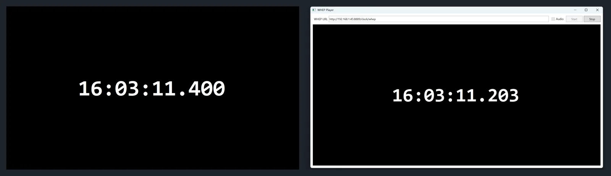
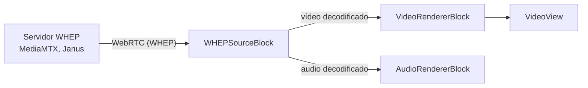

# Reproducir un stream WebRTC por WHEP en C# WPF

[Media Blocks SDK .NET](https://www.visioforge.com/media-blocks-sdk-net){ .md-button .md-button--primary target="_blank" }

!!! info "Ejemplos de demostración"
    El código de esta guía es el ejemplo [whep-player-wpf](https://github.com/visioforge/.Net-SDK-s-samples/tree/master/Media%20Blocks%20SDK/_VideoTutorials/whep-player-wpf). La [WHEP Player Demo (WPF)](https://github.com/visioforge/.Net-SDK-s-samples/tree/master/Media%20Blocks%20SDK/WPF/CSharp/WHEP%20Player%20Demo) es el mismo reproductor con una línea de estado bajo el vídeo.

    La referencia del bloque está en [Bloques fuente → Bloque Fuente WHEP](../Sources/index.md#bloque-fuente-whep).

## Qué va a construir

Una aplicación WPF que reproduce un stream WebRTC desde cualquier URL WHEP: escriba la URL, haga clic en **Start** y el vídeo se reproduce con una latencia muy por debajo de un segundo. El audio también se reproduce cuando el stream lo tiene, y los errores del SDK aparecen en la barra de título.

WHEP (WebRTC-HTTP Egress Protocol) establece una sesión WebRTC con una sola petición HTTP, así que a un reproductor le basta una URL. MediaMTX, Janus, Cloudflare Stream y otros servidores lo admiten.



La imagen muestra la aplicación terminada en funcionamiento: a la izquierda, un reloj que corre en este equipo, capturado y publicado en un servidor MediaMTX de la red; a la derecha, el reproductor muestra ese stream. La diferencia entre los dos relojes es la latencia.



## Requisitos previos

- Windows 10 u 11, Visual Studio 2026, .NET 10.
- Media Blocks SDK .NET 2026.11.23 o posterior. Esa versión corrige la reproducción de un stream solo de vídeo desde MediaMTX: antes, el servidor rechazaba la sesión con `codecs not supported by client`.
- Un servidor WHEP con un stream. Los ejemplos usan [MediaMTX](https://github.com/bluenviron/mediamtx), un servidor de medios gratuito: publique en él un stream por RTSP, RTMP, SRT o WHIP, y lo sirve por WHEP en `http://<servidor>:8889/<nombre del stream>/whep`.

Paquetes NuGet:

- [VisioForge.DotNet.MediaBlocks](https://www.nuget.org/packages/VisioForge.DotNet.MediaBlocks/) — el SDK
- [VisioForge.CrossPlatform.Core.Windows.x64](https://www.nuget.org/packages/VisioForge.CrossPlatform.Core.Windows.x64/) — el runtime de GStreamer sobre el que funcionan los bloques, con la pila WebRTC y los decodificadores de vídeo y audio
- [VisioForge.CrossPlatform.Core.Windows.Adds.x64](https://www.nuget.org/packages/VisioForge.CrossPlatform.Core.Windows.Adds.x64/) — los plugins adicionales, entre ellos el cliente WHEP

## Crear el proyecto

Cree una **WPF Application** de C# en .NET 10 llamada `WhepPlayerWpf` y añada los paquetes:

```bash
dotnet add package VisioForge.DotNet.MediaBlocks
dotnet add package VisioForge.CrossPlatform.Core.Windows.x64
dotnet add package VisioForge.CrossPlatform.Core.Windows.Adds.x64
```

Los paquetes del runtime son de 64 bits, así que compile la aplicación para x64. En el archivo del proyecto:

```xml
<PropertyGroup>
  <OutputType>WinExe</OutputType>
  <TargetFramework>net10.0-windows</TargetFramework>
  <PlatformTarget>x64</PlatformTarget>
  <UseWPF>true</UseWPF>
  <Nullable>disable</Nullable>
  <ImplicitUsings>enable</ImplicitUsings>
</PropertyGroup>
```

## La ventana

`MainWindow.xaml`: una barra con la URL, una casilla **Audio** y los botones **Start** y **Stop**, y debajo el `VideoView` del SDK. La ventana empieza deshabilitada; se habilita cuando el SDK se ha cargado.

```xml
<Window x:Class="WhepPlayerWpf.MainWindow"
        xmlns="http://schemas.microsoft.com/winfx/2006/xaml/presentation"
        xmlns:x="http://schemas.microsoft.com/winfx/2006/xaml"
        xmlns:vf="clr-namespace:VisioForge.Core.UI.WPF;assembly=VisioForge.Core"
        Title="WHEP Player" Height="600" Width="900" IsEnabled="False"
        Loaded="Window_Loaded" Closing="Window_Closing">
    <DockPanel Margin="10">
        <DockPanel DockPanel.Dock="Top" Margin="0,0,0,10">
            <Label DockPanel.Dock="Left" Content="WHEP URL" VerticalAlignment="Center" />
            <Button x:Name="btStop" DockPanel.Dock="Right" Content="Stop" Width="70" Margin="5,0,0,0"
                    IsEnabled="False" Click="btStop_Click" />
            <Button x:Name="btStart" DockPanel.Dock="Right" Content="Start" Width="70" Margin="5,0,0,0"
                    Click="btStart_Click" />
            <CheckBox x:Name="cbAudio" DockPanel.Dock="Right" Content="Audio" VerticalAlignment="Center"
                      Margin="10,0,5,0" />
            <TextBox x:Name="edURL" VerticalContentAlignment="Center"
                     Text="http://localhost:8889/mystream/whep" />
        </DockPanel>
        <vf:VideoView x:Name="VideoView1" Background="Black" />
    </DockPanel>
</Window>
```

## El código

`MainWindow.xaml.cs`, completo:

```csharp
using System.ComponentModel;
using System.Windows;
using VisioForge.Core;
using VisioForge.Core.MediaBlocks;
using VisioForge.Core.MediaBlocks.AudioRendering;
using VisioForge.Core.MediaBlocks.Sources;
using VisioForge.Core.MediaBlocks.VideoRendering;
using VisioForge.Core.Types.X.Sources;

namespace WhepPlayerWpf;

public partial class MainWindow : Window
{
    private MediaBlocksPipeline _pipeline;

    public MainWindow()
    {
        InitializeComponent();
    }

    private async void Window_Loaded(object sender, RoutedEventArgs e)
    {
        await VisioForgeX.InitSDKAsync();

        if (!WHEPSourceBlock.IsAvailable())
        {
            Title = "No WHEP source: add the VisioForge.CrossPlatform.Core.Windows.Adds.x64 package";
            btStart.IsEnabled = false;
            cbAudio.IsEnabled = false;
        }

        IsEnabled = true;
    }

    private async void btStart_Click(object sender, RoutedEventArgs e)
    {
        Title = "WHEP Player";
        IsEnabled = false; // ni clics ni cierre hasta que haya arrancado

        _pipeline = new MediaBlocksPipeline();

        // Errores del SDK en la barra de título, también los que el servidor envía después de Start (una ruta errónea, una pista rechazada)
        _pipeline.OnError += (_, args) => Dispatcher.InvokeAsync(() => Title = args.Message);

        // El vídeo se pide siempre; el audio solo cuando el stream lo tiene: el servidor rechaza una pista que no envía
        var audio = cbAudio.IsChecked == true;
        var source = new WHEPSourceBlock(new WHEPSourceSettings
        {
            Location = edURL.Text.Trim(),
            AudioEnabled = audio,
        });

        // IsSync = false: cada fotograma se muestra en cuanto llega, la latencia más baja, a costa de la sincronización labial
        var video = new VideoRendererBlock(_pipeline, VideoView1) { IsSync = false };
        _pipeline.Connect(source.VideoOutput, video.Input);

        if (audio)
        {
            var speakers = new AudioRendererBlock { IsSync = false };
            _pipeline.Connect(source.AudioOutput, speakers.Input);
        }

        var started = await _pipeline.StartAsync();
        if (!started) await StopAsync();

        btStart.IsEnabled = !started;
        cbAudio.IsEnabled = !started;
        btStop.IsEnabled = started;
        IsEnabled = true;
    }

    private async Task StopAsync()
    {
        await _pipeline.StopAsync();
        await _pipeline.DisposeAsync();
        _pipeline = null;
    }

    private async void btStop_Click(object sender, RoutedEventArgs e)
    {
        IsEnabled = false;
        await StopAsync();
        btStop.IsEnabled = false;
        btStart.IsEnabled = true;
        cbAudio.IsEnabled = true;
        IsEnabled = true;
    }

    private async void Window_Closing(object sender, CancelEventArgs e)
    {
        if (IsEnabled && _pipeline == null)
        {
            VisioForgeX.DestroySDK();
            return;
        }

        e.Cancel = true; // ocupado, o aún reproduciendo: primero detener
        if (!IsEnabled) return; // cargando, arrancando o deteniendo: cerrar de nuevo después
        IsEnabled = false;

        if (_pipeline != null) await StopAsync();

        IsEnabled = true;
        await Dispatcher.InvokeAsync(Close); // no Close(): WPF lanza una excepción dentro de Closing
    }
}
```

Qué hace cada parte:

- **`VisioForgeX.InitSDKAsync`** carga el SDK y su runtime de GStreamer una vez, al abrirse la ventana. **`WHEPSourceBlock.IsAvailable()`** indica después si el cliente WHEP está presente: sin el paquete `Adds` no lo está, la barra de título lo indica y **Start** queda deshabilitado.
- **`WHEPSourceBlock`** hace el trabajo de WebRTC: envía la petición WHEP a `Location`, se conecta por ICE y decodifica el vídeo y el audio que recibe. Sus `VideoOutput` y `AudioOutput` entregan fotogramas y muestras decodificados.
- **`AudioEnabled`** decide si el bloque pide audio al servidor. Un stream sin pista de audio debe reproducirse con él desactivado: MediaMTX rechaza una sesión que pide una pista que el stream no tiene, y `OnError` informa `codecs not supported by client`. `AudioEnabled` vale `true` por defecto, así que el ejemplo lo toma de la casilla **Audio**, desmarcada por defecto.
- **`IsSync = false`** en los dos renderizadores muestra cada fotograma y reproduce cada muestra en cuanto llega, en lugar de retenerlos hasta su momento en el reloj del pipeline. Así la latencia es la más baja, a costa de una sincronización labial exacta.
- **`OnError`** se produce en un hilo de GStreamer, por eso el controlador pasa al hilo de la interfaz con `Dispatcher.InvokeAsync`. También informa de los errores que el servidor envía después de que `StartAsync` haya devuelto el control: una ruta en la que no se publica nada, o una pista rechazada.
- **`StopAsync` y `DisposeAsync`** terminan la sesión WebRTC y liberan el pipeline. **`Window_Closing`** cancela el cierre mientras el reproductor reproduce, detiene el pipeline y vuelve a cerrar; en esa segunda pasada el SDK se libera con `VisioForgeX.DestroySDK()`. Un cierre mientras el SDK se carga, arranca o se detiene se ignora: cierre la ventana de nuevo cuando vuelva a estar habilitada.

## Ejecutar y medir la latencia

Ejecute la aplicación, escriba la URL WHEP —en MediaMTX, `http://<servidor>:8889/<nombre del stream>/whep`— y haga clic en **Start**.

Para ver la latencia, publique un reloj: la imagen del principio de esta guía muestra un reloj con milisegundos capturado en un equipo, codificado en H.264 con `x264` en su ajuste de latencia cero, publicado en MediaMTX por RTSP y reproducido por esta aplicación junto al original. El reloj de la derecha iba unos 0,2 segundos por detrás del de la izquierda. La cifra incluye la captura, el codificador, el servidor, la red, el decodificador y la pantalla.

Con el stream publicado directamente desde una fuente WHIP, la WHEP Player Demo midió una mediana de 71 ms con H.264 y de 93 ms con VP8 en una red local (consulte [Reproducción de baja latencia](../Sources/index.md#reproduccion-de-baja-latencia)).

## Solución de problemas

| Síntoma | Causa y solución |
| --- | --- |
| La barra de título dice `No WHEP source` y **Start** está deshabilitado | Falta la referencia al paquete `VisioForge.CrossPlatform.Core.Windows.Adds.x64`. Añádalo. |
| La barra de título dice `codecs not supported by client` | El reproductor pidió una pista que el stream no tiene, normalmente el audio. Desmarque **Audio** para un stream solo de vídeo. |
| La barra de título muestra un error HTTP como `404` | No se publica nada en esa ruta, o la URL es incorrecta. En MediaMTX la URL termina en `/<nombre del stream>/whep`. |
| **Start** funciona pero el vídeo sigue negro | El tráfico WebRTC no llega: permita la aplicación en el Firewall de Windows Defender y, en MediaMTX, el puerto UDP de WebRTC del servidor (8189). Entre redes distintas, configure `StunServer` o `TurnServer` en `WHEPSourceSettings`. |
| El audio y el vídeo se desincronizan | `IsSync = false` reproduce cada stream según llega. Ponga `IsSync = true` en los dos renderizadores para la sincronización labial, a costa de más latencia. |

## Preguntas frecuentes

### ¿Desde qué servidores reproduce?

Desde cualquier servidor que publique por WHEP: MediaMTX, Janus, Cloudflare Stream y otros. Para los servidores que piden un token, configure `AuthToken` en `WHEPSourceSettings`; se envía como `Authorization: Bearer`.

### ¿Funciona fuera de Windows?

`WHEPSourceBlock` funciona en Windows, macOS y Linux con el paquete `Adds` de la plataforma (en Linux, además, con `gstreamer1.0-plugins-bad` y `gstreamer1.0-nice` de la distribución), y en iOS con `VisioForge.CrossPlatform.Core.iOS` 2026.11.23 o posterior. La interfaz de esta guía es WPF; el código del pipeline es el mismo en todas las plataformas.

### ¿Puedo grabar el stream mientras se reproduce?

Sí. Ponga un `TeeBlock` tras el `VideoOutput` de la fuente, conecte una salida al renderizador y la otra a un codificador y a un sink de archivo. `MediaBlocksPipeline.StopAsync` finaliza el archivo.

### ¿Cómo publico un stream desde C# en un servidor WHEP?

Con `WHIPSinkBlock`: consulte [Pantalla o cámara a un navegador por WebRTC](webrtc-whip.md). Para servir cámaras RTSP a los navegadores por WHEP sin servidor de medios, consulte [Cámaras IP RTSP en el navegador con WHEP](rtsp-cameras-in-browser-whep.md).

## Véase también

- [Bloques fuente → Bloque Fuente WHEP](../Sources/index.md#bloque-fuente-whep) — referencia de `WHEPSourceBlock` y `WHEPSourceSettings`
- [Pantalla o cámara a un navegador por WebRTC](webrtc-whip.md) — publicar por WHIP y directamente a los navegadores
- [Cámaras IP RTSP en el navegador con WHEP](rtsp-cameras-in-browser-whep.md) — cámaras IP en una página web
- [Visor de Streams RTSP](rtsp-player-csharp.md) — el mismo tipo de reproductor para cámaras RTSP
