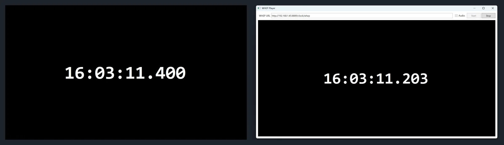
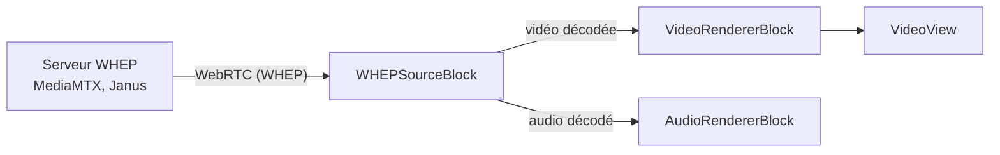

# Lire un flux WebRTC en WHEP en C# WPF

[Media Blocks SDK .NET](https://www.visioforge.com/media-blocks-sdk-net){ .md-button .md-button--primary target="_blank" }

!!! info "Exemples de démonstration"
    Le code de ce guide est l'exemple [whep-player-wpf](https://github.com/visioforge/.Net-SDK-s-samples/tree/master/Media%20Blocks%20SDK/_VideoTutorials/whep-player-wpf). La [WHEP Player Demo (WPF)](https://github.com/visioforge/.Net-SDK-s-samples/tree/master/Media%20Blocks%20SDK/WPF/CSharp/WHEP%20Player%20Demo) est le même lecteur avec une ligne d'état sous la vidéo.

    La référence du bloc se trouve dans [Blocs source → Bloc source WHEP](../Sources/index.md#bloc-source-whep).

## Ce que vous allez construire

Une application WPF qui lit un flux WebRTC depuis n'importe quelle URL WHEP : saisissez l'URL, cliquez sur **Start**, et la vidéo s'affiche avec une latence bien inférieure à une seconde. L'audio est lu aussi quand le flux en contient, et les erreurs du SDK s'affichent dans la barre de titre.

WHEP (WebRTC-HTTP Egress Protocol) établit une session WebRTC avec une seule requête HTTP : une URL suffit donc à un lecteur. MediaMTX, Janus, Cloudflare Stream et d'autres serveurs le prennent en charge.



L'image montre l'application terminée en fonctionnement : à gauche, une horloge qui tourne sur cet ordinateur, capturée et publiée vers un serveur MediaMTX du réseau ; à droite, le lecteur affiche ce flux. L'écart entre les deux horloges est la latence.



## Prérequis

- Windows 10 ou 11, Visual Studio 2026, .NET 10.
- Media Blocks SDK .NET 2026.11.23 ou ultérieur. Cette version corrige la lecture d'un flux vidéo seul depuis MediaMTX : auparavant, le serveur refusait la session avec `codecs not supported by client`.
- Un serveur WHEP avec un flux. Les exemples utilisent [MediaMTX](https://github.com/bluenviron/mediamtx), un serveur multimédia gratuit : publiez-y un flux en RTSP, RTMP, SRT ou WHIP, et il le sert en WHEP à l'adresse `http://<serveur>:8889/<nom du flux>/whep`.

Paquets NuGet :

- [VisioForge.DotNet.MediaBlocks](https://www.nuget.org/packages/VisioForge.DotNet.MediaBlocks/) — le SDK
- [VisioForge.CrossPlatform.Core.Windows.x64](https://www.nuget.org/packages/VisioForge.CrossPlatform.Core.Windows.x64/) — le runtime GStreamer sur lequel tournent les blocs, avec la pile WebRTC et les décodeurs vidéo et audio
- [VisioForge.CrossPlatform.Core.Windows.Adds.x64](https://www.nuget.org/packages/VisioForge.CrossPlatform.Core.Windows.Adds.x64/) — les plugins supplémentaires, dont le client WHEP

## Créer le projet

Créez une **WPF Application** C# sur .NET 10 nommée `WhepPlayerWpf`, puis ajoutez les paquets :

```bash
dotnet add package VisioForge.DotNet.MediaBlocks
dotnet add package VisioForge.CrossPlatform.Core.Windows.x64
dotnet add package VisioForge.CrossPlatform.Core.Windows.Adds.x64
```

Les paquets du runtime sont en 64 bits : compilez donc l'application pour x64. Dans le fichier de projet :

```xml
<PropertyGroup>
  <OutputType>WinExe</OutputType>
  <TargetFramework>net10.0-windows</TargetFramework>
  <PlatformTarget>x64</PlatformTarget>
  <UseWPF>true</UseWPF>
  <Nullable>disable</Nullable>
  <ImplicitUsings>enable</ImplicitUsings>
</PropertyGroup>
```

## La fenêtre

`MainWindow.xaml` : une barre avec l'URL, une case **Audio** et les boutons **Start** et **Stop**, et dessous le `VideoView` du SDK. La fenêtre démarre désactivée ; elle est activée une fois le SDK chargé.

```xml
<Window x:Class="WhepPlayerWpf.MainWindow"
        xmlns="http://schemas.microsoft.com/winfx/2006/xaml/presentation"
        xmlns:x="http://schemas.microsoft.com/winfx/2006/xaml"
        xmlns:vf="clr-namespace:VisioForge.Core.UI.WPF;assembly=VisioForge.Core"
        Title="WHEP Player" Height="600" Width="900" IsEnabled="False"
        Loaded="Window_Loaded" Closing="Window_Closing">
    <DockPanel Margin="10">
        <DockPanel DockPanel.Dock="Top" Margin="0,0,0,10">
            <Label DockPanel.Dock="Left" Content="WHEP URL" VerticalAlignment="Center" />
            <Button x:Name="btStop" DockPanel.Dock="Right" Content="Stop" Width="70" Margin="5,0,0,0"
                    IsEnabled="False" Click="btStop_Click" />
            <Button x:Name="btStart" DockPanel.Dock="Right" Content="Start" Width="70" Margin="5,0,0,0"
                    Click="btStart_Click" />
            <CheckBox x:Name="cbAudio" DockPanel.Dock="Right" Content="Audio" VerticalAlignment="Center"
                      Margin="10,0,5,0" />
            <TextBox x:Name="edURL" VerticalContentAlignment="Center"
                     Text="http://localhost:8889/mystream/whep" />
        </DockPanel>
        <vf:VideoView x:Name="VideoView1" Background="Black" />
    </DockPanel>
</Window>
```

## Le code

`MainWindow.xaml.cs`, en entier :

```csharp
using System.ComponentModel;
using System.Windows;
using VisioForge.Core;
using VisioForge.Core.MediaBlocks;
using VisioForge.Core.MediaBlocks.AudioRendering;
using VisioForge.Core.MediaBlocks.Sources;
using VisioForge.Core.MediaBlocks.VideoRendering;
using VisioForge.Core.Types.X.Sources;

namespace WhepPlayerWpf;

public partial class MainWindow : Window
{
    private MediaBlocksPipeline _pipeline;

    public MainWindow()
    {
        InitializeComponent();
    }

    private async void Window_Loaded(object sender, RoutedEventArgs e)
    {
        await VisioForgeX.InitSDKAsync();

        if (!WHEPSourceBlock.IsAvailable())
        {
            Title = "No WHEP source: add the VisioForge.CrossPlatform.Core.Windows.Adds.x64 package";
            btStart.IsEnabled = false;
            cbAudio.IsEnabled = false;
        }

        IsEnabled = true;
    }

    private async void btStart_Click(object sender, RoutedEventArgs e)
    {
        Title = "WHEP Player";
        IsEnabled = false; // ni clic ni fermeture tant que la lecture n'a pas démarré

        _pipeline = new MediaBlocksPipeline();

        // Erreurs du SDK dans la barre de titre, y compris celles que le serveur envoie après Start (un mauvais chemin, une piste refusée)
        _pipeline.OnError += (_, args) => Dispatcher.InvokeAsync(() => Title = args.Message);

        // La vidéo est toujours demandée ; l'audio seulement si le flux en contient : le serveur refuse une piste qu'il n'envoie pas
        var audio = cbAudio.IsChecked == true;
        var source = new WHEPSourceBlock(new WHEPSourceSettings
        {
            Location = edURL.Text.Trim(),
            AudioEnabled = audio,
        });

        // IsSync = false : chaque image est affichée dès son arrivée, la latence la plus basse, au prix de la synchronisation labiale
        var video = new VideoRendererBlock(_pipeline, VideoView1) { IsSync = false };
        _pipeline.Connect(source.VideoOutput, video.Input);

        if (audio)
        {
            var speakers = new AudioRendererBlock { IsSync = false };
            _pipeline.Connect(source.AudioOutput, speakers.Input);
        }

        var started = await _pipeline.StartAsync();
        if (!started) await StopAsync();

        btStart.IsEnabled = !started;
        cbAudio.IsEnabled = !started;
        btStop.IsEnabled = started;
        IsEnabled = true;
    }

    private async Task StopAsync()
    {
        await _pipeline.StopAsync();
        await _pipeline.DisposeAsync();
        _pipeline = null;
    }

    private async void btStop_Click(object sender, RoutedEventArgs e)
    {
        IsEnabled = false;
        await StopAsync();
        btStop.IsEnabled = false;
        btStart.IsEnabled = true;
        cbAudio.IsEnabled = true;
        IsEnabled = true;
    }

    private async void Window_Closing(object sender, CancelEventArgs e)
    {
        if (IsEnabled && _pipeline == null)
        {
            VisioForgeX.DestroySDK();
            return;
        }

        e.Cancel = true; // occupé, ou encore en lecture : arrêter d'abord
        if (!IsEnabled) return; // chargement, démarrage ou arrêt : refermer ensuite
        IsEnabled = false;

        if (_pipeline != null) await StopAsync();

        IsEnabled = true;
        await Dispatcher.InvokeAsync(Close); // pas Close() : WPF lève une exception dans Closing
    }
}
```

Le rôle de chaque partie :

- **`VisioForgeX.InitSDKAsync`** charge le SDK et son runtime GStreamer une seule fois, à l'ouverture de la fenêtre. **`WHEPSourceBlock.IsAvailable()`** indique ensuite si le client WHEP est présent : sans le paquet `Adds`, il ne l'est pas, la barre de titre le signale et **Start** reste désactivé.
- **`WHEPSourceBlock`** fait le travail WebRTC : il envoie la requête WHEP à `Location`, se connecte via ICE et décode la vidéo et l'audio reçus. Ses sorties `VideoOutput` et `AudioOutput` fournissent des images et des échantillons décodés.
- **`AudioEnabled`** détermine si le bloc demande l'audio au serveur. Un flux sans piste audio doit être lu avec cette option désactivée : MediaMTX refuse une session qui demande une piste absente du flux, et `OnError` signale `codecs not supported by client`. `AudioEnabled` vaut `true` par défaut ; l'exemple le règle donc d'après la case **Audio**, décochée par défaut.
- **`IsSync = false`** sur les deux moteurs de rendu affiche chaque image et joue chaque échantillon dès son arrivée, au lieu de les retenir jusqu'à leur instant sur l'horloge du pipeline. La latence reste ainsi au plus bas, au prix d'une synchronisation labiale exacte.
- **`OnError`** est déclenché sur un thread GStreamer : le gestionnaire repasse donc sur le thread de l'interface avec `Dispatcher.InvokeAsync`. Il signale aussi les erreurs que le serveur envoie après le retour de `StartAsync` : un chemin sur lequel rien n'est publié, ou une piste refusée.
- **`StopAsync` et `DisposeAsync`** terminent la session WebRTC et libèrent le pipeline. **`Window_Closing`** annule la fermeture tant que le lecteur lit, arrête le pipeline, puis referme ; à ce second passage, le SDK est libéré par `VisioForgeX.DestroySDK()`. Une fermeture pendant le chargement, le démarrage ou l'arrêt du SDK est ignorée : refermez la fenêtre une fois qu'elle est de nouveau active.

## Lancer l'application et mesurer la latence

Lancez l'application, saisissez l'URL WHEP — sur MediaMTX, `http://<serveur>:8889/<nom du flux>/whep` — et cliquez sur **Start**.

Pour voir la latence, publiez une horloge : l'image en tête de ce guide montre une horloge à la milliseconde capturée sur un ordinateur, encodée en H.264 par `x264` en réglage latence zéro, publiée vers MediaMTX en RTSP, et lue par cette application à côté de l'original. L'horloge de droite avait environ 0,2 seconde de retard sur celle de gauche. Ce chiffre inclut la capture, l'encodeur, le serveur, le réseau, le décodeur et l'affichage.

Avec un flux publié directement depuis une source WHIP, la WHEP Player Demo a mesuré une médiane de 71 ms en H.264 et de 93 ms en VP8 sur un réseau local (voir [Lecture à faible latence](../Sources/index.md#lecture-a-faible-latence)).

## Dépannage

| Symptôme | Cause et solution |
| --- | --- |
| La barre de titre indique `No WHEP source` et **Start** est désactivé | Le paquet `VisioForge.CrossPlatform.Core.Windows.Adds.x64` n'est pas référencé. Ajoutez-le. |
| La barre de titre indique `codecs not supported by client` | Le lecteur a demandé une piste absente du flux, en général l'audio. Décochez **Audio** pour un flux vidéo seul. |
| La barre de titre affiche une erreur HTTP comme `404` | Rien n'est publié sur ce chemin, ou l'URL est erronée. Sur MediaMTX, l'URL se termine par `/<nom du flux>/whep`. |
| **Start** réussit mais la vidéo reste noire | Le trafic WebRTC ne passe pas : autorisez l'application dans le Pare-feu Windows Defender et, sur MediaMTX, le port UDP WebRTC du serveur (8189). Entre réseaux différents, renseignez `StunServer` ou `TurnServer` dans `WHEPSourceSettings`. |
| L'audio et la vidéo se décalent | `IsSync = false` lit chaque flux à son arrivée. Mettez `IsSync = true` sur les deux moteurs de rendu pour la synchronisation labiale, au prix d'une latence plus élevée. |

## Questions fréquentes

### Depuis quels serveurs lit-il ?

Depuis tout serveur qui publie en WHEP : MediaMTX, Janus, Cloudflare Stream et d'autres. Pour un serveur qui exige un jeton, renseignez `AuthToken` dans `WHEPSourceSettings` ; il est envoyé comme `Authorization: Bearer`.

### Fonctionne-t-il hors de Windows ?

`WHEPSourceBlock` fonctionne sous Windows, macOS et Linux avec le paquet `Adds` de la plateforme (sous Linux, également avec `gstreamer1.0-plugins-bad` et `gstreamer1.0-nice` de la distribution), et sous iOS avec `VisioForge.CrossPlatform.Core.iOS` 2026.11.23 ou ultérieur. L'interface de ce guide est en WPF ; le code du pipeline est le même sur toutes les plateformes.

### Puis-je enregistrer le flux pendant la lecture ?

Oui. Placez un `TeeBlock` après la sortie `VideoOutput` de la source, reliez une sortie au moteur de rendu et l'autre à un encodeur et à un sink de fichier. `MediaBlocksPipeline.StopAsync` finalise le fichier.

### Comment publier un flux depuis C# vers un serveur WHEP ?

Avec `WHIPSinkBlock` : voir [Écran ou caméra vers un navigateur en WebRTC](webrtc-whip.md). Pour diffuser des caméras RTSP vers les navigateurs en WHEP sans serveur multimédia, voir [Caméras IP RTSP dans le navigateur avec WHEP](rtsp-cameras-in-browser-whep.md).

## Voir aussi

- [Blocs source → Bloc source WHEP](../Sources/index.md#bloc-source-whep) — référence de `WHEPSourceBlock` et `WHEPSourceSettings`
- [Écran ou caméra vers un navigateur en WebRTC](webrtc-whip.md) — publier en WHIP et directement vers les navigateurs
- [Caméras IP RTSP dans le navigateur avec WHEP](rtsp-cameras-in-browser-whep.md) — caméras IP sur une page web
- [Visionneuse RTSP](rtsp-player-csharp.md) — le même type de lecteur pour les caméras RTSP
