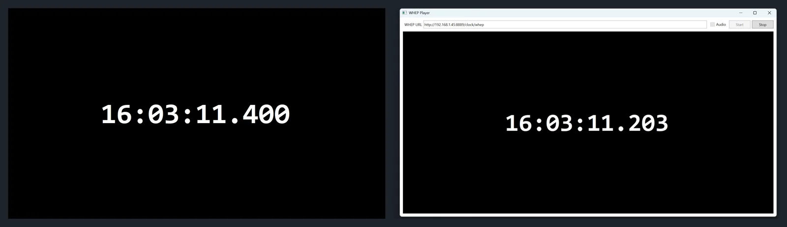
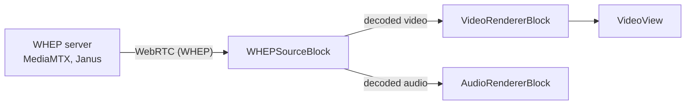

# Play a WebRTC Stream over WHEP in C# WPF

[Media Blocks SDK .NET](https://www.visioforge.com/media-blocks-sdk-net){ .md-button .md-button--primary target="_blank" }

!!! info "Demo Samples"
    The code of this guide is the [whep-player-wpf](https://github.com/visioforge/.Net-SDK-s-samples/tree/master/Media%20Blocks%20SDK/_VideoTutorials/whep-player-wpf) sample. The [WHEP Player Demo (WPF)](https://github.com/visioforge/.Net-SDK-s-samples/tree/master/Media%20Blocks%20SDK/WPF/CSharp/WHEP%20Player%20Demo) is the same player with a status line under the video.

    The block reference is in [Source blocks → WHEP Source Block](../Sources/index.md#whep-source-block).

## What You Will Build

A WPF application that plays a WebRTC stream from any WHEP URL: enter the URL, click **Start**, and the video plays with a latency well under a second. Audio plays too when the stream has it, and the SDK's errors appear in the title bar.

WHEP (WebRTC-HTTP Egress Protocol) sets up a WebRTC session with one HTTP request, so a player needs only a URL. MediaMTX, Janus, Cloudflare Stream and other servers speak it.



The picture is the finished app at work: on the left, a clock running on this computer, captured and published to a MediaMTX server on the network; on the right, the player shows that stream. The gap between the two clocks is the latency.



## Prerequisites

- Windows 10 or 11, Visual Studio 2026, .NET 10.
- Media Blocks SDK .NET 2026.11.23 or later. That release fixes the playback of a video-only stream from MediaMTX: before it, the server refused the session with `codecs not supported by client`.
- A WHEP server with a stream on it. The examples use [MediaMTX](https://github.com/bluenviron/mediamtx), a free media server: publish a stream to it over RTSP, RTMP, SRT or WHIP, and it serves the stream over WHEP at `http://<server>:8889/<stream name>/whep`.

NuGet packages:

- [VisioForge.DotNet.MediaBlocks](https://www.nuget.org/packages/VisioForge.DotNet.MediaBlocks/) — the SDK
- [VisioForge.CrossPlatform.Core.Windows.x64](https://www.nuget.org/packages/VisioForge.CrossPlatform.Core.Windows.x64/) — the GStreamer runtime the blocks run on, with the WebRTC stack and the video and audio decoders
- [VisioForge.CrossPlatform.Core.Windows.Adds.x64](https://www.nuget.org/packages/VisioForge.CrossPlatform.Core.Windows.Adds.x64/) — the additional plugins, the WHEP client among them

## Create the Project

Create a **WPF Application** for C# on .NET 10 named `WhepPlayerWpf`, then add the packages:

```bash
dotnet add package VisioForge.DotNet.MediaBlocks
dotnet add package VisioForge.CrossPlatform.Core.Windows.x64
dotnet add package VisioForge.CrossPlatform.Core.Windows.Adds.x64
```

The runtime packages are 64-bit, so build the app for x64. In the project file:

```xml
<PropertyGroup>
  <OutputType>WinExe</OutputType>
  <TargetFramework>net10.0-windows</TargetFramework>
  <PlatformTarget>x64</PlatformTarget>
  <UseWPF>true</UseWPF>
  <Nullable>disable</Nullable>
  <ImplicitUsings>enable</ImplicitUsings>
</PropertyGroup>
```

## The Window

`MainWindow.xaml`: a bar with the URL, an **Audio** check box and the **Start** and **Stop** buttons, and the SDK's `VideoView` under it. The window starts disabled; it is enabled once the SDK has loaded.

```xml
<Window x:Class="WhepPlayerWpf.MainWindow"
        xmlns="http://schemas.microsoft.com/winfx/2006/xaml/presentation"
        xmlns:x="http://schemas.microsoft.com/winfx/2006/xaml"
        xmlns:vf="clr-namespace:VisioForge.Core.UI.WPF;assembly=VisioForge.Core"
        Title="WHEP Player" Height="600" Width="900" IsEnabled="False"
        Loaded="Window_Loaded" Closing="Window_Closing">
    <DockPanel Margin="10">
        <DockPanel DockPanel.Dock="Top" Margin="0,0,0,10">
            <Label DockPanel.Dock="Left" Content="WHEP URL" VerticalAlignment="Center" />
            <Button x:Name="btStop" DockPanel.Dock="Right" Content="Stop" Width="70" Margin="5,0,0,0"
                    IsEnabled="False" Click="btStop_Click" />
            <Button x:Name="btStart" DockPanel.Dock="Right" Content="Start" Width="70" Margin="5,0,0,0"
                    Click="btStart_Click" />
            <CheckBox x:Name="cbAudio" DockPanel.Dock="Right" Content="Audio" VerticalAlignment="Center"
                      Margin="10,0,5,0" />
            <TextBox x:Name="edURL" VerticalContentAlignment="Center"
                     Text="http://localhost:8889/mystream/whep" />
        </DockPanel>
        <vf:VideoView x:Name="VideoView1" Background="Black" />
    </DockPanel>
</Window>
```

## The Code

`MainWindow.xaml.cs`, complete:

```csharp
using System.ComponentModel;
using System.Windows;
using VisioForge.Core;
using VisioForge.Core.MediaBlocks;
using VisioForge.Core.MediaBlocks.AudioRendering;
using VisioForge.Core.MediaBlocks.Sources;
using VisioForge.Core.MediaBlocks.VideoRendering;
using VisioForge.Core.Types.X.Sources;

namespace WhepPlayerWpf;

public partial class MainWindow : Window
{
    private MediaBlocksPipeline _pipeline;

    public MainWindow()
    {
        InitializeComponent();
    }

    private async void Window_Loaded(object sender, RoutedEventArgs e)
    {
        await VisioForgeX.InitSDKAsync();

        if (!WHEPSourceBlock.IsAvailable())
        {
            Title = "No WHEP source: add the VisioForge.CrossPlatform.Core.Windows.Adds.x64 package";
            btStart.IsEnabled = false;
            cbAudio.IsEnabled = false;
        }

        IsEnabled = true;
    }

    private async void btStart_Click(object sender, RoutedEventArgs e)
    {
        Title = "WHEP Player";
        IsEnabled = false; // no clicks, and no close, until it has started

        _pipeline = new MediaBlocksPipeline();

        // Show SDK errors in the title bar, also those the server sends after Start (a wrong path, a refused track)
        _pipeline.OnError += (_, args) => Dispatcher.InvokeAsync(() => Title = args.Message);

        // Video is always asked for; audio only when the stream has it: the server refuses a track it does not send
        var audio = cbAudio.IsChecked == true;
        var source = new WHEPSourceBlock(new WHEPSourceSettings
        {
            Location = edURL.Text.Trim(),
            AudioEnabled = audio,
        });

        // IsSync = false: play each frame the moment it arrives, the lowest latency, at the cost of lip sync
        var video = new VideoRendererBlock(_pipeline, VideoView1) { IsSync = false };
        _pipeline.Connect(source.VideoOutput, video.Input);

        if (audio)
        {
            var speakers = new AudioRendererBlock { IsSync = false };
            _pipeline.Connect(source.AudioOutput, speakers.Input);
        }

        var started = await _pipeline.StartAsync();
        if (!started) await StopAsync();

        btStart.IsEnabled = !started;
        cbAudio.IsEnabled = !started;
        btStop.IsEnabled = started;
        IsEnabled = true;
    }

    private async Task StopAsync()
    {
        await _pipeline.StopAsync();
        await _pipeline.DisposeAsync();
        _pipeline = null;
    }

    private async void btStop_Click(object sender, RoutedEventArgs e)
    {
        IsEnabled = false;
        await StopAsync();
        btStop.IsEnabled = false;
        btStart.IsEnabled = true;
        cbAudio.IsEnabled = true;
        IsEnabled = true;
    }

    private async void Window_Closing(object sender, CancelEventArgs e)
    {
        if (IsEnabled && _pipeline == null)
        {
            VisioForgeX.DestroySDK();
            return;
        }

        e.Cancel = true; // busy, or still playing: stop first
        if (!IsEnabled) return; // loading, starting or stopping: close again after
        IsEnabled = false;

        if (_pipeline != null) await StopAsync();

        IsEnabled = true;
        await Dispatcher.InvokeAsync(Close); // not Close(): WPF throws inside Closing
    }
}
```

What each part does:

- **`VisioForgeX.InitSDKAsync`** loads the SDK and its GStreamer runtime once, when the window opens. **`WHEPSourceBlock.IsAvailable()`** then tells whether the WHEP client is there: without the `Adds` package it is not, the title bar says so, and **Start** stays disabled.
- **`WHEPSourceBlock`** does the WebRTC work: it posts the WHEP request to `Location`, connects over ICE, and decodes the video and audio it receives. Its `VideoOutput` and `AudioOutput` carry decoded frames and samples.
- **`AudioEnabled`** decides whether the block asks the server for audio. A stream with no audio track must be played with it off: MediaMTX refuses a session that asks for a track the stream does not have, and `OnError` reports `codecs not supported by client`. `AudioEnabled` defaults to `true`, so the sample sets it from the **Audio** check box, off by default.
- **`IsSync = false`** on both renderers shows each frame and plays each sample the moment it arrives, instead of holding it for its time on the pipeline clock. That keeps the latency at its lowest, at the cost of exact lip sync.
- **`OnError`** is raised on a GStreamer thread, so the handler marshals to the UI thread with `Dispatcher.InvokeAsync`. It reports errors the server sends after `StartAsync` returned too: a path with nothing published on it, or a refused track.
- **`StopAsync` and `DisposeAsync`** end the WebRTC session and release the pipeline. **`Window_Closing`** cancels a close while the player plays, stops the pipeline, and closes again; on that second pass the SDK is released with `VisioForgeX.DestroySDK()`. A close while the SDK loads, starts or stops is ignored: close the window again once it is enabled.

## Run It and Measure the Latency

Run the app, type the WHEP URL — on MediaMTX, `http://<server>:8889/<stream name>/whep` — and click **Start**.

To see the latency, publish a clock: the picture at the top of this guide shows a millisecond clock captured on one computer, encoded to H.264 with `x264` at its zero-latency tuning, published to MediaMTX over RTSP, and played back by this app next to the original. The right clock ran about 0.2 seconds behind the left one. The figure includes the capture, the encoder, the server, the network, the decoder and the display.

Published straight from a WHIP source instead, the WHEP Player Demo measured 71 ms median with H.264 and 93 ms with VP8 on a local network (see [Low-latency playback](../Sources/index.md#low-latency-playback)).

## Troubleshooting

| Symptom | Cause and fix |
| --- | --- |
| The title bar says `No WHEP source`, **Start** is disabled | The `VisioForge.CrossPlatform.Core.Windows.Adds.x64` package is not referenced. Add it. |
| The title bar says `codecs not supported by client` | The player asked for a track the stream does not have, usually audio. Turn **Audio** off for a video-only stream. |
| The title bar shows an HTTP error such as `404` | Nothing is published on that path, or the URL is wrong. On MediaMTX the URL ends with `/<stream name>/whep`. |
| **Start** succeeds but the video stays black | The WebRTC media does not get through: allow the app through Windows Defender Firewall, and on MediaMTX the server's WebRTC UDP port (8189). Across networks, set `StunServer` or `TurnServer` in `WHEPSourceSettings`. |
| Audio and video drift apart | `IsSync = false` plays each stream as it arrives. Set `IsSync = true` on both renderers for lip sync, at the cost of a higher latency. |

## Frequently Asked Questions

### Which servers does it play from?

Any server that publishes over WHEP: MediaMTX, Janus, Cloudflare Stream and others. For servers that need a token, set `AuthToken` in `WHEPSourceSettings`; it is sent as `Authorization: Bearer`.

### Does it run outside Windows?

`WHEPSourceBlock` runs on Windows, macOS and Linux with the platform's `Adds` package (on Linux also with the distribution's `gstreamer1.0-plugins-bad` and `gstreamer1.0-nice`), and on iOS with `VisioForge.CrossPlatform.Core.iOS` 2026.11.23 or later. This guide's UI is WPF; the pipeline code is the same on every platform.

### Can I record the stream while it plays?

Yes. Put a `TeeBlock` after the source's `VideoOutput`, connect one output to the renderer and the other to an encoder and a file sink. `MediaBlocksPipeline.StopAsync` finalizes the file.

### How do I publish a stream from C# to a WHEP server?

With `WHIPSinkBlock`: see [Screen or Camera to a Browser over WebRTC](webrtc-whip.md). To serve RTSP cameras to browsers over WHEP without a media server, see [RTSP Cameras in a Browser with WHEP](rtsp-cameras-in-browser-whep.md).

## See Also

- [Source blocks → WHEP Source Block](../Sources/index.md#whep-source-block) — `WHEPSourceBlock` and `WHEPSourceSettings` reference
- [Screen or Camera to a Browser over WebRTC](webrtc-whip.md) — publishing over WHIP and straight to browsers
- [RTSP Cameras in a Browser with WHEP](rtsp-cameras-in-browser-whep.md) — IP cameras on a web page
- [RTSP Stream Viewer](rtsp-player-csharp.md) — the same kind of player for RTSP cameras
