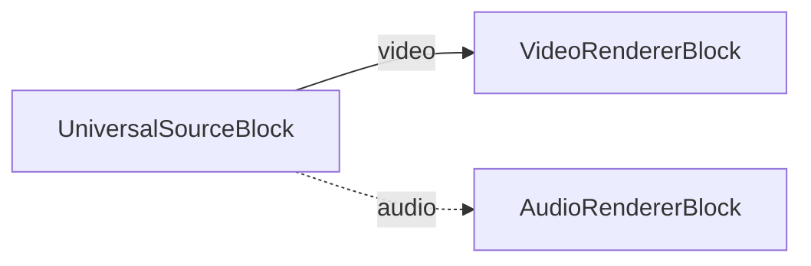

# Reproducción de video en reversa en C# y .NET

En Media Player SDK .NET y Media Blocks SDK .NET, la reproducción en reversa es una velocidad de reproducción negativa. `Rate_SetAsync(-1.0)` reproduce el archivo hacia atrás desde la posición actual hasta su inicio a velocidad normal; `-2.0` lo reproduce hacia atrás al doble de velocidad y `-0.5` a la mitad. La misma llamada funciona en `MediaPlayerCoreX` y en un `MediaBlocksPipeline`. Los fragmentos de interfaz de abajo usan WPF.

La reproducción en reversa necesita una fuente con búsqueda: un archivo multimedia, no una transmisión en vivo como una cámara o RTSP.

## Reproducción en reversa con MediaPlayerCoreX

### Abrir, reproducir y luego invertir

```cs
using System.Diagnostics;
using VisioForge.Core;
using VisioForge.Core.MediaPlayerX;

// Un campo de la ventana
private MediaPlayerCoreX player;

// En el manejador Loaded de la ventana
await VisioForgeX.InitSDKAsync(); // una vez por aplicación

player = new MediaPlayerCoreX(VideoView1);
player.OnError += (_, e) => Debug.WriteLine(e.Message);

await player.OpenAsync(@"C:\Videos\sample.mp4");
await player.PlayAsync();
```

Cambie a reversa mientras el archivo se reproduce, por ejemplo desde un botón:

```cs
private async void btReverse_Click(object sender, RoutedEventArgs e)
{
    // Reproduce hacia atrás desde la posición actual hasta el inicio del archivo
    await player.Rate_SetAsync(-1.0);
}
```

`Rate_SetAsync` devuelve `false` y genera `OnError` cuando no puede aplicar la velocidad. El SDK impone tres reglas:

- **La reversa se establece una vez iniciada la reproducción.** Mientras el archivo no se reproduce (después de `OpenAsync` y antes de `PlayAsync`, o en pausa al final por `PauseOnStop`), se rechaza una velocidad negativa; solo una velocidad positiva se guarda para el siguiente inicio.
- **El cambio de velocidad necesita una posición.** Justo después de `PlayAsync` es posible que el pipeline aún no informe ninguna, así que llámelo cuando la reproducción ya esté en marcha, no en la línea siguiente a `PlayAsync`.
- **Cada archivo empieza a 1.0.** Después de `StopAsync`, o del final del archivo sin `PauseOnStop`, se rechaza cualquier velocidad hasta el siguiente `OpenAsync`; establézcala de nuevo después.

### Reproducir todo el archivo hacia atrás desde el final

La reversa se reproduce desde la posición actual. Para reproducir todo el archivo hacia atrás, active la velocidad negativa y luego busque el final. Una búsqueda hecha con la velocidad negativa reproduce desde esa posición hasta el inicio. Busque solo si la velocidad se aplicó; de lo contrario, la búsqueda va hacia adelante hasta el final y la reproducción termina de inmediato:

```cs
if (await player.Rate_SetAsync(-1.0))
{
    await player.Position_SetAsync(await player.DurationAsync());
}
```

### Velocidad de la reversa y vuelta hacia adelante

```cs
// Al doble de velocidad, hacia atrás
await player.Rate_SetAsync(-2.0);

// A media velocidad, hacia atrás (cámara lenta)
await player.Rate_SetAsync(-0.5);

// De vuelta a la reproducción normal hacia adelante desde la posición actual
await player.Rate_SetAsync(1.0);

// Qué dirección se está reproduciendo ahora
bool isReverse = await player.Rate_GetAsync() < 0;
```

Una velocidad de `0` se rechaza; use `PauseAsync` para detener la imagen.

### La posición y el inicio del archivo

`MediaPlayerCoreX` no genera ningún evento de posición. Lea la posición con un temporizador, igual que en la reproducción hacia adelante:

```cs
// Un campo de la ventana
private readonly DispatcherTimer _timer = new() { Interval = TimeSpan.FromMilliseconds(500) };

// En el constructor de la ventana o en su manejador Loaded
_timer.Tick += async (_, _) =>
{
    var position = await player.Position_GetAsync();
    var duration = await player.DurationAsync();
    lbTime.Text = $"{position:hh\\:mm\\:ss} / {duration:hh\\:mm\\:ss}";
};
```

Llame a `_timer.Start()` después de `PlayAsync`. Cuando la reproducción en reversa llega al inicio del archivo, termina igual que al final de una reproducción hacia adelante y se genera `OnStop`:

```cs
player.OnStop += (_, _) => Dispatcher.InvokeAsync(() =>
{
    _timer.Stop();
    btPlay.IsEnabled = true;
});
```

Con `PauseOnStop = true` el reproductor se pausa en el primer fotograma en lugar de detenerse, y genera `OnPause` en lugar de `OnStop`. Llame a `ResumeAsync` para reproducir el archivo de nuevo; `PlayAsync` cerraría el archivo.

### Avanzar fotograma a fotograma en reversa

Dos métodos se mueven exactamente un fotograma. Ambos pausan la reproducción primero y solo funcionan con archivos:

| Método | Reproducción hacia adelante | Reproducción en reversa |
| --- | --- | --- |
| `NextFrame()` | un fotograma hacia adelante | un fotograma **atrás**, se mantiene la velocidad negativa |
| `PrevFrame()` | un fotograma **atrás**, la velocidad pasa a 1.0 | un fotograma hacia adelante, se mantiene la velocidad negativa |

```cs
// Un fotograma atrás mientras el archivo se reproduce hacia adelante
player.PrevFrame();

// Seguir retrocediendo: establezca la velocidad negativa una vez y retroceda fotograma a fotograma
await player.Rate_SetAsync(-1.0);
player.NextFrame();
player.NextFrame();

// Avanzar por fotogramas deja la reproducción en pausa; reanúdela para continuar
await player.ResumeAsync();
```

`NextFrame` necesita un renderizador de video (un `VideoView`). `PrevFrame` busca el fotograma anterior y espera la búsqueda en el hilo que lo llama, hasta un segundo, por lo que es más lento, y su precisión depende del códec y de la distancia entre fotogramas clave. Desde el manejador de un botón, llámelo como `await Task.Run(player.PrevFrame);` para que la ventana siga respondiendo.

## Reproducción en reversa con Media Blocks

Un `MediaBlocksPipeline` acepta las mismas llamadas de velocidad. Construya un pipeline de reproducción, inícielo y establezca una velocidad negativa mientras se ejecuta:



```cs
using System.Diagnostics;
using VisioForge.Core;
using VisioForge.Core.MediaBlocks;
using VisioForge.Core.MediaBlocks.AudioRendering;
using VisioForge.Core.MediaBlocks.Sources;
using VisioForge.Core.MediaBlocks.VideoRendering;
using VisioForge.Core.Types.X.Sources;

// Un campo de la ventana
private MediaBlocksPipeline pipeline;

// En el manejador Loaded de la ventana
await VisioForgeX.InitSDKAsync(); // una vez por aplicación

pipeline = new MediaBlocksPipeline();
pipeline.OnError += (_, e) => Debug.WriteLine(e.Message);
pipeline.OnStop += (_, _) => Debug.WriteLine("Reached the start of the file");

var sourceSettings = await UniversalSourceSettings.CreateAsync(@"C:\Videos\sample.mp4");
var fileSource = new UniversalSourceBlock(sourceSettings);

var videoRenderer = new VideoRendererBlock(pipeline, VideoView1);
pipeline.Connect(fileSource.VideoOutput, videoRenderer.Input);

// Un archivo sin audio no tiene AudioOutput
if (fileSource.AudioOutput != null)
{
    var audioRenderer = new AudioRendererBlock();
    pipeline.Connect(fileSource.AudioOutput, audioRenderer.Input);
}

await pipeline.StartAsync();
```

Luego, una vez que se reproduce (por ejemplo desde un botón, no en la línea siguiente a `StartAsync`):

```cs
// Hacia atrás desde la posición actual
await pipeline.Rate_SetAsync(-1.0);
```

Para reproducir todo el archivo hacia atrás, busque el final cuando la velocidad negativa esté activa:

```cs
if (await pipeline.Rate_SetAsync(-1.0))
{
    await pipeline.Position_SetAsync(await pipeline.DurationAsync());
}
```

Retroceda un fotograma y vuelva hacia adelante:

```cs
// Un fotograma atrás durante la reproducción en reversa (pausa primero)
pipeline.NextFrame();

// De nuevo hacia adelante: el paso dejó el pipeline en pausa, así que reanúdelo
await pipeline.Rate_SetAsync(1.0);
await pipeline.ResumeAsync();
```

Igual que en `MediaPlayerCoreX`, la velocidad negativa se establece después de `StartAsync` y la búsqueda del final solo se hace cuando se aplicó, `OnStop` se genera al inicio del archivo y `NextFrame` necesita el `VideoRendererBlock`. A diferencia del reproductor, una velocidad positiva establecida después de una detención se aplica en el siguiente `StartAsync`. El pipeline no tiene `PrevFrame`; pertenece a `MediaPlayerCoreX`.

Cuando se cierre la ventana, libere el motor y luego el SDK:

```cs
// MediaPlayerCoreX: Dispose detiene primero la reproducción
player.Dispose();

// MediaBlocksPipeline
await pipeline.StopAsync();
await pipeline.DisposeAsync();

// Una vez por aplicación, después de liberar el último motor
VisioForgeX.DestroySDK();
```

## Windows: fotogramas en reversa con MediaPlayerCore

El motor `MediaPlayerCore` de Windows (DirectShow) retrocede a través de una caché de fotogramas decodificados en lugar de usar una velocidad negativa. Mientras la reproducción en reversa está activada, los fotogramas que se reproducen se guardan en la caché; la función requiere la edición Professional.

```cs
using VisioForge.Core.MediaPlayer;

// MediaPlayer1 es un MediaPlayerCore; número de fotogramas decodificados guardados para retroceder
MediaPlayer1.ReversePlayback_CacheSize = 100;
MediaPlayer1.ReversePlayback_Enabled = true;
```

Cuando ya se hayan reproducido algunos fotogramas, recorra la caché. Cada llamada pausa la reproducción primero:

```cs
MediaPlayer1.ReversePlayback_PreviousFrame();
MediaPlayer1.ReversePlayback_NextFrame();

// Saltar a un fotograma de la caché; 0 es el más antiguo
MediaPlayer1.ReversePlayback_GoToFrame(50);

// De vuelta a la reproducción normal: libera la caché y reanuda si está en pausa
MediaPlayer1.ReversePlayback_Enabled = false;
```

Una caché más grande le permite retroceder más y usa más memoria, que crece con la resolución del video.

## Paquetes necesarios

Para una aplicación Windows x64:

```xml
<!-- MediaPlayerCoreX; for Media Blocks use VisioForge.DotNet.MediaBlocks instead -->
<PackageReference Include="VisioForge.DotNet.MediaPlayer" Version="[2026.11.13]" />
<PackageReference Include="VisioForge.CrossPlatform.Core.Windows.x64" Version="[2026.11.12]" />
<PackageReference Include="VisioForge.CrossPlatform.Libav.Windows.x64" Version="[2026.11.12]" />

<!-- MediaPlayerCore -->
<PackageReference Include="VisioForge.DotNet.Core" Version="[2026.11.13]" />
<PackageReference Include="VisioForge.DotNet.Core.Redist.MediaPlayer.x64" Version="[2026.11.13]" />
<PackageReference Include="VisioForge.DotNet.Core.Redist.LAV.x64" Version="[2026.11.13]" />
```

Las demás plataformas usan sus propios redistribuibles: consulte [Implementación multiplataforma](../../deployment-x/index.md) e [Implementación de Media Player SDK](../deployment.md).

## Aplicaciones de ejemplo

- **[Simple Media Player (Media Player SDK X, Avalonia)](https://github.com/visioforge/.Net-SDK-s-samples/tree/master/Media%20Player%20SDK%20X/Avalonia/Simple%20Media%20Player)** — `MediaPlayerCoreX` con velocidad de reproducción y avance fotograma a fotograma.
- **[Simple Player Demo WPF (Media Blocks SDK)](https://github.com/visioforge/.Net-SDK-s-samples/tree/master/Media%20Blocks%20SDK/WPF/CSharp/Simple%20Player%20Demo%20WPF)** — un pipeline de reproducción construido con bloques.
- **[Main Demo (Media Player SDK, WPF)](https://github.com/visioforge/.Net-SDK-s-samples/tree/master/Media%20Player%20SDK/WPF/CSharp/Main%20Demo)** — `MediaPlayerCore` con la caché de fotogramas para la reversa.
