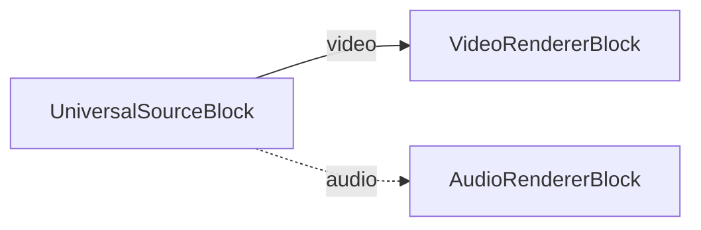

# Reproducción de video en reversa en C# y .NET

En Media Player SDK .NET y Media Blocks SDK .NET, la reproducción en reversa es una velocidad de reproducción negativa. `Rate_SetAsync(-1.0)` reproduce el archivo hacia atrás desde la posición actual hasta su inicio a velocidad normal; `-2.0` lo reproduce hacia atrás al doble de velocidad y `-0.5` a la mitad. La misma llamada funciona en `MediaPlayerCoreX` y en un `MediaBlocksPipeline`. Los fragmentos de interfaz de abajo usan WPF.

La reproducción en reversa necesita una fuente con búsqueda: un archivo multimedia, no una transmisión en vivo como una cámara o RTSP.

## Tutorial de YouTube

<div class="video-wrapper">
  <iframe src="https://www.youtube.com/embed/70NC7wAvehw?controls=1" title="Reproducir un video en reversa en C# WPF - tutorial de YouTube" frameborder="0" allowfullscreen></iframe>
</div>

[Código fuente en GitHub](https://github.com/visioforge/.Net-SDK-s-samples/tree/master/Media%20Player%20SDK%20X/_VideoTutorials/reverse-playback-csharp-wpf)

La película del video es [Big Buck Bunny](https://peach.blender.org/) (c) Blender Foundation, con licencia [CC BY 3.0](https://creativecommons.org/licenses/by/3.0/).

El video crea el proyecto con .NET 10, que requiere Visual Studio 2026; en Visual Studio 2022, elija .NET 8 o .NET 9.

## Reproducción en reversa con MediaPlayerCoreX

### Abrir, reproducir y luego invertir

```cs
using System.Diagnostics;
using VisioForge.Core;
using VisioForge.Core.MediaPlayerX;

// Un campo de la ventana
private MediaPlayerCoreX player;

// En el manejador Loaded de la ventana
await VisioForgeX.InitSDKAsync(); // una vez por aplicación

player = new MediaPlayerCoreX(VideoView1);
player.OnError += (_, e) => Debug.WriteLine(e.Message);

await player.OpenAsync(@"C:\Videos\sample.mp4");
await player.PlayAsync();
```

Cambie a reversa mientras el archivo se reproduce, por ejemplo desde un botón:

```cs
private async void btReverse_Click(object sender, RoutedEventArgs e)
{
    // Reproduce hacia atrás desde la posición actual hasta el inicio del archivo
    await player.Rate_SetAsync(-1.0);
}
```

`Rate_SetAsync` devuelve `false` y genera `OnError` cuando no puede aplicar la velocidad. El SDK impone tres reglas:

- **La reversa se establece una vez iniciada la reproducción.** Mientras el archivo no se reproduce (después de `OpenAsync` y antes de `PlayAsync`, o en pausa al final por `PauseOnStop`), se rechaza una velocidad negativa; solo una velocidad positiva se guarda para el siguiente inicio.
- **El cambio de velocidad necesita una posición.** Justo después de `PlayAsync` es posible que el pipeline aún no informe ninguna, así que llámelo cuando la reproducción ya esté en marcha, no en la línea siguiente a `PlayAsync`.
- **Cada archivo empieza a 1.0.** Después de `StopAsync`, o del final del archivo sin `PauseOnStop`, se rechaza cualquier velocidad hasta el siguiente `OpenAsync`; establézcala de nuevo después.

### Reproducir todo el archivo hacia atrás desde el final

La reversa se reproduce desde la posición actual. Para reproducir todo el archivo hacia atrás, active la velocidad negativa y luego busque el final. Una búsqueda hecha con la velocidad negativa reproduce desde esa posición hasta el inicio. Busque solo si la velocidad se aplicó; de lo contrario, la búsqueda va hacia adelante hasta el final y la reproducción termina de inmediato:

```cs
if (await player.Rate_SetAsync(-1.0))
{
    await player.Position_SetAsync(await player.DurationAsync());
}
```

### Velocidad de la reversa y vuelta hacia adelante

```cs
// Al doble de velocidad, hacia atrás
await player.Rate_SetAsync(-2.0);

// A media velocidad, hacia atrás (cámara lenta)
await player.Rate_SetAsync(-0.5);

// De vuelta a la reproducción normal hacia adelante desde la posición actual
await player.Rate_SetAsync(1.0);

// Qué dirección se está reproduciendo ahora
bool isReverse = await player.Rate_GetAsync() < 0;
```

Una velocidad de `0` se rechaza; use `PauseAsync` para detener la imagen.

### La posición y el inicio del archivo

`MediaPlayerCoreX` no genera ningún evento de posición. Lea la posición con un temporizador, igual que en la reproducción hacia adelante:

```cs
// Un campo de la ventana
private readonly DispatcherTimer _timer = new() { Interval = TimeSpan.FromMilliseconds(500) };

// En el constructor de la ventana o en su manejador Loaded
_timer.Tick += async (_, _) =>
{
    var position = await player.Position_GetAsync();
    var duration = await player.DurationAsync();
    lbTime.Text = $"{position:hh\\:mm\\:ss} / {duration:hh\\:mm\\:ss}";
};
```

Llame a `_timer.Start()` después de `PlayAsync`. Cuando la reproducción en reversa llega al inicio del archivo, termina igual que al final de una reproducción hacia adelante y se genera `OnStop`:

```cs
player.OnStop += (_, _) => Dispatcher.InvokeAsync(() =>
{
    _timer.Stop();
    btPlay.IsEnabled = true;
});
```

Con `PauseOnStop = true` el reproductor se pausa en el primer fotograma en lugar de detenerse, y genera `OnPause` en lugar de `OnStop`. Llame a `ResumeAsync` para reproducir el archivo de nuevo; `PlayAsync` cerraría el archivo.

### Avanzar fotograma a fotograma en reversa

Dos métodos se mueven exactamente un fotograma. Ambos pausan la reproducción primero y solo funcionan con archivos:

| Método | Reproducción hacia adelante | Reproducción en reversa |
| --- | --- | --- |
| `NextFrame()` | un fotograma hacia adelante | un fotograma **atrás**, se mantiene la velocidad negativa |
| `PrevFrame()` | un fotograma **atrás**, la velocidad pasa a 1.0 | un fotograma hacia adelante, se mantiene la velocidad negativa |

```cs
// Un fotograma atrás mientras el archivo se reproduce hacia adelante
player.PrevFrame();

// Seguir retrocediendo: establezca la velocidad negativa una vez y retroceda fotograma a fotograma
await player.Rate_SetAsync(-1.0);
player.NextFrame();
player.NextFrame();

// Avanzar por fotogramas deja la reproducción en pausa; reanúdela para continuar
await player.ResumeAsync();
```

`NextFrame` necesita un renderizador de video (un `VideoView`). `PrevFrame` busca el fotograma anterior y espera la búsqueda en el hilo que lo llama, hasta un segundo, por lo que es más lento, y su precisión depende del códec y de la distancia entre fotogramas clave. Desde el manejador de un botón, llámelo como `await Task.Run(player.PrevFrame);` para que la ventana siga respondiendo.

## Reproducción en reversa con Media Blocks

Un `MediaBlocksPipeline` acepta las mismas llamadas de velocidad. Construya un pipeline de reproducción, inícielo y establezca una velocidad negativa mientras se ejecuta:



```cs
using System.Diagnostics;
using VisioForge.Core;
using VisioForge.Core.MediaBlocks;
using VisioForge.Core.MediaBlocks.AudioRendering;
using VisioForge.Core.MediaBlocks.Sources;
using VisioForge.Core.MediaBlocks.VideoRendering;
using VisioForge.Core.Types.X.Sources;

// Un campo de la ventana
private MediaBlocksPipeline pipeline;

// En el manejador Loaded de la ventana
await VisioForgeX.InitSDKAsync(); // una vez por aplicación

pipeline = new MediaBlocksPipeline();
pipeline.OnError += (_, e) => Debug.WriteLine(e.Message);
pipeline.OnStop += (_, _) => Debug.WriteLine("Reached the start of the file");

var sourceSettings = await UniversalSourceSettings.CreateAsync(@"C:\Videos\sample.mp4");
var fileSource = new UniversalSourceBlock(sourceSettings);

var videoRenderer = new VideoRendererBlock(pipeline, VideoView1);
pipeline.Connect(fileSource.VideoOutput, videoRenderer.Input);

// Un archivo sin audio no tiene AudioOutput
if (fileSource.AudioOutput != null)
{
    var audioRenderer = new AudioRendererBlock();
    pipeline.Connect(fileSource.AudioOutput, audioRenderer.Input);
}

await pipeline.StartAsync();
```

Luego, una vez que se reproduce (por ejemplo desde un botón, no en la línea siguiente a `StartAsync`):

```cs
// Hacia atrás desde la posición actual
await pipeline.Rate_SetAsync(-1.0);
```

Para reproducir todo el archivo hacia atrás, busque el final cuando la velocidad negativa esté activa:

```cs
if (await pipeline.Rate_SetAsync(-1.0))
{
    await pipeline.Position_SetAsync(await pipeline.DurationAsync());
}
```

Retroceda un fotograma y vuelva hacia adelante:

```cs
// Un fotograma atrás durante la reproducción en reversa (pausa primero)
pipeline.NextFrame();

// De nuevo hacia adelante: el paso dejó el pipeline en pausa, así que reanúdelo
await pipeline.Rate_SetAsync(1.0);
await pipeline.ResumeAsync();
```

Igual que en `MediaPlayerCoreX`, la velocidad negativa se establece después de `StartAsync` y la búsqueda del final solo se hace cuando se aplicó, `OnStop` se genera al inicio del archivo y `NextFrame` necesita el `VideoRendererBlock`. A diferencia del reproductor, una velocidad positiva establecida después de una detención se aplica en el siguiente `StartAsync`. El pipeline no tiene `PrevFrame`; pertenece a `MediaPlayerCoreX`.

Cuando se cierre la ventana, libere el motor y luego el SDK:

```cs
// MediaPlayerCoreX: Dispose detiene primero la reproducción
player.Dispose();

// MediaBlocksPipeline
await pipeline.StopAsync();
await pipeline.DisposeAsync();

// Una vez por aplicación, después de liberar el último motor
VisioForgeX.DestroySDK();
```

## Windows: fotogramas en reversa con MediaPlayerCore

El motor `MediaPlayerCore` de Windows (DirectShow) retrocede a través de una caché de fotogramas decodificados en lugar de usar una velocidad negativa. Mientras la reproducción en reversa está activada, los fotogramas que se reproducen se guardan en la caché; la función requiere la edición Professional.

```cs
using VisioForge.Core.MediaPlayer;

// MediaPlayer1 es un MediaPlayerCore; número de fotogramas decodificados guardados para retroceder
MediaPlayer1.ReversePlayback_CacheSize = 100;
MediaPlayer1.ReversePlayback_Enabled = true;
```

Cuando ya se hayan reproducido algunos fotogramas, recorra la caché. Cada llamada pausa la reproducción primero:

```cs
MediaPlayer1.ReversePlayback_PreviousFrame();
MediaPlayer1.ReversePlayback_NextFrame();

// Saltar a un fotograma de la caché; 0 es el más antiguo
MediaPlayer1.ReversePlayback_GoToFrame(50);

// De vuelta a la reproducción normal: libera la caché y reanuda si está en pausa
MediaPlayer1.ReversePlayback_Enabled = false;
```

Una caché más grande le permite retroceder más y usa más memoria, que crece con la resolución del video.

## Paquetes necesarios

Para una aplicación Windows x64:

```xml
<!-- MediaPlayerCoreX; for Media Blocks use VisioForge.DotNet.MediaBlocks instead -->
<PackageReference Include="VisioForge.DotNet.MediaPlayer" Version="[2026.11.20]" />
<PackageReference Include="VisioForge.CrossPlatform.Core.Windows.x64" Version="[2026.11.16]" />
<PackageReference Include="VisioForge.CrossPlatform.Libav.Windows.x64" Version="[2026.11.16]" />

<!-- MediaPlayerCore -->
<PackageReference Include="VisioForge.DotNet.Core" Version="[2026.11.20]" />
<PackageReference Include="VisioForge.DotNet.Core.Redist.MediaPlayer.x64" Version="[2026.11.20]" />
<PackageReference Include="VisioForge.DotNet.Core.Redist.LAV.x64" Version="[2026.11.20]" />
```

Las demás plataformas usan sus propios redistribuibles: consulte [Implementación multiplataforma](../../deployment-x/index.md) e [Implementación de Media Player SDK](../deployment.md).

## Aplicaciones de ejemplo

- **[Ejemplo del tutorial de reproducción en reversa (Media Player SDK X, WPF)](https://github.com/visioforge/.Net-SDK-s-samples/tree/master/Media%20Player%20SDK%20X/_VideoTutorials/reverse-playback-csharp-wpf)** — la aplicación del video: reversa desde cualquier punto o desde el final, un control de velocidad para ambas direcciones y avance fotograma a fotograma.
- **[Simple Media Player (Media Player SDK X, Avalonia)](https://github.com/visioforge/.Net-SDK-s-samples/tree/master/Media%20Player%20SDK%20X/Avalonia/Simple%20Media%20Player)** — `MediaPlayerCoreX` con velocidad de reproducción y avance fotograma a fotograma.
- **[Simple Player Demo WPF (Media Blocks SDK)](https://github.com/visioforge/.Net-SDK-s-samples/tree/master/Media%20Blocks%20SDK/WPF/CSharp/Simple%20Player%20Demo%20WPF)** — un pipeline de reproducción construido con bloques.
- **[Main Demo (Media Player SDK, WPF)](https://github.com/visioforge/.Net-SDK-s-samples/tree/master/Media%20Player%20SDK/WPF/CSharp/Main%20Demo)** — `MediaPlayerCore` con la caché de fotogramas para la reversa.

## Transcripción del video

### Qué vamos a construir

Vamos a reproducir un video en reversa en una aplicación C# WPF, con el VisioForge Media Player SDK. Esto es lo que vamos a construir. En este SDK, la reproducción en reversa es una velocidad de reproducción negativa. El reproductor reproduce hacia atrás desde el punto actual, o todo el archivo desde su final. Un control deslizante de velocidad cambia la rapidez de reproducción, en cualquier dirección. Y un botón retrocede un fotograma cada vez. Este es el reproductor terminado, reproduciendo hacia atrás a velocidad normal. La película es Big Buck Bunny, de la Blender Foundation, con licencia Creative Commons Attribution.

### Requisitos previos

Necesita Windows 10 u 11, y Visual Studio 2026 con la carga de trabajo de desarrollo de escritorio de .NET. El proyecto es una aplicación WPF en .NET 10; en Visual Studio 2022, elija .NET 8 o .NET 9. Y un archivo de video, porque la reproducción en reversa necesita una fuente en la que se pueda buscar: un archivo, no una transmisión en vivo. El reproductor es MediaPlayerCoreX, que también funciona en macOS, Linux, Android e iOS.

### Crear un proyecto WPF

En Visual Studio, cree un proyecto nuevo. Busque WPF y elija WPF Application para C#. Llame al proyecto ReversePlaybackWpf. Elija .NET 10 y haga clic en Create. Visual Studio abre MainWindow.xaml, con el diseñador arriba y el XAML abajo.

### Añadir los paquetes NuGet

Ahora añada tres paquetes NuGet. El propio Media Player SDK. CrossPlatform Core, el runtime de GStreamer sobre el que se construye el reproductor. Y CrossPlatform Libav, con los códecs FFmpeg que decodifican la mayoría de los archivos de video. O use el NuGet Package Manager: haga clic derecho en el proyecto, Manage NuGet Packages, e instale VisioForge.DotNet.MediaPlayer desde la pestaña Browse. Después instale los paquetes Core y Libav para Windows x64. La pestaña Installed muestra los tres. Estos son los paquetes x64, así que establezca PlatformTarget en x64 en el archivo del proyecto.

### Construir la ventana en XAML

La ventana se escribe en XAML. Primero la ventana en sí, con un grid y un VideoView, y el diseñador la dibuja de inmediato. Asigne el espacio de nombres VisioForge.Core.UI.WPF a un prefijo, aquí vf. El grid tiene dos columnas, el video y una columna de ajustes de 260 píxeles, y cuatro filas: el video, el tiempo, los botones de reproducción y los botones inversos. El VideoView llena la primera celda. La ventana también nombra sus controladores Loaded y Closing. Debajo del video van el tiempo y la dirección. Dos bloques de texto. La posición y la duración a la izquierda, con centésimas de segundo, para que se vea un salto de un solo fotograma. La dirección y la velocidad a la derecha. Luego los botones de reproducción. Play, Pause, Resume y Stop, cada uno con un controlador Click. Todos empiezan desactivados: Play hasta que el SDK se haya cargado, los demás hasta que se reproduzca un archivo. La segunda fila contiene los botones inversos. Reverse reproduce hacia atrás desde donde está la película. Forward continúa hacia adelante. From the end reproduce todo el archivo hacia atrás. Y Frame back retrocede un fotograma. Por último, la columna de ajustes a la derecha. Contiene el nombre del archivo con un botón de examinar, un control deslizante de velocidad de 0.5 a 2 en pasos de 0.25, y un cuadro de texto de solo lectura para el registro de errores. Todos los controladores que nombra el XAML van en MainWindow.xaml.cs, y los próximos capítulos los escriben.

### Inicializar el SDK

MainWindow.xaml.cs empieza con estos usings: los espacios de nombres de WPF para la ventana y el temporizador, Microsoft.Win32 para el cuadro de diálogo de archivo, y los espacios de nombres de VisioForge. La ventana guarda el reproductor y un temporizador que marca cuatro veces por segundo. Cuando se carga la ventana, ejecute await VisioForgeX.InitSDKAsync una sola vez. Luego cree MediaPlayerCoreX y pásele el VideoView, donde se dibuja el video. Los errores llegan en el evento OnError, en otro hilo, así que el controlador vuelve al hilo de la interfaz y los añade al registro. OnStop se dispara después de StopAsync, y cuando la reproducción se queda sin archivo: al final yendo hacia adelante, y al principio yendo hacia atrás. El controlador actúa solo mientras Stop está activado y State es Free. Después Window_Loaded configura el temporizador y activa Play. El botón de examinar muestra un OpenFileDialog filtrado a archivos de video, y pone la ruta elegida en el cuadro del nombre de archivo.

### Abrir y reproducir

El controlador de Play desactiva los botones y borra el registro. OpenAsync abre el archivo, y PlayAsync lo reproduce hacia adelante a velocidad normal. Reverse viene después, desde su propio botón: una velocidad negativa solo se acepta cuando el archivo ya se está reproduciendo. State Free significa que el archivo no se abrió o no se reprodujo, y la ventana vuelve al estado detenido. En caso contrario los botones pasan a reproducción, y el temporizador arranca.

### Reproducir hacia atrás

Esto es toda la reproducción en reversa. Rate_SetAsync con una velocidad negativa reproduce el archivo hacia atrás, desde la posición actual hasta el principio. Menos uno es velocidad normal, menos dos el doble de rápido. Forward establece la misma velocidad, en positivo, y la película continúa hacia adelante desde el mismo punto. Cuando el control deslizante de velocidad se mueve durante la reproducción, Rate_GetAsync indica en qué dirección se reproduce la película. Una velocidad negativa significa hacia atrás, así que la nueva velocidad también se establece en negativo, y la dirección se mantiene. Para reproducir todo el archivo hacia atrás, active primero la velocidad inversa, y luego salte al final con Position_SetAsync y la duración. Un salto hecho con la velocidad negativa reproduce desde ese punto hasta el principio. Salte solo cuando la velocidad ya se haya aplicado: si no, el salto va hacia adelante hasta el final, y la reproducción termina de inmediato.

### Avanzar y retroceder fotograma a fotograma

Dos métodos se mueven un fotograma, y ambos dejan la imagen en pausa. NextFrame avanza en la dirección de la reproducción, así que mientras la película va hacia atrás, retrocede un fotograma. PrevFrame avanza contra la dirección, así que yendo hacia adelante, es el que retrocede. PrevFrame salta y espera a que termine el salto, así que se ejecuta en un hilo de trabajo con Task.Run. También restablece una velocidad hacia adelante a uno, así que el controlador vuelve a establecer la velocidad elegida.

### Pausar, reanudar y detener

Pause y Resume son una llamada cada uno, y Resume continúa en la misma dirección. Stop detiene el temporizador, desactiva los botones mientras trabaja, espera StopAsync y restablece la ventana. Pequeños métodos auxiliares configuran los botones: ShowBusy los desactiva todos, y ShowPlaying activa Play, o todos los botones de reproducción e inversos. Stopped devuelve la ventana a su estado: los botones, el tiempo y la dirección.

### Mostrar la posición y la dirección

El reproductor no genera ningún evento de posición, así que la lee el temporizador. Cada tick lee Position_GetAsync, la duración y la velocidad. Si la reproducción se detuvo entretanto, deja las etiquetas como están. En caso contrario muestra la posición con centésimas de segundo, y la dirección y la velocidad a partir del signo y el tamaño de la velocidad. Yendo hacia atrás, la posición cuenta hacia abajo.

### Cerrar la ventana

Cuando se cierra la ventana, Dispose detiene la reproducción y libera el reproductor, y DestroySDK libera el SDK. Mientras el SDK aún se carga, o un archivo se abre o se detiene, la ventana todavía no se cierra.

### Ejecutarla

Ejecute la aplicación desde Visual Studio. Una vez cargado el SDK, Play está activado. Haga clic en el botón de examinar y elija el archivo de video. Haga clic en Play. La película se reproduce hacia adelante a velocidad normal, y la etiqueta de la derecha lo indica. Arrastre la velocidad a dos. Ahora se reproduce hacia adelante al doble de velocidad; aquí se acelera aún más, para llegar al punto de la película. Haga clic en Reverse. La película se reproduce hacia atrás desde donde estaba, al doble de velocidad, y el tiempo cuenta hacia abajo. Arrastre la velocidad de nuevo a uno. La dirección se mantiene: hacia atrás, a velocidad normal. Forward continúa hacia adelante desde el mismo punto. Frame back retrocede un fotograma en cada clic, y la imagen queda en pausa. Observe las centésimas. Resume continúa la reproducción. From the end salta al final del archivo y lo reproduce hacia atrás, hacia el principio. Frame back también funciona mientras la película va hacia atrás, y Resume continúa hacia atrás. Stop restablece la ventana. Luego ciérrela.

### Errores frecuentes

Algunos errores comunes. Establecer una velocidad negativa antes de que el archivo se reproduzca: el reproductor la rechaza, así que establézcala una vez iniciada la reproducción. Saltar al final antes de activar la velocidad inversa: el archivo termina de inmediato. Probar la reproducción en reversa en una transmisión en vivo, como una cámara: necesita un archivo en el que se pueda buscar. Llamar a PrevFrame en el hilo de la interfaz, lo que congela la ventana mientras salta. Y omitir el paquete Libav, de modo que muchos formatos no se decodifican.

### Próximos pasos

También hay guías para un reproductor de video completo con línea de tiempo y volumen, para la misma reproducción en reversa en un pipeline de Media Blocks, para reproducir solo un fragmento de un archivo, y para desplegar los redists con su aplicación. El código fuente completo está en GitHub, y la documentación en visioforge.com/help. Gracias por ver el video.

## Ver también

- [Crear un reproductor de video en C#](../guides/video-player-csharp.md) — un reproductor completo con línea de tiempo, volumen y velocidad
- [Reproducción en reversa con Media Blocks](#reproduccion-en-reversa-con-media-blocks) — la misma velocidad negativa en un pipeline de Media Blocks
- [Reproducir un fragmento de un archivo](play-fragment-file.md) — reproducir solo un rango de un archivo multimedia
- [Despliegue multiplataforma](../../deployment-x/index.md) — los redistribuibles que necesita la aplicación en cada plataforma
- [Página del producto Media Player SDK .NET](https://www.visioforge.com/media-player-sdk-net)
