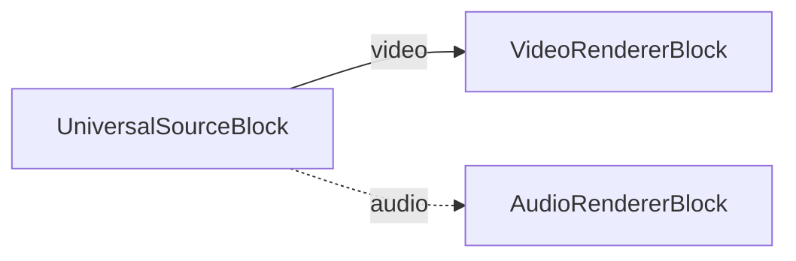

# Lecture vidéo inversée en C# et .NET

Dans Media Player SDK .NET et Media Blocks SDK .NET, la lecture inversée est une vitesse de lecture négative. `Rate_SetAsync(-1.0)` lit le fichier à l'envers depuis la position actuelle jusqu'à son début, à vitesse normale ; `-2.0` le lit à l'envers deux fois plus vite, `-0.5` à mi-vitesse. Le même appel fonctionne sur `MediaPlayerCoreX` et sur un `MediaBlocksPipeline`. Les extraits d'interface ci-dessous utilisent WPF.

La lecture inversée nécessite une source où l'on peut se déplacer : un fichier multimédia, pas un flux en direct comme une caméra ou du RTSP.

## Lecture inversée avec MediaPlayerCoreX

### Ouvrir, lire, puis inverser

```cs
using System.Diagnostics;
using VisioForge.Core;
using VisioForge.Core.MediaPlayerX;

// Un champ de la fenêtre
private MediaPlayerCoreX player;

// Dans le gestionnaire Loaded de la fenêtre
await VisioForgeX.InitSDKAsync(); // une fois par application

player = new MediaPlayerCoreX(VideoView1);
player.OnError += (_, e) => Debug.WriteLine(e.Message);

await player.OpenAsync(@"C:\Videos\sample.mp4");
await player.PlayAsync();
```

Passez en lecture inversée pendant que le fichier est lu, par exemple depuis un bouton :

```cs
private async void btReverse_Click(object sender, RoutedEventArgs e)
{
    // Lit à l'envers depuis la position actuelle jusqu'au début du fichier
    await player.Rate_SetAsync(-1.0);
}
```

`Rate_SetAsync` renvoie `false` et déclenche `OnError` lorsque la vitesse ne peut pas être appliquée. Le SDK impose trois règles :

- **L'inversion se règle une fois la lecture démarrée.** Tant que le fichier n'est pas lu (après `OpenAsync` et avant `PlayAsync`, ou en pause à la fin avec `PauseOnStop`), une vitesse négative est refusée ; seule une vitesse positive est conservée pour le prochain démarrage.
- **Le changement de vitesse a besoin d'une position.** Juste après `PlayAsync`, le pipeline peut ne pas encore en fournir : appelez-le une fois la lecture lancée, pas à la ligne qui suit `PlayAsync`.
- **Chaque fichier démarre à 1.0.** Après `StopAsync`, ou la fin du fichier sans `PauseOnStop`, toute vitesse est refusée jusqu'au prochain `OpenAsync` ; réglez-la de nouveau ensuite.

### Lire tout le fichier à l'envers depuis la fin

La lecture inversée part de la position actuelle. Pour lire tout le fichier à l'envers, activez la vitesse négative, puis placez-vous à la fin. Un déplacement effectué avec une vitesse négative lit depuis cette position jusqu'au début. Ne vous déplacez que si la vitesse a été appliquée ; sinon le déplacement va vers l'avant jusqu'à la fin et la lecture s'arrête aussitôt :

```cs
if (await player.Rate_SetAsync(-1.0))
{
    await player.Position_SetAsync(await player.DurationAsync());
}
```

### Vitesse de la lecture inversée et retour en avant

```cs
// Deux fois plus vite, à l'envers
await player.Rate_SetAsync(-2.0);

// À mi-vitesse, à l'envers (ralenti)
await player.Rate_SetAsync(-0.5);

// Retour à la lecture normale vers l'avant depuis la position actuelle
await player.Rate_SetAsync(1.0);

// Sens de lecture actuel
bool isReverse = await player.Rate_GetAsync() < 0;
```

Une vitesse de `0` est refusée ; utilisez `PauseAsync` pour figer l'image.

### Position et début du fichier

`MediaPlayerCoreX` ne déclenche aucun événement de position. Lisez la position avec une minuterie, comme pour la lecture vers l'avant :

```cs
// Un champ de la fenêtre
private readonly DispatcherTimer _timer = new() { Interval = TimeSpan.FromMilliseconds(500) };

// Dans le constructeur de la fenêtre ou son gestionnaire Loaded
_timer.Tick += async (_, _) =>
{
    var position = await player.Position_GetAsync();
    var duration = await player.DurationAsync();
    lbTime.Text = $"{position:hh\\:mm\\:ss} / {duration:hh\\:mm\\:ss}";
};
```

Appelez `_timer.Start()` après `PlayAsync`. Lorsque la lecture inversée atteint le début du fichier, elle se termine comme à la fin d'une lecture vers l'avant, et `OnStop` est déclenché :

```cs
player.OnStop += (_, _) => Dispatcher.InvokeAsync(() =>
{
    _timer.Stop();
    btPlay.IsEnabled = true;
});
```

Avec `PauseOnStop = true`, le lecteur se met en pause sur la première image au lieu de s'arrêter, et déclenche `OnPause` au lieu de `OnStop`. Appelez `ResumeAsync` pour relire le fichier ; `PlayAsync` fermerait le fichier.

### Avancer image par image en arrière

Deux méthodes se déplacent d'exactement une image. Toutes deux mettent d'abord la lecture en pause et ne fonctionnent qu'avec des fichiers :

| Méthode | Lecture vers l'avant | Lecture inversée |
| --- | --- | --- |
| `NextFrame()` | une image en avant | une image **en arrière**, la vitesse négative est conservée |
| `PrevFrame()` | une image **en arrière**, la vitesse passe à 1.0 | une image en avant, la vitesse négative est conservée |

```cs
// Une image en arrière pendant la lecture vers l'avant
player.PrevFrame();

// Continuer en arrière : réglez la vitesse négative une fois, puis reculez image par image
await player.Rate_SetAsync(-1.0);
player.NextFrame();
player.NextFrame();

// Le pas à pas laisse la lecture en pause ; reprenez-la pour continuer
await player.ResumeAsync();
```

`NextFrame` nécessite un moteur de rendu vidéo (un `VideoView`). `PrevFrame` se déplace jusqu'à l'image précédente et attend la fin du déplacement sur le thread appelant, jusqu'à une seconde ; il est donc plus lent, et sa précision dépend du codec et de l'écart entre les images clés. Depuis le gestionnaire d'un bouton, appelez-le sous la forme `await Task.Run(player.PrevFrame);` pour que la fenêtre reste réactive.

## Lecture inversée avec Media Blocks

Un `MediaBlocksPipeline` accepte les mêmes appels de vitesse. Construisez un pipeline de lecture, démarrez-le et réglez une vitesse négative pendant qu'il tourne :



```cs
using System.Diagnostics;
using VisioForge.Core;
using VisioForge.Core.MediaBlocks;
using VisioForge.Core.MediaBlocks.AudioRendering;
using VisioForge.Core.MediaBlocks.Sources;
using VisioForge.Core.MediaBlocks.VideoRendering;
using VisioForge.Core.Types.X.Sources;

// Un champ de la fenêtre
private MediaBlocksPipeline pipeline;

// Dans le gestionnaire Loaded de la fenêtre
await VisioForgeX.InitSDKAsync(); // une fois par application

pipeline = new MediaBlocksPipeline();
pipeline.OnError += (_, e) => Debug.WriteLine(e.Message);
pipeline.OnStop += (_, _) => Debug.WriteLine("Reached the start of the file");

var sourceSettings = await UniversalSourceSettings.CreateAsync(@"C:\Videos\sample.mp4");
var fileSource = new UniversalSourceBlock(sourceSettings);

var videoRenderer = new VideoRendererBlock(pipeline, VideoView1);
pipeline.Connect(fileSource.VideoOutput, videoRenderer.Input);

// Un fichier sans audio n'a pas d'AudioOutput
if (fileSource.AudioOutput != null)
{
    var audioRenderer = new AudioRendererBlock();
    pipeline.Connect(fileSource.AudioOutput, audioRenderer.Input);
}

await pipeline.StartAsync();
```

Puis, une fois la lecture lancée (par exemple depuis un bouton, pas à la ligne qui suit `StartAsync`) :

```cs
// À l'envers depuis la position actuelle
await pipeline.Rate_SetAsync(-1.0);
```

Pour lire plutôt tout le fichier à l'envers, placez-vous à la fin une fois la vitesse négative active :

```cs
if (await pipeline.Rate_SetAsync(-1.0))
{
    await pipeline.Position_SetAsync(await pipeline.DurationAsync());
}
```

Reculez d'une image, puis repartez vers l'avant :

```cs
// Une image en arrière pendant la lecture inversée (met d'abord en pause)
pipeline.NextFrame();

// De nouveau vers l'avant : le pas a laissé le pipeline en pause, reprenez-le
await pipeline.Rate_SetAsync(1.0);
await pipeline.ResumeAsync();
```

Comme avec `MediaPlayerCoreX`, la vitesse négative se règle après `StartAsync` et le déplacement à la fin n'a lieu qu'une fois qu'elle a été appliquée, `OnStop` est déclenché au début du fichier et `NextFrame` nécessite le `VideoRendererBlock`. Contrairement au lecteur, une vitesse positive réglée après un arrêt est appliquée au prochain `StartAsync`. Le pipeline n'a pas de `PrevFrame` ; cette méthode appartient à `MediaPlayerCoreX`.

À la fermeture de la fenêtre, libérez le moteur, puis le SDK :

```cs
// MediaPlayerCoreX : Dispose arrête d'abord la lecture
player.Dispose();

// MediaBlocksPipeline
await pipeline.StopAsync();
await pipeline.DisposeAsync();

// Une fois par application, après la libération du dernier moteur
VisioForgeX.DestroySDK();
```

## Windows : images en arrière avec MediaPlayerCore

Le moteur `MediaPlayerCore` de Windows (DirectShow) recule dans un cache d'images décodées au lieu d'utiliser une vitesse négative. Tant que la lecture inversée est activée, les images lues sont conservées dans le cache ; la fonction nécessite l'édition Professional.

```cs
using VisioForge.Core.MediaPlayer;

// MediaPlayer1 est un MediaPlayerCore ; nombre d'images décodées conservées pour reculer
MediaPlayer1.ReversePlayback_CacheSize = 100;
MediaPlayer1.ReversePlayback_Enabled = true;
```

Une fois quelques images lues, parcourez le cache. Chaque appel met d'abord la lecture en pause :

```cs
MediaPlayer1.ReversePlayback_PreviousFrame();
MediaPlayer1.ReversePlayback_NextFrame();

// Aller à une image du cache ; 0 est la plus ancienne
MediaPlayer1.ReversePlayback_GoToFrame(50);

// Retour à la lecture normale : libère le cache et reprend la lecture si elle est en pause
MediaPlayer1.ReversePlayback_Enabled = false;
```

Un cache plus grand permet de reculer plus loin et consomme plus de mémoire, qui augmente avec la résolution de la vidéo.

## Paquets nécessaires

Pour une application Windows x64 :

```xml
<!-- MediaPlayerCoreX; for Media Blocks use VisioForge.DotNet.MediaBlocks instead -->
<PackageReference Include="VisioForge.DotNet.MediaPlayer" Version="[2026.11.13]" />
<PackageReference Include="VisioForge.CrossPlatform.Core.Windows.x64" Version="[2026.11.12]" />
<PackageReference Include="VisioForge.CrossPlatform.Libav.Windows.x64" Version="[2026.11.12]" />

<!-- MediaPlayerCore -->
<PackageReference Include="VisioForge.DotNet.Core" Version="[2026.11.13]" />
<PackageReference Include="VisioForge.DotNet.Core.Redist.MediaPlayer.x64" Version="[2026.11.13]" />
<PackageReference Include="VisioForge.DotNet.Core.Redist.LAV.x64" Version="[2026.11.13]" />
```

Les autres plateformes utilisent leurs propres redistribuables : voir [Déploiement multiplateforme](../../deployment-x/index.md) et [Déploiement de Media Player SDK](../deployment.md).

## Applications d'exemple

- **[Simple Media Player (Media Player SDK X, Avalonia)](https://github.com/visioforge/.Net-SDK-s-samples/tree/master/Media%20Player%20SDK%20X/Avalonia/Simple%20Media%20Player)** — `MediaPlayerCoreX` avec vitesse de lecture et avance image par image.
- **[Simple Player Demo WPF (Media Blocks SDK)](https://github.com/visioforge/.Net-SDK-s-samples/tree/master/Media%20Blocks%20SDK/WPF/CSharp/Simple%20Player%20Demo%20WPF)** — un pipeline de lecture construit à partir de blocs.
- **[Main Demo (Media Player SDK, WPF)](https://github.com/visioforge/.Net-SDK-s-samples/tree/master/Media%20Player%20SDK/WPF/CSharp/Main%20Demo)** — `MediaPlayerCore` avec le cache d'images pour la lecture inversée.
