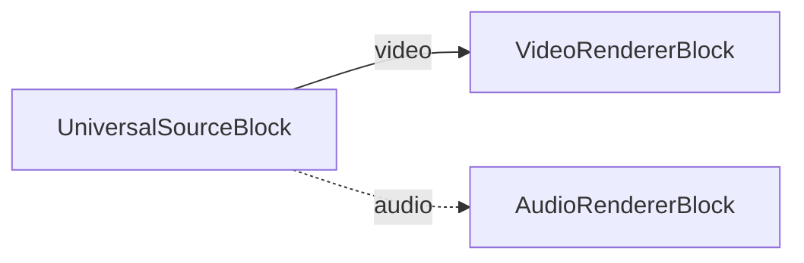

# Lecture vidéo inversée en C# et .NET

Dans Media Player SDK .NET et Media Blocks SDK .NET, la lecture inversée est une vitesse de lecture négative. `Rate_SetAsync(-1.0)` lit le fichier à l'envers depuis la position actuelle jusqu'à son début, à vitesse normale ; `-2.0` le lit à l'envers deux fois plus vite, `-0.5` à mi-vitesse. Le même appel fonctionne sur `MediaPlayerCoreX` et sur un `MediaBlocksPipeline`. Les extraits d'interface ci-dessous utilisent WPF.

La lecture inversée nécessite une source où l'on peut se déplacer : un fichier multimédia, pas un flux en direct comme une caméra ou du RTSP.

## Tutoriel YouTube

<div class="video-wrapper">
  <iframe src="https://www.youtube.com/embed/70NC7wAvehw?controls=1" title="Lire une vidéo à l'envers en C# WPF - tutoriel YouTube" frameborder="0" allowfullscreen></iframe>
</div>

[Code source sur GitHub](https://github.com/visioforge/.Net-SDK-s-samples/tree/master/Media%20Player%20SDK%20X/_VideoTutorials/reverse-playback-csharp-wpf)

Le film de la vidéo est [Big Buck Bunny](https://peach.blender.org/) (c) Blender Foundation, sous licence [CC BY 3.0](https://creativecommons.org/licenses/by/3.0/).

La vidéo crée le projet en .NET 10, qui nécessite Visual Studio 2026 ; dans Visual Studio 2022, choisissez .NET 8 ou .NET 9.

## Lecture inversée avec MediaPlayerCoreX

### Ouvrir, lire, puis inverser

```cs
using System.Diagnostics;
using VisioForge.Core;
using VisioForge.Core.MediaPlayerX;

// Un champ de la fenêtre
private MediaPlayerCoreX player;

// Dans le gestionnaire Loaded de la fenêtre
await VisioForgeX.InitSDKAsync(); // une fois par application

player = new MediaPlayerCoreX(VideoView1);
player.OnError += (_, e) => Debug.WriteLine(e.Message);

await player.OpenAsync(@"C:\Videos\sample.mp4");
await player.PlayAsync();
```

Passez en lecture inversée pendant que le fichier est lu, par exemple depuis un bouton :

```cs
private async void btReverse_Click(object sender, RoutedEventArgs e)
{
    // Lit à l'envers depuis la position actuelle jusqu'au début du fichier
    await player.Rate_SetAsync(-1.0);
}
```

`Rate_SetAsync` renvoie `false` et déclenche `OnError` lorsque la vitesse ne peut pas être appliquée. Le SDK impose trois règles :

- **L'inversion se règle une fois la lecture démarrée.** Tant que le fichier n'est pas lu (après `OpenAsync` et avant `PlayAsync`, ou en pause à la fin avec `PauseOnStop`), une vitesse négative est refusée ; seule une vitesse positive est conservée pour le prochain démarrage.
- **Le changement de vitesse a besoin d'une position.** Juste après `PlayAsync`, le pipeline peut ne pas encore en fournir : appelez-le une fois la lecture lancée, pas à la ligne qui suit `PlayAsync`.
- **Chaque fichier démarre à 1.0.** Après `StopAsync`, ou la fin du fichier sans `PauseOnStop`, toute vitesse est refusée jusqu'au prochain `OpenAsync` ; réglez-la de nouveau ensuite.

### Lire tout le fichier à l'envers depuis la fin

La lecture inversée part de la position actuelle. Pour lire tout le fichier à l'envers, activez la vitesse négative, puis placez-vous à la fin. Un déplacement effectué avec une vitesse négative lit depuis cette position jusqu'au début. Ne vous déplacez que si la vitesse a été appliquée ; sinon le déplacement va vers l'avant jusqu'à la fin et la lecture s'arrête aussitôt :

```cs
if (await player.Rate_SetAsync(-1.0))
{
    await player.Position_SetAsync(await player.DurationAsync());
}
```

### Vitesse de la lecture inversée et retour en avant

```cs
// Deux fois plus vite, à l'envers
await player.Rate_SetAsync(-2.0);

// À mi-vitesse, à l'envers (ralenti)
await player.Rate_SetAsync(-0.5);

// Retour à la lecture normale vers l'avant depuis la position actuelle
await player.Rate_SetAsync(1.0);

// Sens de lecture actuel
bool isReverse = await player.Rate_GetAsync() < 0;
```

Une vitesse de `0` est refusée ; utilisez `PauseAsync` pour figer l'image.

### Position et début du fichier

`MediaPlayerCoreX` ne déclenche aucun événement de position. Lisez la position avec une minuterie, comme pour la lecture vers l'avant :

```cs
// Un champ de la fenêtre
private readonly DispatcherTimer _timer = new() { Interval = TimeSpan.FromMilliseconds(500) };

// Dans le constructeur de la fenêtre ou son gestionnaire Loaded
_timer.Tick += async (_, _) =>
{
    var position = await player.Position_GetAsync();
    var duration = await player.DurationAsync();
    lbTime.Text = $"{position:hh\\:mm\\:ss} / {duration:hh\\:mm\\:ss}";
};
```

Appelez `_timer.Start()` après `PlayAsync`. Lorsque la lecture inversée atteint le début du fichier, elle se termine comme à la fin d'une lecture vers l'avant, et `OnStop` est déclenché :

```cs
player.OnStop += (_, _) => Dispatcher.InvokeAsync(() =>
{
    _timer.Stop();
    btPlay.IsEnabled = true;
});
```

Avec `PauseOnStop = true`, le lecteur se met en pause sur la première image au lieu de s'arrêter, et déclenche `OnPause` au lieu de `OnStop`. Appelez `ResumeAsync` pour relire le fichier ; `PlayAsync` fermerait le fichier.

### Avancer image par image en arrière

Deux méthodes se déplacent d'exactement une image. Toutes deux mettent d'abord la lecture en pause et ne fonctionnent qu'avec des fichiers :

| Méthode | Lecture vers l'avant | Lecture inversée |
| --- | --- | --- |
| `NextFrame()` | une image en avant | une image **en arrière**, la vitesse négative est conservée |
| `PrevFrame()` | une image **en arrière**, la vitesse passe à 1.0 | une image en avant, la vitesse négative est conservée |

```cs
// Une image en arrière pendant la lecture vers l'avant
player.PrevFrame();

// Continuer en arrière : réglez la vitesse négative une fois, puis reculez image par image
await player.Rate_SetAsync(-1.0);
player.NextFrame();
player.NextFrame();

// Le pas à pas laisse la lecture en pause ; reprenez-la pour continuer
await player.ResumeAsync();
```

`NextFrame` nécessite un moteur de rendu vidéo (un `VideoView`). `PrevFrame` se déplace jusqu'à l'image précédente et attend la fin du déplacement sur le thread appelant, jusqu'à une seconde ; il est donc plus lent, et sa précision dépend du codec et de l'écart entre les images clés. Depuis le gestionnaire d'un bouton, appelez-le sous la forme `await Task.Run(player.PrevFrame);` pour que la fenêtre reste réactive.

## Lecture inversée avec Media Blocks

Un `MediaBlocksPipeline` accepte les mêmes appels de vitesse. Construisez un pipeline de lecture, démarrez-le et réglez une vitesse négative pendant qu'il tourne :



```cs
using System.Diagnostics;
using VisioForge.Core;
using VisioForge.Core.MediaBlocks;
using VisioForge.Core.MediaBlocks.AudioRendering;
using VisioForge.Core.MediaBlocks.Sources;
using VisioForge.Core.MediaBlocks.VideoRendering;
using VisioForge.Core.Types.X.Sources;

// Un champ de la fenêtre
private MediaBlocksPipeline pipeline;

// Dans le gestionnaire Loaded de la fenêtre
await VisioForgeX.InitSDKAsync(); // une fois par application

pipeline = new MediaBlocksPipeline();
pipeline.OnError += (_, e) => Debug.WriteLine(e.Message);
pipeline.OnStop += (_, _) => Debug.WriteLine("Reached the start of the file");

var sourceSettings = await UniversalSourceSettings.CreateAsync(@"C:\Videos\sample.mp4");
var fileSource = new UniversalSourceBlock(sourceSettings);

var videoRenderer = new VideoRendererBlock(pipeline, VideoView1);
pipeline.Connect(fileSource.VideoOutput, videoRenderer.Input);

// Un fichier sans audio n'a pas d'AudioOutput
if (fileSource.AudioOutput != null)
{
    var audioRenderer = new AudioRendererBlock();
    pipeline.Connect(fileSource.AudioOutput, audioRenderer.Input);
}

await pipeline.StartAsync();
```

Puis, une fois la lecture lancée (par exemple depuis un bouton, pas à la ligne qui suit `StartAsync`) :

```cs
// À l'envers depuis la position actuelle
await pipeline.Rate_SetAsync(-1.0);
```

Pour lire plutôt tout le fichier à l'envers, placez-vous à la fin une fois la vitesse négative active :

```cs
if (await pipeline.Rate_SetAsync(-1.0))
{
    await pipeline.Position_SetAsync(await pipeline.DurationAsync());
}
```

Reculez d'une image, puis repartez vers l'avant :

```cs
// Une image en arrière pendant la lecture inversée (met d'abord en pause)
pipeline.NextFrame();

// De nouveau vers l'avant : le pas a laissé le pipeline en pause, reprenez-le
await pipeline.Rate_SetAsync(1.0);
await pipeline.ResumeAsync();
```

Comme avec `MediaPlayerCoreX`, la vitesse négative se règle après `StartAsync` et le déplacement à la fin n'a lieu qu'une fois qu'elle a été appliquée, `OnStop` est déclenché au début du fichier et `NextFrame` nécessite le `VideoRendererBlock`. Contrairement au lecteur, une vitesse positive réglée après un arrêt est appliquée au prochain `StartAsync`. Le pipeline n'a pas de `PrevFrame` ; cette méthode appartient à `MediaPlayerCoreX`.

À la fermeture de la fenêtre, libérez le moteur, puis le SDK :

```cs
// MediaPlayerCoreX : Dispose arrête d'abord la lecture
player.Dispose();

// MediaBlocksPipeline
await pipeline.StopAsync();
await pipeline.DisposeAsync();

// Une fois par application, après la libération du dernier moteur
VisioForgeX.DestroySDK();
```

## Windows : images en arrière avec MediaPlayerCore

Le moteur `MediaPlayerCore` de Windows (DirectShow) recule dans un cache d'images décodées au lieu d'utiliser une vitesse négative. Tant que la lecture inversée est activée, les images lues sont conservées dans le cache ; la fonction nécessite l'édition Professional.

```cs
using VisioForge.Core.MediaPlayer;

// MediaPlayer1 est un MediaPlayerCore ; nombre d'images décodées conservées pour reculer
MediaPlayer1.ReversePlayback_CacheSize = 100;
MediaPlayer1.ReversePlayback_Enabled = true;
```

Une fois quelques images lues, parcourez le cache. Chaque appel met d'abord la lecture en pause :

```cs
MediaPlayer1.ReversePlayback_PreviousFrame();
MediaPlayer1.ReversePlayback_NextFrame();

// Aller à une image du cache ; 0 est la plus ancienne
MediaPlayer1.ReversePlayback_GoToFrame(50);

// Retour à la lecture normale : libère le cache et reprend la lecture si elle est en pause
MediaPlayer1.ReversePlayback_Enabled = false;
```

Un cache plus grand permet de reculer plus loin et consomme plus de mémoire, qui augmente avec la résolution de la vidéo.

## Paquets nécessaires

Pour une application Windows x64 :

```xml
<!-- MediaPlayerCoreX; for Media Blocks use VisioForge.DotNet.MediaBlocks instead -->
<PackageReference Include="VisioForge.DotNet.MediaPlayer" Version="[2026.11.21]" />
<PackageReference Include="VisioForge.CrossPlatform.Core.Windows.x64" Version="[2026.11.16]" />
<PackageReference Include="VisioForge.CrossPlatform.Libav.Windows.x64" Version="[2026.11.16]" />

<!-- MediaPlayerCore -->
<PackageReference Include="VisioForge.DotNet.Core" Version="[2026.11.21]" />
<PackageReference Include="VisioForge.DotNet.Core.Redist.MediaPlayer.x64" Version="[2026.11.21]" />
<PackageReference Include="VisioForge.DotNet.Core.Redist.LAV.x64" Version="[2026.11.21]" />
```

Les autres plateformes utilisent leurs propres redistribuables : voir [Déploiement multiplateforme](../../deployment-x/index.md) et [Déploiement de Media Player SDK](../deployment.md).

## Applications d'exemple

- **[Exemple du tutoriel de lecture inversée (Media Player SDK X, WPF)](https://github.com/visioforge/.Net-SDK-s-samples/tree/master/Media%20Player%20SDK%20X/_VideoTutorials/reverse-playback-csharp-wpf)** — l'application de la vidéo : lecture inversée depuis n'importe quel point ou depuis la fin, un curseur de vitesse pour les deux sens et l'avance image par image.
- **[Simple Media Player (Media Player SDK X, Avalonia)](https://github.com/visioforge/.Net-SDK-s-samples/tree/master/Media%20Player%20SDK%20X/Avalonia/Simple%20Media%20Player)** — `MediaPlayerCoreX` avec vitesse de lecture et avance image par image.
- **[Simple Player Demo WPF (Media Blocks SDK)](https://github.com/visioforge/.Net-SDK-s-samples/tree/master/Media%20Blocks%20SDK/WPF/CSharp/Simple%20Player%20Demo%20WPF)** — un pipeline de lecture construit à partir de blocs.
- **[Main Demo (Media Player SDK, WPF)](https://github.com/visioforge/.Net-SDK-s-samples/tree/master/Media%20Player%20SDK/WPF/CSharp/Main%20Demo)** — `MediaPlayerCore` avec le cache d'images pour la lecture inversée.

## Transcription de la vidéo

### Ce que nous construisons

Lisons une vidéo à l'envers dans une application C# WPF, avec le VisioForge Media Player SDK. Voici ce que nous construisons. Dans ce SDK, la lecture inversée est une vitesse de lecture négative. Le lecteur lit à rebours depuis le point actuel, ou tout le fichier depuis sa fin. Un curseur de vitesse change la rapidité de lecture, dans les deux sens. Et un bouton recule d'une image à la fois. Voici le lecteur terminé, qui lit à rebours à vitesse normale. Le film est Big Buck Bunny, de la Blender Foundation, sous licence Creative Commons Attribution.

### Prérequis

Il vous faut Windows 10 ou 11, et Visual Studio 2026 avec la charge de travail Développement .NET Desktop. Le projet est une application WPF sur .NET 10 ; dans Visual Studio 2022, choisissez .NET 8 ou .NET 9. Et un fichier vidéo, car la lecture inversée exige une source dans laquelle on peut se déplacer : un fichier, pas un flux en direct. Le lecteur est MediaPlayerCoreX, qui fonctionne aussi sous macOS, Linux, Android et iOS.

### Créer un projet WPF

Dans Visual Studio, créez un nouveau projet. Cherchez WPF, et choisissez WPF Application pour C#. Nommez le projet ReversePlaybackWpf. Choisissez .NET 10 et cliquez sur Create. Visual Studio ouvre MainWindow.xaml, avec le concepteur en haut et le XAML en bas.

### Ajouter les paquets NuGet

Ajoutez maintenant trois paquets NuGet. Le Media Player SDK lui-même. CrossPlatform Core, le runtime GStreamer sur lequel le lecteur est construit. Et CrossPlatform Libav, avec les codecs FFmpeg qui décodent la plupart des fichiers vidéo. Ou utilisez le NuGet Package Manager : clic droit sur le projet, Manage NuGet Packages, puis installez VisioForge.DotNet.MediaPlayer depuis l'onglet Browse. Installez ensuite les paquets Core et Libav pour Windows x64. L'onglet Installed liste les trois. Ce sont les paquets x64, donc réglez PlatformTarget sur x64 dans le fichier du projet.

### Construire la fenêtre en XAML

La fenêtre s'écrit en XAML. D'abord la fenêtre elle-même, avec une grille et un VideoView, et le concepteur la dessine tout de suite. Associez l'espace de noms VisioForge.Core.UI.WPF à un préfixe, ici vf. La grille a deux colonnes, la vidéo et une colonne de réglages de 260 pixels, et quatre lignes : la vidéo, le temps, les boutons de lecture et les boutons inversés. Le VideoView remplit la première cellule. La fenêtre nomme aussi ses gestionnaires Loaded et Closing. Sous la vidéo viennent le temps et le sens. Deux blocs de texte. La position et la durée à gauche, avec les centièmes de seconde, pour qu'un pas d'une seule image se voie. Le sens et la vitesse à droite. Puis les boutons de lecture. Play, Pause, Resume et Stop, chacun avec un gestionnaire Click. Ils démarrent tous désactivés : Play jusqu'au chargement du SDK, les autres jusqu'à la lecture d'un fichier. La deuxième ligne contient les boutons inversés. Reverse lit à rebours depuis l'endroit où se trouve le film. Forward reprend vers l'avant. From the end lit tout le fichier à rebours. Et Frame back recule d'une image. Enfin, la colonne de réglages à droite. Elle contient le nom du fichier avec un bouton de parcours, un curseur de vitesse de 0.5 à 2 par pas de 0.25, et une zone de texte en lecture seule pour le journal des erreurs. Chaque gestionnaire que nomme le XAML va dans MainWindow.xaml.cs, et les prochains chapitres les écrivent.

### Initialiser le SDK

MainWindow.xaml.cs commence par ces usings : les espaces de noms WPF pour la fenêtre et le minuteur, Microsoft.Win32 pour la boîte de dialogue de fichier, et les espaces de noms VisioForge. La fenêtre garde le lecteur et un minuteur qui se déclenche quatre fois par seconde. Au chargement de la fenêtre, faites await VisioForgeX.InitSDKAsync une seule fois. Créez ensuite MediaPlayerCoreX et passez-lui le VideoView, où la vidéo est dessinée. Les erreurs arrivent dans l'événement OnError, sur un autre thread, donc le gestionnaire revient sur le thread de l'interface et les ajoute au journal. OnStop se déclenche après StopAsync, et quand la lecture arrive au bout du fichier : à sa fin en avançant, et à son début en reculant. Le gestionnaire n'agit que tant que Stop est activé et que State est Free. Ensuite Window_Loaded configure le minuteur et active Play. Le bouton de parcours affiche un OpenFileDialog filtré sur les fichiers vidéo, et met le chemin choisi dans la zone du nom de fichier.

### Ouvrir et lire

Le gestionnaire de Play désactive les boutons et efface le journal. OpenAsync ouvre le fichier, et PlayAsync le lit vers l'avant à vitesse normale. Reverse vient plus tard, depuis son propre bouton : une vitesse négative n'est acceptée qu'une fois le fichier en lecture. State Free signifie que le fichier ne s'est pas ouvert ou n'a pas été lu, et la fenêtre revient à l'état arrêté. Sinon les boutons passent en lecture, et le minuteur démarre.

### Lire à l'envers

C'est toute la lecture inversée. Rate_SetAsync avec une vitesse négative lit le fichier à rebours, de la position actuelle jusqu'au début. Moins un est la vitesse normale, moins deux deux fois plus vite. Forward règle la même vitesse, en positif, et le film continue vers l'avant depuis le même point. Quand le curseur de vitesse bouge pendant la lecture, Rate_GetAsync indique dans quel sens le film est lu. Une vitesse négative signifie à rebours, donc la nouvelle vitesse est aussi réglée en négatif, et le sens reste le même. Pour lire tout le fichier à rebours, activez d'abord la vitesse inversée, puis déplacez-vous à la fin avec Position_SetAsync et la durée. Un déplacement fait pendant que la vitesse est négative lit depuis ce point jusqu'au début. Ne vous déplacez que lorsque la vitesse est appliquée : sinon le déplacement va vers l'avant jusqu'à la fin, et la lecture s'arrête aussitôt.

### Image par image

Deux méthodes se déplacent d'une image, et toutes deux laissent l'image en pause. NextFrame avance dans le sens de la lecture, donc quand le film est lu à rebours, elle recule d'une image. PrevFrame avance contre le sens, donc en lecture vers l'avant, c'est elle qui recule. PrevFrame se déplace et attend la fin du déplacement, donc elle s'exécute sur un thread de travail avec Task.Run. Elle remet aussi une vitesse vers l'avant à un, donc le gestionnaire règle de nouveau la vitesse choisie.

### Pause, reprise et arrêt

Pause et Resume sont un appel chacun, et Resume continue dans le même sens. Stop arrête le minuteur, désactive les boutons pendant son travail, attend StopAsync et réinitialise la fenêtre. De petites méthodes d'aide règlent les boutons : ShowBusy les désactive tous, et ShowPlaying active soit Play, soit tous les boutons de lecture et inversés. Stopped remet la fenêtre en état : les boutons, le temps et le sens.

### Afficher la position et le sens

Le lecteur ne lève aucun événement de position, donc le minuteur la lit. Chaque tick lit Position_GetAsync, la durée et la vitesse. Si la lecture s'est arrêtée entre-temps, il laisse les libellés tels quels. Sinon il affiche la position avec les centièmes de seconde, et le sens et la vitesse d'après le signe et la valeur de la vitesse. En lecture à rebours, la position décompte.

### Fermer la fenêtre

Quand la fenêtre se ferme, Dispose arrête la lecture et libère le lecteur, et DestroySDK libère le SDK. Tant que le SDK se charge encore, ou qu'un fichier s'ouvre ou s'arrête, la fenêtre ne se ferme pas encore.

### Lancer l'application

Lancez l'application depuis Visual Studio. Une fois le SDK chargé, Play est activé. Cliquez sur le bouton de parcours et choisissez le fichier vidéo. Cliquez sur Play. Le film est lu vers l'avant à vitesse normale, et le libellé à droite l'indique. Faites glisser la vitesse sur deux. Il est maintenant lu vers l'avant deux fois plus vite ; ici il est encore accéléré, pour entrer dans le film. Cliquez sur Reverse. Le film est lu à rebours depuis l'endroit où il était, à double vitesse, et le temps décompte. Ramenez la vitesse sur un. Le sens reste : à rebours, à vitesse normale. Forward reprend vers l'avant depuis le même point. Frame back recule d'une image à chaque clic, et l'image reste en pause. Regardez les centièmes. Resume reprend la lecture. From the end saute à la fin du fichier et la lit à rebours, vers le début. Frame back fonctionne aussi pendant que le film est lu à rebours, et Resume continue à rebours. Stop réinitialise la fenêtre. Puis fermez-la.

### Erreurs fréquentes

Quelques erreurs fréquentes. Régler une vitesse négative avant la lecture du fichier : le lecteur la refuse, donc réglez-la une fois la lecture démarrée. Se déplacer à la fin avant d'activer la vitesse inversée : le fichier se termine aussitôt. Essayer la lecture inversée sur un flux en direct, comme une caméra : il faut un fichier dans lequel on peut se déplacer. Appeler PrevFrame sur le thread de l'interface, ce qui fige la fenêtre pendant le déplacement. Et oublier le paquet Libav, de sorte que beaucoup de formats ne se décodent pas.

### Étapes suivantes

Il existe aussi des guides pour un lecteur vidéo complet avec barre de temps et volume, pour la même lecture inversée dans un pipeline Media Blocks, pour lire seulement un fragment d'un fichier, et pour déployer les redists avec votre application. Le code source complet est sur GitHub, et la documentation est sur visioforge.com/help. Merci de votre attention.

## Voir aussi

- [Créer un lecteur vidéo en C#](../guides/video-player-csharp.md) — un lecteur complet avec chronologie, volume et vitesse
- [Lecture inversée avec Media Blocks](#lecture-inversee-avec-media-blocks) — la même vitesse négative dans un pipeline Media Blocks
- [Lire un fragment de fichier](play-fragment-file.md) — lire seulement une plage d'un fichier multimédia
- [Déploiement multiplateforme](../../deployment-x/index.md) — les redistribuables dont l'application a besoin sur chaque plateforme
- [Page produit Media Player SDK .NET](https://www.visioforge.com/media-player-sdk-net)
