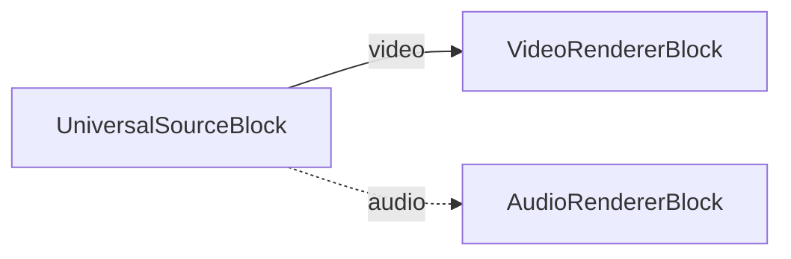

# Reverse Video Playback in C# and .NET

Reverse playback in Media Player SDK .NET and Media Blocks SDK .NET is a negative playback rate. `Rate_SetAsync(-1.0)` plays the file backwards from the current position to its start at normal speed; `-2.0` plays it backwards twice as fast, `-0.5` at half speed. The same call works on `MediaPlayerCoreX` and on a `MediaBlocksPipeline`. The UI snippets below use WPF.

Reverse playback needs a seekable source: a media file, not a live stream such as a camera or RTSP.

## YouTube tutorial

<div class="video-wrapper">
  <iframe src="https://www.youtube.com/embed/70NC7wAvehw?controls=1" title="Play a video backwards in C# WPF - YouTube tutorial" frameborder="0" allowfullscreen></iframe>
</div>

[Source code on GitHub](https://github.com/visioforge/.Net-SDK-s-samples/tree/master/Media%20Player%20SDK%20X/_VideoTutorials/reverse-playback-csharp-wpf)

The film in the video is [Big Buck Bunny](https://peach.blender.org/) (c) Blender Foundation, under [CC BY 3.0](https://creativecommons.org/licenses/by/3.0/).

The video creates the project on .NET 10, which needs Visual Studio 2026; in Visual Studio 2022, choose .NET 8 or .NET 9.

## Reverse Playback with MediaPlayerCoreX

### Open, Play, Then Reverse

```cs
using System.Diagnostics;
using VisioForge.Core;
using VisioForge.Core.MediaPlayerX;

// A field of the window
private MediaPlayerCoreX player;

// In the window's Loaded handler
await VisioForgeX.InitSDKAsync(); // once per application

player = new MediaPlayerCoreX(VideoView1);
player.OnError += (_, e) => Debug.WriteLine(e.Message);

await player.OpenAsync(@"C:\Videos\sample.mp4");
await player.PlayAsync();
```

Switch to reverse while the file is playing, for example from a button:

```cs
private async void btReverse_Click(object sender, RoutedEventArgs e)
{
    // Plays backwards from the current position to the start of the file
    await player.Rate_SetAsync(-1.0);
}
```

`Rate_SetAsync` returns `false` and raises `OnError` when the rate cannot be applied. Three rules come from the SDK:

- **Reverse is set once playback has started.** While the file is not playing (after `OpenAsync` and before `PlayAsync`, or paused at the end by `PauseOnStop`), a negative rate is refused; only a positive rate is stored for the next start.
- **The rate seek needs a position.** Right after `PlayAsync` the pipeline may not report one yet, so call it once playback is running, not on the line after `PlayAsync`.
- **Each file starts at 1.0.** After `StopAsync`, or the end of the file without `PauseOnStop`, every rate is refused until the next `OpenAsync`; set the rate again after it.

### Play the Whole File Backwards from the End

Reverse plays from the current position. To play the whole file backwards, turn the reverse rate on and then seek to the end. A seek made while the rate is negative plays from that position back to the start. Seek only when the rate was applied; otherwise the seek goes forward to the end and playback ends at once:

```cs
if (await player.Rate_SetAsync(-1.0))
{
    await player.Position_SetAsync(await player.DurationAsync());
}
```

### Reverse Speed and Back to Forward

```cs
// Twice as fast, backwards
await player.Rate_SetAsync(-2.0);

// Half speed, backwards (slow motion)
await player.Rate_SetAsync(-0.5);

// Back to normal forward playback from the current position
await player.Rate_SetAsync(1.0);

// Which direction is playing now
bool isReverse = await player.Rate_GetAsync() < 0;
```

A rate of `0` is rejected; use `PauseAsync` to stop the picture.

### Position and the Start of the File

`MediaPlayerCoreX` raises no position event. Read the position on a timer, as for forward playback:

```cs
// A field of the window
private readonly DispatcherTimer _timer = new() { Interval = TimeSpan.FromMilliseconds(500) };

// In the window constructor or its Loaded handler
_timer.Tick += async (_, _) =>
{
    var position = await player.Position_GetAsync();
    var duration = await player.DurationAsync();
    lbTime.Text = $"{position:hh\\:mm\\:ss} / {duration:hh\\:mm\\:ss}";
};
```

Call `_timer.Start()` after `PlayAsync`. When reverse playback reaches the start of the file, playback ends the same way it does at the end of a forward run, and `OnStop` is raised:

```cs
player.OnStop += (_, _) => Dispatcher.InvokeAsync(() =>
{
    _timer.Stop();
    btPlay.IsEnabled = true;
});
```

With `PauseOnStop = true` the player pauses on the first frame instead of stopping, and raises `OnPause` instead of `OnStop`. Call `ResumeAsync` to play the file again; `PlayAsync` would close the file instead.

### Step Frame by Frame in Reverse

Two methods move by exactly one frame. Both pause playback first and work with files only:

| Method | Forward playback | Reverse playback |
| --- | --- | --- |
| `NextFrame()` | one frame forward | one frame **back**, the reverse rate is kept |
| `PrevFrame()` | one frame **back**, the rate is set to 1.0 | one frame forward, the reverse rate is kept |

```cs
// One frame back while the file plays forward
player.PrevFrame();

// Keep stepping backwards: set the reverse rate once, then step
await player.Rate_SetAsync(-1.0);
player.NextFrame();
player.NextFrame();

// Stepping leaves playback paused; resume it to play on
await player.ResumeAsync();
```

`NextFrame` needs a video renderer (a `VideoView`). `PrevFrame` seeks to the previous frame and waits for the seek on the calling thread, up to a second, so it is slower, and its precision depends on the codec and the distance between keyframes. From a button handler, call it as `await Task.Run(player.PrevFrame);` to keep the window responsive.

## Reverse Playback with Media Blocks

A `MediaBlocksPipeline` takes the same rate calls. Build a player pipeline, start it, and set a negative rate while it runs:



```cs
using System.Diagnostics;
using VisioForge.Core;
using VisioForge.Core.MediaBlocks;
using VisioForge.Core.MediaBlocks.AudioRendering;
using VisioForge.Core.MediaBlocks.Sources;
using VisioForge.Core.MediaBlocks.VideoRendering;
using VisioForge.Core.Types.X.Sources;

// A field of the window
private MediaBlocksPipeline pipeline;

// In the window's Loaded handler
await VisioForgeX.InitSDKAsync(); // once per application

pipeline = new MediaBlocksPipeline();
pipeline.OnError += (_, e) => Debug.WriteLine(e.Message);
pipeline.OnStop += (_, _) => Debug.WriteLine("Reached the start of the file");

var sourceSettings = await UniversalSourceSettings.CreateAsync(@"C:\Videos\sample.mp4");
var fileSource = new UniversalSourceBlock(sourceSettings);

var videoRenderer = new VideoRendererBlock(pipeline, VideoView1);
pipeline.Connect(fileSource.VideoOutput, videoRenderer.Input);

// A file without audio has no AudioOutput
if (fileSource.AudioOutput != null)
{
    var audioRenderer = new AudioRendererBlock();
    pipeline.Connect(fileSource.AudioOutput, audioRenderer.Input);
}

await pipeline.StartAsync();
```

Then, once it plays (for example from a button, not on the line after `StartAsync`):

```cs
// Backwards from the current position
await pipeline.Rate_SetAsync(-1.0);
```

To play the whole file backwards instead, seek to the end once the reverse rate is on:

```cs
if (await pipeline.Rate_SetAsync(-1.0))
{
    await pipeline.Position_SetAsync(await pipeline.DurationAsync());
}
```

Step and go forward again:

```cs
// One frame back during reverse playback (pauses first)
pipeline.NextFrame();

// Forward again: the step left the pipeline paused, so resume it
await pipeline.Rate_SetAsync(1.0);
await pipeline.ResumeAsync();
```

As with `MediaPlayerCoreX`, the negative rate is set after `StartAsync` and the seek to the end runs only once it was applied, `OnStop` is raised at the start of the file, and `NextFrame` needs the `VideoRendererBlock`. Unlike the player, a positive rate set after a stop is applied at the next `StartAsync`. The pipeline has no `PrevFrame`; it belongs to `MediaPlayerCoreX`.

When the window closes, release the engine and then the SDK:

```cs
// MediaPlayerCoreX: Dispose stops playback first
player.Dispose();

// MediaBlocksPipeline
await pipeline.StopAsync();
await pipeline.DisposeAsync();

// Once per application, after the last engine is released
VisioForgeX.DestroySDK();
```

## Windows: Reverse Frames with MediaPlayerCore

The Windows `MediaPlayerCore` engine (DirectShow) steps backwards through a cache of decoded frames instead of a negative rate. While reverse playback is enabled, the frames that play are kept in the cache; the feature requires the Professional edition.

```cs
using VisioForge.Core.MediaPlayer;

// MediaPlayer1 is a MediaPlayerCore; number of decoded frames kept for stepping back
MediaPlayer1.ReversePlayback_CacheSize = 100;
MediaPlayer1.ReversePlayback_Enabled = true;
```

Once some frames have played, step through the cache. Each call pauses playback first:

```cs
MediaPlayer1.ReversePlayback_PreviousFrame();
MediaPlayer1.ReversePlayback_NextFrame();

// Jump to a cached frame; 0 is the oldest one
MediaPlayer1.ReversePlayback_GoToFrame(50);

// Back to normal playback: frees the cache and resumes if paused
MediaPlayer1.ReversePlayback_Enabled = false;
```

A larger cache lets you go further back and uses more memory, which grows with the video resolution.

## Required Packages

For a Windows x64 app:

```xml
<!-- MediaPlayerCoreX; for Media Blocks use VisioForge.DotNet.MediaBlocks instead -->
<PackageReference Include="VisioForge.DotNet.MediaPlayer" Version="[2026.11.16]" />
<PackageReference Include="VisioForge.CrossPlatform.Core.Windows.x64" Version="[2026.11.16]" />
<PackageReference Include="VisioForge.CrossPlatform.Libav.Windows.x64" Version="[2026.11.16]" />

<!-- MediaPlayerCore -->
<PackageReference Include="VisioForge.DotNet.Core" Version="[2026.11.16]" />
<PackageReference Include="VisioForge.DotNet.Core.Redist.MediaPlayer.x64" Version="[2026.11.16]" />
<PackageReference Include="VisioForge.DotNet.Core.Redist.LAV.x64" Version="[2026.11.16]" />
```

Other platforms take their own redistributables: see [Cross-platform deployment](../../deployment-x/index.md) and [Media Player SDK deployment](../deployment.md).

## Sample Applications

- **[Reverse Playback tutorial sample (Media Player SDK X, WPF)](https://github.com/visioforge/.Net-SDK-s-samples/tree/master/Media%20Player%20SDK%20X/_VideoTutorials/reverse-playback-csharp-wpf)** — the app from the video: reverse from any point or from the end, a speed slider for both directions, and frame stepping.
- **[Simple Media Player (Media Player SDK X, Avalonia)](https://github.com/visioforge/.Net-SDK-s-samples/tree/master/Media%20Player%20SDK%20X/Avalonia/Simple%20Media%20Player)** — `MediaPlayerCoreX` with playback rate and frame stepping.
- **[Simple Player Demo WPF (Media Blocks SDK)](https://github.com/visioforge/.Net-SDK-s-samples/tree/master/Media%20Blocks%20SDK/WPF/CSharp/Simple%20Player%20Demo%20WPF)** — a player pipeline built from blocks.
- **[Main Demo (Media Player SDK, WPF)](https://github.com/visioforge/.Net-SDK-s-samples/tree/master/Media%20Player%20SDK/WPF/CSharp/Main%20Demo)** — `MediaPlayerCore` with the reverse frame cache.

## Video Transcript

### What we build

Let's play a video backwards in a C# WPF app, with the VisioForge Media Player SDK. Here's what we build. In this SDK, reverse playback is a negative playback rate. The player plays backwards from the current point, or the whole file from its end. A speed slider changes how fast it plays, in either direction. And a button steps back one frame at a time. This is the finished player, playing backwards at normal speed. The film is Big Buck Bunny, by the Blender Foundation, under a Creative Commons Attribution license.

### Prerequisites

You need Windows 10 or 11, and Visual Studio 2026 with the .NET desktop development workload. The project is a WPF app on .NET 10; in Visual Studio 2022, choose .NET 8 or .NET 9. And a video file, because reverse playback needs a source you can seek in: a file, not a live stream. The player is MediaPlayerCoreX, which also runs on macOS, Linux, Android and iOS.

### Create a WPF project

In Visual Studio, create a new project. Search for WPF, and pick WPF Application for C#. Name the project ReversePlaybackWpf. Choose .NET 10 and click Create. Visual Studio opens MainWindow.xaml, with the designer above and the XAML below.

### Add the NuGet packages

Now add three NuGet packages. The Media Player SDK itself. CrossPlatform Core, the GStreamer runtime the player is built on. And CrossPlatform Libav, with the FFmpeg codecs that decode most video files. Or use the NuGet Package Manager: right-click the project, Manage NuGet Packages, and install VisioForge.DotNet.MediaPlayer from the Browse tab. Then install the Core and Libav packages for Windows x64. The Installed tab lists all three. These are the x64 packages, so set PlatformTarget to x64 in the project file.

### Build the window in XAML

The window is written in XAML. First the window itself, with a grid and a VideoView, and the designer draws it right away. Map the VisioForge.Core.UI.WPF namespace to a prefix, here vf. The grid has two columns, the video and a 260-pixel settings column, and four rows: the video, the time, the playback buttons and the reverse buttons. The VideoView fills the first cell. The window also names its Loaded and Closing handlers. Under the video go the time and the direction. Two text blocks. The position and the length on the left, with hundredths of a second, so a single frame step shows. The direction and the speed on the right. Then the playback buttons. Play, Pause, Resume and Stop, each with a Click handler. They all start disabled: Play until the SDK has loaded, the others until a file plays. The second row holds the reverse buttons. Reverse plays backwards from where the film is. Forward plays on forwards. From the end plays the whole file backwards. And Frame back steps one frame back. Last, the settings column on the right. It holds the file name with a browse button, a speed slider from 0.5 to 2 in steps of 0.25, and a read-only text box for the error log. Every handler the XAML names goes into MainWindow.xaml.cs, and the next chapters write them.

### Initialize the SDK

MainWindow.xaml.cs starts with these usings: WPF namespaces for the window and the timer, Microsoft.Win32 for the file dialog, and the VisioForge namespaces. The window keeps the player and a timer that ticks four times a second. When the window loads, await VisioForgeX.InitSDKAsync once. Then create MediaPlayerCoreX and pass it the VideoView, where the video is drawn. Errors arrive in the OnError event on another thread, so the handler goes back to the UI thread and adds them to the log. OnStop fires after StopAsync, and when playback runs out of the file: at its end going forwards, and at its start going backwards. The handler acts only while Stop is enabled and State is Free. Then Window_Loaded wires up the timer and enables Play. The browse button shows an OpenFileDialog filtered to video files, and puts the chosen path into the file name box.

### Open and play

The Play handler disables the buttons and clears the log. OpenAsync opens the file, and PlayAsync plays it forwards at normal speed. Reverse comes later, from its own button: a negative rate is accepted only once the file is playing. State Free means the file did not open or play, and the window goes back to stopped. Otherwise the buttons switch to playing, and the timer starts.

### Play backwards

This is the whole of reverse playback. Rate_SetAsync with a negative rate plays the file backwards, from the current position to the start. Minus one is normal speed, minus two twice as fast. Forward sets the same speed, positive, and the film plays on forwards from the same point. When the speed slider moves during playback, Rate_GetAsync tells which way the film plays. A negative rate means backwards, so the new speed is set negative too, and the direction stays the same. To play the whole file backwards, turn the reverse rate on first, then seek to the end with Position_SetAsync and the duration. A seek made while the rate is negative plays from that point back to the start. Seek only when the rate was applied: otherwise the seek goes forwards to the end, and playback ends at once.

### Step frame by frame

Two methods move by one frame, and both leave the picture paused. NextFrame steps along the playback direction, so while the film plays backwards, it steps one frame back. PrevFrame steps against the direction, so going forwards, it is the one that steps back. PrevFrame seeks and waits for the seek, so it runs on a worker thread with Task.Run. It also resets a forward rate to one, so the handler sets the chosen speed again.

### Pause, resume and stop

Pause and Resume are one call each, and Resume carries on in the same direction. Stop stops the timer, disables the buttons while it works, awaits StopAsync, and resets the window. Small helpers set the buttons: ShowBusy disables them all, and ShowPlaying enables either Play, or every playback and reverse button. Stopped puts the window back: the buttons, the time and the direction.

### Show the position and the direction

The player raises no position event, so the timer reads it. Each tick reads Position_GetAsync, the duration and the rate. If playback stopped in the meantime, it leaves the labels alone. Otherwise it shows the position with hundredths of a second, and the direction and the speed from the sign and the size of the rate. Going backwards, the position counts down.

### Close the window

When the window closes, Dispose stops playback and releases the player, and DestroySDK releases the SDK. While the SDK still loads, or a file opens or stops, the window does not close yet.

### Run it

Run the app from Visual Studio. Once the SDK has loaded, Play is enabled. Click the browse button and pick the video file. Click Play. The film plays forwards at normal speed, and the label on the right says so. Drag the speed to two. Now it plays forwards twice as fast; here it is sped up further, to get into the film. Click Reverse. The film plays backwards from where it was, at twice the speed, and the time counts down. Drag the speed back to one. The direction stays: backwards, at normal speed. Forward plays on forwards from the same point. Frame back steps one frame back on each click, and the picture stays paused. Watch the hundredths. Resume plays on. From the end jumps to the end of the file and plays it backwards, towards the start. Frame back works while the film plays backwards, too, and Resume carries on backwards. Stop resets the window. Then close it.

### Common mistakes

A few common mistakes. Setting a negative rate before the file plays: the player refuses it, so set it once playback has started. Seeking to the end before the reverse rate is on: the file then ends at once. Trying reverse on a live stream, such as a camera: it needs a file you can seek in. Calling PrevFrame on the UI thread, which freezes the window while it seeks. And leaving out the Libav package, so many formats do not decode.

### Next steps

There are also guides for a full video player with a timeline and volume, for the same reverse playback in a Media Blocks pipeline, for playing only a fragment of a file, and for deploying the redists with your app. The full source is on GitHub, and the docs are at visioforge.com/help. Thanks for watching.

## See Also

- [Build a Video Player in C#](../guides/video-player-csharp.md) — a full player with a timeline, volume and speed
- [Reverse Playback with Media Blocks](#reverse-playback-with-media-blocks) — the same negative rate in a Media Blocks pipeline
- [Play a Fragment of a File](play-fragment-file.md) — play only a range of a media file
- [Cross-platform deployment](../../deployment-x/index.md) — the redistributables the app needs on each platform
- [Media Player SDK .NET Product Page](https://www.visioforge.com/media-player-sdk-net)
