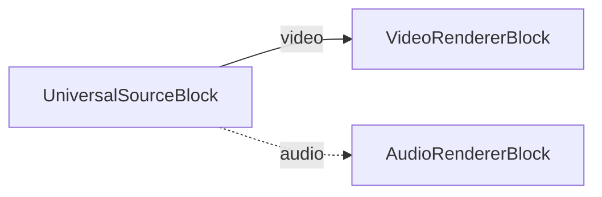

# Reverse Video Playback in C# and .NET

Reverse playback in Media Player SDK .NET and Media Blocks SDK .NET is a negative playback rate. `Rate_SetAsync(-1.0)` plays the file backwards from the current position to its start at normal speed; `-2.0` plays it backwards twice as fast, `-0.5` at half speed. The same call works on `MediaPlayerCoreX` and on a `MediaBlocksPipeline`. The UI snippets below use WPF.

Reverse playback needs a seekable source: a media file, not a live stream such as a camera or RTSP.

## Reverse Playback with MediaPlayerCoreX

### Open, Play, Then Reverse

```cs
using System.Diagnostics;
using VisioForge.Core;
using VisioForge.Core.MediaPlayerX;

// A field of the window
private MediaPlayerCoreX player;

// In the window's Loaded handler
await VisioForgeX.InitSDKAsync(); // once per application

player = new MediaPlayerCoreX(VideoView1);
player.OnError += (_, e) => Debug.WriteLine(e.Message);

await player.OpenAsync(@"C:\Videos\sample.mp4");
await player.PlayAsync();
```

Switch to reverse while the file is playing, for example from a button:

```cs
private async void btReverse_Click(object sender, RoutedEventArgs e)
{
    // Plays backwards from the current position to the start of the file
    await player.Rate_SetAsync(-1.0);
}
```

`Rate_SetAsync` returns `false` and raises `OnError` when the rate cannot be applied. Three rules come from the SDK:

- **Reverse is set once playback has started.** While the file is not playing (after `OpenAsync` and before `PlayAsync`, or paused at the end by `PauseOnStop`), a negative rate is refused; only a positive rate is stored for the next start.
- **The rate seek needs a position.** Right after `PlayAsync` the pipeline may not report one yet, so call it once playback is running, not on the line after `PlayAsync`.
- **Each file starts at 1.0.** After `StopAsync`, or the end of the file without `PauseOnStop`, every rate is refused until the next `OpenAsync`; set the rate again after it.

### Play the Whole File Backwards from the End

Reverse plays from the current position. To play the whole file backwards, turn the reverse rate on and then seek to the end. A seek made while the rate is negative plays from that position back to the start. Seek only when the rate was applied; otherwise the seek goes forward to the end and playback ends at once:

```cs
if (await player.Rate_SetAsync(-1.0))
{
    await player.Position_SetAsync(await player.DurationAsync());
}
```

### Reverse Speed and Back to Forward

```cs
// Twice as fast, backwards
await player.Rate_SetAsync(-2.0);

// Half speed, backwards (slow motion)
await player.Rate_SetAsync(-0.5);

// Back to normal forward playback from the current position
await player.Rate_SetAsync(1.0);

// Which direction is playing now
bool isReverse = await player.Rate_GetAsync() < 0;
```

A rate of `0` is rejected; use `PauseAsync` to stop the picture.

### Position and the Start of the File

`MediaPlayerCoreX` raises no position event. Read the position on a timer, as for forward playback:

```cs
// A field of the window
private readonly DispatcherTimer _timer = new() { Interval = TimeSpan.FromMilliseconds(500) };

// In the window constructor or its Loaded handler
_timer.Tick += async (_, _) =>
{
    var position = await player.Position_GetAsync();
    var duration = await player.DurationAsync();
    lbTime.Text = $"{position:hh\\:mm\\:ss} / {duration:hh\\:mm\\:ss}";
};
```

Call `_timer.Start()` after `PlayAsync`. When reverse playback reaches the start of the file, playback ends the same way it does at the end of a forward run, and `OnStop` is raised:

```cs
player.OnStop += (_, _) => Dispatcher.InvokeAsync(() =>
{
    _timer.Stop();
    btPlay.IsEnabled = true;
});
```

With `PauseOnStop = true` the player pauses on the first frame instead of stopping, and raises `OnPause` instead of `OnStop`. Call `ResumeAsync` to play the file again; `PlayAsync` would close the file instead.

### Step Frame by Frame in Reverse

Two methods move by exactly one frame. Both pause playback first and work with files only:

| Method | Forward playback | Reverse playback |
| --- | --- | --- |
| `NextFrame()` | one frame forward | one frame **back**, the reverse rate is kept |
| `PrevFrame()` | one frame **back**, the rate is set to 1.0 | one frame forward, the reverse rate is kept |

```cs
// One frame back while the file plays forward
player.PrevFrame();

// Keep stepping backwards: set the reverse rate once, then step
await player.Rate_SetAsync(-1.0);
player.NextFrame();
player.NextFrame();

// Stepping leaves playback paused; resume it to play on
await player.ResumeAsync();
```

`NextFrame` needs a video renderer (a `VideoView`). `PrevFrame` seeks to the previous frame and waits for the seek on the calling thread, up to a second, so it is slower, and its precision depends on the codec and the distance between keyframes. From a button handler, call it as `await Task.Run(player.PrevFrame);` to keep the window responsive.

## Reverse Playback with Media Blocks

A `MediaBlocksPipeline` takes the same rate calls. Build a player pipeline, start it, and set a negative rate while it runs:



```cs
using System.Diagnostics;
using VisioForge.Core;
using VisioForge.Core.MediaBlocks;
using VisioForge.Core.MediaBlocks.AudioRendering;
using VisioForge.Core.MediaBlocks.Sources;
using VisioForge.Core.MediaBlocks.VideoRendering;
using VisioForge.Core.Types.X.Sources;

// A field of the window
private MediaBlocksPipeline pipeline;

// In the window's Loaded handler
await VisioForgeX.InitSDKAsync(); // once per application

pipeline = new MediaBlocksPipeline();
pipeline.OnError += (_, e) => Debug.WriteLine(e.Message);
pipeline.OnStop += (_, _) => Debug.WriteLine("Reached the start of the file");

var sourceSettings = await UniversalSourceSettings.CreateAsync(@"C:\Videos\sample.mp4");
var fileSource = new UniversalSourceBlock(sourceSettings);

var videoRenderer = new VideoRendererBlock(pipeline, VideoView1);
pipeline.Connect(fileSource.VideoOutput, videoRenderer.Input);

// A file without audio has no AudioOutput
if (fileSource.AudioOutput != null)
{
    var audioRenderer = new AudioRendererBlock();
    pipeline.Connect(fileSource.AudioOutput, audioRenderer.Input);
}

await pipeline.StartAsync();
```

Then, once it plays (for example from a button, not on the line after `StartAsync`):

```cs
// Backwards from the current position
await pipeline.Rate_SetAsync(-1.0);
```

To play the whole file backwards instead, seek to the end once the reverse rate is on:

```cs
if (await pipeline.Rate_SetAsync(-1.0))
{
    await pipeline.Position_SetAsync(await pipeline.DurationAsync());
}
```

Step and go forward again:

```cs
// One frame back during reverse playback (pauses first)
pipeline.NextFrame();

// Forward again: the step left the pipeline paused, so resume it
await pipeline.Rate_SetAsync(1.0);
await pipeline.ResumeAsync();
```

As with `MediaPlayerCoreX`, the negative rate is set after `StartAsync` and the seek to the end runs only once it was applied, `OnStop` is raised at the start of the file, and `NextFrame` needs the `VideoRendererBlock`. Unlike the player, a positive rate set after a stop is applied at the next `StartAsync`. The pipeline has no `PrevFrame`; it belongs to `MediaPlayerCoreX`.

When the window closes, release the engine and then the SDK:

```cs
// MediaPlayerCoreX: Dispose stops playback first
player.Dispose();

// MediaBlocksPipeline
await pipeline.StopAsync();
await pipeline.DisposeAsync();

// Once per application, after the last engine is released
VisioForgeX.DestroySDK();
```

## Windows: Reverse Frames with MediaPlayerCore

The Windows `MediaPlayerCore` engine (DirectShow) steps backwards through a cache of decoded frames instead of a negative rate. While reverse playback is enabled, the frames that play are kept in the cache; the feature requires the Professional edition.

```cs
using VisioForge.Core.MediaPlayer;

// MediaPlayer1 is a MediaPlayerCore; number of decoded frames kept for stepping back
MediaPlayer1.ReversePlayback_CacheSize = 100;
MediaPlayer1.ReversePlayback_Enabled = true;
```

Once some frames have played, step through the cache. Each call pauses playback first:

```cs
MediaPlayer1.ReversePlayback_PreviousFrame();
MediaPlayer1.ReversePlayback_NextFrame();

// Jump to a cached frame; 0 is the oldest one
MediaPlayer1.ReversePlayback_GoToFrame(50);

// Back to normal playback: frees the cache and resumes if paused
MediaPlayer1.ReversePlayback_Enabled = false;
```

A larger cache lets you go further back and uses more memory, which grows with the video resolution.

## Required Packages

For a Windows x64 app:

```xml
<!-- MediaPlayerCoreX; for Media Blocks use VisioForge.DotNet.MediaBlocks instead -->
<PackageReference Include="VisioForge.DotNet.MediaPlayer" Version="[2026.11.13]" />
<PackageReference Include="VisioForge.CrossPlatform.Core.Windows.x64" Version="[2026.11.12]" />
<PackageReference Include="VisioForge.CrossPlatform.Libav.Windows.x64" Version="[2026.11.12]" />

<!-- MediaPlayerCore -->
<PackageReference Include="VisioForge.DotNet.Core" Version="[2026.11.13]" />
<PackageReference Include="VisioForge.DotNet.Core.Redist.MediaPlayer.x64" Version="[2026.11.13]" />
<PackageReference Include="VisioForge.DotNet.Core.Redist.LAV.x64" Version="[2026.11.13]" />
```

Other platforms take their own redistributables: see [Cross-platform deployment](../../deployment-x/index.md) and [Media Player SDK deployment](../deployment.md).

## Sample Applications

- **[Simple Media Player (Media Player SDK X, Avalonia)](https://github.com/visioforge/.Net-SDK-s-samples/tree/master/Media%20Player%20SDK%20X/Avalonia/Simple%20Media%20Player)** — `MediaPlayerCoreX` with playback rate and frame stepping.
- **[Simple Player Demo WPF (Media Blocks SDK)](https://github.com/visioforge/.Net-SDK-s-samples/tree/master/Media%20Blocks%20SDK/WPF/CSharp/Simple%20Player%20Demo%20WPF)** — a player pipeline built from blocks.
- **[Main Demo (Media Player SDK, WPF)](https://github.com/visioforge/.Net-SDK-s-samples/tree/master/Media%20Player%20SDK/WPF/CSharp/Main%20Demo)** — `MediaPlayerCore` with the reverse frame cache.
