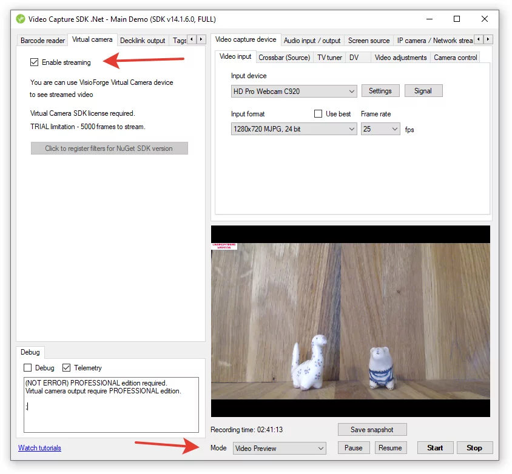

# Integración de streaming FFMPEG con .NET

[Video Capture SDK .NET](https://www.visioforge.com/video-capture-sdk-net){ .md-button .md-button--primary target="_blank" }

!!! tip "Agentes de IA: use el servidor MCP de VisioForge"

    ¿Lo construye con **Claude Code**, **Cursor** u otro agente de IA?
    Conecte al servidor MCP público de VisioForge
    ([documentación](../../general/mcp-server-usage.md))
    en `https://mcp.visioforge.com/mcp` para consultas estructuradas de la API,
    ejemplos de código ejecutables y guías de despliegue — más preciso que
    buscar en `llms.txt`. Sin autenticación requerida.

    Claude Code: `claude mcp add --transport http visioforge-sdk https://mcp.visioforge.com/mcp`

## Introducción al streaming FFMPEG

El Video Capture SDK ofrece capacidades poderosas para transmitir video desde múltiples fuentes directamente a FFMPEG, que se ejecuta como un proceso externo. Esta integración proporciona a los desarrolladores flexibilidad excepcional, permitiéndole usar compilaciones FFMPEG GPL/LGPL con cualquier configuración de códecs de video/audio y muxers según los requisitos de su proyecto.

Con esta integración, puede:

- Capturar video desde varias fuentes
- Transmitir el contenido capturado a FFMPEG
- Configurar FFMPEG para guardar flujos a archivos
- Transmitir contenido a servidores remotos
- Procesar video en tiempo real
- Aplicar filtros y transformaciones

Este enfoque combina la robustez del SDK .NET con la versatilidad de FFMPEG, creando una solución poderosa para aplicaciones de captura y streaming de video.

## Comenzar con streaming FFMPEG

Antes de profundizar en detalles de implementación, es importante entender el flujo de trabajo básico:

1. Configurar su fuente de video (dispositivo de captura, pantalla, archivo, etc.)
2. Habilitar la salida de Cámara Virtual
3. Iniciar el proceso de streaming de video
4. Configurar y lanzar FFMPEG con parámetros apropiados
5. Procesar o guardar el flujo según sea necesario

Exploremos cada paso en detalle.

## Implementación básica

### Paso 1: Configurar su fuente de video

El primer paso implica configurar su fuente de video. Esto puede hacerse programáticamente o a través de la UI si está usando la aplicación Main Demo. Aquí hay un ejemplo de código simple para habilitar la salida de Cámara Virtual:

```cs
VideoCapture1.Virtual_Camera_Output_Enabled = true;
```

Esta única línea de código activa la característica de salida de Cámara Virtual, haciendo el flujo de video disponible para FFMPEG.



### Paso 2: Iniciar Streaming de Video

Una vez que la salida de Cámara Virtual está habilitada, necesita iniciar el proceso de streaming de video. Esto puede hacerse llamando al método apropiado en su instancia de VideoCapture:

```cs
// Configurar sus fuentes de video
// ...

// Habilitar la salida de Cámara Virtual
VideoCapture1.Virtual_Camera_Output_Enabled = true;

// Iniciar el proceso de streaming
VideoCapture1.Start();
```

### Paso 3: Configurar y lanzar FFMPEG

Ahora que su video está transmitiendo y siendo enviado a la salida de Cámara Virtual, necesita configurar FFMPEG para recibir y procesar este flujo. FFMPEG se lanza como un proceso externo con argumentos de línea de comandos específicos:

```bash
ffmpeg -f dshow -i video="VisioForge Virtual Camera" -c:v libopenh264 output.mp4
```

Este comando le dice a FFMPEG que:

- Use DirectShow (`-f dshow`) como formato de entrada
- Capture video de la fuente "VisioForge Virtual Camera" (`-i video="VisioForge Virtual Camera"`)
- Codifique el video usando el códec libopenh264 (`-c:v libopenh264`)
- Guarde la salida en un archivo llamado "output.mp4"

## Opciones de configuración avanzada de FFMPEG

### Añadir audio a su flujo

Si quiere incluir audio en su flujo, puede usar la Tarjeta de Audio Virtual proporcionada con el SDK:

```bash
ffmpeg -f dshow -i video="VisioForge Virtual Camera" -f dshow -i audio="VisioForge Virtual Audio Card" -c:v libopenh264 -c:a aac -b:a 128k output.mp4
```

Este comando añade:

- Captura de audio desde la Tarjeta de Audio Virtual
- Codificación de audio AAC con una tasa de bits de 128 kbps

### Streaming a servidores RTMP

Para streaming en vivo a plataformas como YouTube, Twitch o Facebook, puede usar RTMP:

```bash
ffmpeg -f dshow -i video="VisioForge Virtual Camera" -f dshow -i audio="VisioForge Virtual Audio Card" -c:v libx264 -preset veryfast -tune zerolatency -c:a aac -b:a 128k -f flv rtmp://tu-servidor-streaming/app/key
```

Esta configuración:

- Usa el códec x264 para codificación de video
- Establece el preset de codificación a "veryfast" para uso reducido de CPU
- Habilita ajuste de latencia cero para streaming en vivo
- Salida al formato FLV
- Envía el flujo a su URL de servidor RTMP

### Streaming HLS

HTTP Live Streaming (HLS) es otra opción popular, especialmente para espectadores web y móviles:

```bash
ffmpeg -f dshow -i video="VisioForge Virtual Camera" -c:v libx264 -c:a aac -b:a 128k -f hls -hls_time 4 -hls_playlist_type event stream.m3u8
```

Este comando:

- Crea segmentos HLS de 4 segundos cada uno
- Establece el tipo de playlist a "event"
- Genera un archivo de playlist m3u8 y archivos de segmento TS

## Optimización de rendimiento

Al trabajar con streaming FFMPEG, varios factores pueden afectar el rendimiento:

### Aceleración de hardware

Habilitar aceleración de hardware puede reducir significativamente el uso de CPU y mejorar el rendimiento:

```bash
ffmpeg -f dshow -i video="VisioForge Virtual Camera" -c:v h264_nvenc -preset llhq -b:v 5M output.mp4
```

Este ejemplo usa el codificador NVENC de NVIDIA para codificación H.264, que descarga el trabajo de codificación a la GPU.

### Configuración de tamaño de buffer

Ajustar tamaños de buffer puede ayudar con la estabilidad, especialmente para flujos de alta resolución:

```bash
ffmpeg -f dshow -video_size 1920x1080 -framerate 30 -i video="VisioForge Virtual Camera" -c:v libx264 -bufsize 5M -maxrate 5M output.mp4
```

### Opciones de multi-threading

Controlar cómo FFMPEG utiliza hilos de CPU puede optimizar el rendimiento:

```bash
ffmpeg -f dshow -i video="VisioForge Virtual Camera" -c:v libx264 -threads 4 output.mp4
```

## Casos de uso comunes

### Grabar video de vigilancia

FFMPEG es excelente para aplicaciones de vigilancia, soportando características como superposiciones de marca de tiempo:

```bash
ffmpeg -f dshow -i video="VisioForge Virtual Camera" -vf "drawtext=text='%{localtime}':fontcolor=white:fontsize=24:box=1:boxcolor=black@0.5:x=10:y=10" -c:v libx264 vigilancia.mp4
```

### Crear videos time-lapse

Puede configurar FFMPEG para crear videos time-lapse desde sus flujos:

```bash
ffmpeg -f dshow -i video="VisioForge Virtual Camera" -vf "setpts=0.1*PTS" -c:v libx264 timelapse.mp4
```

### Múltiples formatos de salida simultáneamente

FFMPEG puede generar múltiples salidas desde un solo flujo de entrada:

```bash
ffmpeg -f dshow -i video="VisioForge Virtual Camera" -c:v libx264 -f mp4 output.mp4 -c:v libvpx -f webm output.webm
```

## Requisitos de despliegue

Para desplegar exitosamente aplicaciones usando este enfoque de streaming, asegúrese de incluir:

- Redistribuibles base del SDK
- Redistribuibles específicos del SDK
- Redistribuibles del Virtual Camera SDK

Para información detallada sobre requisitos de despliegue, consulte la página de [Despliegue](../deployment.md) en la documentación.

## Solución de problemas comunes

### El flujo no aparece en FFMPEG

Si FFMPEG no reconoce la Cámara Virtual:

- Asegúrese de que el controlador de Cámara Virtual esté instalado apropiadamente
- Verifique que la salida de Cámara Virtual esté habilitada en su código
- Compruebe que el streaming de video haya iniciado exitosamente

### Problemas de calidad de video

Si la calidad del video es pobre:

- Aumente la tasa de bits en su comando FFMPEG
- Ajuste el preset de codificación (presets más lentos generalmente producen mejor calidad)
- Verifique la resolución y tasa de fotogramas de su video fuente

### Alto uso de CPU

Para abordar alta utilización de CPU:

- Habilite aceleración de hardware si está disponible
- Use un preset de codificación más rápido
- Reduzca la resolución o tasa de fotogramas de salida

## Conclusión

Integrar streaming FFMPEG con el Video Capture SDK proporciona una solución poderosa y flexible para necesidades de procesamiento y streaming de video. Siguiendo las guías y ejemplos en esta documentación, puede crear aplicaciones de video sofisticadas que aprovechan las fortalezas de ambas tecnologías.

Ya sea que esté construyendo una aplicación de streaming, un sistema de vigilancia o una herramienta de procesamiento de video, esta integración ofrece el rendimiento y flexibilidad necesarios para soluciones de grado profesional.

---
Para más muestras de código y ejemplos, visite nuestro [repositorio de GitHub](https://github.com/visioforge/.Net-SDK-s-samples).