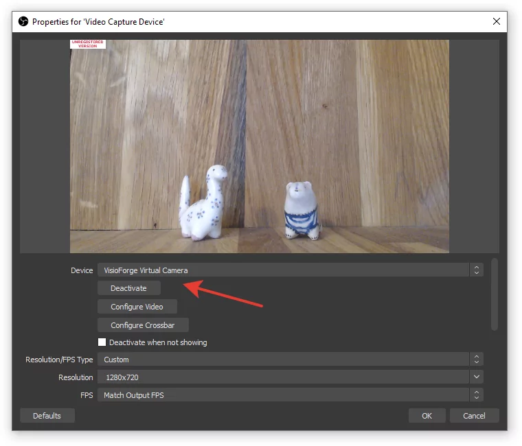

# Integrar streaming OBS en Video Capture SDK .NET

[Video Capture SDK .NET](https://www.visioforge.com/video-capture-sdk-net){ .md-button .md-button--primary target="_blank" }

## Introducción a la integración OBS

Open Broadcaster Software (OBS) se ha convertido en el estándar de la industria para el streaming en vivo y la grabación de video. El Video Capture SDK .NET proporciona capacidades robustas para transmitir video y audio desde múltiples fuentes directamente a OBS, creando un pipeline poderoso para la creación de contenido de calidad broadcast.

Esta integración permite a los desarrolladores crear aplicaciones que pueden:

- Capturar desde múltiples dispositivos de cámara simultáneamente
- Procesar y mejorar flujos de video en tiempo real
- Mezclar varias fuentes de contenido antes de enviar a OBS
- Crear soluciones de broadcasting profesionales con configuración mínima

Ya sea que desarrolle aplicaciones para WinForms, WPF o entornos de consola, el SDK proporciona una API coherente para la integración con OBS.

## Cómo funciona la integración OBS

El SDK aprovecha la tecnología DirectShow Virtual Camera para crear un puente entre su aplicación y OBS. Este enfoque ofrece varias ventajas:

1. **Streaming sin latencia**: la transferencia directa en memoria minimiza el retraso
2. **Flexibilidad de formato**: soporte para varias resoluciones y tasas de fotogramas
3. **Configuración mínima**: OBS reconoce el dispositivo virtual automáticamente
4. **Sincronización de audio**: capacidades combinadas de streaming audio-video

La cámara virtual aparece a OBS como un dispositivo de webcam estándar, lo que la hace inmediatamente utilizable dentro de cualquier escena OBS.

## Guía de implementación

### Componentes requeridos

Antes de implementar el streaming OBS, asegúrese de tener instalados los siguientes componentes:

- Video Capture SDK .NET (se recomienda la última versión)
- Componentes DirectShow Virtual Camera
- OBS Studio (se recomienda versión 27.0 o superior)
- .NET Framework 4.6.2 o superior (para compatibilidad completa)

### Implementación básica

El siguiente código demuestra cómo habilitar la salida de cámara virtual en su aplicación:

```cs
// Inicializar el componente de captura de video
var videoCapture = new VideoCaptureCore();

// Configurar ajustes básicos de captura
// ...

// Habilitar la salida de cámara virtual
videoCapture.Virtual_Camera_Output_Enabled = true;
// Clave de licencia de Virtual Camera SDK; sin ella, la cámara virtual muestra una franja TRIAL
videoCapture.Virtual_Camera_Output_LicenseKey = "YOUR-VIRTUAL-CAMERA-SDK-KEY";

// Iniciar la captura
videoCapture.Start();
```

Esta implementación mínima enviará la señal de la cámara al dispositivo virtual que OBS puede usar como fuente de entrada.

## Configurar OBS para la integración con el SDK

### Añadir la fuente de cámara virtual

1. Inicie OBS Studio
2. En su escena, haga clic en el botón « + » bajo Fuentes
3. Seleccione « Dispositivo de captura de video » de la lista
4. Nombre su fuente (por ejemplo, « Virtual Camera SDK »)
5. En el cuadro de diálogo Propiedades, seleccione « VisioForge Virtual Camera » del desplegable Dispositivo
6. Configure la resolución y los FPS para que coincidan con sus ajustes del SDK
7. Haga clic en « Aceptar » para añadir la fuente



### Configuración de audio

Para el streaming de audio, habilite la salida de cámara virtual junto con la grabación de audio en el motor `VideoCaptureCore` — la « VisioForge Virtual Audio Card » se enruta automáticamente cuando ambos indicadores están activados. Luego seleccione ese dispositivo en OBS:

```csharp
// Habilitar la salida de cámara virtual en el motor VideoCaptureCore.
// Combinado con Audio_RecordAudio = true, el audio se enruta automáticamente
// a la tarjeta de audio virtual — sin indicador separado.
VideoCapture1.Virtual_Camera_Output_Enabled = true;
// Clave de licencia de Virtual Camera SDK; sin ella, la cámara virtual muestra una franja TRIAL
VideoCapture1.Virtual_Camera_Output_LicenseKey = "YOUR-VIRTUAL-CAMERA-SDK-KEY";

// Configurar su fuente de audio como de costumbre.
VideoCapture1.Audio_CaptureDevice  = new AudioCaptureSource("Microphone");
VideoCapture1.Audio_PlayAudio      = false;
VideoCapture1.Audio_RecordAudio    = true;

await VideoCapture1.StartAsync();
```

Luego, en el lado de OBS:

1. Abra las propiedades de la fuente « Dispositivo de captura de video » que muestra « VisioForge Virtual Camera »
2. Marque « Utilizar dispositivo de audio personalizado » y seleccione « VisioForge Virtual Audio Card » como dispositivo de audio. Una fuente « Captura de entrada de audio » no lo muestra: esa fuente solo lista los dispositivos de audio de Windows, y la Virtual Audio Card es un dispositivo DirectShow
3. Ajuste los niveles de audio y los filtros según sea necesario

Esto crea un pipeline audiovisual completo desde su aplicación hasta OBS.

## Consideraciones de rendimiento

Al transmitir a OBS, considere estos consejos de rendimiento:

1. **Coincidencia de resolución**: defina la misma resolución en el SDK y en OBS
2. **Coherencia de tasa de fotogramas**: mantenga un FPS coherente en todo el pipeline
3. **Uso de CPU**: supervise la carga del procesador, especialmente al usar procesamiento de fotogramas
4. **Gestión de memoria**: libere los recursos innecesarios rápidamente
5. **Tamaño de búfer**: ajuste el tamaño del búfer según la memoria disponible en el sistema

Para un rendimiento óptimo, recomendamos usar una GPU dedicada para las tareas de procesamiento de video.

## Redistribuibles requeridos

Asegúrese de incluir los siguientes componentes en el despliegue de su aplicación:

- Paquete redistribuible base
- Componentes redistribuibles del SDK
- Archivos redistribuibles del Virtual Camera SDK

Consulte la documentación completa de [Despliegue](../deployment.md) para instrucciones detalladas.

## Solución de problemas comunes

Si encuentra problemas con la integración OBS:

1. **La cámara virtual no aparece en OBS**: verifique que el controlador de cámara virtual esté correctamente instalado
2. **Bajo rendimiento**: revise los ajustes de resolución y tasa de fotogramas tanto en el SDK como en OBS
3. **Problemas de sincronización de audio**: asegúrese de que los flujos de audio y video usen el mismo mecanismo de timing
4. **Problemas de calidad de video**: verifique los ajustes de codificación y las configuraciones de búfer
5. **Bloqueos de aplicación**: verifique la correcta inicialización y cierre de los componentes del SDK

## Conclusión

Integrar capacidades de streaming OBS en sus aplicaciones .NET usando Video Capture SDK proporciona una base poderosa para construir soluciones de broadcasting profesionales. El enfoque DirectShow Virtual Camera garantiza la compatibilidad con OBS manteniendo un alto rendimiento y calidad.

Siguiendo la guía de implementación y las mejores prácticas descritas en este documento, los desarrolladores pueden crear aplicaciones de streaming sofisticadas que aprovechan las fuerzas combinadas del SDK y OBS.

---
Visite nuestra página de [GitHub](https://github.com/visioforge/.Net-SDK-s-samples) para obtener más ejemplos de código.
