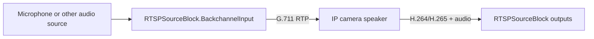

# Two-Way Audio with IP Cameras (ONVIF Audio Backchannel)

[Video Capture SDK .NET](https://www.visioforge.com/video-capture-sdk-net){ .md-button .md-button--primary target="_blank" } [Media Blocks SDK .NET](https://www.visioforge.com/media-blocks-sdk-net){ .md-button .md-button--primary target="_blank" } [VideoCaptureCoreX](#){ .md-button } [MediaBlocksPipeline](#){ .md-button }

Many IP cameras, video doorbells and intercom stations have a built-in speaker or an audio output jack. The SDK can send audio to that speaker over the **ONVIF RTSP audio backchannel** while it receives the camera's video and audio over the same RTSP session. Typical uses are talking to a visitor at a door, a public address announcement through a camera, or a two-way intercom.

## How It Works

The ONVIF audio backchannel is a `sendonly` audio track in the camera's RTSP description (SDP). When `RTSPSourceSettings.AudioBackchannel` is `true`, the SDK requests the backchannel (`Require: www.onvif.org/ver20/backchannel`), finds that track, and sends your audio to it as RTP over the transport the session already uses (TCP or UDP).



- The audio is sent as **G.711 mu-law (PCMU), 8000 Hz, mono** — the backchannel codec ONVIF requires from every camera with an audio output. A camera whose backchannel offers PCMA/8000 but not PCMU/8000 gets **G.711 A-law (PCMA)** instead. Any input format is converted.
- The camera must offer a backchannel. ONVIF Profile S and Profile T cameras with an audio output do. A camera that does not support the ONVIF `Require` header may refuse the connection, so enable `AudioBackchannel` only for cameras with a speaker.
- The backchannel needs GStreamer 1.22 or newer. The SDK runtime packages for Windows, macOS, Android and iOS include it; on Linux, where the system GStreamer is used, that means Ubuntu 24.04 or another distribution with 1.22+. On an older runtime the SDK logs an error saying so and sends no audio; video and audio from the camera keep playing.
- The audio is sent as it is captured: the camera receives it without the receive buffer (`RTSPSourceSettings.Latency`) added on top.
- If the camera's backchannel lists neither PCMU/8000 nor PCMA/8000, the SDK logs an error naming the codecs the camera offers, and video and audio from the camera keep playing.

## Video Capture SDK .NET (VideoCaptureCoreX)

Set `Audio_BackchannelSource` to the audio you want to send. It opens the backchannel of the RTSP source; you do not set `AudioBackchannel` yourself, and your `RTSPSourceSettings` are not changed. It takes the same source types as `Audio_Source`, built as a separate source, so do not set the same capture device in both.

```cs
var core = new VideoCaptureCoreX(VideoView1 as IVideoView);

// The camera.
var rtsp = await RTSPSourceSettings.CreateAsync(
    new Uri("rtsp://192.168.1.22:554/cam/realmonitor?channel=1&subtype=0"),
    "admin", "password", audioEnabled: true);
core.Video_Source = rtsp;

// The camera's own sound, played on the default PC speakers.
var outputs = await DeviceEnumerator.Shared.AudioOutputsAsync();
var speakers = outputs.FirstOrDefault(device => device.IsDefault) ?? outputs.FirstOrDefault();
if (speakers != null) core.Audio_OutputDevice = new AudioRendererSettings(speakers);

// The microphone that talks to the camera speaker.
var mic = (await DeviceEnumerator.Shared.AudioSourcesAsync())[0];
core.Audio_BackchannelSource = mic.CreateSourceSettingsVC();

await core.StartAsync();
```

`Audio_Source` stays independent: when it is `null`, the camera's own microphone is still played on `Audio_OutputDevice` and recorded by the outputs, so you hear the visitor while they hear you.

## Media Blocks SDK .NET (RTSPSourceBlock)

With `AudioBackchannel` set, `RTSPSourceBlock` has an audio input, `BackchannelInput`. Connect any audio block to it before the start.

```cs
var pipeline = new MediaBlocksPipeline();

var rtsp = await RTSPSourceSettings.CreateAsync(
    new Uri("rtsp://192.168.1.22:554/cam/realmonitor?channel=1&subtype=0"),
    "admin", "password", audioEnabled: true);
rtsp.AudioBackchannel = true;

var camera = new RTSPSourceBlock(rtsp);

// Camera video and audio to this PC.
pipeline.Connect(camera.VideoOutput, new VideoRendererBlock(pipeline, VideoView1).Input);
pipeline.Connect(camera.AudioOutput, new AudioRendererBlock().Input);

// Microphone to the camera speaker.
var mic = (await DeviceEnumerator.Shared.AudioSourcesAsync())[0];
var micSource = new SystemAudioSourceBlock(mic.CreateSourceSettings());
pipeline.Connect(micSource.Output, camera.BackchannelInput);

await pipeline.StartAsync();
```

The backchannel input takes any audio block: a file through `UniversalSourceBlock` for a recorded announcement, or `VirtualAudioSourceBlock` for a test tone. The audio is sent in real time.

If `BackchannelInput` is left unconnected, no backchannel is requested and the block behaves as without `AudioBackchannel`. The backchannel is supported by `RTSPSourceBlock`; `FallbackSwitchSourceBlock` (and `FallbackSwitch` in `VideoCaptureCoreX`) does not open it.

## Speaker Volume over ONVIF

`ONVIFClientX` reads and sets the camera's audio output configuration, including the speaker volume (`OutputLevel`).

```cs
var onvif = new ONVIFClientX();
await onvif.ConnectAsync("http://192.168.1.22/onvif/device_service", "admin", "password");

var outputs = await onvif.GetAudioOutputsAsync();            // empty: the camera has no speaker
var configs = await onvif.GetAudioOutputConfigurationsAsync();
if (configs?.Length > 0)
{
    var config = configs[0];
    var options = await onvif.GetAudioOutputConfigurationOptionsAsync(config.token);

    config.OutputLevel = options.OutputLevelRange.Max;       // loudest
    await onvif.SetAudioOutputConfigurationAsync(config);
}
```

`GetAudioOutputsAsync` is also a quick check before you enable the backchannel: a camera that reports no audio output has no speaker to send to.

## Troubleshooting

- **The connection fails after enabling `AudioBackchannel`** — the camera rejects the ONVIF backchannel request. Check that it has an audio output (`GetAudioOutputsAsync`) and that two-way audio is enabled in its web interface.
- **No sound from the camera speaker** — check the error log for the codecs the camera offers, raise `OutputLevel`, and check that no other client (a vendor app or NVR) holds the camera's talk channel.
- **The camera's microphone does not pick up its own speaker** — this is expected. Cameras with a speaker cancel it in their microphone (echo cancellation, or a half-duplex `SendPrimacy` such as `www.onvif.org/ver20/HalfDuplex/Auto` that mutes the microphone while the speaker plays), so you do not hear yourself back. Check the speaker by ear.

## Related Documentation

- [IP camera two-way audio tutorial](../../video-tutorials/ip-camera-two-way-audio.md) — a complete WPF app: camera preview with its sound, the PC microphone to the camera speaker
- [RTSP camera streams](rtsp.md) — connection, transport and low-latency settings
- [ONVIF IP camera integration](onvif.md) — discovery, profiles and PTZ control
- [IP camera brands directory](../../../camera-brands/index.md) — RTSP URLs for each brand
